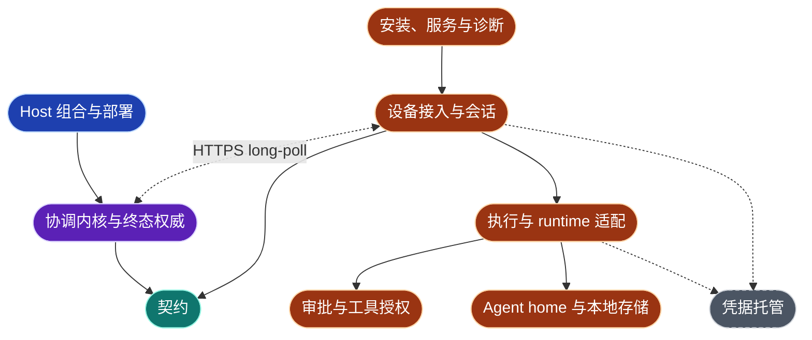
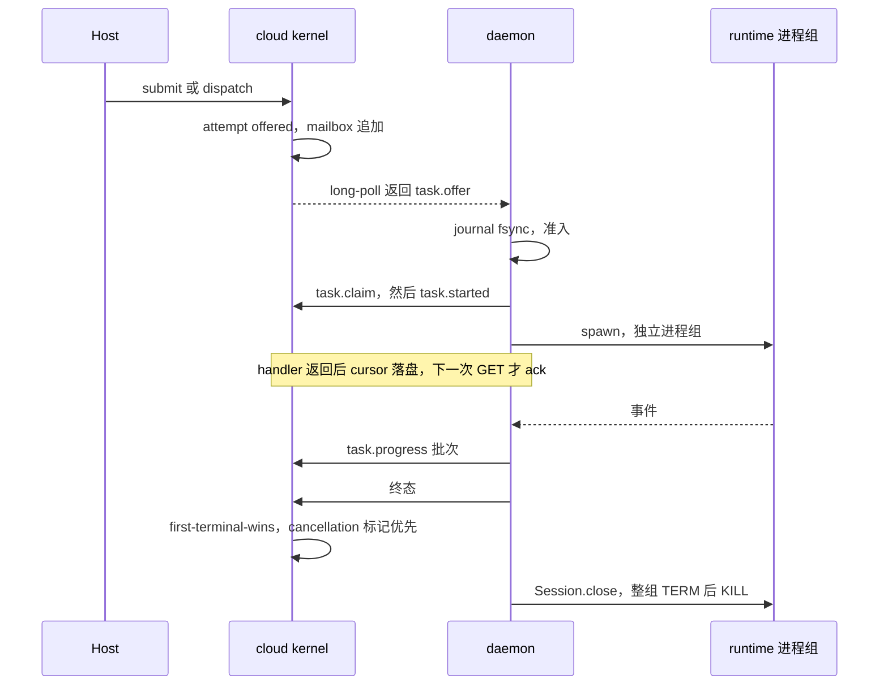

# 当前功能架构

源码基线：`671309da6cc78bebb21b660180620c431a3dc512`（2026-10-28）。
本页是手写视图，记录源码核对的结果，不是产品运行或性能测量。ArchContext 不投影它；`diagrams/architecture.*` 与 `modules/sdk/sdk-root.md` 的生成区保留各自的投影版本。
[分层视图](layered-architecture.md)与[进程与命名空间视图](process-namespace-topology.md)是同一基线的审查视图：它们给出逐条证据、完整时序图和 Remarks，本页只保留结论与权威归属。两页之后的修订以各自的文件历史为准。

事实优先级：源码 > `docs/spec.md` > 本页 > [`sdk-architecture.md`](sdk-architecture.md)。

## 功能域

下面 9 个功能域是跨 package 的逻辑视图，不改名、不移动代码。package 名省略 `@byok-sdk/` 前缀。

| 功能域 | 职责与权威 | 源码入口 |
| --- | --- | --- |
| 契约 | wire v4 消息、codec、HTTP 路径常量；tenant、store ports、device proof、sealed payload。两者都是叶子 package | `packages/protocol/src/version.ts`、`codec.ts`、`http-api.ts`；`packages/core/src/stores.ts` |
| 协调内核与终态权威 | 认证、路由登记、设备上行闸门、mailbox、attempt 与终态裁决。不持有进程状态，事实全部在注入的 stores 里 | `packages/cloud/src/cloud.ts#createByokCloud`、`inbound.ts`、`router/registry.ts` |
| Host 组合与部署 | Topology L 内嵌组合（SQLite 或 memory）；Topology H 的 Postgres + R2 与 mailbox wake；浏览器端 timeline 投影 | `packages/server/src/index.ts#createByokServer`；`packages/cloud-dataplane/src/runtime.ts`；`packages/ui-runtime/src/timeline.ts` |
| 设备接入与会话 | 配对、token 续期、单会话 long-poll、cursor 落盘即 ack、outbox、SQLite journal | `packages/client/src/daemon/auth-manager.ts`、`connection-manager.ts`、`journal/` |
| 执行与 runtime 适配 | offer 准入、Agent home 预留、manifest 封存、claim / started、事件泵、终态；每个 runtime 一个 adapter；进程组所有权 | `packages/client/src/daemon/task-runner/`；`packages/client/src/adapters/`；`adapters/process-tree.ts` |
| 审批与工具授权 | 唯一审批入口与待审批登记表；`auto` 模式的本地闸门；cloud 侧由审批 timeline 尾部折叠出当前槽 | `packages/client/src/daemon/approvals.ts`、`tool-authorization.ts`、`tool-authorization-ipc.ts`；`packages/cloud/src/approval-control.ts` |
| Agent home 与本地存储 | `storeDir` 下的设备状态、执行 scratch 与保留；Host 给出 `hostStorageRoot`，SDK 拼出并校验 `agents/<agentId>/` | `packages/client/src/agent-home.ts`、`daemon/store.ts`、`daemon/retention/` |
| 凭据托管 | 设备私钥与 bearer token 在 OS 凭据库；provider key 由 keys 托管，Pi 经 launcher 取用 | `packages/client/src/daemon/device-credential-store.ts`；`packages/keys/src/registry.ts`、`custody.ts` |
| 安装、服务与诊断 | `byok-agent` 子命令、服务定义（launchd、systemd user、WinSW）、登录 shell 环境捕获、`doctor` 与 `support-bundle` | `packages/client/src/bin/byok-agent.ts`、`lifecycle/`、`diagnostics/` |

箭头表示消费方与被依赖的职责，不新增模型关系。设备侧与 Host 侧之间只有 HTTPS long-poll 一条通道。

## 运行时时序

完整的四张时序图在[分层视图 §4](layered-architecture.md#4-时序图)。这里只记各条路径的权威和不变量。

### 配对与建连

`/byok/pair` 直接返回 accessToken；challenge 与 token 只用于续期和 401 之后的重新认证。每次重连先单独 POST 一条 `conn.hello`，被接受后才开始轮询和发送 outbox。cloud 把 hello 当作幂等的能力快照，不检查先后。

### 派工到终态

wire v4 只有一种 offer：`task.offer`，每个 offer 都绑定 Agent，`session` 区分新执行（`executions.submit`）与续接（`dispatch`）。

不变量：

- cursor 只在 handler 成功返回并落盘后前进；handler 失败时 mailbox 重投同一行。
- offer handler 在 `task.started` 发出后就返回，ack 发生在执行期间，不等任务结束。
- 终态以第一条设备终态为准；`Session.close()` 在 wire 终态之后执行，只挡本地释放。

### 审批与 `auto` 工具授权

`auto` 还是 `all` 由设备本地的 Host resolver 决定，不来自 offer。`auto` 需要执行前的闸门：runtime 未声明 `toolAuthorizationAuto`，或 offer 是 prepared 时，在 claim 前 decline。runtime 的 `approvalChannel` 与闸门都进入同一个 `TaskRunner.requestApproval`，每个 task 同时至多派发一个待审批。审批是 Host 控制面的方法，不是 HTTP 路由。

### 投递唤醒

server 与进程内组合用进程内 wake；常驻 Node + Postgres 用 `LISTEN byok_mailbox_wake`（需要 session 模式连接）；Worker 没有 LISTEN，按兜底间隔（默认 5 秒）重读。

## 存储与进程拓扑

| 面 | 共享范围与生命周期 | 权威 / 写入方 |
| --- | --- | --- |
| cloud stores（attempts、mailbox、receipts、审批 timeline） | 每个 tenant；随部署 | cloud kernel，经 Host 注入的 ports（memory、SQLite 或 Postgres） |
| 能力声明与 HTTP 路由 | 每个 `createByokCloud` 实例 | Host 传入的声明与 ports；声明了但缺 port 时构造失败 |
| 配置（CLI 路径的 JSON 或内嵌路径的 `DaemonConfig`） | 每个产品安装 | Host |
| `storeDir`（默认 `~/.byok/<productId>`） | 每个 productId，同用户的 daemon 与 CLI 共用，`mutex.sock` 保证单 daemon | SDK |
| `hostStorageRoot/agents/<agentId>/` | 每个 Agent，跨任务持久 | 根由 Host 给出；路径由 SDK 拼接并校验；`.byok/` 是 SDK 保留区 |
| 执行 scratch `tmp/exec/<token>/` | 每次执行；`sdk/` 释放即删，`runtime/` 由 retention 清理 | SDK |
| 设备私钥与 bearer token | 每个 productId，OS 凭据库 | SDK |
| provider key | OS 凭据库，`com.byok.keys.scope.…` | keys |
| runtime 登录目录（`~/.claude`、`CODEX_HOME` 等） | 用户自己的 agent 配置，原样继承 | 用户 |
| daemon 进程 | 长驻；服务管理器或 Host 进程托管 | Host 选择 CLI 服务或内嵌 |
| runtime 进程组 | 每任务；`detached` 成组，POSIX 记入 `owned-processes/` 台账 | daemon |
| 控制通道与工具授权闸门 | 同一 OS 用户；HMAC 或 token 只防跨用户 | daemon |

SDK 不创建内核 namespace、bind mount、chroot 或容器；需要 OS 级隔离时由 Host 自己包一层。

### 下游集成路径

两条路径共用同一个 daemon，差别在谁组装配置、谁托管进程。2026-10-29 对两个下游的核对：

| | 内嵌路径 | CLI 路径 |
| --- | --- | --- |
| 入口 | Host 进程内调用 `createDaemonWithAdapters`（Topology L 时再加 `createByokServer`） | `byok-agent start --config <abs>`，由服务管理器托管 |
| 配置 | 代码组装 `DaemonConfig`，自己提供 `localAgentRelease` | JSON 文件；CLI 只校验 `productName`、`productId`、`serverUrl`，`localAgentRelease` 由发行版固定、不许填写 |
| 服务与升级 | Host 自己负责 | `byok-agent install` 生成服务定义；没有升级机制 |
| 例子 | AiphaBee（0.30.2） | Salesko（旧版） |

指引、配置 schema 与共用的服务和升级机制由 #1094、#1097 跟进。

## 重构跟进与验证范围

审查视图的 Remarks 已立项，由 [#1093](https://github.com/Ancienttwo/byok-sdk/issues/1093) 跟踪，分 3 个阶段：

| 阶段 | issue | 内容 | Remarks |
| --- | --- | --- | --- |
| P0 | [#1094](https://github.com/Ancienttwo/byok-sdk/issues/1094) | 下游指引、`DaemonConfig` JSON Schema、`config check` | R-T5 |
| P0 → P1 | [#1095](https://github.com/Ancienttwo/byok-sdk/issues/1095) | 闸门 token 改文件传递；runtime 环境默认收窄为 allowlist | R-T1、R-T2、R-T4 |
| P0 | [#1096](https://github.com/Ancienttwo/byok-sdk/issues/1096) | 能力声明与 ports 双向一致 | R-L3 |
| P1 | [#1097](https://github.com/Ancienttwo/byok-sdk/issues/1097) | 服务定义、日志轮转、升级机制做成库 API | R-T6 |
| P1 | [#1061](https://github.com/Ancienttwo/byok-sdk/issues/1061) | resolver 输入带 `autoSupported`；hello 与 presence 公开 `toolAuthorizationAuto` | R-T3 |
| P2 | [#1098](https://github.com/Ancienttwo/byok-sdk/issues/1098) | 依赖方向 checker；`ui-runtime` 不再值导入 `cloud` | R-L4、R-L5 |
| P2 | [#1099](https://github.com/Ancienttwo/byok-sdk/issues/1099) | client 目录分层，拆导入环；TaskRunner 抽成纯 reducer | R-L1 |
| P2 | [#1100](https://github.com/Ancienttwo/byok-sdk/issues/1100) | `cloud.ts` 反向导入清零 | R-L2 |

本页与两页审查视图只改文档，不改源码、模型 YAML 或生成区。验证范围：

- 三页的全部 Mermaid 图用 Mermaid CLI 本地渲染通过。
- 审查视图的 `path:line`、规模与依赖边计数由一次独立复核对照基线源码核对，修正已并入。
- 因为只改文档，没有运行 `bun run test`。
