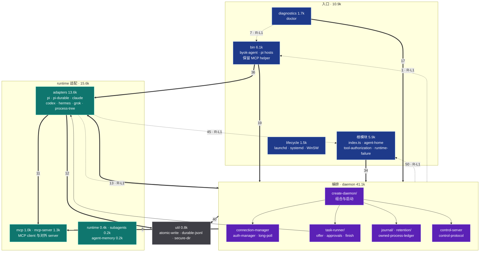
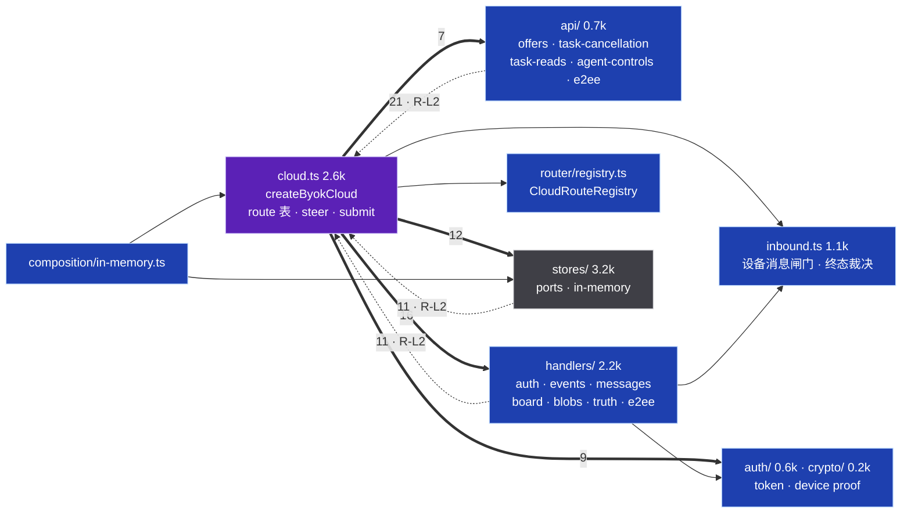
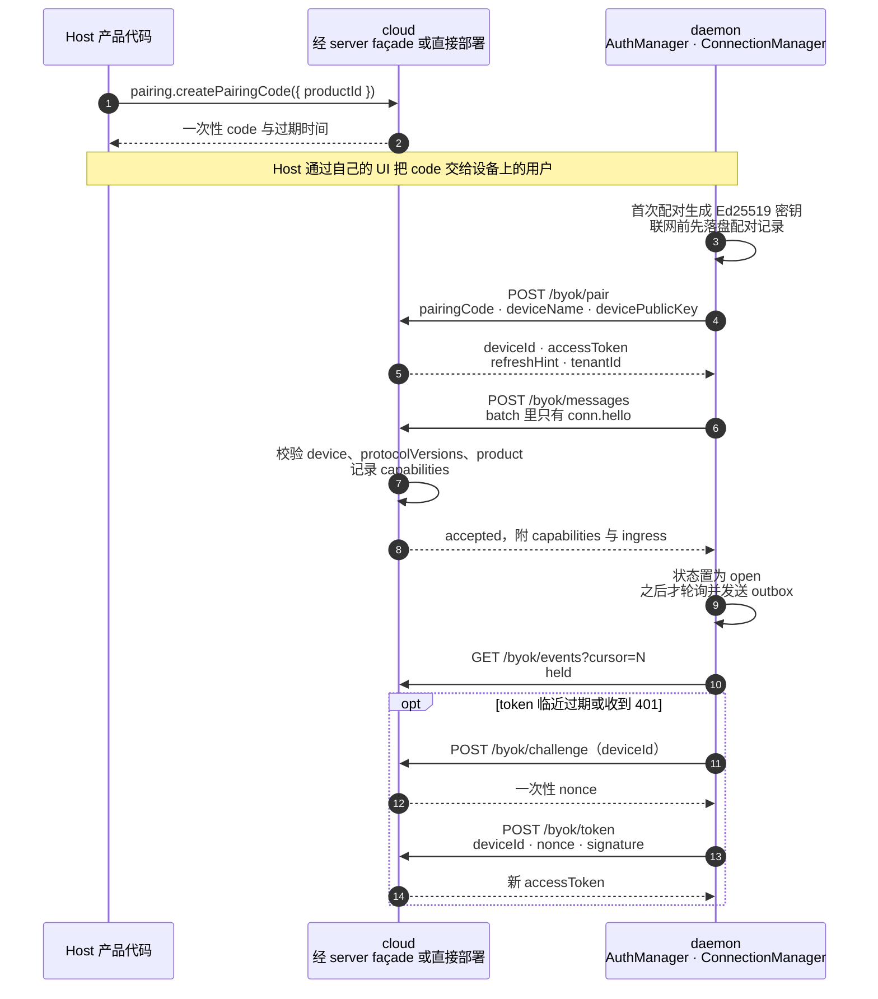
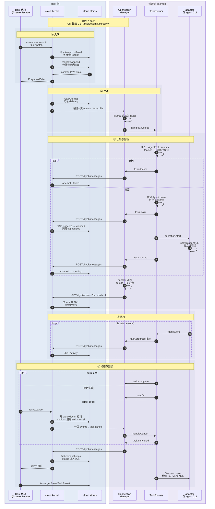
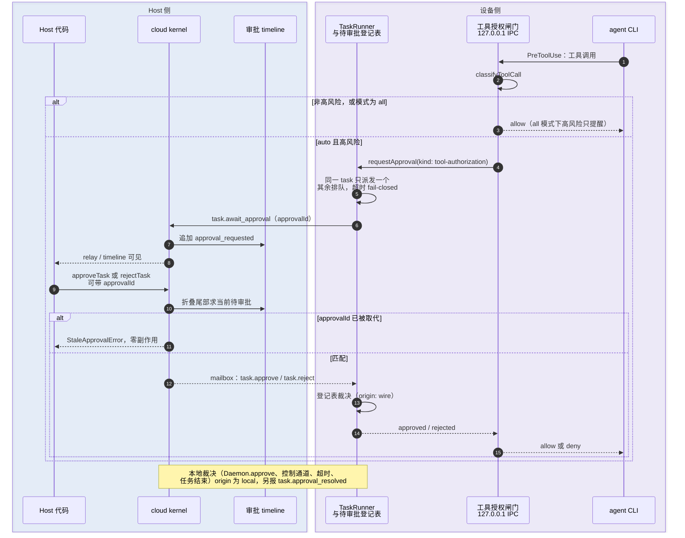
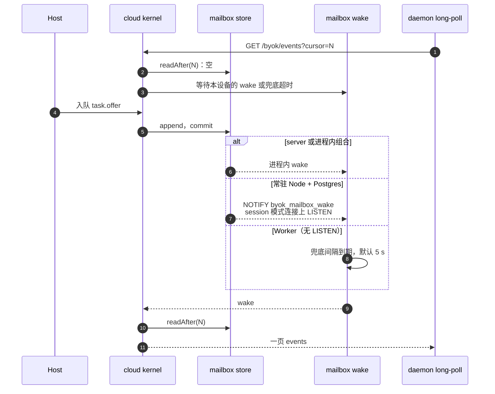

# 总分层架构、模块与时序

> **核对基准**：commit `671309da`（2026-10-28）。文中 `path:line` 均指这一版，路径相对仓库根。
> **事实优先级**：源码 > `docs/spec.md` > 本文 > [`sdk-architecture.md`](sdk-architecture.md)。本文是手写视图，ArchContext 不投影它；`diagrams/architecture.*` 与 `modules/sdk/sdk-root.md` 的机器区仍由 ArchContext 生成。与 `sdk-architecture.md` 的已知差异由 #927 跟踪。
> **配套**：[进程与命名空间拓扑 + 挂载层](process-namespace-topology.md) · [Architecture Index](index.md) · [`host-runtime-isolation-matrix.md`](../host-runtime-isolation-matrix.md) · [`host-local-storage-layout.md`](../host-local-storage-layout.md)
> **用途**：定位图与精简重构的入口。`R-Lx` 指向本文 [Remarks](#remarks)，`R-Tx` 指向[拓扑文档的 Remarks](process-namespace-topology.md#remarks)。
> **图例**：实线是运行时 import 或调用；粗线上的数字是值导入边数；虚线是进程边界、网络边界或可选路径；虚线框是 SDK 不提供、由 Host 自备的部分。package 名省略 `@byok-sdk/` 前缀。
> **取代**：本页与拓扑页取代 2026-10-25 的单页 `system-diagrams.md`（基准 `142acbe2`）。

## 1. 分层总图

Host 侧分四层，L1 契约层同时被设备侧使用。设备侧 `client` 只 import `core` 与 `protocol`，和 Host 侧之间只有 HTTPS long-poll 一条通道。`keys` 与 `cloud-do` 不在派工主链路上。L4 的参考实现在 `examples/`：Topology L 见 `host-execution-core`、`basic`；Topology H 见 `hosted-bot-collaboration`、`hosted-bot-collaboration-worker`；Host UI 见 `live-activity-host`。

图里省略了 L3 对 L1 的直接 import：`server` 与 `cloud-dataplane` 都直接用 `core` 和 `protocol`，`ui-runtime` 直接用 `protocol`。完整的边见 §2。

| 层 | package | 规模（非测试 `.ts` 行数 / 文件数） | 主要入口 |
| --- | --- | --- | --- |
| L1 | `@byok-sdk/protocol` | 7.3k / 29 | `PROTOCOL_VERSION = 4`（`packages/protocol/src/version.ts:46`）；`parseMessage` / `decodeEnvelope` / `encodeEnvelope`（`packages/protocol/src/codec.ts:20,46,58`）；`BYOK_*_PATH`（`packages/protocol/src/http-api.ts:463-550`）；子路径 `./constants` |
| L1 | `@byok-sdk/core` | 9.6k / 55 | store ports `CoreStores`（`packages/core/src/stores.ts`）；`createInMemoryCoreStores`（`packages/core/src/in-memory/index.ts:45`）；子路径 `./sealed-payload` |
| L2 | `@byok-sdk/cloud` | 15.3k / 86 | `createByokCloud`（`packages/cloud/src/cloud.ts:1021`）；`createInMemoryByokCloud`（`packages/cloud/src/composition/in-memory.ts:106`） |
| L3 | `@byok-sdk/server` | 6.3k / 21 | `createByokServer`（`packages/server/src/index.ts:365`）；`listenLoopback`（`packages/server/src/loopback.ts:84`） |
| L3 | `@byok-sdk/cloud-dataplane` | 10.8k / 50 | `./runtime`：`createByokPool` 与 Postgres、R2 stores（`packages/cloud-dataplane/src/runtime.ts`）；根入口另有 `migrate`、`createPostgresMailboxWake` 等 Node-only 能力（`packages/cloud-dataplane/src/index.ts`） |
| L3 | `@byok-sdk/ui-runtime` | 0.9k / 5 | `projectTimeline`、`replayTimeline`（`packages/ui-runtime/src/timeline.ts:360,373`） |
| 设备 | `@byok-sdk/client` | 73.9k / 388；`vendor/` 99.9k | `createDaemon`（`packages/client/src/daemon/create-daemon.ts:963`）；`createDaemonWithAdapters`（同文件 `:718`）；`byok-agent` 等 8 个 bin；子路径 `./adapters`、`./agent-memory`、`./assertion-client`、`./mcp-server`、`./mcp-server/http`、`./testing` |
| 旁路 | `@byok-sdk/keys` | 9.7k / 42 | `ProviderRegistry`（`packages/keys/src/registry.ts:184`）；`byok-pi-provider-launcher`；子路径 `./pi-catalog`、`./model-route` |
| 旁路 | `@byok-sdk/cloud-do` | 3.8k / 19 | `AgentDO`（`packages/cloud-do/src/agent-do.ts:78`） |
| 私有 | `@byok-sdk/conformance` | 5.7k / 36 | `run*Conformance`（`packages/conformance/src/index.ts`） |
| 私有 | `@byok-sdk/testkit` | 0.6k / 4 | `createDeviceSimulator`（`packages/testkit/src/index.ts`） |

公开发布集合是前 8 个 package 加 `keys`，同一个版本号；`conformance` 与 `testkit` 必须保持 private（`scripts/release/check-package-graph.mjs:2-29`，ADR-035）。

## 2. 依赖方向（实测）

统计口径：`packages/*/src` 下非测试的 `.ts`/`.tsx`（排除 `__tests__/`、`*.test.ts`、`vendor/`），按 `import … from`、`export … from` 与 `import()` 的 `@byok-sdk/*` 说明符计数。`import type` 与只含 `type` 成员的花括号记为类型边。

| 方向 | 值边 / 类型边 | 判定 | 例子 |
| --- | --- | --- | --- |
| client → protocol | 73 / 54 | 允许 | `packages/client/src/adapters/served-model.ts` → `@byok-sdk/protocol/constants` |
| client → core | 22 / 4 | 允许 | `packages/client/src/bin/commands/pair.ts` → `@byok-sdk/core/sealed-payload` |
| cloud → core | 43 / 31 | 允许 | `packages/cloud/src/activity.ts` → `@byok-sdk/core` |
| cloud → protocol | 36 / 14 | 允许 | `packages/cloud/src/activity.ts` → `@byok-sdk/protocol` |
| server → cloud / core / protocol | 15 / 9；6 / 3；3 / 6 | 允许 | `packages/server/src/index.ts` → `@byok-sdk/cloud` |
| cloud-dataplane → cloud / core / protocol | 12 / 12；26 / 18；4 / 3 | 允许 | `packages/cloud-dataplane/src/mailbox-wake.ts` → `@byok-sdk/cloud` |
| ui-runtime → cloud / protocol | 2 / 2；1 / 1 | 允许，值边见 R-L4 | `packages/ui-runtime/src/timeline.ts:1-5` → `TimelineEventSchema` |
| keys → core | 5 / 0 | 允许 | `packages/keys/src/custody.ts` → `@byok-sdk/core` |
| conformance → cloud / core / protocol / testkit | 7 / 5；16 / 3；1 / 0；1 / 0 | 允许，私有 | `packages/conformance/src/simulator/harness.ts` → `@byok-sdk/testkit` |
| testkit → core / protocol | 1 / 1；1 / 0 | 允许，私有 | `packages/testkit/src/simulator.ts` → `@byok-sdk/protocol` |
| core、protocol、cloud-do → 任何 workspace package | 0 | 叶子，已满足 | — |
| client ↔ cloud / server，cloud → server / dataplane | 0 | 禁止，已满足 | — |

只在测试里出现的边：`client → server`、`cloud-do → keys`、`server → conformance`、`cloud-dataplane → conformance`，都声明为 devDependency。

检查覆盖：

- 每个 package 的 `dependencies` 与上表的实测边一一对应，没有未声明的 workspace import。
- `scripts/release/check-package-graph.mjs` 检查发布集合、版本对齐、`keys → core` 的 `workspace:*` 依赖与 client 依赖的纯度（`:2-29`、`:314-380`），不检查 package 之间的方向。
- `scripts/api-surface/check-api-surface.mjs` 与 `entry-closure.mjs` 锁公开 API 和入口闭包，不检查 package 内部目录方向。
- 没有检查的部分：package 级方向（靠 `package.json` 与 review 维持）、package 内部目录环（R-L1、R-L2）。仓库没有 eslint、dependency-cruiser 或 madge 配置。

## 3. 模块视图

### 3.1 client：设备侧 daemon

client 是唯一的设备侧 package，占全部非测试源码的约 50%。按职责分四层：入口、编排、runtime 适配、共享工具。目录名对应 `packages/client/src/<dir>`。

| 模块 | 职责 | 关键锚点 |
| --- | --- | --- |
| `bin/` | 8 个 bin 的入口：`byok-agent` 子命令、Pi 三种 host（rpc、prepared、durable）、4 个 SDK 保留 MCP helper。`control-client.ts` 也在这里，被 daemon 与 diagnostics 当库使用（R-L1）。 | `packages/client/src/bin/byok-agent.ts`；`packages/client/src/bin/sdk-reserved-helper-runners.ts` |
| 根模块 | 公开 API 汇总、Agent home 布局、工具授权模式与 IPC、runtime 失败投影。 | `packages/client/src/index.ts`；`packages/client/src/agent-home.ts:28`；`packages/client/src/tool-authorization.ts:13`；`packages/client/src/tool-authorization-ipc.ts:74` |
| `daemon/create-daemon/` | 把 store、journal、连接、TaskRunner、控制通道组合成 `Daemon`。`createDaemon` 只构建 pi、claude、codex，Hermes 与 Grok 由 Host 经 `createDaemonWithAdapters` 注入。 | `packages/client/src/daemon/create-daemon.ts:718,963`；`packages/client/src/daemon/create-daemon/support.ts:288-292` |
| `daemon/connection-manager.ts` 等 | 单会话 HTTP long-poll：`conn.hello` 握手、cursor 持久化即 ack、outbox 批量发送、token 续期。 | `packages/client/src/daemon/connection-manager.ts:273-300`；`packages/client/src/daemon/auth-manager.ts:312` |
| `daemon/task-runner/` | offer 准入、Agent home 预留、workspace 与 manifest 封存、claim/started、事件泵、审批、终态与清理。 | `packages/client/src/daemon/task-runner/offer.ts`；`offer-activation.ts:181`；`approvals.ts:11`；`finish.ts` |
| `daemon/journal/`、`daemon/retention/` | SQLite journal（offer 与终态的崩溃恢复）、scratch 与 session ledger 的保留清理。 | `packages/client/src/daemon/journal/sqlite-journal.ts`；`packages/client/src/daemon/retention/scratch.ts` |
| `adapters/` | 每个 runtime 一个 `RuntimeAdapter`：拼命令行、写 MCP 配置、解析事件流、工具授权桥、进程树所有权。 | `packages/client/src/adapters/process-tree.ts`；`adapters/claude/claude-adapter.ts:344-366`；`adapters/pi/pi-adapter.ts` |
| `mcp/`、`mcp-server/` | `mcp/` 是 daemon 探测 MCP server 用的 client；`mcp-server/` 是对外的 `./mcp-server` 子路径（stdio 与 HTTP）。 | `packages/client/src/daemon/mcp-tools-probe.ts`；`docs/mcp-server-http.md` |
| `lifecycle/`、`diagnostics/` | 服务安装（launchd、systemd --user、WinSW）与 `doctor`。 | `packages/client/src/lifecycle/service-types.ts:63` |

### 3.2 cloud：协调内核

cloud 不持有进程状态，所有事实都在注入的 stores 里。`cloud.ts` 是唯一的组合点，2.6k 行；#1074 起把一部分 Host API 拆进 `api/`。

| 模块 | 职责 | 关键锚点 |
| --- | --- | --- |
| `cloud.ts` | 校验 capability 声明与 ports，登记路由，组装 `ByokCloud` 的全部方法。 | `packages/cloud/src/cloud.ts:1021`（入口）、`:1025`（`assertNoOverDeclaration`）、`:1077-1340`（路由表）、`:1814`（`steerTask`）、`:2303`（`submitAgentExecution`） |
| `api/` | 从 `cloud.ts` 拆出的 Host API：`enqueueAgentOffer`、`cancelTask`、`readTaskResult` 等。 | `packages/cloud/src/cloud.ts:2390-2462` 处挂接 |
| `inbound.ts` | 设备上行消息的唯一闸门：`conn.hello` 能力快照、claim CAS、终态 first-terminal-wins、cancellation 标记优先。 | `packages/cloud/src/inbound.ts:589`、`:473`、`:1000` |
| `handlers/` | HTTP 路由处理器，按 `public`、`device`、`proof`、`presigned` 四类凭据。 | `packages/cloud/src/handlers/events.ts:134-150`；`handlers/auth.ts:51-57` |
| `approval-control.ts`、`approval-timeline.ts` | 待审批槽由审批 timeline 尾部折叠得出，不另存记录。 | `packages/cloud/src/approval-control.ts:1-35` |
| `stores/` | `CloudStores` ports 与内存实现；Postgres 实现在 `cloud-dataplane`，SQLite 实现在 `server`。 | `packages/cloud/src/stores/ports.ts` |

### 3.3 Host 侧组合

| 组合 | 用到的内核 | 附加的东西 |
| --- | --- | --- |
| `server`（Topology L） | `createByokCloud`，固定 `fullCapabilityDeclaration()`（`packages/server/src/index.ts:418`） | `TaskEventRelay`、`WakeScheduler`、`ProjectionWaiters`、`TaskHandle`、`tasks.events`；memory 或 SQLite stores（`packages/server/src/stores/sqlite/`）；`hono.all('*')` 整体转发（`:449`） |
| `cloud-dataplane`（Topology H） | Host 自己调 `createByokCloud` | Postgres stores 与迁移（`deploy/sql/` 下 30 个有序迁移）、R2 blob、`LISTEN byok_mailbox_wake`（`packages/cloud-dataplane/src/mailbox-wake.ts:10,99`） |
| `ui-runtime` | 只读 `ActivityTail` 与审批 timeline | `projectTimeline`、`replayTimeline` 的纯函数投影 |

## 4. 时序图

每张图只画主路径和改变结果的分支。`box` 表示同一侧的组件，不表示同一个 OS 进程；进程边界见[拓扑文档 §1](process-namespace-topology.md#1-进程拓扑)。

### 4.1 配对与建连

- `conn.hello` 必须是会话的第一条消息，这个顺序由 client 保证：每次重连单独 POST 一条 hello，被接受后才开始轮询和发送（`packages/client/src/daemon/connection-manager.ts:273-300`）。cloud 把 hello 当作幂等的能力快照，不检查先后（`packages/cloud/src/inbound.ts:585-611`）。
- `/byok/pair` 已经返回 accessToken（`packages/cloud/src/handlers/auth.ts:51-57`）。challenge 与 token 只用于续期和 401 之后的重新认证（`packages/client/src/daemon/auth-manager.ts:269-337`）。
- 三条 public 路由在 Host 传入 `publicRouteLimiter` 时经 `limitPublic` 限流，超限返回 429（`packages/cloud/src/cloud.ts:1066-1090`）。

### 4.2 派工到终态

wire v4 只有一种 offer：`task.offer`，每个 offer 都绑定 Agent，`session` 区分新执行与续接（#925 阶段 2，#1031）。

| Host 入口 | `task.offer` 的 `session` |
| --- | --- |
| `executions.submit(input)` → `cloud.submitAgentExecution` | `{ mode: 'fresh' }`，必带 `egressPolicy` |
| `dispatch(input)` → `cloud.enqueueAgentOffer` / `enqueueAgentEgressOffer`，必带 `agentRef` 与 `sessionRef` | `{ mode: 'resume', sessionRef }`；fresh 会被拒绝（`packages/cloud/src/cloud.ts:540`） |

- **参与者 H** 合并了 Host 代码与 server façade（relay、TaskHandle）。Topology H 的 Host 直接调 `ByokCloud` 上的 `submitAgentExecution`、`cancelTask`、`readTaskResult`（`packages/cloud/src/cloud.ts:2396,2441,2462`）。
- **ack 时机**：cursor 只在 handler 成功返回并原子落盘后前进，下一次 GET 才携带它；cloud 读取之前先 `advanceCursor`（`packages/cloud/src/handlers/events.ts:134-150`）。offer 在 handler 里先 fsync 进 SQLite journal 再交给 TaskRunner（`packages/client/src/daemon/create-daemon/start-envelopes.ts`）。handler 失败时 cursor 不动，mailbox 重投同一行。
- **offer handler 不等任务结束**：`task.started` 发出、事件泵启动后就返回（`packages/client/src/daemon/task-runner/offer-activation.ts:179-181`），所以 ack 发生在执行期间。
- **准入里的工具授权**：Host 选 `auto` 而 adapter 未声明 `toolAuthorizationAuto`，或 offer 是 prepared 时，直接 decline（`packages/client/src/daemon/task-runner/offer-launch.ts:61`）。当前只有 Claude 与 Pi 声明了它（`adapters/claude/claude-adapter.ts:166`，`adapters/pi/pi-adapter.ts:227`），Pi 又只在普通 RPC lane 上支持（同文件 `:436-440`）。
- **批量上限**：progress 由 `ProgressBatcher` 成批发送；每次 POST 最多 256 条、2 MiB（`packages/protocol/src/http-api.ts:268-271`）。
- **终态内容**：`task.fail` 的 `failure` 是封闭的失败类别，`resetsAt` 只出现在 `quota` 上（`packages/protocol/src/messages.ts:1292-1296`）；只有声明了 `runtime-failure-class` 的 server 才会收到它（`packages/protocol/src/wire-additions.ts:127`）。daemon 自己判定的失败带 `{ class: 'unknown' }`（`packages/client/src/daemon/task-failure.ts:4`）。
- **`Session.close()` 在终态发出之后执行**：它挡住的是本地 lease、workspace 与 task 记录的释放，wire 终态不等它（`packages/client/src/daemon/task-runner/finish.ts:156`）。
- **终态裁决**：cloud 以第一条设备终态为准；attempt 上有 Host 的 cancellation 标记时，结果记为 `cancelled`（`packages/cloud/src/inbound.ts:1000-1001`）。
- **steer**：只有 status 为 running、且 claim 时快照的 `capabilities.steer` 为 true，才会入队 `task.steer`（`packages/cloud/src/cloud.ts:1811-1814`）。

### 4.3 审批与 `auto` 工具授权

#1036 之后审批只有一个入口和一个裁决点：runtime 经 `approvalChannel`，或 `auto` 模式的工具授权桥，都进入 `TaskRunner.requestApproval`；所有裁决都落在 daemon 的待审批登记表（`packages/client/src/daemon/approvals.ts:1-7`）。

- 闸门是每个 runtime 一个的 loopback HTTP server，只监听 `127.0.0.1` 的随机端口，路径 `/authorize-tool`，用 64 位十六进制 token 认证（`packages/client/src/tool-authorization-ipc.ts:28-37,74-103`）。token 经环境变量 `BYOK_TOOL_AUTHORIZATION_GATE` 传给 SDK 自己的子会话，认证的是通道，不是同用户之间的边界（同文件 `:5-17`）。
- Claude 的闸门在 stdio control 通道里以 hook 形式运行（`packages/client/src/adapters/claude/claude-adapter.ts:369-372`）；Pi 经 `startToolAuthorizationIpc` 起 IPC（`packages/client/src/adapters/pi/pi-adapter.ts:525-555`）。
- TaskRunner 把两条入口都接到同一个 `requestApproval`（`packages/client/src/daemon/task-runner/offer-launch.ts:390-434`）。cloud 的待审批槽由 timeline 尾部折叠得出，尾部过期即没有待审批，调用方 fail-closed（`packages/cloud/src/approval-control.ts:1-35`）。server 的 SQLite 审批 timeline 跨重启保留（#1049，`packages/server/src/stores/sqlite/approval-timeline.ts`）。
- cloud 没有设备侧的审批路由：审批是 Host 控制面的方法，不是 HTTP 路由（`packages/cloud/src/cloud.ts:1341-1345`）。

### 4.4 投递唤醒：Topology L 与 H

- 兜底间隔默认 5 秒（`packages/cloud/src/stores/in-memory/mailbox-wake.ts:4`）。Postgres 的 `LISTEN` 需要 session 模式 DSN，Hyperdrive 与 transaction 模式的 pooler 不行（`packages/cloud-dataplane/src/mailbox-wake.ts:10-19,99-105`；`deploy/sql/0024_mailbox_wake.sql`）。

## Remarks

按级别排序。`高`：影响正确性或安全边界。`中`：结构负担或重复。`低`：命名与清理。本页只记录观察到的事实与方向，不代表已立项。

| ID | 级别 | 问题 | 证据 | 精简方向 |
| --- | --- | --- | --- | --- |
| R-L1 | 中 | client 内部目录没有方向规则，实测存在多组值导入环：`daemon ↔ adapters`（15 / 13）、`daemon ↔ 根模块`（50 / 34）、`daemon ↔ bin`（1 / 19）、`adapters ↔ runtime`（8 / 2）、`adapters ↔ 根模块`（45 / 7）、`bin ↔ diagnostics`（3 / 7）、`bin ↔ agent-memory`（2 / 5）。`bin/control-client.ts` 被 `daemon/assertion-client.ts` 与 `diagnostics/device-doctor.ts` 当库导入；`index.ts` 导入 `bin/team-tmux-view`。 | §2 统计口径应用到 `packages/client/src/<dir>`；`packages/client/src/daemon/assertion-client.ts` → `../bin/control-client`；`packages/client/src/agent-memory/index.ts` → `../bin/agent-memory-mcp-server` | 把 `bin/` 里的库代码（control-client、各 MCP server 实现）移到非入口目录，`bin/` 只留 argv 外壳；之后为 client 加目录方向检查。 |
| R-L2 | 中 | `cloud.ts` 是 2.6k 行的组合点，`api/`、`handlers/`、`stores/` 都反向导入根模块（21 / 11 / 11 条值边）。#1074 已拆出 offers、取消、读取等 API，`steerTask` 与 `submitAgentExecution` 仍在 `cloud.ts` 内。 | `packages/cloud/src/cloud.ts:1814,2303`；§3.2 图 | 继续按 Host API 拆分，根模块只留组合；共享的错误与类型移到不被组合点依赖的叶子文件。 |
| R-L3 | 中 | 内嵌 `server` 把 `e2eeMemberStore` 传给 `createByokCloud`，但用不带参数的 `fullCapabilityDeclaration()`，它默认不含 `e2ee.member`、`truth.records`、`skills.pack`、`agent.memory.projection`、`host-mcp-task-context`，所以这些路由在 Topology L 永远不挂载。是否有意需要确认。 | `packages/server/src/index.ts:413,418`；`packages/cloud/src/capabilities.ts:157-178`；`packages/cloud/src/cloud.ts:1260` | 若有意，删掉传入的 store 或在注释里说明；若无意，让 server 按传入的 ports 打开对应声明。 |
| R-L4 | 低 | `ui-runtime` 有 2 条对 `cloud` 的值导入（`TimelineEventSchema` 等），浏览器端打包会带入这部分 cloud 代码。 | `packages/ui-runtime/src/timeline.ts:1-5`；`packages/ui-runtime/src/approval-timeline.ts:5` | 若 schema 属于契约，移到 `protocol`；否则保持现状并在 API surface 里锁定。 |
| R-L5 | 低 | package 级方向没有 checker，目前靠 `package.json` 与 review 维持；`check-package-graph.mjs` 只查发布集合与依赖纯度。 | §2 检查覆盖 | 在 `check:release-graph` 加一条：workspace 依赖只能指向 §1 中更低的层。 |
