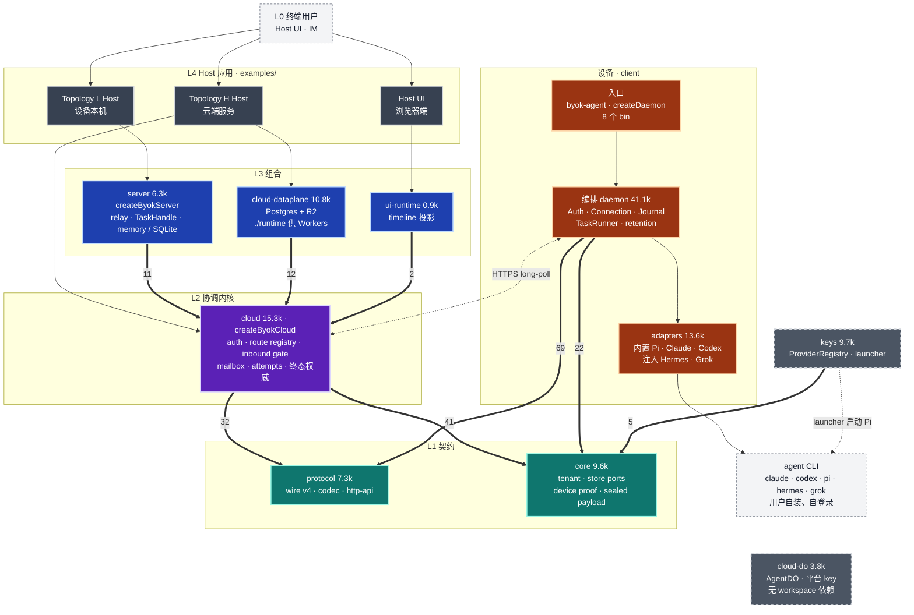
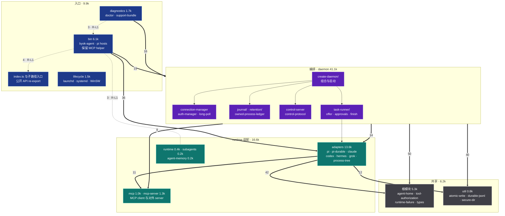
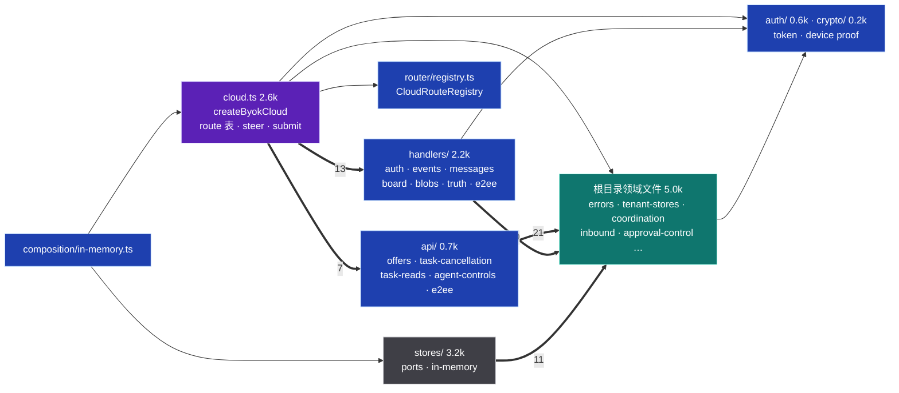
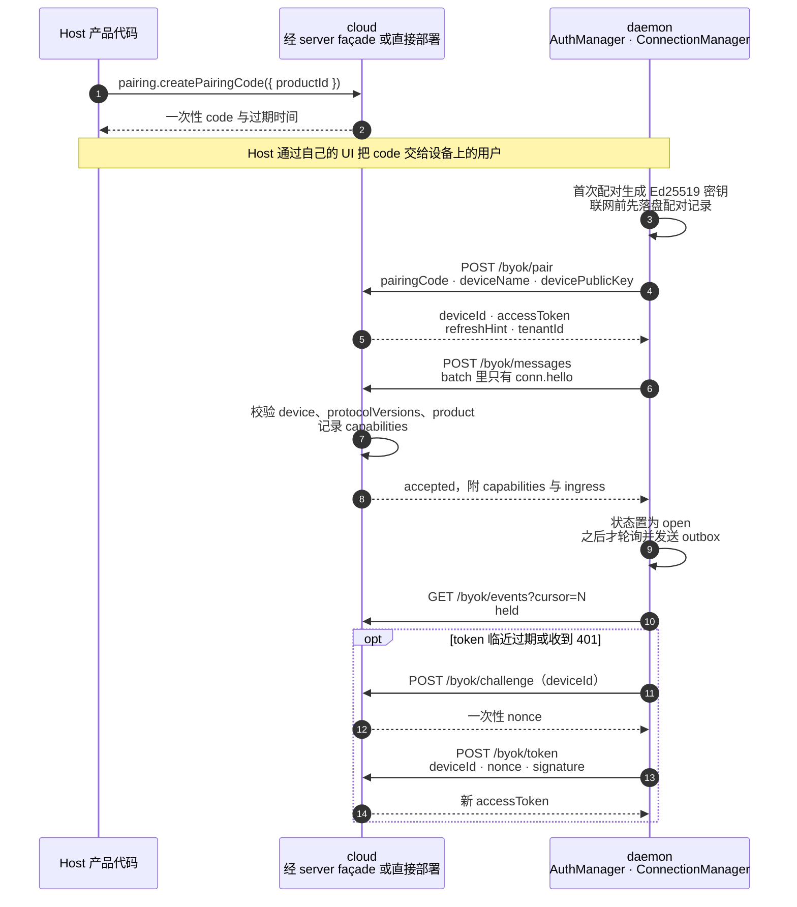
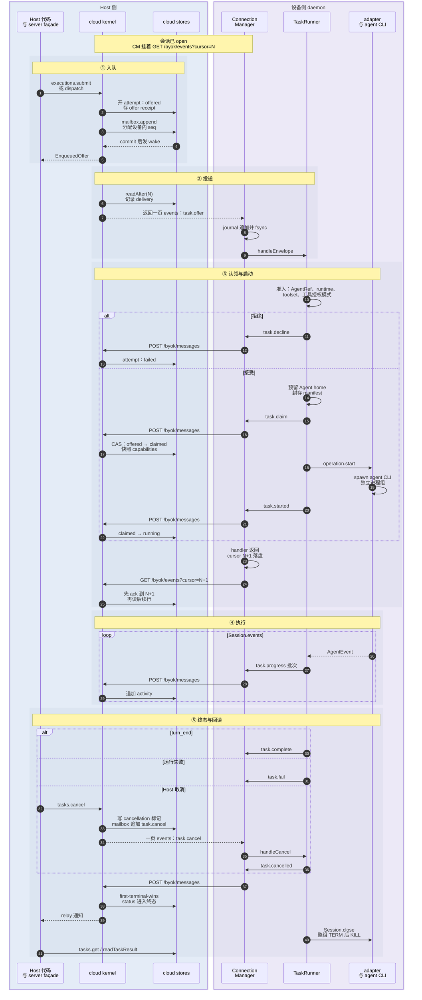
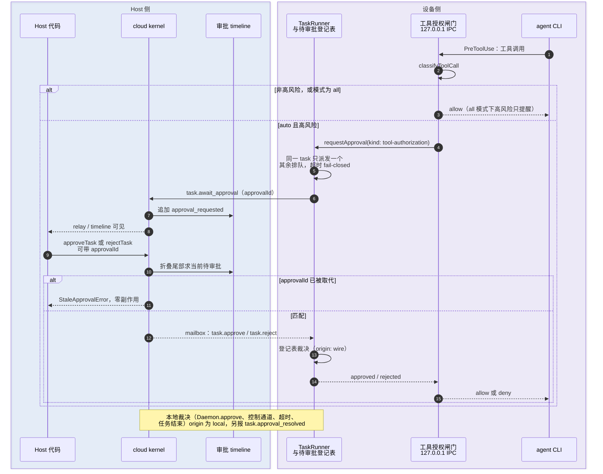
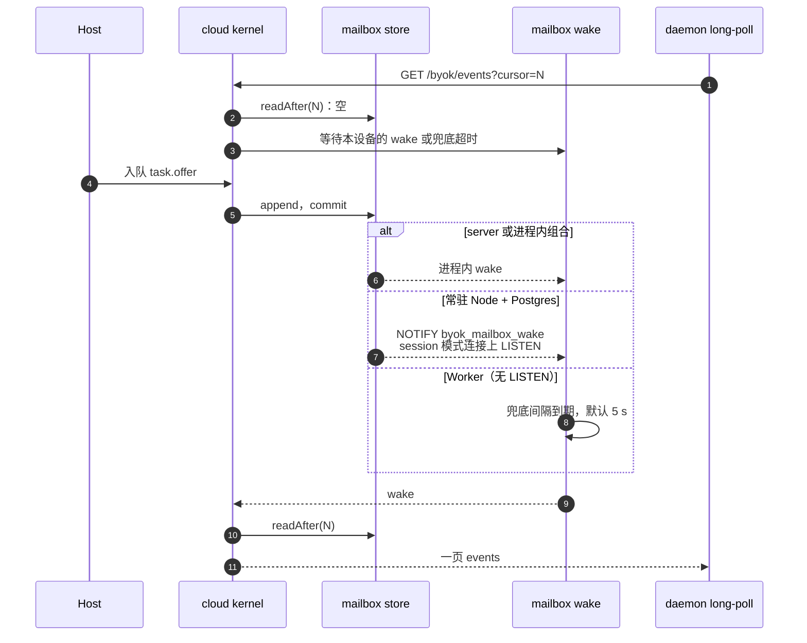

# 总分层架构、模块与时序

> **定位**：审查视图。当前规范见[当前功能架构](current-architecture.md)；本页给出逐条证据、完整时序图与 Remarks。之后的修订以本页的文件历史为准。
> **核对基准**：commit `671309da`（2026-10-28）。文中 `path:line` 均指这一版，路径相对仓库根。
> **事实优先级**：源码 > `docs/spec.md` > 本文 > [`sdk-architecture.md`](sdk-architecture.md)。本文是手写视图，ArchContext 不投影它；`diagrams/architecture.*` 与 `modules/sdk/sdk-root.md` 的机器区仍由 ArchContext 生成。与 `sdk-architecture.md` 的已知差异由 #927 跟踪。
> **配套**：[当前功能架构](current-architecture.md) · [进程与命名空间拓扑 + 挂载层](process-namespace-topology.md) · [Architecture Index](index.md) · [`host-runtime-isolation-matrix.md`](../host-runtime-isolation-matrix.md) · [`host-local-storage-layout.md`](../host-local-storage-layout.md)
> **用途**：定位图与精简重构的入口。`R-Lx` 指向本文 [Remarks](#remarks)，`R-Tx` 指向[拓扑文档的 Remarks](process-namespace-topology.md#remarks)。
> **图例**：实线是运行时 import 或调用；粗线上的数字是值导入边数；虚线是进程边界、网络边界或可选路径；虚线框是 SDK 不提供、由 Host 自备的部分。package 名省略 `@byok-sdk/` 前缀。
> **取代**：本页与拓扑页取代 2026-10-25 的单页 `system-diagrams.md`（基准 `142acbe2`）。

## 1. 分层总图

Host 侧分四层，L1 契约层同时被设备侧使用。设备侧 `client` 只 import `core` 与 `protocol`，和 Host 侧之间只有 HTTPS long-poll 一条通道。`keys` 与 `cloud-do` 不在派工主链路上。Host 执行核心是 `@byok-sdk/server/execution-core`（#1106）。L4 的参考实现在 `examples/`：Topology L 见 `host-execution-core`（组合该子路径的演示）、`basic`；Topology H 见 `hosted-bot-collaboration`、`hosted-bot-collaboration-worker`；Host UI 见 `live-activity-host`。

图里省略了 L3 对 L1 的直接 import：`server` 与 `cloud-dataplane` 都直接用 `core` 和 `protocol`，`ui-runtime` 直接用 `protocol`。完整的边见 §2。

| 层 | package | 规模（非测试 `.ts` 行数 / 文件数） | 主要入口 |
| --- | --- | --- | --- |
| L1 | `@byok-sdk/protocol` | 7.3k / 28 | `PROTOCOL_VERSION = 4`（`packages/protocol/src/version.ts:46`）；`parseMessage` / `decodeEnvelope` / `encodeEnvelope`（`packages/protocol/src/codec.ts:20,46,58`）；`BYOK_*_PATH`（`packages/protocol/src/http-api.ts:463-550`）；子路径 `./constants` |
| L1 | `@byok-sdk/core` | 9.6k / 48 | store ports `CoreStores`（`packages/core/src/stores.ts`）；`createInMemoryCoreStores`（`packages/core/src/in-memory/index.ts:45`）；子路径 `./sealed-payload` |
| L2 | `@byok-sdk/cloud` | 15.3k / 83 | `createByokCloud`（`packages/cloud/src/cloud.ts:1021`）；`createInMemoryByokCloud`（`packages/cloud/src/composition/in-memory.ts:106`） |
| L3 | `@byok-sdk/server` | 6.3k / 20 | `createByokServer`（`packages/server/src/index.ts:365`）；`listenLoopback`（`packages/server/src/loopback.ts:84`） |
| L3 | `@byok-sdk/cloud-dataplane` | 10.8k / 41 | `./runtime`：`createByokPool` 与 Postgres、R2 stores（`packages/cloud-dataplane/src/runtime.ts`）；根入口另有 `migrate`、`createPostgresMailboxWake` 等 Node-only 能力（`packages/cloud-dataplane/src/index.ts`） |
| L3 | `@byok-sdk/ui-runtime` | 0.9k / 5 | `projectTimeline`、`replayTimeline`（`packages/ui-runtime/src/timeline.ts:360,373`） |
| 设备 | `@byok-sdk/client` | 73.9k / 342（含 7 个 `.d.ts`）；`vendor/` 99.9k | `createDaemon`（`packages/client/src/daemon/create-daemon.ts:963`）；`createDaemonWithAdapters`（同文件 `:718`）；`byok-agent` 等 8 个 bin；子路径 `./adapters`、`./agent-memory`、`./assertion-client`、`./mcp-server`、`./mcp-server/http`、`./testing` |
| 旁路 | `@byok-sdk/keys` | 9.7k / 42 | `ProviderRegistry`（`packages/keys/src/registry.ts:184`）；`byok-pi-provider-launcher`；子路径 `./pi-catalog`、`./model-route` |
| 旁路 | `@byok-sdk/cloud-do` | 3.8k / 19 | `AgentDO`（`packages/cloud-do/src/agent-do.ts:78`） |
| 私有 | `@byok-sdk/conformance` | 5.7k / 36 | `run*Conformance`（`packages/conformance/src/index.ts`） |
| 私有 | `@byok-sdk/testkit` | 0.6k / 4 | `createDeviceSimulator`（`packages/testkit/src/index.ts`） |

公开发布集合是前 8 个 package 加 `keys`，同一个版本号；`conformance` 与 `testkit` 必须保持 private（`scripts/release/check-package-graph.mjs:2-29`，ADR-035）。

## 2. 依赖方向（实测）

统计口径：`packages/*/src` 下非测试的 `.ts`/`.tsx`（排除 `__tests__/`、`*.test.ts`、`vendor/`），按 `import … from`、`export … from` 与 `import()` 的 `@byok-sdk/*` 说明符计数。`import type`、只含 `type` 成员的花括号，以及类型位置的 `import('…').T` 记为类型边；运行时的 `import()` 记为值边。

| 方向 | 值边 / 类型边 | 判定 | 例子 |
| --- | --- | --- | --- |
| client → protocol | 69 / 59 | 允许 | `packages/client/src/adapters/served-model.ts` → `@byok-sdk/protocol/constants` |
| client → core | 22 / 4 | 允许 | `packages/client/src/bin/commands/pair.ts` → `@byok-sdk/core/sealed-payload` |
| cloud → core | 41 / 33 | 允许 | `packages/cloud/src/activity.ts` → `@byok-sdk/core` |
| cloud → protocol | 32 / 18 | 允许 | `packages/cloud/src/activity.ts` → `@byok-sdk/protocol` |
| server → cloud / core / protocol | 11 / 13；6 / 3；3 / 6 | 允许 | `packages/server/src/index.ts` → `@byok-sdk/cloud` |
| cloud-dataplane → cloud / core / protocol | 12 / 12；26 / 18；4 / 3 | 允许 | `packages/cloud-dataplane/src/mailbox-wake.ts` → `@byok-sdk/cloud` |
| ui-runtime → cloud / protocol | 2 / 2；1 / 1 | 允许，值边见 R-L4 | `packages/ui-runtime/src/timeline.ts:1-5` → `TimelineEventSchema` |
| keys → core | 5 / 0 | 允许 | `packages/keys/src/custody.ts` → `@byok-sdk/core` |
| conformance → cloud / core / protocol / testkit | 7 / 5；16 / 3；1 / 0；1 / 0 | 允许，私有 | `packages/conformance/src/simulator/harness.ts` → `@byok-sdk/testkit` |
| testkit → core / protocol | 1 / 1；1 / 0 | 允许，私有 | `packages/testkit/src/simulator.ts` → `@byok-sdk/protocol` |
| core、protocol、cloud-do → 任何 workspace package | 0 | 叶子，已满足 | — |
| client ↔ cloud / server，cloud → server / dataplane | 0 | 禁止，已满足 | — |

只在测试里出现的边：`client → server`、`cloud-do → keys`、`server → conformance`、`cloud-dataplane → conformance`，都声明为 devDependency。`cloud-do` 另把 `client` 声明为 devDependency，只在 `test/check-dist.node.mjs` 里作为字符串出现。

检查覆盖：

- `bun run check:release-graph` 调用 [`scripts/architecture/dependency-graph.mjs`](../../scripts/architecture/dependency-graph.mjs)：使用已安装 TypeScript 7 的 AST API 区分类型边和值边，解析 workspace export 到源码，保留 barrel re-export 边以检测文件级环；同时检查 workspace manifest 的运行时依赖方向与源码值导入的 `dependencies` 声明。
- K8 单独复制的 `examples/bot-collaboration/src/rules` 另做真实闭包检查：从规则文件出发沿 workspace export 解析值导入，禁止到达 `node:async_hooks` 与 `node:sqlite`（含 `process.getBuiltinModule('node:sqlite')`）。K4 根入口 `@byok-sdk/server/execution-core` 会失败，`./execution-core/canonical` 只到 `node:crypto`。该检查不依赖基线。
- client 目录层级为入口（`bin`、`lifecycle`、`diagnostics`、`testing`）→ `daemon` → runtime 适配 → 共享；cloud 为 `composition` → `cloud.ts` → `api` / `handlers` / `router` → `stores` → 根领域文件 → 叶子目录。同层允许，纯 re-export 入口不计逆层边，但仍参与环检测。
- [`dependency-baseline.json`](../../scripts/architecture/dependency-baseline.json) 记录当前 client/cloud 的逆层边、环内每条边，以及 conformance → testkit 的 manifest 缺口。本轮后基线为 34 条环内边 + 0 条目录逆层边 + 1 条 manifest 缺口 = 35（#1099 的第二个切片删除了最后 6 条目录逆层边，第三个切片删除了 diagnostics ↔ bin 文件级环的 8 条边）。新违规或已消失但未删除的基线项均失败；CI 还用精确 `CI_BASE` 检查基线不得增加。基线清空后可删除文件，检查等同零容忍。首次引入基线由本 PR review 确认。
- R-L4 的 2 条 `ui-runtime → cloud` 值导入不在 baseline 里：checker 用带理由的 reviewed allowlist 锁定精确文件、说明符与成员名，多一条、少一条或成员集合变化都失败。把它们迁到 `protocol` 会新增公开导出并改写 cloud/ui-runtime 的声明面，故留到后续。
- `node --test scripts/architecture/dependency-graph.test.mjs` 以合成 fixture 锁定 AST API 口径、动态 import、barrel 环、分层与基线单调性；K8 用例复制真实 workspace 源码，人为把 K4 根入口加进 `rules/` 后必须报出 `node:sqlite` 与 `node:async_hooks`。检查只扫描上述非测试 TypeScript 源码；JS/vendor 及非字面量动态模块表达式不属于该静态图。
- release checker 继续检查发布集合、版本、client 安装纯度及训练线不得到达 keys；api-surface 检查公开 API 和入口闭包。K8 rules 的平台闭包已纳入本 checker，K4 demo 仍是 Node-only 演示；timeline schema 未迁到 `protocol`，按 R-L4 的 reviewed allowlist 锁定。

## 3. 模块视图

### 3.1 client：设备侧 daemon

client 是唯一的设备侧 package，占全部非测试源码的约 50%。按职责分四层：入口、编排、runtime 适配、共享。目录名对应 `packages/client/src/<dir>`；「根模块」指 `src/` 根目录下除 `index.ts` 以外的文件。

边上的数字是值导入语句数，口径同 §2。公开入口（`index.ts`，以及 `adapters/`、`agent-memory/`、`assertion-client/`、`mcp-server/`、`testing/` 的子路径入口）只做 re-export，它们发出的边不计；其中 `index.ts` 发出 71 条，32 条指向 daemon。非公开入口模块的目录逆层值导入已清零；图中保留的 R-L1 虚线是公开入口 barrel 发出的入口边与同层边（`agent-memory/index.ts` → bin 3、`diagnostics` → bin 3、`bin` → `index.ts` 4）。公开入口 barrel 仍 re-export 高层实现，检查器按设计不计这些入口边。文件级环与同层互指见 R-L1。

| 模块 | 职责 | 关键锚点 |
| --- | --- | --- |
| `bin/` | 8 个 bin 的入口：`byok-agent` 子命令、Pi 三种 host（rpc、prepared、durable）、4 个 SDK 保留 MCP helper。`audit-log.ts`、`format.ts`、`agent-memory-mcp-server.ts`、`sdk-reserved-helper-runners.ts`、`sdk-reserved-helper-command.ts` 也在这里，被 diagnostics、agent-memory 与根模块当库使用（R-L1）。`runtime-probe.ts` 已移到 `diagnostics/runtime-probe.ts`（#1099）；`control-client.ts` 已移到 `daemon/control-client.ts`，`lifecycle/exec-runner.ts` 已移到 `util/exec-runner.ts`（#1205）。 | `packages/client/src/bin/byok-agent.ts`；`packages/client/src/bin/sdk-reserved-helper-runners.ts`；`packages/client/src/bin/sdk-reserved-helper-command.ts` |
| `index.ts` | 公开 API 汇总，只做 re-export；`adapters/`、`agent-memory/` 等子路径各有自己的入口。`bin/` 有 4 个文件从这里取 API；`runtime-probe` 的库代码已移到 `diagnostics/runtime-probe.ts`，不再经公开入口与 `diagnostics/` 成环（R-L1）。 | `packages/client/src/index.ts`；`packages/client/src/bin/commands/runtimes.ts` |
| 根模块 | Agent home 布局、工具授权模式与 IPC、runtime 失败投影、共享类型。被 daemon 与 adapters 广泛依赖。 | `packages/client/src/agent-home.ts:28`；`packages/client/src/tool-authorization.ts:13`；`packages/client/src/tool-authorization-ipc.ts:74` |
| `daemon/create-daemon/` | 把 store、journal、连接、TaskRunner、控制通道组合成 `Daemon`。`createDaemon` 只构建 pi、claude、codex，Hermes 与 Grok 由 Host 经 `createDaemonWithAdapters` 注入。`daemon.start()` 总会拉起控制通道，内嵌 Host 也一样。 | `packages/client/src/daemon/create-daemon.ts:718,963`；`packages/client/src/daemon/create-daemon/support.ts:288-292`；`packages/client/src/daemon/create-daemon/lifecycle.ts:41` |
| `daemon/connection-manager.ts` 等 | 单会话 HTTP long-poll：`conn.hello` 握手、cursor 持久化即 ack、outbox 批量发送、token 续期。 | `packages/client/src/daemon/connection-manager.ts:273-327`；`packages/client/src/daemon/auth-manager.ts:312` |
| `daemon/task-runner/` | offer 准入、Agent home 预留、workspace 与 manifest 封存、claim/started、事件泵、审批、终态与清理。 | `packages/client/src/daemon/task-runner/offer.ts`；`offer-activation.ts:179-203`；`approvals.ts:11`；`finish.ts:145` |
| `daemon/journal/`、`daemon/retention/` | SQLite journal（offer 与终态的崩溃恢复）、scratch 与 session ledger 的保留清理。 | `packages/client/src/daemon/journal/sqlite-journal.ts`；`packages/client/src/daemon/retention/scratch.ts` |
| `daemon/environment.ts` | runtime 子进程的环境：完整继承与窄 allowlist 两种构造。adapters 有 8 条值导入指向它，`./adapters` 子路径入口也 re-export 它（R-L1）。 | `packages/client/src/daemon/environment.ts:1-14` |
| `adapters/` | 每个 runtime 一个 `RuntimeAdapter`：拼命令行、写 MCP 配置、解析事件流、工具授权桥、进程树所有权。 | `packages/client/src/adapters/process-tree.ts`；`adapters/claude/claude-adapter.ts:344-366`；`adapters/pi/pi-adapter.ts` |
| `mcp/`、`mcp-server/` | `mcp/` 是 daemon 探测 MCP server 用的 client；`mcp-server/` 是对外的 `./mcp-server` 子路径（stdio 与 HTTP）。 | `packages/client/src/daemon/mcp-tools-probe.ts`；`docs/mcp-server-http.md` |
| `lifecycle/`、`diagnostics/` | 服务安装（launchd、systemd --user、WinSW）与 `doctor`、`support-bundle`。 | `packages/client/src/lifecycle/service-types.ts:63` |

### 3.2 cloud：协调内核

cloud 不持有进程状态，所有事实都在注入的 stores 里。`src/` 根目录有 29 个文件（8.0k 行）：组合点 `cloud.ts`（2.6k 行）、公开入口 `index.ts`，以及 27 个领域文件（5.0k 行，`errors`、`tenant-stores`、`coordination`、`inbound`、`approval-control` 等）。#1074 起把一部分 Host API 拆进 `api/`。

同一目录里的 `cloud.ts` 与领域文件被目录级检查视为一个单元，所以 `api/`、`handlers/`、`stores/` 与根目录之间显示为双向依赖（R-L2）。实际上子目录没有值导入指向 `cloud.ts`：`api/` 只以 `import type` 引用它，唯一的值导入来自上层的 `composition/in-memory.ts`。文件级只有 `inbound.ts ↔ task-agent-message.ts` 一个环。

| 模块 | 职责 | 关键锚点 |
| --- | --- | --- |
| `cloud.ts` | 校验 capability 声明与 ports，登记路由，组装 `ByokCloud` 的全部方法。 | `packages/cloud/src/cloud.ts:1021`（入口）、`:1024`（`assertDeclarationMatchesPorts`，双向）、`:1077-1340`（路由表）、`:1893-1916`（steer 闸门）、`:2303`（`submitAgentExecution`） |
| `api/` | 从 `cloud.ts` 拆出的 Host API：`enqueueAgentOffer`、`cancelTask`、`readTaskResult` 等。 | `packages/cloud/src/cloud.ts:2390-2462` 处挂接 |
| `inbound.ts` | 设备上行消息的唯一闸门：`conn.hello` 能力快照、claim CAS、终态 first-terminal-wins、cancellation 标记优先。 | `packages/cloud/src/inbound.ts:585-602`、`:838-851`、`:950-965`、`:1000` |
| `handlers/` | HTTP 路由处理器，按 `public`、`device`、`proof`、`presigned` 四类凭据登记。 | `packages/cloud/src/router/registry.ts:32`；`handlers/auth.ts:51-57`；cursor ack 见 `handlers/events.ts:134-150` |
| `approval-control.ts`、`approval-timeline.ts` | 待审批槽由审批 timeline 尾部折叠得出，不另存记录。 | `packages/cloud/src/approval-control.ts:1-35` |
| `stores/` | `CloudStores` ports 与内存实现；Postgres 实现在 `cloud-dataplane`，SQLite 实现在 `server`。 | `packages/cloud/src/stores/ports.ts` |

### 3.3 Host 侧组合

| 组合 | 用到的内核 | 附加的东西 |
| --- | --- | --- |
| `server`（Topology L） | `createByokCloud`，声明由 ports 推导：`capabilityDeclarationForPorts`（`packages/server/src/index.ts:410,419`） | `TaskEventRelay`、`WakeScheduler`、`ProjectionWaiters`、`TaskHandle`、`tasks.events`；memory 或 SQLite stores（`packages/server/src/stores/sqlite/`）；`hono.all('*')` 整体转发（`:449`） |
| `cloud-dataplane`（Topology H） | Host 自己调 `createByokCloud` | Postgres stores 与迁移（`deploy/sql/` 下 30 个有序迁移）、R2 blob、`LISTEN byok_mailbox_wake`（`packages/cloud-dataplane/src/mailbox-wake.ts:10,99`） |
| `ui-runtime` | 只读 `ActivityTail` 与审批 timeline | `projectTimeline`、`replayTimeline` 的纯函数投影 |

## 4. 时序图

每张图只画主路径和改变结果的分支。`box` 表示同一侧的组件，不表示同一个 OS 进程；进程边界见[拓扑文档 §1](process-namespace-topology.md#1-进程拓扑)。

### 4.1 配对与建连

- `conn.hello` 必须是会话的第一条消息，这个顺序由 client 保证：每次重连单独 POST 一条 hello，被接受后才置为 open、开始轮询和发送（`packages/client/src/daemon/connection-manager.ts:273-300`、`:313-327`）。cloud 把 hello 当作幂等的能力快照，不检查先后（`packages/cloud/src/inbound.ts:585-602`）。
- `/byok/pair` 已经返回 accessToken（`packages/cloud/src/handlers/auth.ts:51-57`）。challenge 与 token 只用于续期和 401 之后的重新认证（`packages/client/src/daemon/auth-manager.ts:269-337`）。
- 三条 public 路由在 Host 传入 `publicRouteLimiter` 时经 `limitPublic` 限流，超限返回 429（`packages/cloud/src/cloud.ts:1066-1090`）。

### 4.2 派工到终态

wire v4 只有一种 offer：`task.offer`，每个 offer 都绑定 Agent，`session` 区分新执行与续接（#925 阶段 2，#1031）。

| Host 入口 | `task.offer` 的 `session` |
| --- | --- |
| `executions.submit(input)` → `cloud.submitAgentExecution` | `{ mode: 'fresh' }`，必带 `egressPolicy` |
| `dispatch(input)` → `cloud.enqueueAgentOffer` / `enqueueAgentEgressOffer`，必带 `agentRef` 与 `sessionRef` | `{ mode: 'resume', sessionRef }`；fresh 会被拒绝（`packages/cloud/src/cloud.ts:540`） |

- **参与者 H** 合并了 Host 代码与 server façade（relay、TaskHandle）。Topology H 的 Host 直接调 `ByokCloud` 上的 `submitAgentExecution`、`cancelTask`、`readTaskResult`（`packages/cloud/src/cloud.ts:2396,2441,2462`）。
- **ack 时机**：cursor 只在 handler 成功返回并原子落盘后前进，下一次 GET 才携带它；cloud 读取之前先 `advanceCursor`（`packages/cloud/src/handlers/events.ts:134-150`）。offer 在 handler 里先 fsync 进 SQLite journal 再交给 TaskRunner（`packages/client/src/daemon/create-daemon/start-connection.ts:85-88`）。handler 失败时 cursor 不动，mailbox 重投同一行。
- **offer handler 不等任务结束**：`task.started` 发出、事件泵启动后就返回（`packages/client/src/daemon/task-runner/offer-activation.ts:179-203`），所以 ack 发生在执行期间。
- **准入里的工具授权**：Host 选 `auto` 而 adapter 未声明 `toolAuthorizationAuto`，或 offer 是 prepared 时，直接 decline（`packages/client/src/daemon/task-runner/offer-launch.ts:61`）。当前只有 Claude 与 Pi 声明了它（`adapters/claude/claude-adapter.ts:166`，`adapters/pi/pi-adapter.ts:227`），Pi 又只在普通 RPC lane 上支持（同文件 `:436-440`）。
- **批量上限**：progress 由 `ProgressBatcher` 成批发送；每次 POST 最多 256 条、2 MiB（`packages/protocol/src/http-api.ts:268-271`）。
- **终态内容**：`task.fail` 的 `failure` 是封闭的失败类别，`resetsAt` 只出现在 `quota` 上（`packages/protocol/src/messages.ts:1292-1296`）；只有声明了 `runtime-failure-class` 的 server 才会收到它（`packages/protocol/src/wire-additions.ts:127`）。daemon 自己判定的失败带 `{ class: 'unknown' }`（`packages/client/src/daemon/task-failure.ts:4`）。
- **`Session.close()` 在终态发出之后执行**：它挡住的是本地 lease、workspace 与 task 记录的释放，wire 终态不等它（`packages/client/src/daemon/task-runner/finish.ts:145` → `task-runner/lifecycle.ts:25-31`）。
- **终态裁决**：cloud 以第一条设备终态为准；attempt 上有 Host 的 cancellation 标记时，结果记为 `cancelled`（`packages/cloud/src/inbound.ts:1000-1001`）。
- **steer**：只有 status 为 running、且 claim 时快照的 `capabilities.steer` 为 true，才会入队 `task.steer`（`packages/cloud/src/cloud.ts:1893-1916` 的 `runningSteerTarget`）。

### 4.3 审批与 `auto` 工具授权

#1036 之后审批只有一个入口和一个裁决点：runtime 经 `approvalChannel`，或 `auto` 模式的工具授权桥，都进入 `TaskRunner.requestApproval`；所有裁决都落在 daemon 的待审批登记表（`packages/client/src/daemon/approvals.ts:1-7`）。

- 闸门是每个 runtime 一个的 loopback HTTP server，只监听 `127.0.0.1` 的随机端口，路径 `/authorize-tool`，用 64 位十六进制 token 认证（`packages/client/src/tool-authorization-ipc.ts:28-37,74-103`）。daemon 把地址与 token 写进 0600 的 `sdk/rpc-launch.json` 交给 Pi host（`packages/client/src/adapters/pi/pi-adapter.ts:537,555`）；Pi host 再把它放进自己的环境变量 `BYOK_TOOL_AUTHORIZATION_GATE`，交给 SDK 自己的 Pi 子会话（`packages/client/src/bin/pi-rpc-host.ts:184`），Pi host 的子进程都会继承它。token 认证的是通道，不是同用户之间的边界（`tool-authorization-ipc.ts:5-17`）。
- Claude 的闸门在 stdio control 通道里以 hook 形式运行（`packages/client/src/adapters/claude/claude-adapter.ts:369-372`）；Pi 经 `startToolAuthorizationIpc` 起 IPC（`packages/client/src/adapters/pi/pi-adapter.ts:525-555`）。
- TaskRunner 把两条入口都接到同一个 `requestApproval`（`packages/client/src/daemon/task-runner/offer-launch.ts:390-434`）。cloud 的待审批槽由 timeline 尾部折叠得出，尾部过期即没有待审批，调用方 fail-closed（`packages/cloud/src/approval-control.ts:1-35`）。server 的 SQLite 审批 timeline 跨重启保留（#1049，`packages/server/src/stores/sqlite/approval-timeline.ts`）。
- cloud 没有设备侧的审批路由：审批是 Host 控制面的方法，不是 HTTP 路由（`packages/cloud/src/cloud.ts:1341-1345`）。
- 本地裁决不区分审批种类：登记表不记录种类（`packages/client/src/daemon/approvals.ts:29-34`），经控制通道的 `approvals.resolve`（`byok-agent approve`）也能批准 `tool-authorization` 审批（`packages/client/src/daemon/create-daemon/control-methods.ts:189-199`），见 R-T2。

### 4.4 投递唤醒：Topology L 与 H

- 兜底间隔默认 5 秒（`packages/cloud/src/stores/in-memory/mailbox-wake.ts:4`）。Postgres 的 `LISTEN` 需要 session 模式 DSN，Hyperdrive 与 transaction 模式的 pooler 不行（`packages/cloud-dataplane/src/mailbox-wake.ts:10-19,99-105`；`deploy/sql/0024_mailbox_wake.sql`）。

## Remarks

按级别排序。`高`：影响正确性或安全边界。`中`：结构负担或重复。`低`：命名与清理。各条已立项，由 [#1093](https://github.com/Ancienttwo/byok-sdk/issues/1093) 及其子 issue 跟踪，见最后一列。

| ID | 级别 | 问题 | 证据 | 方向与跟踪 |
| --- | --- | --- | --- | --- |
| R-L1 | 中 | client 内部目录没有方向规则。按 §3.1 的四层与口径，非公开入口模块的目录逆层值导入已清零；基线只剩 34 条环内边 + 0 条目录逆层边 + 1 条 manifest 缺口 = 35。公开入口 barrel 仍 re-export 高层实现（`index.ts` 56 条、`agent-memory/index.ts` 11 条、`assertion-client/index.ts` 2 条、`adapters/index.ts` 1 条），检查器按设计不计。同层互指：diagnostics ↔ bin（3 / 4）、adapters ↔ runtime（14 / 2）。文件级环 1 个、34 条边：`daemon/task-runner.ts` 与 `task-runner/` 下 14 个阶段文件（34 条）。 | §3.1 图；`packages/client/src/agent-memory/index.ts` → `bin/agent-memory-mcp-server.ts`；`packages/client/src/bin/commands/runtimes.ts` → `packages/client/src/diagnostics/runtime-probe.ts`；`packages/client/src/daemon/task-runner/approvals.ts:9` | `bin/` 只留 argv 外壳，库代码移出；被下层使用的原语下沉（本轮已下沉 `daemon-owner`、`sqlite-support`、`prepared-agent-*`、`agent-memory-helper-*`，并把 reserved-helper 命令移入 `bin/`；#1205 已移走 `control-client` 与 `exec-runner`；#1099 本轮已移走 `runtime-probe`）；TaskRunner 抽成纯 reducer。[#1099](https://github.com/Ancienttwo/byok-sdk/issues/1099)；检查由 [#1098](https://github.com/Ancienttwo/byok-sdk/issues/1098) 提供，以只减不增的基线上线。 |
| R-L2 | 低 | 已收口（[#1100](https://github.com/Ancienttwo/byok-sdk/issues/1100)）。`createByokCloud` 只剩能力声明校验、路由登记和 `ByokCloud` 组装；`steerTask`、`submitAgentExecution` 与其余 Host API 按 #1012 的命名空间方式移到 `api/`，共享的入队闸门在 `api/enqueue.ts`。`parseAgentMessageDisposition` 移到叶子文件 `agent-message-disposition.ts`，cloud 的文件级值导入环为 0。`cloud.ts` 其余行数是公开类型 `ByokCloudOptions` 与 `ByokCloud`。 | `packages/cloud/src/cloud.ts`（`createByokCloud`）；`packages/cloud/src/api/steering.ts`；`packages/cloud/src/api/agent-executions.ts`；`packages/cloud/src/agent-message-disposition.ts` | 剩余：#1098 的目录检查把 `cloud.ts` 与领域文件分开计算。 |
| R-L3 | 中 | 内嵌 `server` 把 `e2eeMemberStore` 传给 `createByokCloud`，但用不带参数的 `fullCapabilityDeclaration()`，它默认不含 `e2ee.member`、`truth.records`、`skills.pack`、`agent.memory.projection`、`host-mcp-task-context`，所以这些路由在 Topology L 永远不挂载，Host 看到的是 404。目前没有下游报告。 | `packages/server/src/index.ts:413,418`；`packages/cloud/src/capabilities.ts:157-178`；`packages/cloud/src/cloud.ts:1260` | 已修（#1096）：server 不再传 `e2eeMemberStore`，SQLite 的 E2EE 存储已删除；能力声明与 ports 双向校验，server 的声明由 ports 推导。proof receipt 的保留拆成独立的 `SqliteProofRequestReceiptStore` 与 `SqliteProofReceiptRetentionAuthority`（`packages/server/src/stores/sqlite/proof-receipts.ts`）。见[迁移说明](process-namespace-topology.md#capability-ports-migration)。 |
| R-L4 | 低 | 已锁定（[#1098](https://github.com/Ancienttwo/byok-sdk/issues/1098)）。`ui-runtime` 仍有 2 条对 `cloud` 的值导入（`TimelineEventSchema`、`projectTimelineEvents`、`ApprovalObservationSchema`），浏览器端打包会带入这部分 cloud 代码。迁到 `protocol` 会新增 protocol 公开导出并改写 cloud/ui-runtime 的声明面（ui-runtime 的 `.d.ts` 再导出这些 cloud 类型），故用带理由的 reviewed allowlist 锁定精确文件、说明符与成员名；新增或缺少锁定的边都失败，后续可再清零。 | `packages/ui-runtime/src/timeline.ts:1-6`；`packages/ui-runtime/src/approval-timeline.ts:1-5`；`scripts/architecture/dependency-graph.mjs` 的 `UI_RUNTIME_CLOUD_VALUE_IMPORTS` | schema 迁移留作后续；当前由 checker 锁定。 |
| R-L5 | 低 | package 级方向没有 checker，目前靠 `package.json` 与 review 维持；`check-package-graph.mjs` 只查发布集合、依赖纯度和两条 manifest 方向。源码导入与 manifest 也可能不一致（`conformance` → `testkit`）。 | §2 检查覆盖 | `check:release-graph` 加方向规则，并核对源码值导入都已在 manifest 声明；被下游复制的示例纳入检查。[#1098](https://github.com/Ancienttwo/byok-sdk/issues/1098)。 |
