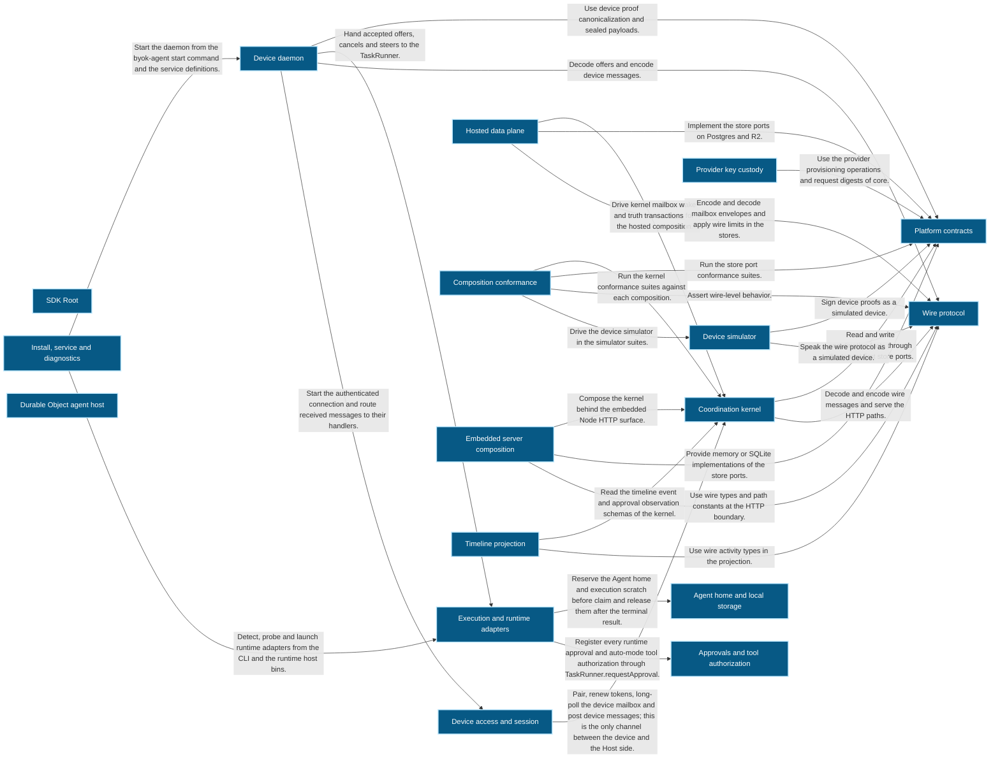
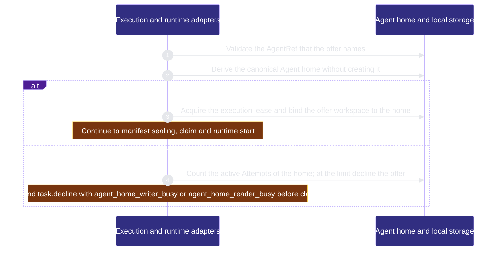

# sdk/sdk-root 架構文檔

<!-- BEGIN ARCHCONTEXT:generated target="projection_target.entity.capability-sdk-sdk-root" rendererVersion="archcontext.docs-renderer/v6" outputDigest="sha256:0dba605b7e8f28d02b4dd49e281971555437e3df14541484209a89e17907430c" -->
> **狀態**:`active`
> **Capability ID**:`capability.sdk.sdk-root`(kind `capability`)
> **Matched Prefixes**:`packages/**`
> **Local Contracts**:`packages/AGENTS.md`、`packages/CLAUDE.md`
> **事實優先級**:倉庫當前狀態 > 本文檔機器區 > 本文檔人工區。機器區(引言、§1、§2)由 ArchContext 從架構模型與源碼度量投影生成,手改會在下次投影被覆蓋。本文檔不記錄出處;本次投影所驗證的 commit 見 `docs/architecture/.projection-manifest.json`。

Owns the BYOK SDK workspace packages: the wire and store contracts, the coordination kernel, the Host compositions, the device daemon, key custody, the Durable Object host and the private conformance suites.

## 1. P1:能力架構地圖

### 1.1 架構圖

- Proof: `proven` (`sha256:802940b72d927499e32c950fcf8242cd2796ddf52ca2e7e55af285d2c29d8edd`).
- Semantic nodes: `17`; declared relations: `26`.

### 1.2 模組職責表

- 未宣告 `source.entrypoints`,入口清單無法從架構模型推導。

### 1.3 規模信號

- 規模量級:`2000–5000` 個文件 / `200k–500k` 行
- 匹配前綴:`packages/**`
- 推導:掃描 `source.include` 減 `source.exclude`,跳過 `.git/` 與 `node_modules/`,再按 1–2–5 階梯分桶。精確計數不入本文檔:量級足以回答「這個能力有多大」,而逐行計數會讓覆蓋範圍內任何一次源碼改動都改寫本文檔。

### 1.4 依賴邊界

出向關係:

- 無。

入向關係:

- 無。

## 2. P2:端到端數據流

> **Proof**: `proven` (`sha256:802940b72d927499e32c950fcf8242cd2796ddf52ca2e7e55af285d2c29d8edd`); selectors `4/4`.

<!-- END ARCHCONTEXT:generated target="projection_target.entity.capability-sdk-sdk-root" -->

## 3. P3:設計決策與不變量

The existing `packages/**` capability is retained as repository-level SDK ownership. It spans every workspace package under `packages/`: the nine published packages (the eight aligned train packages, including `@byok-sdk/cloud-do` and `@byok-sdk/ui-runtime`, and the credential plane `@byok-sdk/keys`, which uses the release train version from 0.28.2) and the private `@byok-sdk/conformance` and `@byok-sdk/testkit`. The `byok-sdk` umbrella package was retired in 0.21.0 (ADR-035). Package and runtime responsibilities remain documented in [the SDK architecture](../../sdk-architecture.md) and [the authority ADRs](../../adr-2026-09-03-domain-model-and-authority.md); this adoption does not repartition public packages.

The generated map is a representative local execution slice, not an exhaustive diagram of every SDK subsystem. `TaskRunner.handleOffer` calls the same-file AgentRef/decline helpers and the owned runtime-start wrapper. The helper component shares its source file with the orchestrator; it is not another service or admission implementation. The three selectors prove those direct calls and their declared branches. Dynamic adapter preparation/start, network delivery, persistence and model generation require their separate tests and runtime evidence.

`handleOffer` deduplicates an already-owned task, checks strict Agent identity, prepares the selected adapter, seals its manifest before claim, resolves input, then awaits owned startup. Invalid Agent identity is declined before startup. A startup timeout withdraws admission and retains disposal responsibility; it is not a quiescence receipt. At higher concurrency the real constraints remain runtime ownership, workspace leases and bounded task resources, rather than an additional execution state machine.

C07's proposed pre-Execution full-request preparation API remains a separate unimplemented contract. This flow begins after an SDK offer exists. The offline preparation/consume spike proves its controlled native request seam only; it does not authorize production budget configuration.

## 4. 歷史決策記錄(append-only)

### Cloud slice 4a (2026-10-03)

`packages/cloud-do` is a private Cloudflare deployment boundary under the existing
SDK root capability. ADR-035 preserves runtime boundaries and the nine published
artifacts: this host adds no published package or public client export. The client
retains its local replica admission/lock/reset/inspect path; only native pi Storage
construction is injectable. The DO adapter consumes portable pi SQLite and Harness
exports, with a type-only reference to the factory declaration; it does not import
the local client engine or environment. One named DO owns one Harness and creates
a new ownerless conversation for each execution. Its async SQL transaction queue
and pi-prefixed schema preserve native storage semantics. Configuration, tests,
runtime constraints and deferred 4b–4d responsibilities are documented in
[`packages/cloud-do/README.md`](../../../../packages/cloud-do/README.md).

The broader unmatched examples and ancestor capability coverage are intentional
repository ownership observations for separate architecture work; 4a does not
repartition them. Verification is the complete native pi conformance suite on
local SQLite and real workerd, execution isolation/restart and the root gates.

### cloud-do publication status note (2026-10-13)

The 4a entry above is stale on one point: `packages/cloud-do` is no longer a
private, unpublished boundary. Since the 0.24.0 train `@byok-sdk/cloud-do` is a
published package (`packages/cloud-do/package.json` has no `private` flag and sets
`publishConfig.access: public`; see `docs/releases/v0.24.0.md`). It stays
Cloudflare-only and platform-key-only (ADR-038 decision 4). The 4a description of
its runtime boundaries is otherwise unchanged.

## Optimization Backlog
