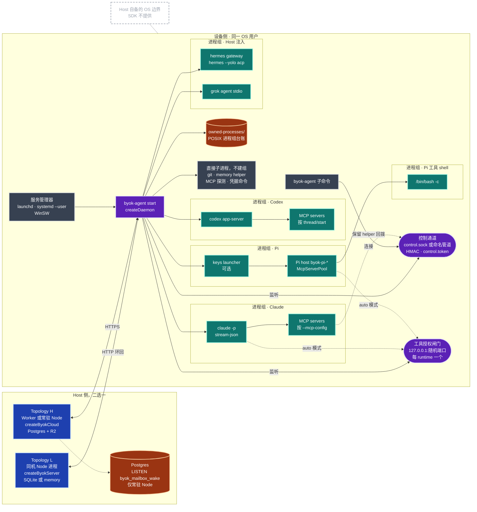
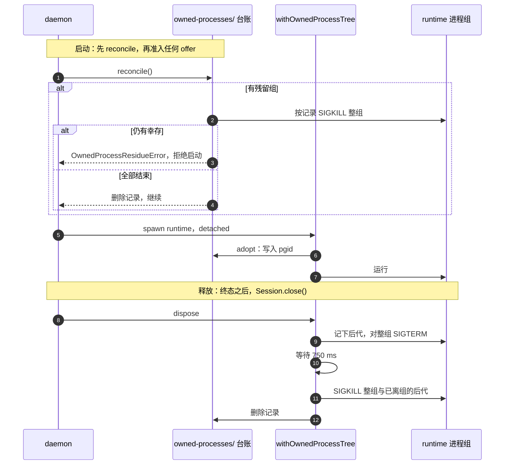
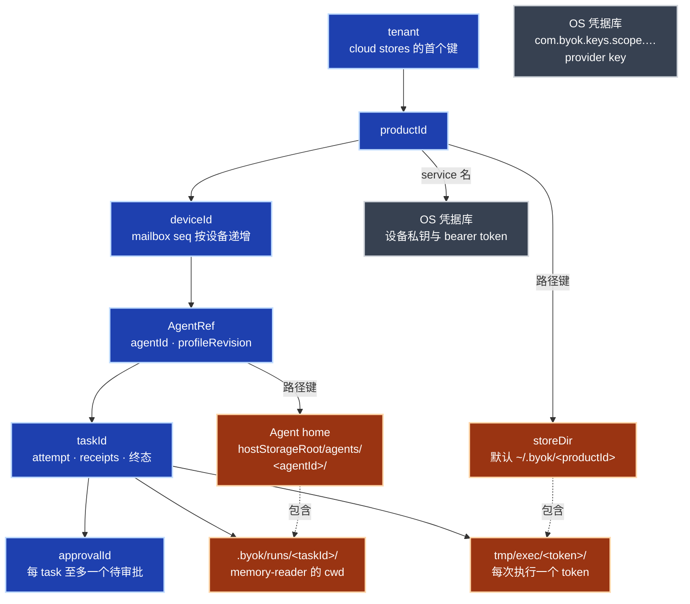
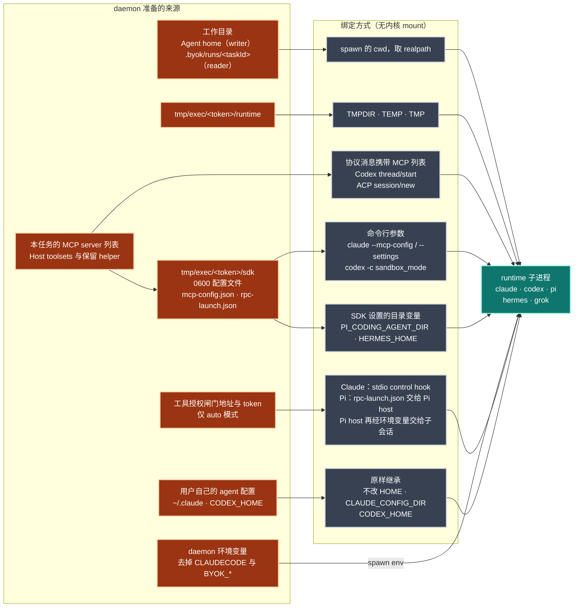
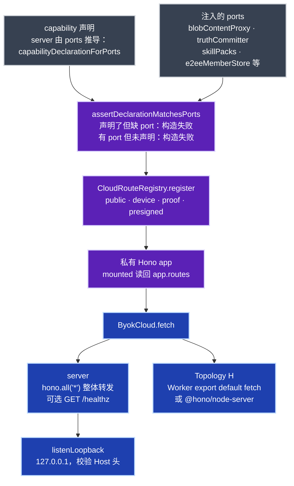

# 进程与命名空间拓扑 + 挂载层

> **定位**：审查视图。当前规范见[当前功能架构](current-architecture.md)；本页给出逐条证据与 Remarks。之后的修订以本页的文件历史为准。
> **核对基准**：commit `671309da`（2026-10-28）。文中 `path:line` 均指这一版，路径相对仓库根。
> **事实优先级**：源码 > `docs/spec.md` > 本文。本文是手写视图，ArchContext 不投影它。
> **配套**：[当前功能架构](current-architecture.md) · [总分层架构、模块与时序](layered-architecture.md) · [`host-runtime-isolation-matrix.md`](../host-runtime-isolation-matrix.md) · [`host-local-storage-layout.md`](../host-local-storage-layout.md) · [Architecture Index](index.md)
> **用途**：定位进程、身份与目录边界。`R-Tx` 指向本文 [Remarks](#remarks)，`R-Lx` 指向[分层文档的 Remarks](layered-architecture.md#remarks)。

本文的"命名空间"和"挂载"指代码里实际存在的三样东西：进程树与进程组；身份 keyspace 与目录树；daemon 交给每个 runtime 子进程的 cwd、环境变量和配置文件。SDK 不创建内核 namespace、bind mount、chroot 或容器，`packages/client` 与 `packages/keys` 里检索 `unshare`、`bwrap`、`sandbox-exec`、`landlock`、`chroot`、`seccomp` 均无结果，与 [`host-runtime-isolation-matrix.md`](../host-runtime-isolation-matrix.md) 一致。需要 OS 级隔离时由 Host 自己包一层。

术语：

- `storeDir`：一个 productId 的设备侧状态根，默认 `~/.byok/<productId>`。
- 长驻进程：daemon、Topology H 的常驻 Node Host；收到信号或服务管理器停止才退出。
- 每任务进程：runtime 根进程及其后代，任务释放时整组回收。

## 1. 进程拓扑



| 进程 | 生命周期 | 谁启动 | 证据 |
| --- | --- | --- | --- |
| Topology L Host | 长驻，内嵌 `createByokServer`；Host 自己把 handler 交给 `listenLoopback`，只绑 `127.0.0.1` 并校验 Host 头 | Host | `packages/server/src/loopback.ts:84` |
| Topology H Host | Worker 按请求；常驻 Node 另开一条 session 模式 Postgres 连接 `LISTEN` | Host | `packages/cloud-dataplane/src/mailbox-wake.ts:10-19,99` |
| daemon | 长驻；服务管理器的命令行是 `<node> <byok-agent> start --config <abs> --service` | launchd `gui/<uid>` LaunchAgent、systemd user unit、WinSW | `packages/client/src/lifecycle/service-types.ts:63`；`lifecycle/launchd.ts`、`systemd.ts`、`winsw.ts` |
| runtime 根进程 | 每任务；`detached: true`，各自成为进程组 leader | daemon | `packages/client/src/adapters/process-tree.ts:54-60` |
| keys launcher | 每任务，可选；以继承的 stdio 启动 Pi host。rpc 与 durable lane 的 provider key 走私有 IPC；prepared lane 不运行原生工具，key 经环境变量 `PI_PROVIDER_API_KEY` 交给它 | daemon | `packages/keys/src/pi-provider-launcher-core.ts:548-552,586-592` |
| durable Pi 工具 shell | 每次工具调用；`/bin/bash`（缺失时 `/bin/sh`）`-c`，`detached: true` | Pi host | `packages/client/src/adapters/pi-durable/shell.ts:28-32` |
| SDK 保留 MCP helper | 随 runtime；`byok-agent-message-mcp`、`-result-mcp`、`-memory-mcp`、`-team-mcp`，经控制通道回拨 daemon | runtime 当作 MCP server 拉起 | `packages/client/src/bin/sdk-reserved-helper-runners.ts:30-40,146-160` |
| 工具授权闸门 | 每 runtime 一个 loopback HTTP server，仅 `auto` 模式 | daemon 进程内 | `packages/client/src/tool-authorization-ipc.ts:74-103` |
| 直接子进程 | 短命，不建组 | daemon | git、memory helper、`daemon/mcp-tools-probe.ts`、`daemon/device-credential-store.ts` |

- **内置与注入**：`createDaemon` 只构建 pi、claude、codex（`packages/client/src/daemon/create-daemon/support.ts:288-292`）；Hermes 与 Grok 由 Host 经 `createDaemonWithAdapters` 加入。
- **控制通道**：POSIX 用 `<storeDir>/control.sock`，路径过长时退到 `/tmp/byok-<hash>/sock`（`packages/client/src/daemon/control-protocol.ts:119-121`）；Windows 用 `\\.\pipe\byok-<id>`（`:147`）；双方用 `control.token` 做 HMAC-SHA256 双向认证，token 本身不上线（`:180-193`）。能以 daemon 同一 OS 用户运行的进程都能读到这个 token，这是同用户信任边界（R-T2）。

## 2. 受监督执行协议

runtime 根进程的所有权由 `withOwnedProcessTree` 统一管理。POSIX 用进程组加台账，Windows 用 kill-on-close Job Object 加 `taskkill /T /F`。



- 默认宽限 750 ms（`packages/client/src/adapters/process-tree.ts:8`）；SIGTERM 前先记下根进程的后代，包括已经离开进程组的，直到它们也收到 SIGKILL（同文件 `:19`、`:503`）。
- 台账目录 `owned-processes/`（`packages/client/src/daemon/owned-process-ledger.ts:36`）；`reconcile` 有幸存者就抛错（`:98-106`），daemon 在准入之前调用它（`packages/client/src/daemon/create-daemon/start-run.ts:40-44`）。Windows 不写台账，Job Object 已经结束它们。
- Windows 释放以 `taskkill /T /F` 报告遍历到的 pid 集合判断是否静止，不看退出码（`packages/client/src/adapters/process-tree.ts:17`；`adapters/taskkill-pid-set.ts`；`adapters/win32-job-object.ts`）。

## 3. 命名空间拓扑



storeDir 的内容（Agent home 的布局见 [`host-local-storage-layout.md`](../host-local-storage-layout.md)）：

```text
<storeDir>/                        默认 ~/.byok/<productId>
  device.json                      enrollment 的非秘密投影；私钥与 token 在 OS 凭据库
  cursor-<hash>.json               已落盘的 mailbox cursor
  daemon.db                        本机 journal（SQLite）
  control.sock  control.token      控制通道与 HMAC 密钥
  mutex.sock  daemon-owner.json    单 daemon 所有权
  owned-processes/                 POSIX 进程组台账
  skill-packs/<name>/<hash>/       skill pack 安装根
  tmp/exec/<token>/sdk/            SDK 写给 runtime 的配置，释放即删
  tmp/exec/<token>/runtime/        子进程的 TMPDIR，由 retention 清理
```

| 名字空间 | 规则 | 证据 |
| --- | --- | --- |
| storeDir | `DeviceStore.resolveDir(productId, config.storeDir)`，默认 `~/.byok/<productId>`。同一 productId 的 daemon 与 CLI 共用，`mutex.sock` 与 `daemon-owner.json` 保证只有一个 daemon 持有它。 | `packages/client/src/daemon/store.ts:210,222`；`packages/client/src/daemon/daemon-owner.ts:12,92` |
| cursor 与 journal | `cursor-<key>.json` 按 server 与 device 分键；journal 是单库 `daemon.db`。 | `packages/client/src/daemon/cursor-store.ts:32`；`packages/client/src/daemon/journal/sqlite-journal.ts:69` |
| 执行 scratch | 每次执行一个 12 位十六进制 token；`sdk/` 释放即删，`runtime/` 写 `released` 标记后由 retention 清理；路径放不下 Unix socket 时改到 `/tmp/byok-scratch-<hash>`（macOS `/private/tmp`）。 | `packages/client/src/daemon/retention/scratch.ts:28,60,158-187` |
| Agent home | `hostStorageRoot/agents/<agentId>/`；`.byok/` 是其中唯一的 SDK 保留区，路径由 SDK 拼接并拒绝 symlink 与越界。 | `packages/client/src/agent-home.ts:27-28` |
| 设备凭据 | 设备私钥与 bearer token 整条存在 OS 凭据库：macOS `/usr/bin/security`，Linux `secret-tool`，Windows 经 PowerShell 编译的 credential bridge。 | `packages/client/src/daemon/device-credential-store.ts:71-76,331,344` |
| provider key | 由 `@byok-sdk/keys` 存放，service 名形如 `com.byok.keys.scope.acct_<hash>.<name>`。 | `packages/keys/src/secret-name.ts`、`secret-scope.ts` |
| approvalId | 每个 task 同时至多派发一个，其余在 daemon 内排队；cloud 侧由 timeline 尾部折叠出当前槽。 | `packages/client/src/daemon/task-runner/approvals.ts:25-46`；`packages/cloud/src/approval-control.ts:14-35` |

## 4. 挂载层

### 4.1 设备侧：runtime 子进程看到什么



| runtime | 启动命令（节选） | MCP server 由谁拉起 | 权限相关参数 | `auto` 工具授权 |
| --- | --- | --- | --- | --- |
| Claude，内置 | `claude -p --input-format stream-json --output-format stream-json --verbose --include-partial-messages` | claude 按 `--mcp-config` 文件拉起 | 默认 `--dangerously-skip-permissions`；Host 开启 native interactions 时改为 `--permission-prompt-tool stdio --permission-mode acceptEdits` | 支持，PreToolUse hook 走 stdio control |
| Codex，内置 | `codex app-server -c sandbox_mode=… --listen stdio://` | codex 按 `thread/start` / `thread/resume` 的 `mcp_servers` 拉起 | `approvalPolicy` 默认 `never`；`sandbox_mode` 默认 `danger-full-access`，`codexSandbox: 'inherit'` 时不覆盖 | 不支持，`auto` 会被 decline |
| Pi，内置 | Pi host bin，可经 `byok-pi-provider-launcher` 启动 | Pi host 的 `McpServerPool`，配置在 `sdk/rpc-launch.json` | 预信任会话 cwd | 只在普通 `pi-rpc` lane 支持，loopback IPC；prepared offer 与 durable lane 在准入时以 `tool_authorization_unsupported` decline（durable 的 descriptor 不声明 `toolAuthorizationAuto`，启动时的检查只是兜底） |
| Hermes，Host 注入 | `hermes gateway run --quiet --external-supervisor --force` 与 `hermes --yolo acp` | Hermes 按 ACP `session/new` 的 `mcpServers` 拉起 | `--yolo` | 不支持 |
| Grok，Host 注入 | `grok agent --always-approve --no-leader stdio` | Grok 按 ACP `session/new` 的 `mcpServers` 拉起 | `--always-approve` | 不支持 |

出处：`packages/client/src/adapters/claude/claude-adapter.ts:128-139,344-366`；`packages/client/src/adapters/codex/codex-adapter.ts:49-65,236,271`；`packages/client/vendor/oar/51b83c9/runtimes/codex/app-server-client.ts:110`；`packages/client/vendor/oar/51b83c9/runtimes/codex/open.ts:112,137`；`packages/client/src/adapters/pi/pi-adapter.ts:227,436-440,525-555`；`packages/client/src/adapters/hermes/hermes-adapter.ts:100,335,346`；`packages/client/vendor/oar/51b83c9/runtimes/grok/session.ts:144`；`auto` 准入见 `packages/client/src/daemon/task-runner/offer-launch.ts:61`。

- **环境变量**：`buildRuntimeEnv` 继承 daemon 的完整环境，只去掉 `CLAUDECODE` 与 `BYOK_*`（`packages/client/src/daemon/environment.ts:1-11,102-103,154`），再叠加 scratch 的 `TMPDIR`、`TEMP`、`TMP`（`packages/client/src/daemon/retention/scratch.ts:187`）。环境里的 provider key 等秘密会传到 agent 子进程（R-T1）。窄 allowlist `buildAllowlistedEnv` 用在 durable Pi 工具 shell、Pi 受控目录 lane，以及经 launcher 或 custody 的 Hermes（`adapters/pi-durable/environment.ts:7`；`adapters/pi/runtime-launch.ts:93`；`adapters/hermes/hermes-adapter.ts:228,262,325`；R-T4）。
- **目录变量**：`PI_CODING_AGENT_DIR` 只在经 keys launcher 时指向 launcher 的投影目录（`packages/keys/src/pi-provider-launcher-core.ts:396`）；`HERMES_HOME` 指向每次运行新建的 profile `<Hermes home>/profiles/byok-<id>`（`packages/client/src/adapters/hermes/hermes-home.ts:98-104`；`hermes-adapter.ts:100`）。
- **Claude 的 `agentUserContext: 'excluded'`**：只对 Agent 任务生效，加 `--strict-mcp-config` 与 `--settings <sdk>/claude-settings.json`，排除 Agent home 之外的 `CLAUDE.md` 和 auto memory（`packages/client/src/adapters/claude/claude-adapter.ts:105-106,297-314`；`adapters/claude/agent-user-context.ts:17`）。
- **skill packs** 只装到 `<dataDir>/skill-packs/<name>/<hash>/`，由 Host 调 `projectSkillPack` 复制到它选的目录；SDK 不替 runtime 决定技能目录（`packages/client/src/daemon/skill-pack-installer.ts:20-32,72`）。

### 4.2 Host 侧：按能力声明挂载 HTTP 路由



| 路由组 | 路径 | 挂载条件 | 凭据类别 |
| --- | --- | --- | --- |
| 配对与认证 | `POST /byok/pair`、`/byok/challenge`、`/byok/token` | 总是挂载；可选限流 | public |
| 能力声明 | `GET /byok/capabilities` | 总是挂载 | public |
| 回执 | `PUT /byok/agent-home-projections/:requestId/completion`；`PUT`、`GET /byok/input-preparations/:requestId…` | 总是挂载 | device |
| 投递 | `GET /byok/events` | `events.longpoll` | device |
| 回传 | `POST /byok/messages` | `messages.batch` | device |
| board | `GET /byok/board`、`POST /byok/board/:id/{claim,unclaim,status}`；`GET /byok/board/stream` | `board.coordination`，stream 另需 `board.sse` | device |
| presence 与 activity | `PUT /byok/presence`、`POST /byok/activity` | `presence.hints`、`activity.tail` | device |
| truth records | `GET /byok/records`、`GET`、`PUT /byok/records/:kind/:key` | `truth.records` 加 truth ports | proof |
| E2EE | 写：`POST /byok/e2ee/{member-key,chain,key-packages}`；读：`GET /byok/e2ee/{chain,key-packages,pairing-mac}` | `e2ee.member` 加 store | 写 proof，读 device |
| skill packs | `GET /byok/skill-packs`、`GET /byok/skill-packs/:name/files/:path` | `skills.pack` 加 store | device |
| blobs | `POST /byok/blobs`、`POST /byok/blobs/:id/finalize`、`GET /byok/blobs/:id/url` | `blobs.presigned` | device |
| blob 内容代理 | `PUT`、`GET /byok/blobs/:id/content` | `blobs.contentproxy` 加 `blobContentProxy` | presigned |
| Agent memory 投影 | `POST /byok/agent-memory-projections` | `agent.memory.projection` 加 store 与 authorizer | device |

- 路由表在 `packages/cloud/src/cloud.ts:1077-1340`，登记与读回在 `packages/cloud/src/router/registry.ts:50-81`。Host 的控制面操作（取消、审批、steer 等）没有 HTTP 路由，是 `ByokCloud` 上的方法（`cloud.ts:1341-1345`）。
- 能力声明与 ports 双向校验（`packages/cloud/src/cloud.ts:2485`）：声明了能力却缺它的 port，错误码 `capability_over_declared`；传了 port 却没声明它的能力，错误码 `capability_port_undeclared`，错误信息列出每个多传的 port 与对应能力。能力与 port 的对应表是 `CAPABILITY_PORTS`（`packages/cloud/src/capabilities.ts:164`）。
- `createByokServer` 只传 `blobContentProxy`，声明由 `capabilityDeclarationForPorts` 按传入的 ports 推导（`packages/server/src/index.ts:410,419`），所以只含标准能力与 `blobs.contentproxy`，不含 `truth.records`、`skills.pack`、`agent.memory.projection`、`host-mcp-task-context`、`e2ee.member`。内嵌 server 不再传 `e2eeMemberStore`，也不再有 E2EE 存储：Topology L 走本机回环，端到端加密不增加安全性（R-L3，#1096）。SQLite 组合里的 `proof_request_receipt` 由独立的 `SqliteProofRequestReceiptStore` 与 `SqliteProofReceiptRetentionAuthority` 承担（`packages/server/src/stores/sqlite/proof-receipts.ts`；`stores/sqlite/index.ts:1430,1438`）。

<a id="capability-ports-migration"></a>

**迁移（#1096，breaking）**：`createByokCloud` 收到没声明能力的 port 时构造失败（`capability_port_undeclared`），不再静默不挂载。Host 要么在声明里加上该能力，要么不再传这个 port；暂停某个能力也是不传它的 port。`createInMemoryByokCloud` 的默认声明改为由它持有的 ports 推导。0.31.x 的 SQLite 文件里遗留的 `e2ee_*` 表不再被读写，可以留着；`SqliteSchemaErrorCode` 去掉了只由 E2EE KEM floor 检查产生的 `SQLITE_MIGRATION_REFUSED`。
- server 把整个 cloud app 挂成兜底路由，不逐条重新声明（`packages/server/src/index.ts:440-449`）。

## Remarks

按级别排序，含义同[分层文档](layered-architecture.md#remarks)。各条已立项，由 [#1093](https://github.com/Ancienttwo/byok-sdk/issues/1093) 及其子 issue 跟踪，见最后一列。

| ID | 级别 | 问题 | 证据 | 方向与跟踪 |
| --- | --- | --- | --- | --- |
| R-T1 | 高 | 默认环境是完整继承：除 `CLAUDECODE` 与 `BYOK_*` 外，daemon 环境里的变量都会进入 agent 子进程及其 MCP server。继承本身是有意的（ADR-037 D2：用户自己的 agent 读自己的凭据），问题在于 daemon 内嵌在 Host 进程里时，Host 自己放进 `process.env` 的变量也被当成用户的一并传过去；Host 直接构造的 adapter 也不受 `DaemonConfig` 约束。 | `packages/client/src/daemon/environment.ts:1-14,100-103`；`packages/client/src/lifecycle/service-environment.ts:1-30` | 环境策略落到 adapter 层；基底改为登录 shell 环境的快照，`allowlist` 作为可选的严格模式（Q2'，owner 2026-10-29 批准）。[#1095](https://github.com/Ancienttwo/byok-sdk/issues/1095)。 |
| R-T2 | 中 | 设备侧的本地认证（`control.token`、工具授权闸门 token）只防跨用户，不防同用户进程；闸门 token 还经环境变量传给 Pi 的子会话。控制通道的 `approvals.resolve` 不区分审批种类，同用户进程能以本地来源批准 `auto` 闸门登记的工具授权审批，审计记录显示为本机批准。 | `packages/client/src/daemon/control-server.ts:549`；`packages/client/src/daemon/create-daemon/control-methods.ts:189-199`；`packages/client/src/daemon/approvals.ts:29-34,115`；`packages/client/src/tool-authorization-ipc.ts:5-17` | `auto` 不是沙箱，这仍在威胁模型之内（`packages/client/src/tool-authorization.ts:6-11`），但工具授权的批准应只认 Host：[#1101](https://github.com/Ancienttwo/byok-sdk/issues/1101)。闸门 token 改为文件传递：[#1095](https://github.com/Ancienttwo/byok-sdk/issues/1095)。两者写进 [`security.md`](../security.md)。 |
| R-T3 | 中 | `auto` 工具授权只有 Claude 与普通 Pi RPC lane 支持。Codex、Hermes、Grok、durable Pi 与 prepared offer 收到 `auto` 都在准入时 decline（durable Pi 的 descriptor 把 `toolAuthorizationAuto` 设为 false，启动时的检查只是兜底）。wire 上的 runtime 能力不含这一项，Host 派工前看不到；CLI 路径设不了 resolver，总是 `all`。 | `packages/client/src/daemon/task-runner/offer-launch.ts:61-66`；`packages/client/src/adapters/pi/pi-adapter.ts:243,436-440`；`packages/client/src/adapters/claude/claude-adapter.ts:166`；`packages/protocol/src/messages.ts:87-94` | 公开 `toolAuthorizationAuto`，resolver 输入带 `autoSupported`：[#1061](https://github.com/Ancienttwo/byok-sdk/issues/1061)；扩成按 runtime × lane 的能力矩阵：[#1103](https://github.com/Ancienttwo/byok-sdk/issues/1103)；CLI 路径的静态 `toolAuthorization`：[#1094](https://github.com/Ancienttwo/byok-sdk/issues/1094)。 |
| R-T4 | 低 | `environment.ts` 的文件头说 `buildAllowlistedEnv` "只有两个 Pi lane 使用"，实际 Hermes 在 launcher 或 custody 下也用它。 | `packages/client/src/daemon/environment.ts:13-14`；`packages/client/src/adapters/hermes/hermes-adapter.ts:228,262,325`；`adapters/hermes/hermes-custody.ts:38` | 更新注释。[#1095](https://github.com/Ancienttwo/byok-sdk/issues/1095) 第 1 步。 |
| R-T5 | 中 | 下游的安装与配置没有契约。CLI 只校验 `productName`、`productId`、`serverUrl`，`DaemonConfig` 其余 36 个字段原样透传。`toolAuthorization` 是函数，adapter 的隔离选项只能在构造 adapter 时设置，所以 CLI 路径既设不了 `auto`，也设不了隔离。OS 凭据库的服务名只由 productId 派生，同一 productId 的第二个 `storeDir` 会读到前一个的配对。两个下游因此各自写了配置组装、目录布局与 adapter 构造。 | `packages/client/src/bin/config.ts:14,40-67`；`packages/client/src/daemon/create-daemon/support.ts:285-294`；`packages/client/src/daemon/device-credential-store.ts:221-225` | SDK 提供下游指引、配置 schema、`config check`（含生效值）、布局 helper，以及 CLI 路径的 `runtimes` 配置块和静态 `toolAuthorization`。[#1094](https://github.com/Ancienttwo/byok-sdk/issues/1094)。 |
| R-T6 | 中 | 服务与升级只在 CLI 路径上有，而且不完整：服务管理器追加写日志，从不轮转；store 格式只能单向升级（server SQLite v6 既不接受旧文件也不接受新文件，client journal 的旧格式要人工处理），只换回旧二进制回不到旧状态。内嵌 Host 只能自己写服务注册、payload 切换与回滚。 | `packages/client/src/lifecycle/launchd.ts:87-91`；`packages/server/src/stores/sqlite/index.ts:237-239,1391`；`packages/client/src/daemon/journal/sqlite-journal.ts:417` | 服务单元、升级（含 store 兼容预检与快照）、日志轮转、运维操作做成 CLI 与内嵌共用的库 API：[#1097](https://github.com/Ancienttwo/byok-sdk/issues/1097)；store 兼容预检与 Host 可见变更清单：[#1102](https://github.com/Ancienttwo/byok-sdk/issues/1102)。 |
