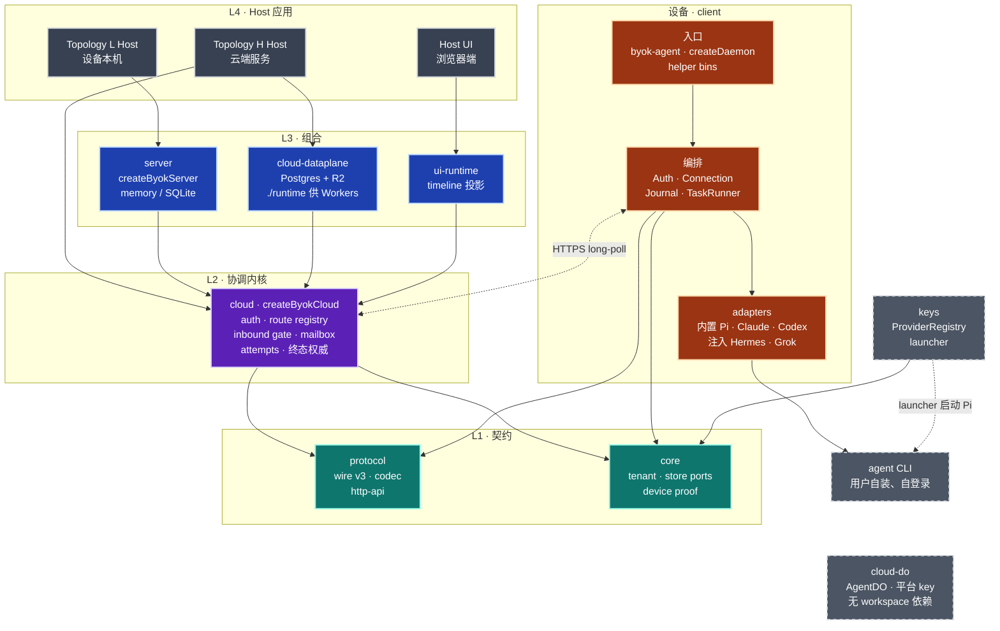
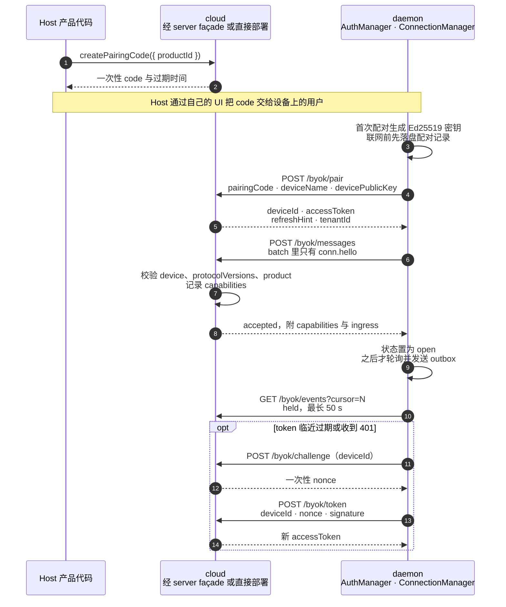
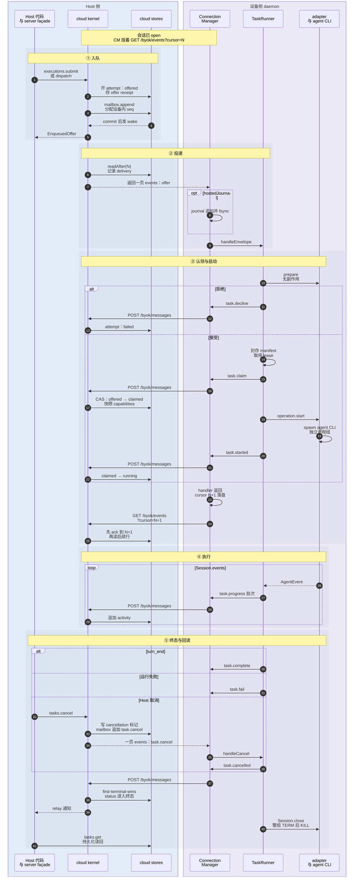
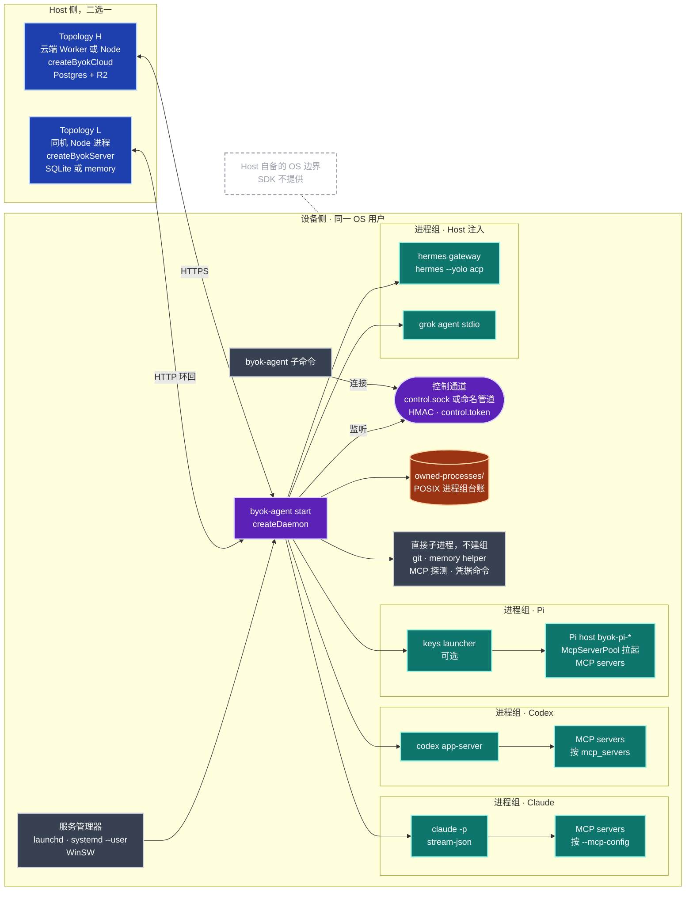
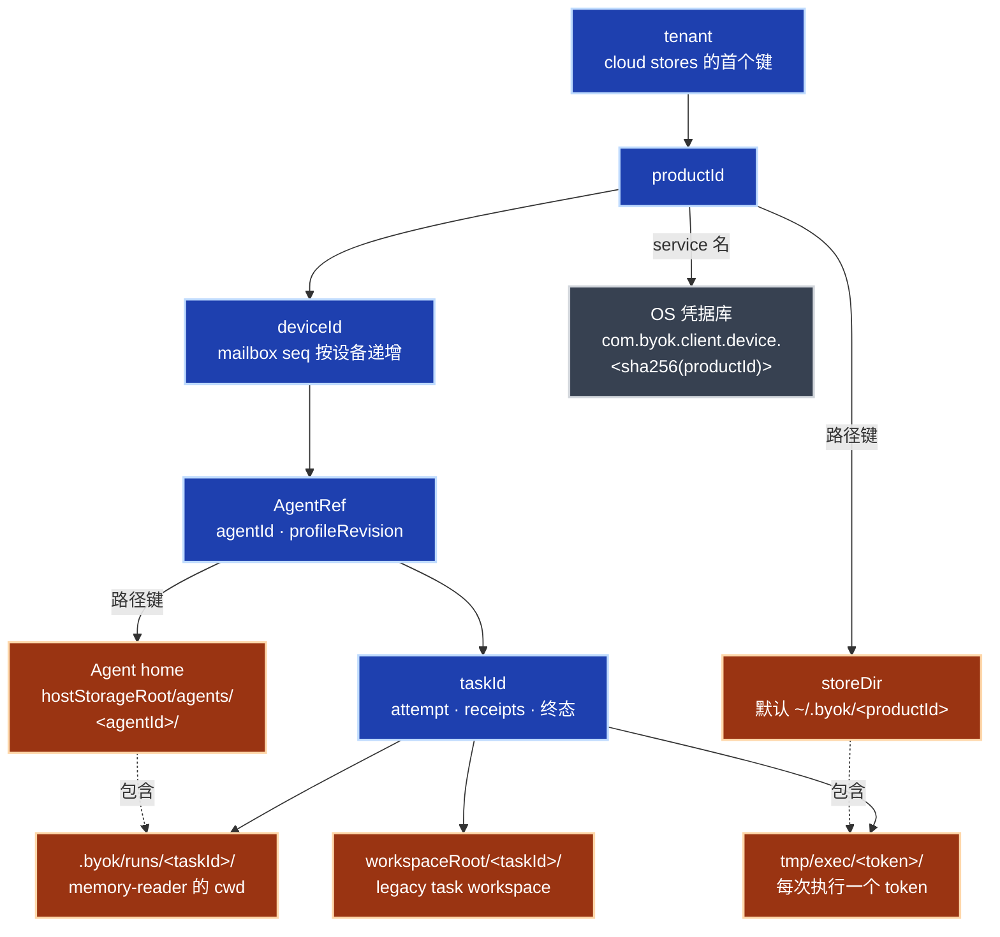
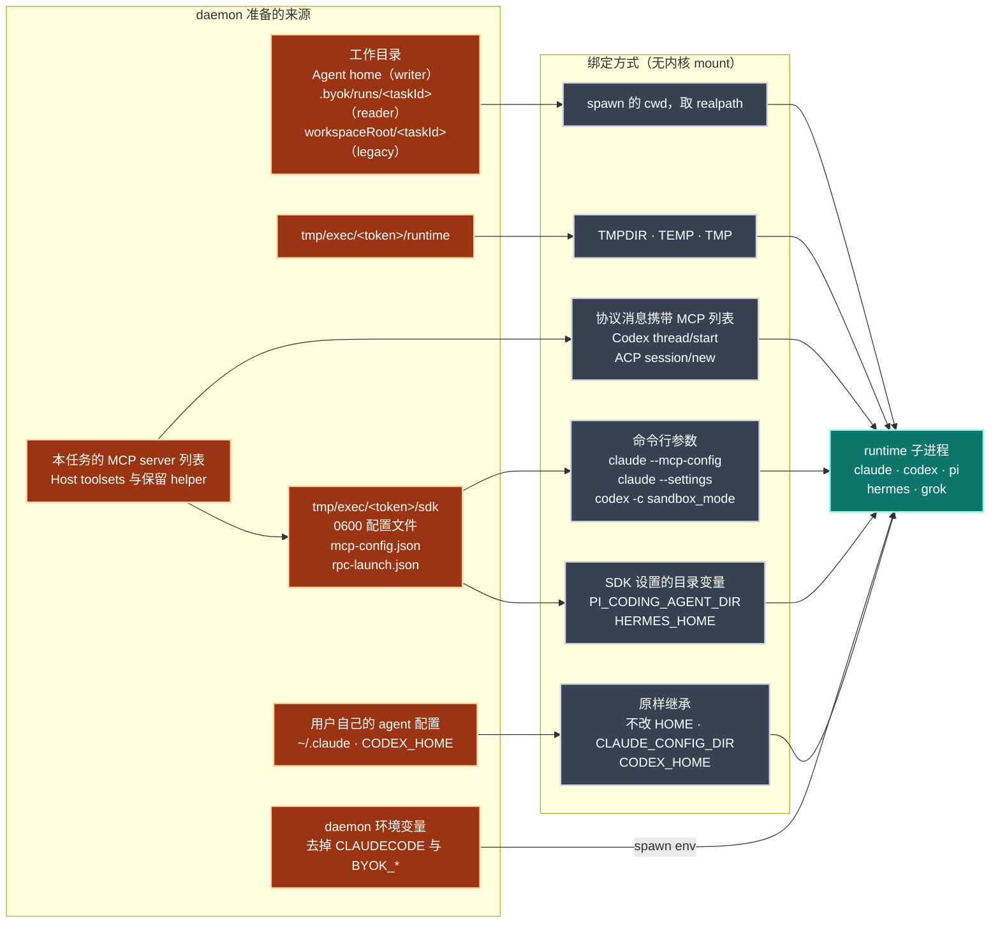
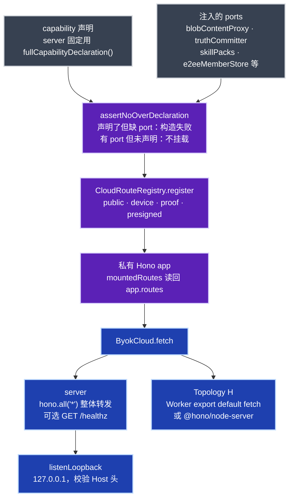

# BYOK SDK 系统图

> 状态：CURRENT，人工绘制；每个节点和边都对照过源码。
> 核对基准：commit `142acbe2`（2026-10-24）。文中 `path:line` 均指这一版，路径相对仓库根。
> 与 [`sdk-architecture.md`](sdk-architecture.md) 不一致时以源码为准，已知差异由 #927 跟踪。
> 图例：实线箭头表示运行时 import 或调用；虚线表示进程边界、网络边界或可选路径；虚线框是 SDK 不提供、需要 Host 自备的部分。图中 package 名省略 `@byok-sdk/` 前缀。

## 1. 分层架构图

Host 侧分四层，L1 契约层同时被设备侧使用。设备侧 `client` 只 import `core` 与 `protocol`，和 Host 侧之间只有 HTTP long-poll 一条通道。`keys` 与 `cloud-do` 不在派工主链路上。L4 的参考实现在 `examples/`：Topology L 见 `host-execution-core`、`basic`，Topology H 见 `hosted-bot-collaboration`，Host UI 见 `live-activity-host`。



图里省略了 L3 对 L1 的直接 import：`server` 与 `cloud-dataplane` 都直接用 `core` 和 `protocol`，`ui-runtime` 直接用 `protocol`。下表是完整的运行时依赖，不含测试文件，每条边都有值导入（不只是 `import type`）。

| 层 | package | workspace 运行时依赖 | 主要入口 |
| --- | --- | --- | --- |
| L1 | `@byok-sdk/protocol` | 无 | `PROTOCOL_VERSION = 3`（`packages/protocol/src/version.ts:35`）；`encodeEnvelope` / `decodeEnvelope` / `parseMessage`（`packages/protocol/src/codec.ts`）；`BYOK_*_PATH`（`packages/protocol/src/http-api.ts:464-550`） |
| L1 | `@byok-sdk/core` | 无，只依赖 `zod` | store ports `CoreStores`（`packages/core/src/stores.ts`）；`createInMemoryCoreStores`（`packages/core/src/in-memory/index.ts:45`） |
| L2 | `@byok-sdk/cloud` | core、protocol | `createByokCloud`（`packages/cloud/src/cloud.ts:1023`）；`createInMemoryByokCloud`（`packages/cloud/src/composition/in-memory.ts:106`） |
| L3 | `@byok-sdk/server` | cloud、core、protocol | `createByokServer`（`packages/server/src/index.ts:327`）；`listenLoopback`（`packages/server/src/loopback.ts:84`） |
| L3 | `@byok-sdk/cloud-dataplane` | cloud、core、protocol | `./runtime` 导出 `createPostgresCloudStores`、`createPostgresCoreStores` 与 R2 stores；根入口另有 `migrate`、`createPostgresMailboxWake` 等 Node-only 能力（`packages/cloud-dataplane/src/index.ts:31-94`） |
| L3 | `@byok-sdk/ui-runtime` | cloud、protocol | `projectTimeline`、`replayTimeline`（`packages/ui-runtime/src/timeline.ts:366,379`） |
| 设备 | `@byok-sdk/client` | core、protocol | `createDaemon`（`packages/client/src/daemon/create-daemon.ts:4801`）；`createDaemonWithAdapters`（同文件 `:1308`）；`byok-agent` 等 8 个 bin |
| 旁路 | `@byok-sdk/keys` | core | `ProviderRegistry`（`packages/keys/src/registry.ts:184`）；`byok-pi-provider-launcher` |
| 旁路 | `@byok-sdk/cloud-do` | 无 | `AgentDO`（`packages/cloud-do/src/agent-do.ts:78`） |
| 私有 | `@byok-sdk/conformance` | cloud、core、protocol、testkit | `run*Conformance`（`packages/conformance/src/index.ts`） |
| 私有 | `@byok-sdk/testkit` | core、protocol | `createDeviceSimulator`（`packages/testkit/src/index.ts`） |

只在测试里出现的边：`client → server`、`cloud-do → keys`、`server → conformance`、`cloud-dataplane → conformance`，都声明为 devDependency。

## 2. 时序图

### 2.1 配对与建连



- `conn.hello` 必须是会话的第一条消息，这个顺序由 client 保证：hello 单独 POST，被接受后才开始轮询和发送（`packages/client/src/daemon/connection-manager.ts:282-327`）。cloud 把 hello 当作幂等的能力快照，不检查先后（`packages/cloud/src/inbound.ts:598-611`）。
- `/byok/pair` 已经返回 accessToken（`packages/cloud/src/handlers/auth.ts:47-58`）。challenge 与 token 只用于续期和 401 之后的重新认证（`packages/client/src/daemon/auth-manager.ts:266-337`）。

### 2.2 派工到终态

主线是新的 Agent 执行 `executions.submit`。`dispatch()` 的几种 offer 走同一条下游链路，只是入队的 wire 类型不同：

| Host 入口 | wire 类型 |
| --- | --- |
| `executions.submit(input)` | `task.offer_for_agent_with_egress_fresh` |
| `dispatch(input)` | `task.offer` |
| `dispatch(input)`，带 `requiredToolsets` | `task.offer_with_toolsets` |
| `dispatch(input)`，带 `agentRef` 与 `sessionRef`，只用于 resume | `task.offer_for_agent`；再带 `egressPolicy` 时是 `task.offer_for_agent_with_egress` |

入口见 `packages/server/src/index.ts:537-701`、`:807-826`，入队见 `packages/cloud/src/cloud.ts:1354-1482`、`:2339-2447`。



- **参与者 H** 合并了 Host 代码与 server façade（relay、TaskHandle）。Topology H 的 Host 直接调用 `ByokCloud` 上对应的 `submitAgentExecution`、`cancelTask`、`readTaskResult`（`packages/cloud/src/cloud.ts:2339`、`:2721`、`:2827`）。
- **ack 时机**：cursor 只在 handler 成功返回并原子落盘后前进，下一次 GET 才携带它；cloud 读取之前先 `advanceCursor`（`packages/cloud/src/handlers/events.ts:136-147`，`packages/client/src/daemon/connection-manager.ts:758-815`）。配置了 `hostedJournal` 时，offer 在 handler 里先 fsync 进 SQLite journal（`packages/client/src/daemon/create-daemon.ts:3127-3139`），没配置时没有这一步。handler 失败时 cursor 不动，mailbox 重投同一行。
- **offer handler 不等任务结束**：`task.started` 发出、事件泵启动后就返回（`packages/client/src/daemon/task-runner.ts:3254-3280`），所以 ack 发生在执行期间。
- **批量上限**：progress 由 `ProgressBatcher` 成批发送；每次 POST 最多 256 条、2 MiB（`packages/protocol/src/http-api.ts:269-272`）。
- **终态内容**：`task.complete` 带 summary、finalMessage、sessionRef 与 usage。`task.fail` 带 reason、retryable 与 `failure`；runtime 失败时三者由 adapter 的 `RuntimeExecutionFailure` 投影而来（`packages/client/src/runtime-failure.ts:162-188`），daemon 自己判定的失败带 `{ class: 'unknown' }`（`packages/client/src/daemon/task-failure.ts:4`）。`failure` 是封闭的失败类别，`resetsAt` 只出现在 `quota` 上（`packages/protocol/src/messages.ts:1292-1295`）；只有声明了 `runtime-failure-class` 的 server 才会收到它（`packages/protocol/src/wire-additions.ts:154`）。
- **`Session.close()` 在终态发出之后执行**：它挡住的是本地 lease、workspace 与 task 记录的释放，wire 终态不等它（`packages/client/src/daemon/task-runner.ts:5598-5710`）。
- **终态裁决**：cloud 以第一条设备终态为准；attempt 上有 Host 的 cancellation 标记时，结果记为 `cancelled`（`packages/cloud/src/inbound.ts:987-1074`）。
- **steer**：`TaskHandle.steer(text)` 调 `cloud.steerTask`，只有 status 为 running、且 claim 时快照的 `capabilities.steer` 为 true，才会入队 `task.steer`（`packages/cloud/src/cloud.ts:1847-1929`）。

## 3. 进程与命名空间拓扑 + 挂载层

本节的命名空间和挂载对应代码里实际存在的三样东西：进程树与进程组；身份 keyspace 与目录树；daemon 交给每个 runtime 子进程的 cwd、环境变量和配置文件。SDK 不创建内核 namespace、bind mount、chroot 或容器，`packages/client` 与 `packages/keys` 里检索 `unshare`、`bwrap`、`sandbox-exec`、`landlock`、`chroot`、`seccomp` 均无结果，与 [`host-runtime-isolation-matrix.md`](../host-runtime-isolation-matrix.md) 一致。需要 OS 级隔离时由 Host 自己包一层。

### 3.1 进程拓扑



- **Host 侧**：Topology L 的 Host 进程内嵌 `createByokServer`，用 `listenLoopback` 在 `127.0.0.1` 上服务 daemon（`packages/server/src/loopback.ts:84`）。Topology H 的 Host 以 `cloud.fetch` 挂在 Worker 或 Node 上；常驻 Node 进程另开一条 session 模式的 Postgres 连接 `LISTEN byok_mailbox_wake`，Worker 没有这条连接，用进程内 wake 加可配置的兜底间隔重读，默认 5 秒（`packages/cloud-dataplane/src/mailbox-wake.ts:61-108`，`deploy/sql/0024_mailbox_wake.sql`，`packages/cloud/src/stores/in-memory/mailbox-wake.ts:4`）。
- **进程组**：daemon 指向各进程组的边都是 detached spawn。runtime 根进程经 `withOwnedProcessTree` 以 `detached: true` 启动，各自成为进程组 leader（`packages/client/src/adapters/process-tree.ts:57-62`）；释放时先对整组 SIGTERM，750 ms 后 SIGKILL（`process-tree.ts:750-821`）。Windows 不建进程组，改用 kill-on-close Job Object 和 `taskkill /T /F`，也不写台账（`packages/client/src/adapters/win32-job-object.ts`）。
- **台账**：POSIX 下 adopt 时把 pgid 写进 `<storeDir>/owned-processes/`（`packages/client/src/daemon/owned-process-ledger.ts:36,78-91`）。daemon 启动先 reconcile 台账，清掉崩溃遗留的进程组，有组杀不掉就拒绝启动（`packages/client/src/daemon/create-daemon.ts:2164`，`owned-process-ledger.ts:98-108`）。
- **Pi**：配置了 keys launcher 时 daemon 先起 launcher，launcher 以继承的 stdio 加 IPC 启动 Pi host，provider key 走 IPC（`packages/keys/src/pi-provider-launcher-core.ts:584-592`）；没配置时 daemon 直接 spawn Pi host。durable Pi 的工具 shell 由 Pi host 以 `/bin/bash -c` 另起一个进程组（`packages/client/src/adapters/pi-durable/shell.ts:32`）。
- **控制通道**：POSIX 用 `<storeDir>/control.sock`，路径超过 100 字节时退到 `/tmp/byok-<hash>/sock`；Windows 用 `\\.\pipe\byok-<hash>`；双方用 `control.token` 做 HMAC-SHA256 双向认证，token 本身不上线（`packages/client/src/daemon/control-protocol.ts:117-188`）。能以 daemon 同一 OS 用户运行的进程都能读到这个 token，这是同用户信任边界。
- **SDK 保留的 MCP helper**（`byok-agent-message-mcp`、`-result-mcp`、`-memory-mcp`、`-team-mcp`）由 runtime 当作 MCP server 拉起，再经控制通道回拨 daemon（`packages/client/src/bin/sdk-reserved-helper-runners.ts:30-60`）。
- **内置与注入**：`createDaemon` 只构建 pi、claude、codex（`packages/client/src/daemon/create-daemon.ts:1226-1237`）；Hermes 与 Grok 由 Host 通过 `createDaemonWithAdapters` 加入。
- **服务管理器**启动的命令行是 `<node> <byok-agent> start --config <abs> --service`（`packages/client/src/lifecycle/service-types.ts:60-66`）；launchd 用 `gui/<uid>` 下的 LaunchAgent，systemd 用 user unit（`lifecycle/launchd.ts`、`lifecycle/systemd.ts`、`lifecycle/winsw.ts`）。

### 3.2 命名空间



storeDir 的内容（Agent home 的布局见 [`host-local-storage-layout.md`](../host-local-storage-layout.md)）：

```text
<storeDir>/                        默认 ~/.byok/<productId>
  device.json                      enrollment 的非秘密投影；私钥与 token 在 OS 凭据库
  cursor-<hash>.json               已落盘的 mailbox cursor
  daemon.db                        hostedJournal（SQLite），可选
  control.sock  control.token      控制通道与 HMAC 密钥
  mutex.sock  daemon-owner.json    单 daemon 所有权
  owned-processes/                 POSIX 进程组台账
  session-workspaces.json          sessionRef 到 workspace 的映射
  git-workspaces.json              Git checkpoint 私有台账
  skill-packs/<name>/<hash>/       skill pack 安装根，默认在 storeDir
  tmp/exec/<token>/sdk/            SDK 写给 runtime 的配置，释放即删
  tmp/exec/<token>/runtime/        子进程的 TMPDIR，由 retention 清理
```

- **storeDir** 由 `DeviceStore.resolveDir(productId, config.storeDir)` 决定，默认 `~/.byok/<productId>`（`packages/client/src/daemon/store.ts:208-219`）。同一 productId 的 daemon 与 CLI 共用这一个目录，`mutex.sock` 与 `daemon-owner.json` 保证只有一个 daemon 持有它（`packages/client/src/daemon/daemon-owner.ts`）。
- **执行 scratch**：每次执行一个 12 位十六进制 token。`sdk/` 放 SDK 写给 runtime 的配置，释放即删；`runtime/` 是子进程的临时目录，带 `released` 标记后由 retention 清理（`packages/client/src/daemon/retention/scratch.ts:160-187`）。路径过长、放不下 Unix socket 时，scratch 根改到系统 tmp 下的 `byok-scratch-<hash>`（`scratch.ts:50-61`）。
- **Agent home**：`.byok/` 是 Agent home 里唯一的 SDK 保留区，路径由 SDK 拼接并拒绝 symlink 与越界（`packages/client/src/agent-home.ts:28,326,390-398`）。布局细节见 [`host-local-storage-layout.md`](../host-local-storage-layout.md)。
- **凭据库**：设备私钥与 bearer token 整条存在 OS 凭据库，`device.json` 只是它的非秘密投影（`packages/client/src/daemon/store.ts:26-30,176-180`）。macOS 走 `/usr/bin/security`，Linux 走 `secret-tool`，Windows 走 PowerShell 编译的 credential bridge（`packages/client/src/daemon/device-credential-store.ts:221-226,342-360`）。provider key 由 `@byok-sdk/keys` 存放，service 名形如 `com.byok.keys.scope.acct_<hash>.<name>`，规则见 `packages/keys/src/secret-name.ts` 与 `secret-scope.ts`。

### 3.3 挂载层

#### 设备侧：runtime 子进程看到什么



| runtime | 启动命令（节选） | MCP server 由谁拉起 | SDK 传入的权限相关参数 |
| --- | --- | --- | --- |
| Claude，内置 | `claude -p --input-format stream-json --output-format stream-json --verbose` | claude 按 `--mcp-config` 文件拉起，cwd 与会话相同 | 默认 `--dangerously-skip-permissions`；Host 开启 native interactions 时改为 `--permission-prompt-tool stdio --permission-mode acceptEdits` |
| Codex，内置 | `codex app-server -c sandbox_mode=… --listen stdio://` | codex 按 `thread/start` 的 `mcp_servers` 拉起 | `approvalPolicy: never`；`sandbox_mode` 默认 `danger-full-access`，`codexSandbox: 'inherit'` 时不覆盖 |
| Pi，内置 | Pi host bin，可经 `byok-pi-provider-launcher` 启动 | Pi host 的 `McpServerPool`，配置在 `sdk/rpc-launch.json` | 预信任会话 cwd |
| Hermes，Host 注入 | `hermes gateway run --quiet --external-supervisor --force` 与 `hermes --yolo acp` | Hermes 按 ACP `session/new` 的 `mcpServers` 拉起 | `--yolo` |
| Grok，Host 注入 | `grok agent --always-approve --no-leader stdio` | Grok 按 ACP `session/new` 的 `mcpServers` 拉起 | `--always-approve` |

出处：`packages/client/src/adapters/claude/claude-adapter.ts:274-344`，`packages/client/src/adapters/codex/codex-adapter.ts:245-247`，`packages/client/vendor/oar/c88a514/runtimes/codex/app-server-client.ts:110`，`packages/client/src/adapters/pi/pi-adapter.ts:501-527`，`packages/client/src/adapters/hermes/hermes-adapter.ts:332,343`，`packages/client/vendor/oar/c88a514/runtimes/grok/session.ts:144`。

- **环境变量**：`buildRuntimeEnv` 继承 daemon 的完整环境，只去掉 `CLAUDECODE` 与 `BYOK_*`（`packages/client/src/daemon/environment.ts:101-104`），再叠加 scratch 的 `TMPDIR`、`TEMP`、`TMP`（`packages/client/src/daemon/task-runner.ts:3592`）。provider key 等环境里的秘密会传到 agent 子进程。Pi prepared lane、durable 工具 shell 与经 launcher 的 Hermes 改用窄 allowlist（`buildAllowlistedEnv`）。
- **目录变量**：`PI_CODING_AGENT_DIR` 只在经 keys launcher 时由 SDK 指向 `sdk/` 下新建的空目录；`HERMES_HOME` 指向 Host 提供的 Hermes home（`packages/client/src/adapters/hermes/hermes-adapter.ts:93-100`）。
- **Claude 的 `agentUserContext: 'excluded'`**：只对 Agent 任务生效，加 `--strict-mcp-config` 与 `--settings <sdk>/claude-settings.json`，排除 Agent home 之外的 `CLAUDE.md` 和 auto memory（`packages/client/src/adapters/claude/agent-user-context.ts`）。`createDaemon` 不设这个选项，默认是 `inherit`。
- **skill packs** 只装到 `<dataDir>/skill-packs/<name>/<hash>/`，由 Host 调 `projectSkillPack` 复制到它选的目录；SDK 不替 runtime 决定技能目录（`packages/client/src/daemon/skill-pack-installer.ts:20-32,653-670`）。

#### Host 侧：按能力声明挂载 HTTP 路由



| 路由组 | 路径 | 挂载条件 | 凭据类别 |
| --- | --- | --- | --- |
| 配对与认证 | `POST /byok/pair`、`/byok/challenge`、`/byok/token` | 总是挂载 | public |
| 能力声明 | `GET /byok/capabilities` | 总是挂载 | public |
| 回执 | `PUT /byok/agent-home-projections/:requestId/completion`；`PUT`、`GET /byok/input-preparations/:requestId…` | 总是挂载 | device |
| 投递 | `GET /byok/events` | `events.longpoll` | device |
| 回传 | `POST /byok/messages` | `messages.batch` | device |
| board | `GET /byok/board`、`POST /byok/board/:id/{claim,unclaim,status}`；`GET /byok/board/stream` | `board.coordination`，stream 另需 `board.sse` | device |
| presence 与 activity | `PUT /byok/presence`、`POST /byok/activity` | `presence.hints`、`activity.tail` | device |
| blobs | `POST /byok/blobs`、`POST /byok/blobs/:id/finalize`、`GET /byok/blobs/:id/url` | `blobs.presigned` | device |
| blob 内容代理 | `PUT`、`GET /byok/blobs/:id/content` | `blobs.contentproxy` 加 `blobContentProxy` | presigned |
| truth records | `GET /byok/records`、`GET`、`PUT /byok/records/:kind/:key` | `truth.records` 加 truth ports | proof |
| E2EE | 写：`POST /byok/e2ee/{member-key,chain,key-packages}`；读：`GET /byok/e2ee/{chain,key-packages,pairing-mac}` | `e2ee.member` 加 store | 写 proof，读 device |
| skill packs | `GET /byok/skill-packs`、`GET /byok/skill-packs/:name/files/:path` | `skills.pack` 加 store | device |
| Agent memory 投影 | `POST /byok/agent-memory-projections` | `agent.memory.projection` 加 store 与 authorizer | device |

- 路由表在 `packages/cloud/src/cloud.ts:1066-1337`，登记与读回在 `packages/cloud/src/router/registry.ts:49-81`。Host 的控制面操作（取消、审批、steer 等）没有 HTTP 路由，是 `ByokCloud` 上的方法。
- `createByokServer` 用不带参数的 `fullCapabilityDeclaration()`（`packages/server/src/index.ts:379`），这个默认声明不含 `truth.records`、`skills.pack`、`agent.memory.projection`、`e2ee.member`（`packages/cloud/src/capabilities.ts:150-170`），所以内嵌 server 不挂这四组路由，即便它传入了 `e2eeMemberStore`。
- server 把整个 cloud app 挂成兜底路由，不逐条重新声明（`packages/server/src/index.ts:400-410`）。`listenLoopback` 不由 `createByokServer` 调用，Host 自己把 handler 交给它。

## 4. 与 sdk-architecture.md 的已知差异

`sdk-architecture.md` 与源码不一致的地方列在 #927 中，修正也在那里跟踪，本文不另列清单。
