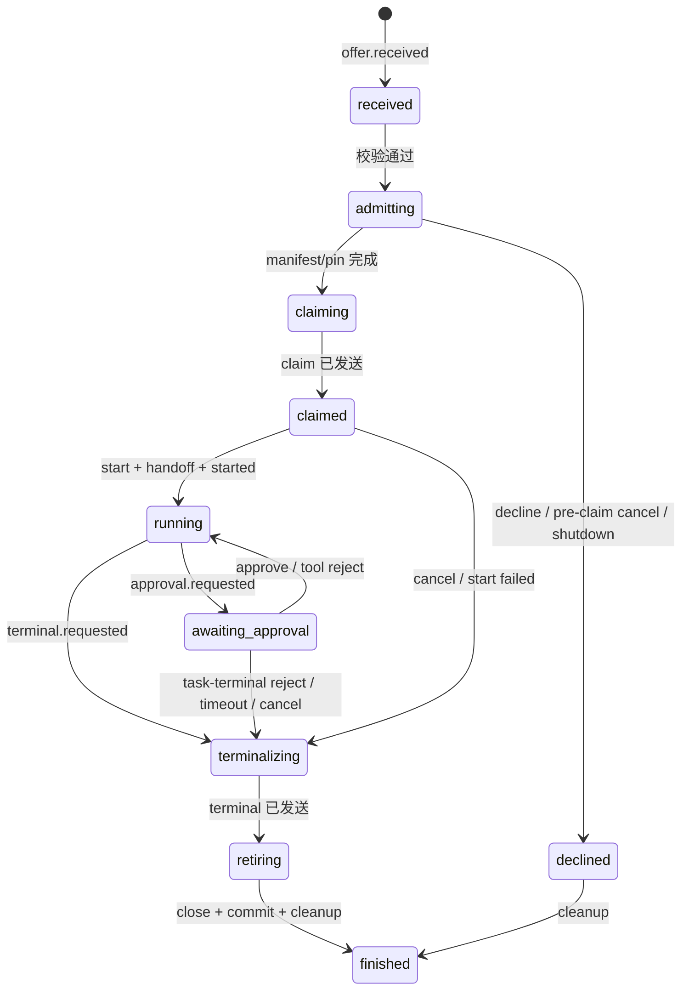

# #1099 TaskRunner 纯 reducer 设计

状态：design-only，decision-complete。基线 `579711ce9`（`origin/main`，2026-10-31）。本文件只写设计与迁移契约，不含实现代码；不改 `packages/`、`api-surface/`、`scripts/architecture/dependency-baseline.json`、`docs/spec.md` 或测试。文中 `path:line` 相对仓库根，指上述基线。

- 父 issue：[#1093](https://github.com/Ancienttwo/byok-sdk/issues/1093)（P2）。
- 目标 issue：[#1099](https://github.com/Ancienttwo/byok-sdk/issues/1099)。
- 已合入前置切片：[#1205](https://github.com/Ancienttwo/byok-sdk/pull/1205)（3 条目录逆层边）、[#1211](https://github.com/Ancienttwo/byok-sdk/pull/1211)（剩余 6 条目录逆层边）。当前 baseline 43 条 = 34 条 TaskRunner 环内边 + 8 条 diagnostics/bin 环内边 + 1 条 manifest 缺口。
- 范围：15 文件 SCC 的实际边与职责、State/Event/Effect 形状、逐行转移表、IO 边界与顺序保证、6 个可独立合并的迁移切片、验收矩阵、风险与非目标。
- 非目标：不把子进程、网络、文件系统、timer、Promise、Session、lease 放进 reducer；不重写 TaskRunner 公共 API；不改 wire 语义；不新增公开 package/entry；不清理 diagnostics/bin 环；不改 journal 格式。

## 0. 结论摘要

| ID | 决定 | 状态 |
| --- | --- | --- |
| D1 | SCC 实际是 15 文件、34 条边。其中 7 条是阶段文件回指 `task-runner.ts` 的**常量导入**，其余 27 条是前向或阶段间边。把常量移到叶子模块后 SCC 整体消失，baseline 的 34 条环内边全部失效（43 → 9）。 | 提议 |
| D2 | reducer 放在一个纯模块 `daemon/task-runner/state.ts`：常量、State/Event/Effect 类型、数据行转移表、`reduce()`。IO 执行器放在 `daemon/task-runner/host.ts`，用模块级 `WeakMap<TaskRunner, Host>` 持有，不新增 TaskRunner 私有字段/方法。 | 提议 |
| D3 | State 是 JSON 可序列化、深度冻结、每任务 O(1) 大小的纯数据；不包含进程、timer、fs、网络、Promise、Session、lease、outbox、batcher、正文、schema。 | 提议 |
| D4 | Event 在边界处冻结；所有时间戳、UUID、approvalId、requestId、terminalToken、generation 由执行器注入，reducer 不读 `Date.now()`、`Math.random()`、`crypto`。 | 提议 |
| D5 | Effect 是描述对象，带 ordering class（`atomic` / `barrier` / `bestEffort`）和 `requires` 谓词。执行器按任务串行、按返回顺序执行；`atomic` 组不可被新事件抢占。 | 提议 |
| D6 | first-terminal-wins 在 reducer 内**同步**完成：第一个 `terminal.requested` 立即写入 `terminal.token`，之后所有终态请求只审计不改写；重试复用同一 token 和同一份 envelope 字节。 | 提议 |
| D7 | claim 边界固定为 `task.claim` 的发送：发送前 cancel 走 `task.decline`（`cancelled before claim`），发送后 cancel 走 `task.cancelled`；start 成功但激活前已 cancel 时绝不发 `task.started`（checkpoint 2）。 | 提议 |
| D8 | 审批保持“同时只有一个 dispatched、FIFO 最多 16、finish 先 drain 队列再 fail-closed 当前项、本地裁决先发 `task.approval_resolved` 再 resolve 请求 promise”。 | 提议 |
| D9 | 迁移分 6 个切片：S1 纯 reducer + 表契约测试；S2 常量下沉、SCC 清零（唯一改 baseline 的切片）；S3 offer/准入；S4 claim/started/cancel 竞态；S5 approval；S6 terminal/finish/shutdown。 | 提议 |
| D10 | 现有 23 个 `task-runner-*.test.ts` 与 `handle-offer-characterization`、`daemon-task-loop`、`agent-message-completion-gate`、`journal-*`、`outbound-settlement` 等作为等价性 oracle；切片不改这些测试的断言。 | 提议 |

待 owner 决定项见 §12，其中 OD1（S2 一次删除 34 条 baseline）、OD2（api-surface golden 允许新增内部 section）、OD6（当前会抛出的基础设施失败是否保持原样）会直接影响切片边界。

## 1. 当前 15 文件 SCC

### 1.1 统计口径

与 `layered-architecture.md` §2 / §3.1 一致：AST 值导入；`import type` 与类型位置的 `import('…').T` 不计；公开入口的纯 re-export 不计。`packages/client/src/daemon/task-runner/` 下实际有 **16** 个阶段文件，其中 **14** 个在 SCC 内；`agent-message.ts` 与 `offer-admission-timing.ts` 不在 SCC：

- `agent-message.ts` 只被 `task-runner.ts` 单向依赖（`task-runner.ts:76`），自身只以 `import type` 取 `TaskRunner`（`:8`），没有回边。
- `offer-admission-timing.ts` 只导入 `@byok-sdk/protocol`，是叶子。

SCC = `task-runner.ts` + 14 个阶段文件：`agent-memory`、`approvals`、`event-pump`、`finish`、`lifecycle`、`mcp-contexts`、`offer`、`offer-activation`、`offer-admission`、`offer-launch`、`offer-runtime`、`offer-workspace`、`support`、`terminal-evidence`。

### 1.2 34 条边

下表按 baseline 的 34 条 `cycle:` 条目逐条列出；“值符号”只列触发值边的符号，行号指该阶段文件的导入行。类型导入不构成边，但同一条 `import` 里混有值符号时按值边计。

| # | 从 | 到 | 值符号 / 行 | 方向 |
| --- | --- | --- | --- | --- |
| 1 | `task-runner.ts` | `task-runner/agent-memory.ts` | `activeMemoryContext`, `runMemoryOperation`, `quiesceAndSnapshotAgentMemory`, `bindAgentMemoryFilesystem`（`:78`） | 前向 |
| 2 | `task-runner.ts` | `task-runner/approvals.ts` | `requestApproval`, `dispatchApproval`, `handleApprove`, `handleReject`（`:82`） | 前向 |
| 3 | `task-runner.ts` | `task-runner/event-pump.ts` | `pump`, `publishSuccessfulCompletion`, `sendArtifact`, `reportArtifactError`（`:85`） | 前向 |
| 4 | `task-runner.ts` | `task-runner/finish.ts` | `fail`, `failClaimedAgent`, `homeFinalizations`, `finishOnce`, `publishExecutionRecord`, `settleSemanticTerminal`, `releasePreparationPin`（`:84`） | 前向 |
| 5 | `task-runner.ts` | `task-runner/lifecycle.ts` | `stopAcceptingOffers`, `closeActiveSession`, `awaitActiveSessionClose`, `interruptBounded`, `teardownActiveTask`, `shutdownTask`, `armMaxDurationTimer`, `handleCancel`, `evictPendingCancelled`, `handleSteer`（`:79`） | 前向 |
| 6 | `task-runner.ts` | `task-runner/mcp-contexts.ts` | `withAgentMessageMcp`, `withAgentResultMcp`, `withAgentMemoryMcp`, `withHostToolsetContext`, `resolveMcpServers`（`:77`） | 前向 |
| 7 | `task-runner.ts` | `task-runner/offer-admission.ts` | `admitOffer`, `reserveOfferHome`, `admitOfferLimits`, `handleSealedOffer`, `declineSealedOffer`, `declineOfferMissingCapabilities`（`:80`） | 前向 |
| 8 | `task-runner.ts` | `task-runner/offer-runtime.ts` | `prepareOfferRuntime`, `pickAdapter`（`:81`） | 前向 |
| 9 | `task-runner.ts` | `task-runner/offer.ts` | `handleOffer`（`:86`） | 前向 |
| 10 | `task-runner.ts` | `task-runner/support.ts` | `offerSettlements`, `trackOffer`（`:75`） | 前向 |
| 11 | `task-runner.ts` | `task-runner/terminal-evidence.ts` | `terminalInferenceUsagePayload`, `preparedObservationPayload`, `agentTerminalPayload`, `resolveStagedResult`, `persistAgentTerminalEvidence`, `measureReaderMemoryChange`, `retryAgentTerminalEvidence`, `reportAgentTerminalEvidenceFailure`（`:83`） | 前向 |
| 12 | `agent-memory.ts` | `support.ts` | `errorMessage`（`:6`） | 阶段间 |
| 13 | `approvals.ts` | `task-runner.ts` | `DEFAULT_APPROVAL_TIMEOUT_MS`, `MAX_PENDING_APPROVALS_PER_TASK`（`:9`） | 回指 |
| 14 | `event-pump.ts` | `task-runner.ts` | `ACTIVITY_INGRESS_EXCEEDED_REASON_PREFIX`, `MAX_OUTPUT_BYTES_EXCEEDED_REASON_PREFIX`, `PREPARED_USAGE_UNAVAILABLE_REASON_PREFIX`（`:14`） | 回指 |
| 15 | `event-pump.ts` | `support.ts` | `MAX_INLINE_ARTIFACT_BYTES`, `observePreparedCall`, `closingReply`, `errorMessage`, `estimateEventBytes`, `openArtifact`, `NO_SEALED_SPILL`, `observeTerminalUsage`（`:12`） | 阶段间 |
| 16 | `finish.ts` | `support.ts` | `executionTerminalOf`, `errorMessage`（`:8`） | 阶段间 |
| 17 | `lifecycle.ts` | `task-runner.ts` | `DEFAULT_SHUTDOWN_INTERRUPT_TIMEOUT_MS`, `MAX_DURATION_EXCEEDED_REASON_PREFIX`, `MAX_TRACKED_TASK_IDS`（`:11`） | 回指 |
| 18 | `lifecycle.ts` | `support.ts` | `raceSettleFirst`（`:9`） | 阶段间 |
| 19 | `mcp-contexts.ts` | `task-runner.ts` | `HOST_TOOLSET_CONTEXT_ENV`（`:11`） | 回指 |
| 20 | `mcp-contexts.ts` | `support.ts` | `freshHostToolsetContextToken`（`:9`） | 阶段间 |
| 21 | `offer-activation.ts` | `support.ts` | `outboundErrorMessage`（`:9`） | 阶段间 |
| 22 | `offer-admission.ts` | `support.ts` | `settledOrWithdrawn`, `outboundErrorMessage`（`:7`） | 阶段间 |
| 23 | `offer-launch.ts` | `task-runner.ts` | `DEFAULT_APPROVAL_TIMEOUT_MS`（`:29`） | 回指 |
| 24 | `offer-launch.ts` | `approvals.ts` | `requestApproval as requestTaskApproval`（`:1`） | 阶段间 |
| 25 | `offer-launch.ts` | `offer-activation.ts` | `activateOffer`（`:26`） | 阶段间 |
| 26 | `offer-launch.ts` | `support.ts` | `isKnownRuntimeId`, `offeredInstruction`, `errorMessage`（`:22`） | 阶段间 |
| 27 | `offer-runtime.ts` | `support.ts` | `isKnownRuntimeId`, `DEFAULT_RUNTIME_PREFERENCE`, `orderByPreference`, `adapterSupportsMcpToolsets`, `runtimeTaskInput`, `errorMessage`, `outboundErrorMessage`（`:12`） | 阶段间 |
| 28 | `offer-workspace.ts` | `support.ts` | `errorMessage`, `outboundErrorMessage`（`:7`） | 阶段间 |
| 29 | `offer.ts` | `offer-launch.ts` | `sealOfferManifest`, `claimOffer`, `startOfferRuntime`（`:11`） | 阶段间 |
| 30 | `offer.ts` | `offer-workspace.ts` | `bindOfferWorkspace`（`:10`） | 阶段间 |
| 31 | `offer.ts` | `support.ts` | `offeredPreparation`, `sameEgressPolicy`, `offeredAgentRef`, `offeredSessionRef`, `offeredHomeAccess`, `errorMessage`, `outboundErrorMessage`（`:7`） | 阶段间 |
| 32 | `support.ts` | `task-runner.ts` | `PREPARED_CONTEXT_OVERFLOW_REASON_PREFIX`, `PREPARED_USAGE_UNAVAILABLE_REASON_PREFIX`（`:32`） | 回指 |
| 33 | `terminal-evidence.ts` | `task-runner.ts` | `AGENT_TERMINAL_EVIDENCE_MAX_ATTEMPTS`, `RESULT_NOT_SUBMITTED_REASON_PREFIX`, `RESULT_UNREADABLE_REASON_PREFIX`（`:15`） | 回指 |
| 34 | `terminal-evidence.ts` | `support.ts` | `AGENT_TERMINAL_EVIDENCE_RETRY_DELAY_MS`, `isKnownRuntimeId`, `terminalUsageNumber`, `errorMessage`（`:13`） | 阶段间 |

### 1.3 职责分类

“reducer 候选”只表示该文件的哪些判断应变成纯转移；不表示整文件迁入 reducer。IO 列写的是该文件真正接触的边界。

| 文件 | 行数 | 职责 | reducer 候选 | IO / timer / 子进程 |
| --- | --- | --- | --- | --- |
| `task-runner.ts` | 1896 | 类门面、依赖、全部状态 Map/Set、模块常量、`handleEnvelope` 入口、~45 个一行委托 | 全局状态、dedup/停止接单、终态仲裁入口 | 无直接 IO；全部经阶段函数 |
| `support.ts` | 741 | `ActiveTask` 等类型；offer 投影、错误脱敏、`raceSettleFirst`、字节估算、token 铸造、artifact 打开 | `ActiveTask` 中可序列化的生命周期字段 | `fs.open`（`:646`）、`randomBytes`（`:704`）、WeakMap（`:725`） |
| `offer.ts` | 322 | `handleOffer` 的准入流水线编排 | 阶段顺序、checkpoint、decline 优先级 | 通过阶段 effects；自身无 fs/net |
| `offer-admission.ts` | 263 | 收单前置判定：pre-cancel、home 预留、设备上限、maxTokens、harness/toolsets | 纯 guard 与 decline 映射 | `canonicalHomePath`、lease 计数、等待（`:88`, `:101`, `:110`） |
| `offer-runtime.ts` | 283 | adapter 选择、环境、scratch、MCP 探测、`prepare()` | 只把 `PickResult`/decline 映射成转移 | 子进程探测、环境快照、scratch、MCP 握手 |
| `offer-workspace.ts` | 159 | Agent home lease、session handoff 匹配、reader run、outbox/result store | 只把错误映射成 decline | fs/lease/handoff/outbox |
| `offer-launch.ts` | 527 | manifest 封存、prepared 比较/pin、claim、instruction、start | claim 边界、start 失败/取消分支 | journal、pin、claim send、spawn、session |
| `offer-activation.ts` | 214 | 构造 `ActiveTask`、handoff、message 激活、checkpoint 2、started、注册、arm、pump | checkpoint 2、started/注册、激活失败 | handoff 持久化、outbox、batcher、timer、pump |
| `event-pump.ts` | 389 | 单一事件流循环、进度/usage/artifact、turn_end、失败投影 | turn_end/stream_end/resource/terminal 请求 | 事件流、spill 上传、artifact fs、batcher |
| `approvals.ts` | 178 | 审批请求/派发/裁决/超时/撤回 | pending/queue/FIFO/终态拒绝 | 注册表、timer、send、Promise resolver |
| `lifecycle.ts` | 211 | stop accepting、close、interrupt、teardown、cancel、steer、maxDuration timer | cancel 分阶段、shutdown 终态、steer guard | session、timer、fs/scratch 释放 |
| `finish.ts` | 265 | fail/failClaimedAgent、finishOnce、first-terminal-wins、清理 | 终态选择、finish 幂等、清理顺序 | close/commit/lease/pin/memory/handoff |
| `terminal-evidence.ts` | 206 | 终态 payload、staged result、handoff evidence、重试 | 只把 evidence 结果映射成终态字段 | handoff store、fs、timer 重试 |
| `agent-memory.ts` | 113 | memory context 校验、MCP 文件系统、quiesce snapshot | 无；上下文授权不迁入 | helper 子进程、fs、MCP |
| `mcp-contexts.ts` | 193 | SDK 保留 MCP server 与 context token、host toolset nonce | 无；token 注册表留在 side table | UUID、config、token 注册表 |
| `agent-message.ts`* | 264 | outbox/result store、消息 disposition、completion gate | completion gate 的 accepted/refused 转移 | outbox/result store、timer、send |
| `offer-admission-timing.ts`* | 36 | 准入计时类型/常量 | 无 | 无 |

`*` 表示不在 15 文件 SCC 内。

按职责再归一次类：**纯状态转移**集中在 `offer.ts` 的阶段顺序、`offer-admission.ts` 的 guard、`approvals.ts` 的 pending/queue、`finish.ts` 的终态仲裁、`offer-activation.ts` 的 checkpoint 2，以及 `task-runner.ts` 的 Map/Set 判定；**IO/定时器/子进程**集中在 `offer-runtime.ts`、`offer-workspace.ts`、`offer-launch.ts`、`offer-activation.ts`、`event-pump.ts`、`lifecycle.ts`、`terminal-evidence.ts`、`agent-memory.ts`；**常量/类型**是 `support.ts` 的类型与纯 helper、`mcp-contexts.ts` 的 token/config、`offer-admission-timing.ts`，以及门面里的模块常量。reducer 只吸收第一类，后两类保持原位置或降为 host side table。

### 1.4 环的真正成因

7 条回指边全部只导入 `task-runner.ts` 的模块常量，没有一条导入类或运行时状态：

| 回指文件 | 导入的常量 |
| --- | --- |
| `approvals.ts:9` | `DEFAULT_APPROVAL_TIMEOUT_MS`, `MAX_PENDING_APPROVALS_PER_TASK` |
| `event-pump.ts:14` | 三个 reason 前缀 |
| `lifecycle.ts:11` | `DEFAULT_SHUTDOWN_INTERRUPT_TIMEOUT_MS`, `MAX_DURATION_EXCEEDED_REASON_PREFIX`, `MAX_TRACKED_TASK_IDS` |
| `mcp-contexts.ts:11` | `HOST_TOOLSET_CONTEXT_ENV` |
| `offer-launch.ts:29` | `DEFAULT_APPROVAL_TIMEOUT_MS` |
| `support.ts:32` | 两个 prepared reason 前缀 |
| `terminal-evidence.ts:15` | `AGENT_TERMINAL_EVIDENCE_MAX_ATTEMPTS`, 两个 result reason 前缀 |

结论：**SCC 的成因不是状态耦合，而是常量住在了门面文件里。** 把常量下沉到叶子模块（S2）就足以让 15 文件 SCC 消失；34 条 baseline 环内边会全部变成 stale，必须同时删除。这也说明 reducer 不是“拆环”的唯一手段，但它是让阶段文件**以后不再需要回指门面**的结构性约束：转移数据、状态类型、常量都住在叶子 `state.ts`，阶段文件没有理由再 import `task-runner.ts`。

### 1.5 现有隐式状态机

把 `task-runner.ts` 的 Map/Set、`ActiveTask` 标志位、`StartupOwnership`、审批队列和 `semanticTerminal` 合起来看，实际状态如下（内部阶段，不等同于 wire 的 7 个 `TaskState`）：



wire 语义仍是 `packages/protocol/src/task-state.ts:29-37`：`Offered → Claimed/Cancelled/Failed`、`Claimed → Running/Failed/Cancelled`、`Running ↔ AwaitApproval`、三个终态无出边。内部多出的 `received/claiming/terminalizing/retiring/declined` 只用于把“已发 decline”“已选终态但还没发”“已发终态但 close/commit 未回执”三个阶段分开，避免把 IO 完成与否混进协议状态。

## 2. 目标与非目标

### 2.1 目标

1. 把 `offer → claim → started → running → terminal` 的控制面判断变成纯函数：输入一个事件，输出新状态 + 有序副作用描述。
2. 转移表是**数据行**，由一个契约测试逐行执行；每行有稳定 ID、guard、state delta、effects、拒绝/竞态语义。
3. 让阶段文件只做 IO 适配：读事实、执行 effect、把完成/失败作为新事件送回 reducer；不再直接改 `pendingApproval`、`semanticTerminal`、`finalizationStarted` 等权威字段。
4. 保持 wire 行为逐字不变：同样的输入产生同样的 `deps.send` 序列、同样的 reason/retryable、同样的 first-terminal-wins 和审批顺序。
5. 让 15 文件 SCC 清零，且不新增任何环；reducer 成为阶段文件唯一允许共享的叶子。

### 2.2 非目标

- 不把 `Session`、`RuntimeAdapter`、`AgentHomeExecutionBinding`、`AgentMessageOutbox`、`AgentResultStore`、batcher、execution record、scratch、MCP 客户端、subprocess 放进 reducer 或 State。
- 不在 reducer 里调用 fs、网络、timer、`Date.now()`、`Math.random()`、`randomUUID()`，也不执行 `deps.send`。
- 不重写 TaskRunner 的公开方法、私有成员或 `TaskRunnerDeps` 形状；不新增公开 entry/export。
- 不改变 wire 协议、`TASK_TRANSITIONS`、reason 文本、retryable 判定，也不改 journal 格式或 terminal commit 协议。
- 不把 Agent message/result/memory 的 context token 注册表、host toolset nonce 注册表迁进 reducer（它们是本地授权事实，不是任务生命周期）。
- 不清理 diagnostics/bin 的 8 条环和 1 条 manifest 缺口；不处理 `agent-message.ts` / `offer-admission-timing.ts` 的归档。
- 不在本设计里改 baseline、api-surface、测试或产品代码。

## 3. 模块布局与依赖方向

### 3.1 两个新模块

```text
packages/client/src/daemon/task-runner/
  state.ts   ← 纯：常量、State/Event/Effect 类型、TRANSITIONS 数据行、reduce()
  host.ts    ← 不纯：WeakMap<TaskRunner, Host>、任务邮箱、effect 执行器、envelope materializer
  offer.ts / offer-admission.ts / ...   ← 阶段适配：读 IO 事实、dispatch 事件、执行 effect
  ../task-runner.ts                     ← 门面：构造 deps、handleEnvelope、一行委托，成员面不变
```

依赖方向：


约束：

1. `state.ts` **不得** import `task-runner.ts`、`host.ts` 或任何阶段文件；只能 import `@byok-sdk/protocol` 的类型、`AgentRef` 类型、少量纯工具类型。这保证它永远是叶子。
2. `host.ts` 只 import `state.ts` 和 `TaskRunner` 的**类型**；它不是 TaskRunner 的成员，不进入类声明。
3. 阶段文件 import `host.ts` 的 dispatch/current/isCurrent；不再 import `task-runner.ts` 的常量。
4. `task-runner.ts` 可以 import 阶段文件和 `state.ts` 的常量/类型；这条前向边不构成环。

### 3.2 为什么用 WeakMap 而不是私有字段

`api-surface/client.d.ts:9469` 起把 `TaskRunner` 的每个私有字段和私有方法都打印出来（`private readonly tasks;`、`private handleOffer;`，不含类型但含成员行）。新增一个 `private readonly stateHost` 或 `private dispatch` 会改变 golden 的成员行，即使公开签名不变。为把 `TaskRunner` 段保持逐字不变，宿主放在：

```ts
// host.ts（草案，非实现）
const hosts = new WeakMap<TaskRunner, Host>();
export function hostFor(runner: TaskRunner): Host { /* get or create */ }
```

这与 `support.ts:725` 已有的 `offerSettlements` WeakMap 同构，且不会阻止 runner 被 GC。代价是状态宿主对调试不可见；用 `hostFor(runner).snapshot()` 和测试清理钩子补偿。

### 3.3 与 api-surface / baseline 的关系

- S1 的新模块没有被任何可达代码 import，声明闭包不变。
- S2 后 `state.ts` 被 `task-runner.ts` 和阶段文件 import，声明闭包会新增一个 `dist/daemon/task-runner/state.d.ts` section（S3 后可能再加 `host.d.ts`）。**有效导出符号集、公开 entry、closure budget 不变**；golden 文本新增内部 section。这与 #1205 新增 `agent-memory/tool-manifest.d.ts`、删除/新增 relocation section 的处理一致。若 owner 要求 golden 逐字不变，则 reducer 不能是新文件，只能塞进已可达模块，代价是继续混在 `support.ts` 或门面里；不推荐。见 OD2。
- baseline 只在 S2 变化：34 条 `cycle:` 行全部删除，43 → 9；不新增任何行。
- 先例：#1152 把 K4 执行核心移入 `server/execution-core` 并新增子路径 entry，验收用的是“有效导出集 + entry closure + 预算”而不是 golden 逐字不变；本设计不新增公开 entry，只沿用同一验收口径。

## 4. State

### 4.1 任务状态

以下为形状草案，命名可在 S1 实现 PR 调整；语义是契约。

```ts
export type TaskPhase =
  | 'received'        // dedup/校验通过，尚未进入准入 IO
  | 'admitting'       // home/runtime/workspace/manifest/pin 在飞
  | 'claiming'        // beforeClaim 已开始，claim 尚未发送
  | 'claimed'         // task.claim 已发送，start/activation 在飞
  | 'running'         // task.started 已发送
  | 'awaiting_approval'
  | 'terminalizing'   // 终态已选，evidence/quiesce/envelope 在飞
  | 'retiring'        // 终态已发送，close/commit/cleanup 在飞
  | 'finished'        // 资源已释放，任务条目已删除
  | 'declined';       // claim 前的 task.decline，已清理

export interface TaskStateV1 {
  readonly v: 1;
  readonly taskId: string;
  /** 同一个 taskId 在一次 runner 生命周期内被重新打开时的代号；用于拒绝旧 pump/旧回调。 */
  readonly generation: number;
  readonly revision: number;
  readonly phase: TaskPhase;
  readonly offer: OfferFactsV1;
  readonly admission: AdmissionStateV1;
  readonly startup: StartupStateV1;
  readonly claim: { readonly journaled: boolean; readonly sent: boolean };
  readonly execution?: ExecutionFactsV1;
  readonly approval: ApprovalStateV1;
  /** required Agent message 的完成闸门状态；accepted 可发生在 turn_end 前（tool 作者）或后（daemon 作者）。 */
  readonly message: { readonly accepted: boolean; readonly sendAttempted: boolean };
  /** turn_end 后等待 required message disposition 的完成闸门；不是 wire 状态。 */
  readonly completion?: CompletionStateV1;
  readonly terminal?: TerminalStateV1;
  readonly cancel: CancelStateV1;
  readonly teardown: TeardownStateV1;
}
```

字段约束：

- `generation` 由执行器在新建任务条目时注入；同一 taskId 的旧事件（旧 pump、旧 timer 回调、旧 disposition）带旧 generation，reducer 直接 `drop:stale-generation`。
- `revision` 每次应用事件 +1；effect 带 `asOfRevision` 仅用于审计，不作为唯一准入条件（见 §6.3）。
- `OfferFactsV1` 只存**决策需要的小事实**：`digest`、requested/dispatch runtime、harnessId、`agentRef`、`sessionRef`、`readerAttempt`、`homeAccess`、`egressEnabled`、`limits.maxDurationMs`、message 的 required/contentType/maxBytes、terminalProjection 的 mode/contract、preparation 的 ref/memoryMode、`requiredToolsets`。不存 instruction、schema、完整 payload、正文。
- `ExecutionFactsV1` 只存 `sessionRef`、`runtimeId`、`harnessId`、`home`、`cwd`、`homeAccess`、`leaseId`、`startedAtMs`。
- `ApprovalStateV1` 只存 `pending {approvalId, requestId, kind}` 与 `queue [{requestId, kind}]`；summary、resolver、signal 在 host side table。
- `TerminalStateV1` 存 `token`、`kind`、`reason`、`retryable`、`failureClass`、`cause`、`stage`、`evidence`、`envelope`；envelope 字节与 prepare 闭包在 host side table。
- `TeardownStateV1` 存 `hostContexts`、`batcher`、`blob`、`interrupt`、`close`、`commit`、`lease`、`pin`、`scratch` 的枚举；资源句柄在 host side table。

### 4.2 Runner 全局状态

```ts
export interface RunnerStateV1 {
  readonly v: 1;
  readonly acceptingOffers: boolean;
  readonly shutdown?: {
    readonly reason: string;
    readonly atMs: number;
    readonly phase: 'stopping' | 'draining' | 'complete';
  };
  readonly pendingCancelled: readonly PendingCancelV1[];
  readonly finished: readonly string[];
  readonly strictDeclined: readonly string[];
  readonly sealedOpening: readonly string[];
  readonly homeReservations: Readonly<Record<string, number>>;
}
```

- `pendingCancelled`、`finished`、`strictDeclined` 保持现有上限 `MAX_TRACKED_TASK_IDS = 2000`（`task-runner.ts:168`）。
- `pendingCancelled` 驱逐仍按“最老且不在 in-flight 窗口”的规则；in-flight 由任务索引派生（phase 为 `received/admitting/claiming/claimed`）。
- `finished` 仍按插入顺序淘汰最老项；`strictDeclined` 只用于 sealed/能力缺失的 strict decline，普通 decline 不进。
- `homeReservations` 是 canonical home 的预留计数；设备槽位、in-flight offer 由任务索引派生，不单独存。

### 4.3 字段所有权（迁移期）

现状字段 → 目标归属。迁移期允许“reducer 写、legacy 字段只读派生”，但每个字段只能有一个写者。

| 现状字段 | 目标 | 说明 |
| --- | --- | --- |
| `tasks` Map | host side table | 仍是 `ActiveTask` 句柄容器；生命周期权威在 reducer |
| `pendingCancelled` | RunnerState | 含 reason/atMs/source，FIFO 上限 |
| `inFlightOffers` | 派生 | phase ∈ received/admitting/claiming/claimed |
| `sealedOpening` | RunnerState | 密封打开期间的 dedup |
| `claimedHarnesses` | TaskState.offer.harnessId | claim 前失败也要能读；任务条目保留到 cleanup |
| `homeReservations` | RunnerState | 计数 |
| `deviceTaskReservations` | 派生 | 未 active 的任务条目 |
| `startupOwnership` | TaskState.startup + host disposer | 保留 `StartupOwnership` 作为 IO 执行者 |
| `finishedTaskIds` | RunnerState.finished | terminal 已发送、finish 开始时加入（与 `finishOnce` 顶部一致） |
| `strictDeclinedTaskIds` | RunnerState.strictDeclined | strict decline |
| `stoppingOffers` | RunnerState.acceptingOffers | 取反 |
| `preparationPinsByTask` | TaskState.admission.pin + side recordId | 记录 held/released |
| `finalizationAttempts` | TaskState.terminal.attempt + host promise | 共享 receipt |
| `pendingApproval`, `approvalQueue` | TaskState.approval | resolver/signal 在 side table |
| `maxDurationTimer`, `messageRetryTimer` | host side table | 句柄不进 state |
| `semanticTerminal.prepare/envelope/attempt` | TaskState.terminal + side table | token 在 state，字节/闭包在 side |
| `beingTornDown`, `finalizationStarted` | TaskState.phase | terminalizing/retiring |
| `terminalCause`, `terminalReason`, `agentTerminalPersisted` | TaskState.terminal | evidence 结果 |
| `summaryParts`, `finalTextParts`, `lastUsage`, `prepared`, `outputBytesSoFar` | host side table | 数据面，不进 reducer |
| `batcher`, `messageDraft`, `executionRecord`, `eventPump`, `disposalAttempt` | host side table | 句柄/Promise |
| `agentBinding`, `agentHandoff`, `scratch`, `session`, `adapter` | host side table | 运行时能力 |
| `messageAccepted`, `messageSendAttempted` | TaskState.message | 完成闸门与 evidence 撤回首选项 |
| `pendingMessageCompletion`, `resultReplyFailure` | host side table | 正文/失败意图，只有 token 进 state |
| context token 注册表（message/result/memory/host） | host side table | 授权事实，不迁 |

### 4.4 序列化与冻结

必须序列化并冻结的字段：`taskId`、`generation`、`revision`、`phase`、`offer`、`admission`（含 stage/reservations/decline）、`startup`、`claim`、`execution`、`approval`（pending/queue，不含 summary/resolver/signal）、`message`、`completion`、`terminal`（不含 envelope bytes/prepare closure）、`cancel`、`teardown` 的枚举，以及 `RunnerState` 的 acceptingOffers/shutdown/pendingCancelled/finished/strictDeclined/sealedOpening/homeReservations。

必须满足：

1. `JSON.stringify(state)` 成功；`JSON.parse(JSON.stringify(state))` 与 state 深相等。禁止 `Map`、`Set`、`Date`、`BigInt`、class 实例、函数、`undefined` 作为显式字段值（可选字段用省略）。
2. reducer 返回的每个新节点都 `Object.freeze`（只冻结变更路径，未变子对象复用已冻结节点）；测试对整棵树递归断言 `Object.isFrozen`。
3. 规范化序列化用于 golden：键排序、可选字段省略、数字用安全整数、字符串原样。`serialize(state)` 是测试工具，不是生产 API。
4. 上限：单任务 State 序列化后 ≤ 8 KiB（审批队列满、终态字段全填的 fixture）；任何字段不得随输出文本长度增长。若实现超出，优先把字段移到 side table，而不是放宽上限。
5. State 不持有任何跨任务引用；任务之间只能通过 `RunnerState` 的 taskId 列表关联。

### 4.5 不能进 reducer 的东西

| 类别 | 例子 | 原因 | 放置 |
| --- | --- | --- | --- |
| 进程/子进程 | `child_process`, `RuntimeAdapter`, `Session`, `PiRuntimeLaunchResources` | 不可序列化、不可重放、跨平台句柄 | host side table |
| 网络 | `BlobResolver`, MCP client, HTTP outbox | IO 结果必须作为事件回来 | host side table |
| 文件系统 | `FileHandle`, workspace 路径句柄, journal, outbox store | 同上 | host side table |
| timer | `setTimeout` 句柄、deadline | reducer 只接收 `atMs` 和超时事件 | host side table |
| Promise / resolver | `requestApproval` 的 resolve、`disposalAttempt` | 不可序列化 | host side table |
| lease / binding | `AgentHomeExecutionBinding`, `RuntimeSessionLease` | 含方法与释放语义 | host side table |
| batcher / record / draft | `ProgressBatcher`, `ExecutionRecordAccumulator`, `AgentMessageDraftPublisher` | 高频数据面、含 timer/回调 | host side table |
| 正文/schema | instruction、summary、finalOutput、result document、MCP schema | 体积无界、隐私面 | host side table，state 只存 token/长度 |
| AbortController / signal | `blobAbort`, parent signal | 句柄 | host side table |

### 4.6 不变量

- **I1**：`phase === 'finished'` 的任务不再出现在 per-task map；`RunnerState.finished` 只保留 bounded taskId。
- **I2**：`terminal` 一旦设置，`kind/reason/retryable/token` 不再改变；只允许 `stage/evidence/envelope` 前进。
- **I3**：`phase ∈ {terminalizing, retiring, finished, declined}` 时，`approval.pending` 必须已被清理或正在清理；`completion` 必须已清除。
- **I4**：`claim.sent === true` 后不可能回到 `declined`；`claim.sent === false` 时不可能进入 `running`。
- **I5**：`phase === 'running'` 必须 `claim.sent && execution !== undefined`；`awaiting_approval` 必须 `approval.pending !== undefined`。
- **I6**：`terminal.kind === 'declined'` 必须 `claim.sent === false`；`terminal.kind !== 'declined'` 必须 `claim.sent === true`。
- **I7**：`teardown.hostContexts === 'deleted'` 只能出现在 `finished`；`teardown.lease === 'released'` 只能在 `finished` 或 cleanup 完成前。
- **I8**：`revision` 单调 +1；同一事件重复应用不改变 state（除审计外无 effect）。

## 5. Event

### 5.1 事件目录

所有事件在进入执行器时冻结；字段中的 `atMs`、`generation`、`approvalId`、`requestId`、`terminalToken` 由执行器/阶段适配器注入。reducer 不生成 ID。

| 事件 | 来源 | 关键载荷 | 何时 |
| --- | --- | --- | --- |
| `offer.sealed_opening` | `handleSealedOffer` | taskId, atMs | 开始解封 |
| `offer.received` | `handleOffer` 入口 | taskId, generation, atMs, OfferFacts, strict?, sealed? | dedup 前 |
| `offer.sealed_opened` | `handleSealedOffer` | taskId, generation, opened OfferFacts | 解封成功后作为 `offer.received` 继续 |
| `offer.sealed_declined` | `handleSealedOffer` | taskId, code, atMs | 解封失败/不支持 |
| `admission.begin` | `handleOffer` 校验后 | taskId, atMs | checkpoint 1 前 |
| `admission.stage` | 各阶段适配器 | stage, facts | 每个 stage 成功 |
| `admission.declined` | 各阶段适配器 | stage, reason, retryable, code?, agentRef? | 各 stage 失败 |
| `admission.claimable` | `offer-launch` | taskId, atMs | manifest 封存/pin 完成，准备 claim |
| `claim.journaled` | `claimOffer` | taskId, atMs | `beforeClaim` 返回 |
| `claim.journal_failed` | `claimOffer` | taskId, reason, atMs | `beforeClaim` 抛错 |
| `claim.sent` | `claimOffer` | taskId, atMs | `deps.send(claim)` 返回 |
| `runtime.session_bound` | `startOfferRuntime`/activation | taskId, sessionRef, runtimeId, atMs | `Session` 已发布 |
| `runtime.started` | activation | taskId, execution facts, atMs | handoff/message 激活后 |
| `runtime.activation_failed` | activation | taskId, stage, reason, retryable, atMs | bind/handoff/message 失败 |
| `runtime.start_failed` | `startOfferRuntime` | taskId, reason, retryable, failure?, disposalFailed, atMs | start 抛错/被取消 |
| `runtime.run_failed` | `pump` | taskId, reason, retryable, failure?, atMs | 事件流 typed failure |
| `turn.ended` | `pump` | taskId, completion facts, atMs | `turn_end` |
| `stream.ended` | `pump` | taskId, atMs | iterable 无终态结束 |
| `resource.exceeded` | `pump`/timer | taskId, reason, atMs | maxDuration/maxOutput/ingress/prepared |
| `approval.requested` | `requestApproval` | taskId, requestId, kind, atMs（summary 在 side table） | 每次请求 |
| `approval.dispatch_next` | `dispatchNextQueuedApproval` | taskId, atMs | 队列非空且 pending 已清 |
| `approval.decided` | registry `onResolve` | taskId, approvalId, decision, reason?, origin, atMs | 任何来源（wire/local/timeout/withdraw/eviction）的 registry 裁决 |
| `approval.withdrawn` | signal abort | taskId, requestId, atMs | 请求方撤回；queued 直接处理，dispatched 走 `resolve.approval` |
| `approval.stale` | `handleApprove`/`handleReject` | taskId, approvalId, reason? | approvalId 不匹配或任务已非 active |
| `terminal.requested` | pump/finish/lifecycle/shutdown | taskId, kind, reason?, retryable?, failure?, cause, atMs | 每个终态入口 |
| `terminal.evidence` | evidence effect | taskId, token, ok, atMs | handoff 写入结果 |
| `terminal.envelope_ready` | materializer | taskId, token, atMs | 字节构建完成 |
| `terminal.envelope_failed` | materializer | taskId, token, atMs | 构建失败 |
| `terminal.sent` | send effect | taskId, token, atMs | 已入 outbox/journal |
| `terminal.close` | close effect | taskId, token, ok, stage?, atMs | close receipt |
| `terminal.commit` | commit effect | taskId, token, ok, atMs | terminal commit receipt |
| `finish.completed` | finish effect | taskId, token, atMs | lease/pin/contexts 清理完成 |
| `cancel.received` | `handleCancel` | taskId, reason?, source, atMs | 每个 cancel |
| `steer.received` | `handleSteer` | taskId, atMs（text 在 side table） | 每个 steer |
| `steer.failed` | `handleSteer` | taskId, reason, retryable | session.steer 抛错 |
| `message.accepted` | disposition | taskId, token, atMs | required message accepted |
| `message.refused` | disposition | taskId, token, atMs | required message refused |
| `message.send_attempted` | `sendAgentMessageRecord` | taskId, atMs | 消息已交给 transport |
| `retry.finalization` | `retryTerminalFinalization`/shutdown | taskId, atMs | 重试 close/commit |
| `startup.registered` | `StartupOwnership` | taskId, atMs | 启动所有权注册 |
| `startup.disposed` | `StartupOwnership` | taskId, ok, atMs | 启动所有权释放 |
| `startup.transferred` | activation | taskId, atMs | startup → active |
| `shutdown.stop_accepting` | `stopAcceptingOffers` | reason, atMs | 停止接单 |
| `shutdown.drain` | `shutdownActiveTasks` | reason, atMs | 排空 active/startup |
| `shutdown.completed` | `shutdownActiveTasks` | atMs | 全部完成 |

### 5.2 事件边界与信任

- 事件是**执行器内部**的边界，不是 wire。wire 的 `task.offer/cancel/steer/approve/reject` 仍由 `handleEnvelope` 先做能力门、解封、认证，再变成事件。
- 事件载荷来自不可信 wire 的字段（reason、summary、steer text）在进入 side table 前仍走现有脱敏/长度限制；reducer 只存 reason/contract 这类已有 wire 限制的字符串。
- 事件不携带 `Error` 对象；失败统一为 `{reason: string, retryable?: boolean, failureClass?: string, stage?: string}`，避免堆栈/路径进入 state 或 golden。

### 5.3 时钟、随机与 ID

reducer 的输入必须已经包含：

- `atMs`：执行器在事件产生点读 `Date.now()`；同一批事件的顺序由执行器 FIFO 决定，不依赖时间比较。
- `approvalId`：`randomUUID()` 由 `dispatchApproval` 适配器生成。
- `requestId`：`requestApproval` 入口生成（可用递增序号 + taskId，测试可注入确定值）。
- `terminalToken`：执行器在第一次 `terminal.requested` 时生成，或由 reducer 用 `taskId + revision` 生成纯 token；推荐后者，保证纯函数。
- `generation`：host 在创建任务条目时递增。

## 6. Effect

### 6.1 形状

```ts
export type EffectMode = 'atomic' | 'barrier' | 'bestEffort';

export interface EffectEnvelope<T extends Effect = Effect> {
  readonly id: string;             // 稳定，用于日志/测试
  readonly effect: T;
  readonly asOfRevision: number;
  readonly mode: EffectMode;
  /** 执行前谓词；不满足则跳过（cleanup 类效果可标 alwaysRun）。 */
  readonly requires?: EffectRequires;
}

export interface EffectRequires {
  readonly phase?: readonly TaskPhase[];
  readonly claim?: 'required' | 'forbidden';
  readonly terminal?: 'none' | 'selected';
  readonly generation?: number;
  readonly alwaysRun?: boolean;
}
```

- `atomic`：同步完成、无 await；执行器在一个 turn 内按序执行完，不插入新事件。用于 `deps.send`（同步 enqueue）、注册/解析审批、arm/clear timer、stop batcher、revoke context。
- `barrier`：必须 await 完成并把完成/失败作为事件送回；在下一条 barrier 前不允许执行后续 barrier。用于 journal、pin、spawn、interrupt、close、commit、lease release。
- `bestEffort`：await 但失败只记录，不改变终态；用于 memory snapshot、context delete、scratch release、execution record publish。
- `requires` 是执行前的纯谓词；不满足时：cleanup 效果若 `alwaysRun` 仍执行，其余 skip 并写 `effect.skipped` 审计。**不以 `asOfRevision === current` 作为唯一条件**，否则一个无关事件（例如审批入队）会让仍在飞的 send 被误跳过。

### 6.2 Effect 目录

| Effect | Mode | 完成事件 | 失败映射 |
| --- | --- | --- | --- |
| `decline` | atomic | 无（send 同步） | send throw：保持当前抛出、不 decline；按当前 `handleOffer` finally 清理；见 follow-up #1217 |
| `journal.admission` | barrier | `claim.journaled` | `claim.journal_failed`；保持当前抛出、不 decline；见 follow-up #1217 |
| `open.preparation` | barrier | `admission.stage(preparation)` | `admission.declined`: `preparation_store_unavailable` false |
| `reserve.home` | barrier | `admission.stage(home)` | `admission.declined`: busy/resolution，按现有 code/retryable |
| `acquire.lease` | barrier | `admission.stage(workspace)` | `admission.declined`: lease/handoff/reader/outbox/store |
| `seal.manifest` | barrier | `admission.claimable` | `admission.declined`: tool auth/runtime launch/prepared |
| `pin.preparation` | barrier | `admission.claimable` | `admission.declined`: not_ready/nullable pinned |
| `consume.pendingCancelled` | atomic | 无 | 不适用 |
| `track.inflight` | atomic | 无（派生） | 不适用 |
| `clear.sealedOpening` | atomic | 无 | 不适用 |
| `open.sealed` | barrier | `offer.received` / `offer.sealed_declined` | `offer.sealed_declined` 带 closed code |
| `register.startup_owner` | barrier | `startup.registered` | 记录；startup settle 负责终态/释放 |
| `transfer.startup` | atomic | `startup.transferred` | 不适用 |
| `release.deviceSlot` | atomic | 无 | 不适用 |
| `send.claim` | atomic | `claim.sent` | 同 `decline` 的 send throw |
| `send.terminal` | atomic | `terminal.sent` | send throw：记录并保留 envelope；保持当前抛出、不 decline；见 follow-up #1217 |
| `mark.finished` | atomic | 无 | 加入 bounded `RunnerState.finished` |
| `flush.batcher` | atomic | 无 | batcher 超限 → `resource.exceeded` |
| `stop.batcher` | atomic | 无 | 不适用 |
| `stop.draft` | atomic | 无 | 不适用 |
| `await.close` | barrier | `terminal.close` | 失败 → T11 |
| `abort.blob` | atomic | 无 | 不适用 |
| `revoke.contexts` | atomic | 无 | 不适用 |
| `revoke.allHostContexts` | atomic | 无 | 不适用 |
| `revoke.message_context` | atomic | 无 | 不适用 |
| `startup.stopRetry` | atomic | 无 | 不适用 |
| `abort.inflightBlobs` | atomic | 无 | 不适用 |
| `start.runtime` | barrier | `runtime.session_bound` / `runtime.start_failed` | 分类为 cancelled / failClaimedAgent |
| `bind.session` | barrier | `runtime.started` 或 `runtime.activation_failed` | `failClaimedAgent(false)` |
| `persist.handoff` | barrier | `runtime.started`/`activation_failed` | `failClaimedAgent(false)` |
| `activate.message` | barrier | `runtime.started`/`activation_failed` | `failClaimedAgent(false)` |
| `send.started` | atomic | 无（同步入 outbox） | send throw：保持当前传播 |
| `register.active` | atomic | 无 | 内存操作，不失败 |
| `arm.max_duration` | atomic | 定时器触发 `resource.exceeded` | 不适用 |
| `start.pump` | atomic | pump 自己产生后续事件 | 不适用 |
| `register.approval` | atomic | 无 | 注册冲突：fail-closed reject |
| `send.approval_request` | atomic | 无 | send throw：fail-closed reject |
| `arm.approval_timeout` | atomic | `approval.timed_out` | 不适用 |
| `send.approval_resolved` | atomic | 无 | send throw：记录；不影响已 resolve 的 promise |
| `resolve.approval` | atomic | 触发 `approval.decided` | 已 resolve：忽略 |
| `resolve.approval_promise` | atomic | 无 | resolver 不存在：忽略 |
| `dispatch.next_approval` | atomic | `approval.dispatch_next` | 队列空：无 |
| `drain.approval_queue` | atomic | 无 | 不适用 |
| `persist.evidence` | barrier | `terminal.evidence` | 3 次后 degraded，继续终态 |
| `prepare.envelope` | barrier | `terminal.envelope_ready` / `_failed` | 失败：degraded/重试，不改 terminal 选择 |
| `interrupt.session` | barrier | `terminal.close`（与 close 共享） | 超时：继续 close；记录 |
| `close.session` | barrier | `terminal.close` | 失败：retiring，保留所有权，可重试 |
| `await.terminal_commit` | barrier | `terminal.commit` | 失败：retiring，保留所有权，可重试 |
| `publish.record` | bestEffort | 无 | 记录；不影响终态 |
| `snapshot.memory` | bestEffort | 无 | 记录；不影响 lease release |
| `release.lease` | bestEffort | 无 | 记录；仍 finished（当前行为） |
| `release.pin` | bestEffort | 无 | 记录；仍 finished |
| `release.scratch` | bestEffort | 无 | 记录；仍 finished |
| `release.home_reservation` | atomic | 无 | 不适用 |
| `revoke.host_contexts` | atomic | 无 | 不适用 |
| `delete.contexts` | atomic | 无 | 不适用 |
| `steer.session` | barrier | 无（成功即 fire-and-forget 由阶段 await） | `SteerUnsupported`：drop+log；其他：rethrow 保持 cursor stall |
| `dispose.startup` | barrier | `startup.disposed` | 保持所有权重试 |
| `dispose.startup_all` | barrier | 全部 `startup.disposed` | 同上 |
| `audit` / `log` | atomic | 无 | 不适用 |
| `finish` | atomic | `finish.completed`（删除任务条目） | 不适用 |

### 6.3 执行器

```text
Host.dispatch(event):
  1. freeze(event); ensure task generation matches or route to global.
  2. enqueue(event); if draining return.
  3. while queue non-empty:
       event = queue.shift()
       { state', effects } = reduce(currentState(event.taskId), event)
       store state'
       for effect in effects (in order):
         if !admissible(state', effect): audit skip; continue
         if mode == atomic:
            run synchronously; if it returns a completion event,
            enqueue it at the FRONT of the queue and continue this atomic group
         else:
            await run(effect); enqueue completion/failure event; break to drain
  4. if task phase == finished: remove from task map; keep id in RunnerState.finished.
```

关键规则：

1. **单任务邮箱**：同一 taskId 的事件严格 FIFO；不同 taskId 可以并行，但全局事件（shutdown、device cap）由 RunnerState 串行处理。实现上可以一个全局队列 + per-task 子队列，但同一 task 的 reducer 应用不得并发。
2. **atomic 组不可抢占**：`runtime.started` 的 `[send.started, register.active, arm.max_duration, start.pump]` 必须在一个 turn 内完成；否则 cancel/steer/approve 会在“注册前”看到任务不存在而静默丢弃（当前代码用同步 handoff 保证这一点，`offer-activation.ts:179-206`）。
3. **barrier 前后**：barrier 完成后，执行器先把完成事件入队到队首，再继续；队列中已有的外部事件排在其后。这样 `claim.journaled -> send.claim` 与 `runtime.session_bound -> activation` 的同步链不会被插队。
4. **effect 准入**：`requires` 只检查 reducer 能表达的条件；不满足的 send/start 效果必须跳过并审计，不能“补发”。cleanup 效果带 `alwaysRun`，在 terminal 后仍执行。
5. **失败不重入 reducer 两次**：每个 effect 只产生一个完成或失败事件；执行器保证 at-most-once。重试只由 `retry.finalization`/显式 retry effect 发起。

## 7. 逐行转移表

### 7.0 读法

- `ph` = phase；`cl` = claim；`ap` = approval；`tm` = terminal；`td` = teardown；`cx` = cancel。
- Effects 列按执行顺序；`!` 表示 atomic 组，`∥` 表示可并行但以一个事件汇合。
- “拒绝/竞态”列说明：drop（无副作用）、decline（发 `task.decline`）、terminal（发终态）、audit（只记录）。
- 每行都应在 `TRANSITIONS` 数据表中存在；表驱动测试逐行执行。未列出的 (event, phase) 组合由每个事件的 fallback 行覆盖，fallback 必须是显式的 drop/audit 行，不能“无匹配”。

### 7.1 准入流水线与 decline 优先级

当前 `handleOffer` 的顺序（`offer.ts:26-243`）必须保留；reducer 只把每个阶段的“成功/失败”变成转移，不重排阶段。优先级从上到下，先命中先处理：

| # | 阶段 | 适配器 / 现有锚点 | 成功事件 | 失败 → decline | 资源所有权 |
| --- | --- | --- | --- | --- | --- |
| 0 | dedup | `offer.ts:41` | 继续 | 重复 → drop | 无 |
| 1 | offer 形状 | `offer.ts:245-312`（AgentRef/memory/preparation/egress/message/result） | `admission.begin` | 各自 reason，retryable 按现有值 | 无 |
| 2 | in-flight 标记 | `offer.ts:116` | 继续 | 无 | `inFlightOffers` |
| 3 | checkpoint 1 | `offer-admission.ts:20-26` | 继续 | `cancelled before claim[: reason]`，false | 消费 pendingCancelled |
| 4 | home 预留 | `offer-admission.ts:29-123` | `admission.stage(home)` | `agent home busy`/resolution，带 code | homeReservations |
| 5 | 准入上限 | `offer-admission.ts:125-203` | `admission.stage(limits)` | admissionGuard、shutting down、device busy、maxTokens、dispatch/harness/toolsets | deviceSlot |
| 6 | runtime | `offer-runtime.ts:15-200` | `admission.stage(runtime)` | detection/env/scratch/probe/prepare 的现有 reason/retryable | scratch |
| 7 | workspace | `offer-workspace.ts:21-158` | `admission.stage(workspace)` | lease/handoff/reader/outbox/result store | lease |
| 8 | manifest/pin | `offer-launch.ts:43-237` | `admission.claimable` | tool auth/runtime launch/prepared compare/pin | pin |
| 9 | claim | `offer-launch.ts:250-339` | `claim.journaled` → `claim.sent` | claim 前可 decline；claim 后不可 | lease/pin |
| 10 | start/activation | `offer-launch.ts:362-527` / `offer-activation.ts:33-213` | `runtime.session_bound` → `runtime.started` | `failClaimedAgent` 或 cancelled | startup → active |

### 7.2 Offer / 准入

| ID | 事件 | Guard | State delta | Effects | 拒绝 / 竞态 |
| --- | --- | --- | --- | --- | --- |
| O0 | `offer.sealed_opening` | taskId 不在 sealedOpening/tasks/startup/inflight/finished/strictDeclined | `runner.sealedOpening += taskId` | `barrier`[open.sealed] | 已在 opening → drop；解封成功走 O1，失败走 O2；两条路径都清除 sealedOpening。 |
| O1 | `offer.received` | taskId 不在 tasks/startup/inflight/finished/strictDeclined/sealedOpening；OfferFacts 合法 | 创建任务：`ph=received`，`offer`，`generation`，`rev+` | `!`[clear.sealedOpening, track.inflight]；`prepare.preparation`（有 preparation 时） | 重复 → drop:duplicate，无 effect；已是 strictDeclined → drop。普通已 decline 不在 dedup 集，重投会重新处理（保持现状）。stopAccepting 后到达的 offer 仍走本行，最终在 limits 阶段 decline（见 O5 映射）。 |
| O2 | `offer.sealed_declined` | strictDeclined 未含 taskId | `runner.strictDeclined += taskId`；`ph=declined`，`tm={kind:'declined', reason:code, retryable:false}` | `!`[clear.sealedOpening, send.decline(code)]；`bestEffort`[release.reservations, revoke.contexts, finish.declined] | 已在 strictDeclined → drop；server 不支持 sealed → 普通 `sealed_payload_unsupported` decline。 |
| O3 | `admission.begin` | `ph=received`；`pendingCancelled` 命中 | 命中 cancel：`ph=declined`，`tm={declined, reason:'cancelled before claim…', retryable:false}`；否则 `ph=admitting` | 命中：`!`[send.decline, consume.pendingCancelled]；未命中：reserve.home | 先命中 checkpoint 1，优先于 home/limits；cancel 在 admission 期间到达由 O4 处理。 |
| O4 | `admission.stage`（成功） | `ph=admitting`；无 terminal；该 stage 成功 | 记录 stage 与 reservations | 下一 stage 的 effect | stage 完成事件可能晚于 cancel；若已 terminalizing/declined → drop:stale。失败走 `admission.declined`（O5），不共用本行。 |
| O5 | `admission.declined` | `ph ∈ {received, admitting, claiming}` 且 `!cl.sent`；任一 stage 失败（原 O6–O8 的 stage 分支合并进本行 + 下表） | `ph=declined`；`tm={declined, reason, retryable, code?}`；记录 decline 原因；`decline.strict` 时 `runner.strictDeclined += taskId` | `!`[send.decline]；`bestEffort`[release.home, release.deviceSlot, release.scratch, release.lease, release.pin, revoke.contexts, finish.declined] | 第一个 decline 胜；后续 decline 只 audit。cancel/shutdown 竞态按原因改写：cancel → `cancelled before claim` false；shutdown → `daemon is shutting down` true；deadline → true。reason/retryable/code 按 stage 映射（见下表）。 |

stage 失败映射（O5 的 reason/retryable/code 来源）：

| stage | reason / retryable / code |
| --- | --- |
| preparation | `preparation_store_unavailable` false；`preparation_not_found` false |
| home | `agent home busy` true，带 `agent_home_writer_busy`/`agent_home_reader_busy`；resolution false |
| limits | admissionGuard 按其返回；shutting down true；device busy true；maxTokens true；dispatch 不一致/harness 不支持/toolsets 不满足 false |
| runtime | detection/platform unsupported true；environment unavailable false；capability/custom-harness false；probe spawn/早退/超时 true；McpAuthority false；prepare reject 按 adapter 返回值 |
| workspace | lease/handoff busy true（带 home code）；resolution false；reader run missing/busy 按现有值；outbox/result store 初始化 true |
| manifest | tool auth 未解析 false；runtime launch false；prepared compare 逐项 false；pin not_ready/occupied false |
| claim | 仅 claim 发送前；`claim.journal_failed` 见 C9/OD6，claim 发送后不再 decline |

### 7.3 Claim / started / activation

| ID | 事件 | Guard | State delta | Effects | 拒绝 / 竞态 |
| --- | --- | --- | --- | --- | --- |
| C0 | `startup.registered` | `ph=claimed` 或 `terminalizing` | `startup.owner='startup'` | 无 | start 失败/取消后保留所有权；settle/release 由 `StartupOwnership` 执行。 |
| C0b | `startup.transferred` | `startup.owner='startup'` | `startup.owner='active'` | 无 | 注册 active 后转移；之后由 finish 释放 lease/pin。 |
| C1 | `admission.claimable` | `ph=admitting`，manifest 已封、pin 已持；`!admissionWithdrawn` | `ph=claiming`；`cl.journaled=false` | `barrier`[journal.admission] | 若 journal 前 cancel/shutdown 已置位 → O5 decline；journal 失败 → `claim.journal_failed`（OD6：当前抛出）。 |
| C2 | `claim.journaled` | `ph=claiming`，`!cl.sent` | `cl.journaled=true` | `!`[send.claim]；执行器同 turn 入队 `claim.sent` | 此事件后 cancel 不再 decline；若 state 已 terminal（并发 cancel）→ drop:stale，不 send claim。 |
| C3 | `claim.sent` | `ph=claiming`，`cl.journaled` | `cl.sent=true`；`ph=claimed`；`admission.deviceSlot=false` | `barrier`[start.runtime] | 重复 `claim.sent` → drop；cancel 在 start 期间 → 记录 cx，start 结果走 C5/C7。 |
| C4 | `runtime.session_bound` | `ph=claimed`；无 terminal | `execution={sessionRef,…,startedAtMs}` | `!`[bind.session]；`barrier`[persist.handoff, activate.message] | bind/handoff/message 失败 → C8 `activation_failed`；cancel 在飞 → 继续完成激活，C6 负责取消。 |
| C5 | `runtime.started` | `ph=claimed`；`!cx.requested` | `ph=running`；`teardown.batcher=running` | `!`[send.started, register.active, arm.max_duration, start.pump]；清 in-flight/deviceSlot | 必须 atomic；中间不得插事件。cancel 若在 C5 前入队，走 C6。 |
| C6 | `runtime.started`（带 cancel） | `ph=claimed`；`cx.requested` | `ph=terminalizing`；`tm={cancelled, reason:cx.reason}`；`td.batcher=stopped` | `!`[transfer.startup, register.active, start.pump]；`barrier`[revoke.contexts, stop.batcher, abort.blob, interrupt, persist.evidence, prepare.envelope] | 不发 `task.started`；这是 checkpoint 2（`offer-activation.ts:162-177`）。 |
| C7 | `runtime.start_failed` | `ph=claimed` 或 `claiming` | 有 cx：`ph=terminalizing`，`tm=cancelled`；无 cx：`tm=failed` | `barrier`[register.startup_owner, dispose.startup, send.cancelled 或 failClaimedAgent]；`bestEffort`[release…] | 有 cx 时发送 `task.cancelled`（`offer-launch.ts:456-502`）；否则 `failClaimedAgent` retryable 取 failure/stoppingOffers。 |
| C8 | `runtime.activation_failed` | `ph=claimed` | `ph=terminalizing`；`tm={failed, reason, retryable:false}` | `barrier`[failClaimedAgent, persist.handoff evidence]；`bestEffort`[release…] | bind/handoff/message 失败一律 false；startup owner 保留到 cleanup。 |
| C9 | `claim.journal_failed` | `ph=claiming`；`!cl.sent` | 保持当前抛出，不改 phase（不 decline） | 无（异常继续逃出 `handleOffer`） | **OD6**：保持当前抛出、不 decline；归一为 retryable decline 见 follow-up [#1217](https://github.com/Ancienttwo/byok-sdk/issues/1217)。 |

### 7.4 Approval

| ID | 事件 | Guard | State delta | Effects | 拒绝 / 竞态 |
| --- | --- | --- | --- | --- | --- |
| A1 | `approval.requested` | `ph ∈ {running, awaiting_approval}`；`td.batcher === 'running'`；`ap.pending` 为空；`ap.queue` 为空 | `ph=awaiting_approval`；`ap.pending={approvalId,requestId,kind}` | `!`[audit.dispatched（先于 send）, flush.batcher, send.approval_request, register.approval, arm.approval_timeout] | 非 active/terminalizing → fail-closed reject（不注册、不发）；先 `onApprovalDispatched` 再 `deps.send`（`approvals.ts:66-73` 顺序）。queue 非空时走 A4，不能插队。 |
| A2 | `approval.requested`（busy） | `ph ∈ {running, awaiting_approval}`；`ap.pending` 非空；队列 < 16 | 队列追加 `{requestId,kind}` | 无（等 A4/A5/A6/A7/A9/A10 触发） | 队列满 → A3；撤回信号由适配器监听，发 `approval.withdrawn`。 |
| A3 | `approval.requested`（overflow/inactive） | 队列 ≥ 16 或任务不 active | 无 | `!`[resolve.approval_promise(requestId,false,reason)] | fail-closed 立即返回；不注册、不发 `task.await_approval`（`approvals.ts:26-31`）。 |
| A4 | `approval.dispatch_next` | `ph ∈ {running, awaiting_approval}`；pending 为空；队列非空 | `ph=awaiting_approval`；弹出队头；`ap.pending={approvalId,requestId,kind}` | `!`[audit.dispatched, flush.batcher, send.approval_request, register.approval, arm.approval_timeout] | 只有队头能 dispatch；空队列 → drop。A5–A7/A9–A10 的 `dispatch.next` effect 产生本事件。 |
| A5 | `approval.decided`（approve） | pending 的 approvalId 匹配 | 清 pending；`ph=running` | `!`[clear.timeout, send.approval_resolved（origin≠wire）, resolve.promise(true), dispatch.next] | 不匹配 → audit stale，不改状态（`approvals.ts:169-177`）。裁决已由 registry 完成；本行只做状态/后续。 |
| A6 | `approval.decided`（reject, kind=tool-authorization） | 匹配；kind=tool-authorization | 清 pending；`ph=running` | `!`[clear.timeout, send.approval_resolved（origin≠wire）, resolve.promise(false,reason), dispatch.next] | 只拒绝该工具调用，回合继续；不产生终态。 |
| A7 | `approval.decided`（reject, kind=task-terminal） | 匹配；kind=task-terminal | 清 pending；`ph=terminalizing`；`tm={failed, reason:reason ?? 'rejected', retryable:false}` | `!`[clear.timeout, send.approval_resolved（origin≠wire）, resolve.promise(false), dispatch.next]；`barrier`[revoke.contexts, stop.batcher, interrupt, persist.evidence, prepare.envelope] | 先 resolve promise/next，再终态（当前 `handleReject` 顺序）；若已 terminal/finalizing → 只 retry `settleSemanticTerminal`，不产生新终态（`approvals.ts:139-142`）。 |
| A9 | `approval.withdrawn`（queued） | requestId 在队列 | 从队列移除 | `!`[resolve.promise(false, WITHDRAWN)]；不 dispatch、不发 | 已 dispatch → A10；已裁决 → no-op。 |
| A10 | `approval.withdrawn`（dispatched） | pending 的 requestId 匹配 | 无（状态由随后的 `approval.decided` 更新） | `!`[resolve.approval(reject, WITHDRAWN, fail-closed)]；registry 回调产生 A6/A7 | 与 timeout 同路径；task-terminal 的撤回本身不直接 terminal，由 runtime/gate 决定是否终止。 |
| A11 | `approval.stale` | 任务不存在/已 finished/terminalizing；或 approvalId 不匹配 | 无 | `!`[audit.stale] | 只审计；不复活、不补发。 |

A6/A7 同时覆盖 timeout 与 registry eviction：定时器/eviction 调 `approvalRegistry.resolve`，registry 回调产生 `approval.decided`，不另设行。A8 编号保留空位（原 timeout 行已合并），避免 review 引用漂移。

### 7.5 Terminal

| ID | 事件 | Guard | State delta | Effects | 拒绝 / 竞态 |
| --- | --- | --- | --- | --- | --- |
| T1 | `turn.ended`（complete） | `ph=running`；无 terminal；completion 无 | 有 required message 且 `!message.accepted`：`completion={token,kind:'complete'}`；否则 `tm={complete}`，`ph=terminalizing` | 有 completion：无；否则同 T2 的 `!`/`barrier` 组 | 若 prepared 无 initialPromptTokens 或 staged result 失败 → pump 发 `terminal.requested failed` 或 `resource.exceeded`，不走 T1。 |
| T2 | `terminal.requested`（complete） | `ph ∈ {running, awaiting_approval}`；`cl.sent`；无 terminal；`completion === undefined`（有 completion 时必须先走 M1/M2） | `ph=terminalizing`；`tm={token,kind:'complete',cause:'complete',stage:'selected'}`；`td.batcher=stopped` | `!`[revoke.host_contexts, stop.batcher, stop.draft]；`barrier`[persist.evidence(complete), prepare.envelope] | 已有 terminal → audit drop；非 running → 合同违规（dev assert，prod audit）。 |
| T3 | `terminal.requested`（failed/cancelled，post-claim） | `ph ∈ {claimed, running, awaiting_approval}`；`cl.sent`；无 terminal | `ph=terminalizing`；`tm={token,kind,reason,retryable,cause,stage:'selected'}`；`td.batcher=stopped`；`td.hostContexts=revoked` | `!`[revoke.host_contexts, stop.batcher, stop.draft, abort.blob]；`barrier`[interrupt, persist.evidence, prepare.envelope] | 与 complete 竞态 → 第一个胜；第二个 audit。cancel 的 reason 可空（`task.cancelled` schema）。 |
| T4 | `terminal.requested`（pre-claim） | `ph ∈ {received, admitting, claiming}` 且 `!cl.sent` | `ph=declined`；`tm={declined, reason, retryable}` | 同 O5 | 不能发 `task.fail/cancelled`；必须 `task.decline`（`Offered → Failed`）。 |
| T5 | `terminal.requested`（重复） | `tm !== undefined` | 无 | `!`[audit.stale-terminal] | first-terminal-wins；不重算 reason、不重发。 |
| T6 | `terminal.evidence` | `ph=terminalizing`；token 匹配 | `tm.evidence='ok'/'degraded'` | `barrier`[prepare.envelope] | degraded 仍继续（`terminal-evidence.ts:143-147`）；重试由 evidence effect 内部 3 次。 |
| T7 | `terminal.envelope_ready` | token 匹配；`tm.evidence !== 'none'` | `tm.envelope='ready'`；`tm.stage='envelope'` | `!`[send.terminal]；执行器同 turn 入队 `terminal.sent` | materializer 只构建一次；失败 → T8。 |
| T8 | `terminal.envelope_failed` | token 匹配 | `tm.envelope='none'`；保持 terminalizing | `!`[log]；保持当前抛出、不 decline（build 失败会抛）；见 follow-up #1217 | 不重新选择终态；不得换 reason。 |
| T9 | `terminal.sent` | token 匹配；envelope='ready' | `tm.stage='sent'`；`ph=retiring` | `!`[mark.finished]；`barrier`[await.close（close receipt）] | 发完才 close；重复 sent → drop；`mark.finished` 对应 `finishOnce` 顶部的 `addFinishedTaskId`。 |
| T10 | `terminal.close`（ok） | token 匹配；stage='sent' | `td.close='settled'` | `barrier`[await.terminal_commit] | close 失败 → T11。 |
| T11 | `terminal.close`（fail） | token 匹配 | `td.close='failed'`；保持 retiring | `!`[report.disposalFailure, audit]；不产生新终态 | 保留 active/lease 所有权；`retry.finalization` 只重试 close，不重发 terminal（`finish.ts:145-146`）。 |
| T12 | `terminal.commit`（ok） | token 匹配；close settled | `td.commit='ok'` | `bestEffort`[publish.record, snapshot.memory, persist.handoff（若未持久）]；`barrier`[release.lease, release.pin]；`!`[delete.contexts, finish] | commit 失败 → T13；scratch 由 close 时的 `session.close()+scratch.release()` 释放。 |
| T13 | `terminal.commit`（fail） | token 匹配 | `td.commit='failed'`；保持 retiring | `!`[report, audit]；不产生新终态 | 保留所有权，等 shutdown/retry（`finish.ts:148-151`）。 |
| T14 | `retry.finalization` | `ph=retiring`；close/commit 失败 | 无 | 只重发失败的那个 barrier effect；token 不变 | 不重选终态、不重发已成功步骤。 |
| T15 | `finish.completed` | cleanup 已执行 | `ph=finished`；任务条目删除 | `!`[audit] | 之后所有事件 drop:finished；不得再发任何 wire 消息。 |

### 7.6 Cancel

| ID | 事件 | Guard | State delta | Effects | 拒绝 / 竞态 |
| --- | --- | --- | --- | --- | --- |
| X1 | `cancel.received`（无任务） | taskId 不在 tasks，且不是 startup owner | RunnerState.pendingCancelled 插入或替换该 taskId（bounded 2000；优先淘汰非 in-flight 最老项） | `!`[abort.inFlightBlob（若有）]；若 startup owner 存在 → `barrier`[dispose.startup] | 未知 taskId 只留下 bounded 标记；不产生终态。 |
| X2 | `cancel.received`（pre-claim） | `ph ∈ {received, admitting, claiming}` 且 `!cl.sent`；`!cx.requested` | `cx={requested:true,reason,source,atMs}`；`ph=declined`；`tm={declined, reason:'cancelled before claim[: reason]', retryable:false}` | `!`[consume.pendingCancelled]；同 O5 cleanup | 先命中者胜；后续 cancel 只 audit；pendingCancelled 必须删除。 |
| X3 | `cancel.received`（startup-owned） | `ph=claimed`；`startup.owner='startup'`；`!cx.requested` | `cx={requested:true,…}` | `barrier`[dispose.startup]；start path 看到 cx 后走 C6/C7 | 不直接发 `task.cancelled`；由 startup settle 或 activation checkpoint 2 发送，保证只发一次。 |
| X4 | `cancel.received`（active） | `ph ∈ {running, awaiting_approval}`；`tm === undefined`；`source !== 'shutdown'`；`!cx.requested` | `cx={requested:true,…}`；若无 terminal → 同 T3 的 delta；`tm={cancelled, reason, cause:'cancelled'}` | 同 T3（revoke/stop/abort/interrupt/evidence/prepare/envelope） | 与 complete 竞态：第一个 terminal 胜；cancel 后 `turn_end` 只能 audit。 |
| X5 | `cancel.received`（terminalizing/retiring） | `ph ∈ {terminalizing, retiring}`；`!cx.requested` | 只记录 `cx` | 若 terminal 尚未 sent → 共享 attempt；若已 sent → 无 | 绝不发第二个终态（`runtime-failure.test.ts:88`）。 |
| X6 | `cancel.received`（finished/declined） | `ph ∈ {finished, declined}` | 无 | `!`[audit] | 幂等；不复活。 |
| X7 | `cancel.received`（重复） | `cx.requested` 已 true | 无 | 无 | 幂等；保留第一个 reason。 |
| X8 | `cancel.received`（shutdown 来源） | 同 X4，但 `source='shutdown'`；`!cx.requested` | 同 X4，但 reason `daemon shutting down: …`，kind=failed retryable=true（shutdown 用 fail，不用 cancelled） | 同 T3 | shutdown 的终态语义是 `task.fail`（`lifecycle.ts:100-108`），不是 `task.cancelled`。 |

### 7.7 Steer

| ID | 事件 | Guard | State delta | Effects | 拒绝 / 竞态 |
| --- | --- | --- | --- | --- | --- |
| ST1 | `steer.received` | `ph ∈ {running, awaiting_approval}`；`!terminalizing` | 无 | `barrier`[steer.session] | 转发文本；不改任务状态。 |
| ST2 | `steer.received` | 任务不存在/已终态/terminalizing | 无 | 无（ack） | 当前 `handleSteer` 对无 active 直接 return（`lifecycle.ts:198-199`）。 |
| ST3 | `steer.failed` | — | 无 | `!`[log] | `SteerUnsupportedError` → drop+log，不重投；其他错误 rethrow，保持 cursor stall（`lifecycle.ts:202-209`）。 |
| ST4 | `steer.received`（sealed） | 由 sealed adapter 先 `applySteer` | 无 | 同 ST1 | 无 sealedTasks → drop；sealed 输入任务拒绝明文 steer（`task-runner.ts:1150-1170`）。 |

### 7.8 Shutdown

| ID | 事件 | Guard | State delta | Effects | 拒绝 / 竞态 |
| --- | --- | --- | --- | --- | --- |
| SH1 | `shutdown.stop_accepting` | `acceptingOffers === true` | `acceptingOffers=false`；`shutdown={reason,atMs,phase:'stopping'}` | `!`[revoke.allHostContexts, startup.stopRetry, abort.inflightBlobs] | 幂等；重复调用只 audit。已经 claim 的任务不受影响（`shutdown.test.ts:88`）。 |

| SH3 | `shutdown.drain` | `shutdown.phase` 为 undefined 或 `'stopping'`（可由 stop_accepting 进入，也可直接调用） | `shutdown.phase='draining'`（若尚无 shutdown 则创建） | `barrier`[await.offerSettlements]；然后对每个 active 任务：`terminal.requested failed reason='daemon shutting down: …' retryable=true`；`barrier`[dispose.startup_all] | 先等 in-flight offer 结算，再快照 tasks（`task-runner.ts:1035-1041`）；startup-owned 任务由 `disposeAll` 的 settle 路径决定 cancelled/fail；shutdown 对 active 用 `task.fail`，不是 `task.cancelled`。 |
| SH4 | `shutdown.drain`（重复） | `shutdown.phase='draining'` | 无 | 只对尚未 terminal 的任务补发 | 幂等；不得重复 terminal。 |
| SH5 | `startup.disposed` | `startup.owner='startup'` | `startup.dispose='settled'` | 无 | 失败保持 owner，shutdown 可重试（`shutdown-startup.test.ts`）。 |
| SH6 | `shutdown.completed` | 所有任务 finished/declined，所有 startup disposed | `shutdown.phase='complete'` | `!`[audit] | 完成后队列应为空；新事件只 audit。 |

shutdown 期间的 offer 不单列：仍走 O1，最后在 limits 阶段由 O5 decline（`daemon is shutting down`，retryable true）。

### 7.9 Message completion gate

| ID | 事件 | Guard | State delta | Effects | 拒绝 / 竞态 |
| --- | --- | --- | --- | --- | --- |
| M0 | `message.accepted`（turn_end 前） | 无 completion；无 terminal；`ph ∈ {running, awaiting_approval}` | `message.accepted=true` | `!`[revoke.message_context] | tool 作者在 turn_end 前 accepted：只置位，任务继续跑；pump 的 T1 看到 accepted 后不再等 completion。 |
| M1 | `message.accepted`（completion 匹配） | `completion.token` 匹配；无 terminal；`ph ∈ {running, awaiting_approval}` | 清 completion；`message.accepted=true`；`tm={complete, cause:'complete'}`；`ph=terminalizing`；`td.batcher=stopped` | `!`[revoke.host_contexts, stop.batcher, stop.draft]；`barrier`[persist.evidence(complete), prepare.envelope] | accepted 先到 → 直接选 complete；cancel 先到 → terminal 已选，M1 audit。 |
| M2 | `message.refused` | `completion.token` 匹配；无 terminal；`ph ∈ {running, awaiting_approval}` | 清 completion；`tm={failed, reason:'required Agent message was refused', retryable:false}`；`ph=terminalizing` | 同 T3（revoke/stop/abort/interrupt/evidence/prepare） | 与 M1 同理；不能把已 accepted 的消息再判 failed。 |
| M3 | `message.send_attempted` | 无 terminal | `message.sendAttempted=true` | 无 | 只影响 failed 终态的 outbox revoke（`terminal-evidence.ts:117-119`）；不产生终态。 |
| M4 | `message.*`（stale） | `ph ∈ {terminalizing, retiring, finished, declined}` | 无 | `!`[audit] | 不复活（`agent-message.ts:226`）；active 且无 completion 的 accepted 由 M0 处理。 |

## 8. IO 边界与顺序保证

### 8.1 单任务串行

- 每个 taskId 一个邮箱；reducer 应用的输入顺序 = 事件入队顺序。执行器可以并行处理不同 taskId，但 `RunnerState`（acceptingOffers、pendingCancelled、homeReservations、device cap）由全局串行段处理。
- 阶段适配器不得直接改状态；只能 `dispatch`。任何“读当前状态”通过 `host.current(taskId)` 拿冻结快照。
- 同一个异步操作只允许一个在飞：close receipt、terminal commit、disposal attempt 用 token 去重；重复 `retry.finalization` 共享同一 attempt。

### 8.2 first-terminal-wins

证明链：

1. `terminal.requested` 在 reducer 内同步写 `terminal`，不 await 任何 IO；第一个到达的事件决定 `kind/reason/retryable/token`。
2. 后续 `terminal.requested` 命中 `tm !== undefined` 的 guard，只 `audit.stale-terminal`，不改变 state、不发 send。
3. evidence/envelope/send/close/commit 的重试都带同一 `token`；`prepare.envelope` 只构建一次，失败重试复用已构建字节；已发送的 terminal 不重建。
4. `finish` 以 phase + token 幂等：重复 finish 返回同一 receipt；close/commit 失败保留所有权，只重试 barrier，不重选终态。
5. 现有 oracle：`task-runner-runtime-failure.test.ts:88`（typed failure + late success 只一个终态）、`task-runner-cancel-durability.test.ts`（duplicate cancel 共享）、`task-runner-close-receipt.test.ts`（共享 close receipt）、`journal-integration.test.ts:358`（terminal 先入 journal 再上 wire）。

### 8.3 审批排队

- `ap.pending` 非空时，新请求只入 FIFO；队列上限 16，溢出 fail-closed，不注册、不发。
- 只有 pending 清空才 dispatch 队头；dispatch 生成新的 approvalId 与自己的 timeout。
- `finish` 的顺序固定：先 `drain.queue`（把所有排队请求 resolve 为 rejected，绝不 dispatch），再 `resolve.pending` fail-closed。反序会让 resolve 回调的 `dispatch.next` 把队头真的发出去（`finish.ts:123-142`）。
- 本地裁决（in-process/control socket/timeout/registry eviction）先 `send.approval_resolved`，再 resolve 请求 promise；wire 裁决不回发 `approval_resolved`。oracle：`task-runner-approval-resolved.test.ts:194` 的顺序测试。
- stale/mistargeted 裁决只 `onStaleApprovalDecision` 审计，不改任何状态（`approvals.ts:169-177`）。

### 8.4 cancel 竞态

| 时点 | 结果 |
| --- | --- |
| offer 尚未到达 | pendingCancelled 有界记录；下一个 offer 在 checkpoint 1 decline；startup owner 若存在则 dispose |
| admission 中（未 claim） | admissionSignal abort；stage 看到 withdrawn → O5 decline；释放 home/scratch/lease |
| `claim.journaled` 前 | decline（claim 未发） |
| `claim.sent` 后、start 前 | 记录 cx；start 结果走 C6/C7，发 `task.cancelled`，不发 `task.started` |
| start 抛错 + cx | 发 `task.cancelled`，不发 `task.fail`（`offer-launch.ts:456-502`） |
| running/awaiting | 选 cancelled 终态；与 complete 竞态时第一个胜 |
| terminalizing/retiring | 共享 attempt；已 sent 则不重发 |
| finished | no-op |

所有路径都先 `revoke.host_contexts`，再 abort blob/interrupt（`lifecycle.ts:135-143`），保证 cancel 到达后不能再 mint 工具授权。

### 8.5 claim / started 边界

- `beforeClaim` 的 journal admission 必须完成后再 `deps.send(task.claim)`（`offer-launch.ts:258-262`）。
- `task.claim` 是第一个外部可见承诺；claim 后所有失败走 `task.fail/cancelled`，不再 `task.decline`。
- `task.started` 只在 `Session` 已发布、lease bind、handoff 持久化、message 激活、checkpoint 2 检查之后发送（`offer-activation.ts:124-181`）。
- handoff 是 Agent 可恢复性的本地权威：必须先 fsync 再 `task.started`；失败走 `failClaimedAgent`，不能“先 started 再补写”。
- `arm.max_duration` 和 `start.pump` 与 `task.started` 在同一 atomic 组，避免注册前的 steer/approve/cancel 被静默丢弃。

### 8.6 Durability / journal 顺序

1. **入站**：envelope 先 append 到 journal，handler 成功返回后 cursor 才前进（`create-daemon/start-connection.ts:80-88`）。
2. **准入**：`beforeClaim` 写 admission journal 后才发 claim（`create-daemon/start-runner.ts:82-84`）。
3. **handoff**：`record()` 先于 `task.started`；terminal 时 `recordTerminal()` 先于终态 envelope。
4. **终态字节**：`deps.send` 对 terminal 走 `commitTerminal`，journal 拥有唯一一份 immutable bytes（`create-daemon/start-terminals.ts:125-154`）；重试发送同一份字节，永不重建。
5. **commit 回执**：`awaitTerminalCommit` 在 `Session.close()` 之后、lease/pin release 之前；失败保留 active 所有权，不产生第二个终态（`finish.ts:145-153`；spec §“Quiescent runtime disposal”）。
6. **顺序**：同一任务的 outbound `send` 顺序即调用顺序；terminal 必须是最后一个 send，terminal 后不得再发 progress/artifact/approval。`finish` 的 cleanup 可以在 terminal 之后，但它不发业务消息。
7. **decline**：也是 journal terminal record（`docs/spec.md:3181`）；decline 后清理，不进入 `finishedTaskIds`（保持现状，普通 decline 重投会重新处理；strict decline 进 `strictDeclined`）。

### 8.7 Event pump

- 每任务恰好一个 pump；由 `start.pump` atomic effect 启动，注册后立即启动（`offer-activation.ts:206`）。
- pump 的每个副作用前检查：`host.current(taskId).phase` 与 `generation`；`terminalizing` 时只允许记录 `usage` 到 evidence side table，不 push 进度/artifact/approval；`retiring/finished` 直接 return。
- pump 的终态判定通过事件：
  - `turn_end` → `turn.ended`（含 staged result/message 完成事实）；
  - typed run failure → `runtime.run_failed`；
  - iterable 无终态结束 → `stream.ended`；
  - output/ingress/prepared 超限 → `resource.exceeded`。
- 进度顺序：batcher 的 seq 单调；`flush.batcher` 在 `task.await_approval` 前、在 terminal 前；cancel/reject 后不再 flush（`lifecycle.ts:163-177`）。
- execution record 在 terminal 决策点停止观察（`event-pump.ts:19-20`、`:72`），在 close + commit 后发布（`finish.ts:153`）。
- oracle：`daemon-task-loop.test.ts:274`（turn_end 竞态 cancel 不复活）、`:233`（progress 先于 complete）、`task-runner-execution-record.test.ts:146`（close+commit 后发布）、`task-runner-event-spill.test.ts`。

### 8.8 等价性 oracle

下表是每个切片必须保持不变的现有测试。切片只允许新增测试；不得改这些断言。行号/测试名指当前基线。

| 转移组 | oracle | 钉住的行为 |
| --- | --- | --- |
| offer 全流程 | `handle-offer-characterization.test.ts` | 各阶段 decline、lease/reservation 释放、checkpoint 1、同 home 等待、cancel/shutdown/deadline 撤回 |
| offer/claim/started e2e | `daemon-task-loop.test.ts:57` | `offer → claim → started → progress → complete` 的 wire 顺序 |
| 准入上限 | `task-runner-admission-limits.test.ts`、`device-task-cap.test.ts` | maxTokens、device cap、admissionGuard 的 pre-claim decline |
| runtime 选择 | `task-runner-runtime-selection.test.ts` | explicit/auto、preference、version block、dispatchSelection |
| bounded dedup | `task-runner-bounded-collections.test.ts` | pendingCancelled/finished 上限与 in-flight 保护（finding #5） |
| claim/start 撤消 | `task-runner-cancel-race.test.ts` | checkpoint 1/2、start 期间的 cancel、无 zombie |
| 原生 cancel/shutdown | `task-runner-cancel-native.test.ts` | cancel/shutdown/deadline、reap、usage 保留、只一个终态 |
| 取消持久性 | `task-runner-cancel-durability.test.ts` | close/commit 失败保留所有权、duplicate cancel 共享 |
| close receipt | `task-runner-close-receipt.test.ts` | 共享 close receipt、失败重试原完成 |
| shutdown | `task-runner-shutdown.test.ts`、`task-runner-shutdown-startup.test.ts` | fail 而非 cancelled、hung interrupt、startup 屏障 |
| approval | `task-runner-approval.test.ts`、`task-runner-approval-resolved.test.ts` | 单 dispatch、FIFO、16 上限、timeout、withdraw、resolved 顺序、stale |
| 审批水位 | `task-runner-queue-watermarks.test.ts` | pending+queue 计数 |
| tool authorization | `task-runner-tool-authorization.test.ts` | auto gate、tool reject 不终止、task-terminal reject 终止 |
| 终态/资源 | `task-runner-runtime-failure.test.ts`、`task-runner-resource-limits.test.ts` | 只一个终态、maxDuration/maxOutput/ingress、close 升级 |
| 终态 usage/evidence | `task-runner-terminal-inference-usage.test.ts`、`task-runner-execution-record.test.ts` | last usage、prepared observation、record 发布时点 |
| message 完成闸门 | `agent-message-completion-gate.test.ts` | 只有 accepted 才 complete；refused/cancel 不伪造 |
| pump/cancel 交互 | `daemon-task-loop.test.ts:274`、`task-runner-final-message.test.ts`、`task-runner-event-spill.test.ts` | turn_end vs cancel、finalMessage、spill 后计数 |
| journal/durability | `journal-integration.test.ts`、`outbound-settlement.test.ts`、`execution-recovery-kill.test.ts` | claim/terminal 顺序、精确字节、恢复不重发 |
| sealed | `sealed-payload-daemon.test.ts` | sealed decline/cancel/steer 的 closed code 与 closed 分支 |

## 9. 迁移顺序

原则：每个切片先加 reducer 行 + 行契约测试（characterization），再替换一个阶段文件/一组转移的调用点；不先删 legacy 字段，直到对应行稳定并通过 oracle。每个切片独立可合并，main 上任何时刻只有一个写者。

### S1 — 纯 reducer 核心与表契约测试（无生产接线）

- 新增 `packages/client/src/daemon/task-runner/state.ts`：常量（暂不迁）、State/Event/Effect 类型、`TRANSITIONS` 数据行、`reduce()`、`serialize()`（测试工具）。
- 新增 `packages/client/src/__tests__/task-runner-reducer.test.ts`、`task-runner-reducer-table.test.ts`：逐行执行、全组合覆盖、冻结/序列化、纯函数扫描、property/fuzz。
- 不改任何生产 import/调用点。新模块不可达，声明闭包与 baseline 不变。
- 退出：表 100% 行被执行；每个 (event, phase) 有明确 fallback；fuzz 不产生双终态/非法 phase；`state.ts` 不含 fs/net/timer/Date/random import。

### S2 — 常量下沉与 SCC 清零（唯一改 baseline 的切片）

- 把 `task-runner.ts` 的 13 个模块常量/reason 前缀（含 `:627` 的 `HOST_TOOLSET_CONTEXT_ENV`，不只是 `:110-261`）移入 `state.ts`；`task-runner.ts` 自身用到的常量从 `state.ts` 导入，不留 re-export 别名；`index.ts` 的两个公开常量改为直接从 `state.ts` 导出；7 个阶段文件改从 `state.ts` 导入。
- SCC 消失；baseline 删除 34 条 `cycle:` 条目，35 → 1（#1213 已删除 8 条 diagnostics/bin；只剩 1 条 manifest）。不新增行。
- api-surface：有效导出集不变；closure budget 不变；golden 新增 `state.d.ts` section（OD2）。S2 后 `task-runner.ts` 不再是公开 entry 的声明可达模块（旧 golden 里唯一指向它的是 `index.ts` 的两个常量 re-export），所以 `task-runner.d.ts` 及其 6 个 type-only 依赖 section 退出 golden；这是内部 section 随可达性迁移，不是公开 API 变化。后续切片若调整 State 类型，`state.d.ts` 内部内容会 churn，但不改公开导出。
- 测试：不改断言；跑 23 个 `task-runner-*` + `handle-offer-characterization`；`node --test scripts/architecture/dependency-graph.test.mjs`；`check:api-surface`。
- 退出：`dependency-baseline.json` 无 task-runner 条目；无新增边；build/typecheck/api 绿。
- 说明：S2 单独就能完成 issue 的“清环”目标；S1+S2 可以先合并，不等后续 reducer 接线。

### S3 — offer / 准入

- 引入 `host.ts`（WeakMap、邮箱、effect 执行器、materializer 骨架），只接 offer 路径。
- 用 reducer 行替换 `offer.ts` 的 dedup/checkpoint1/decline 判断、`offer-admission.ts` 的 guard 顺序、`offer-runtime.ts` 的 `PickResult` 映射。IO 仍留在原函数；每个阶段成功/失败 `dispatch`。
- 新测试：offer 行契约 + 与 `handle-offer-characterization` 同场景的 reducer 快照。
- oracle：`handle-offer-characterization`、`admission-limits`、`runtime-selection`、`bounded-collections`、`offer-scratch`、`device-task-cap`、`shutdown.test.ts:57-101`。
- baseline/api-surface：baseline 无变化；S3 引入 host.ts，新增 host.d.ts section；公开导出/closure/budget 不变。
- 退出：所有准入 decline 的 reason/retryable/code 逐字一致；资源释放顺序一致。

### S4 — claim / started / cancel 竞态

- 接 `admission.claimable`、`claim.journaled/sent`、`runtime.session_bound/started/start_failed/activation_failed`、`cancel.received`、`startup.*`。
- 替换 `offer-launch.ts` 的 claim/start 决策、`offer-activation.ts` 的 checkpoint 2/started/注册、`lifecycle.ts` 的 cancel 分支。IO 保持。
- 新测试：claim 边界矩阵、checkpoint 2、start-failure+cancel、startup dispose。
- oracle：`cancel-race`、`cancel-native`、`close-receipt`、`shutdown-startup`、`offer-scratch`、`daemon-task-loop` cancel 行。
- baseline/api-surface：baseline 无变化；公开导出/closure/budget 不变；`state.d.ts` 内部类型可 churn。

### S5 — approval

- 接 `approval.*`；把 `ActiveTask.pendingApproval/approvalQueue` 的权威迁到 TaskState；resolver/signal/summary 放 host side table。`getQueueWatermarks` 读 reducer。
- 替换 `approvals.ts` 的 pending/queue 判断、`finish.ts` 的 queue drain 顺序、`lifecycle.ts` 的 reject 分支。
- 新测试：FIFO/16 上限/timeout/withdraw/stale、finish drain 顺序。
- oracle：`approval`、`approval-resolved`、`queue-watermarks`、`tool-authorization`、`cancel-durability`、`daemon-task-loop` approval 行。
- baseline/api-surface：baseline 无变化；公开导出/closure/budget 不变；`state.d.ts` 内部类型可 churn。

### S6 — terminal / finish / shutdown / message gate

- 接 `turn.ended`、`terminal.*`、`message.*`、`shutdown.*`、`retry.finalization`。
- 替换 `finish.ts` 的 first-terminal-wins/finishOnce、`lifecycle.ts` 的 teardown/shutdown、`event-pump.ts` 的终态入口、`terminal-evidence.ts` 的编排。
- 删除 legacy 权威字段（`semanticTerminal`、`beingTornDown`、`finalizationStarted`、`pendingMessageCompletion` 等），保留 `ActiveTask` 句柄与 IO。
- 新测试：终态竞态矩阵、close/commit 失败重试、shutdown 顺序、message accepted/refused/cancel 三态。
- oracle：`shutdown`、`runtime-failure`、`resource-limits`、`execution-record`、`terminal-inference-usage`、`cancel-usage`、`final-message`、`event-spill`、`close-receipt`、`cancel-durability`、`agent-message-completion-gate`、`journal-integration`、`outbound-settlement`。
- baseline/api-surface：baseline 无变化；公开导出/closure/budget 不变；`state.d.ts` 内部类型可 churn。

### 切片独立性

- S1、S2 可独立合并；S2 是唯一的 graph/baseline 变更。
- S3–S6 依赖 S1/S2 的 `state.ts` 与 host API；建议顺序 S3 → S4 → S5 → S6，避免 `finish.ts`/`lifecycle.ts` 冲突。S3 与 S5 文件基本不重叠，可在 host API 冻结后并行；S4 与 S6 都碰 `lifecycle.ts`，不并行。

## 10. 验收矩阵

| 层 | 测试 / 命令 | 通过标准 |
| --- | --- | --- |
| reducer 单测 | `bunx vitest run packages/client/src/__tests__/task-runner-reducer.test.ts` | 每个事件/phase 的 guard、delta、effects 与表一致；重复事件幂等；非法组合显式 drop |
| 行契约 | `task-runner-reducer-table.test.ts` | `TRANSITIONS` 每行被执行至少一次；每个 (event, phase) 有且仅有一个匹配（按优先级）；无重复行 ID |
| 纯函数 | 同上 + 源码扫描 | `state.ts` 无 `node:fs`/`node:net`/`node:child_process`/`setTimeout`/`Date`/`Math.random`/`crypto`/`process`；`reduce` 不修改输入 |
| 冻结/序列化 | 同上 | 递归 `Object.isFrozen`；`JSON.parse(JSON.stringify(state))` 深相等；单任务 ≤ 8 KiB |
| fuzz/property | 同上 | 随机事件序列不抛异常、不产生第二终态、不出现非法 phase、state 始终可序列化 |
| 现有 TaskRunner | `bunx vitest run packages/client/src/__tests__/task-runner-*.test.ts`（23 文件） | 全绿，断言不改 |
| e2e / 竞态 | `handle-offer-characterization`、`daemon-task-loop`、`agent-message-completion-gate`、`device-task-cap`、`sealed-payload-daemon`、`real-server-cancel-redelivery` | 全绿；wire 消息序列、reason/retryable 不变 |
| durability | `journal-integration`、`outbound-settlement`、`execution-recovery-kill`、`s10-f1-terminal-recovery` | claim/terminal 顺序、精确字节、恢复不重发 |
| graph | `node --test scripts/architecture/dependency-graph.test.mjs` | S2 后 `dependency-baseline.json` 无 task-runner 条目；baseline 恰为 9；无新增边 |
| api-surface | `bun run check:api-surface` | 有效导出符号集不变；9 个 golden 的公开 entry/closure 绿；预算不变；golden 仅允许内部 section relocation/addition（OD2） |
| build/typecheck | `bun run build`、`bun run typecheck` | 全 workspace 绿 |
| 全量回归 | `bun run test` | 合并前至少跑一次；dataplane 按 AGENTS.md 可选 |
| 性能/内存 | 新增 benchmark（测试内） | 控制面事件 per-event 成本 ≤ 当前直接改字段的 1.5×；100k progress 事件不进入 reducer；state 不随输出增长 |
| 竞态矩阵 | 见下表 | 每个场景断言“只一个终态/正确的 decline/无 zombie/正确的 send 顺序” |

竞态矩阵：

| 场景 | 期望 |
| --- | --- |
| terminal vs terminal | 第一个胜；第二个只 audit；只发一个终态 |
| cancel vs complete | 先到者胜；cancel 后 turn_end 不复活 |
| cancel vs start | checkpoint 2：发 cancelled，不发 started |
| reject vs timeout | 先 resolve 者胜；另一个 no-op |
| approve vs timeout | 同上 |
| shutdown vs cancel | 只一个终态；shutdown 用 fail，cancel 用 cancelled，先到者定 kind |
| shutdown vs start | 先 stopAccepting；startup owner 保留到 disposal；不 claim 新任务 |
| duplicate cancel | 幂等；共享同一 attempt |
| message accepted vs cancel | 先到者胜；cancel 后 accepted 只 audit |
| close failure + retry | 保留所有权；重试 close，不重发 terminal |
| commit failure + retry | 保留所有权；重试 commit，不换字节 |
| offer redelivery during admission | dedup drop；不二次 claim/start |
| offer redelivery after finish | drop；不复活 |
| cancel before offer | 有界 pendingCancelled；下个 offer 在 checkpoint 1 decline |
| finish with queued approvals | 先 drain 队列（全部 rejected），再 fail-closed pending；queue 不 dispatch |
| pump after terminal | 只记录 usage；不 push progress/artifact；不产生第二终态 |

## 11. 风险与非目标

### 11.1 风险

| 风险 | 影响 | 缓解 |
| --- | --- | --- |
| 行为漂移（reason/retryable/顺序） | wire 兼容性、宿主重试策略 | 每个切片先做 characterization；oracle 断言不改；行测试断言 effect 顺序；S2 前不接线 |
| effect 顺序回归 | 双终态、审批越队、progress 在 terminal 后 | ordering class + atomic 组 + `requires` 准入；表测试固定顺序；竞态矩阵 |
| 迁移期双写/双权威 | 状态漂移、难排查 | 字段所有权表；每字段单写者；开发断言比较 legacy 派生值；切片结束删除 legacy |
| api-surface golden churn | 误判公开 API 变化 | 以有效导出集/closure/budget 为门；TaskRunner 成员段不变；owner OD2 |
| baseline 删除 34 条 | review 噪音 | S2 单独 PR；diff 只删除 34 行；dependency graph 测试证明无新增 |
| 高频事件被塞进 reducer | 性能/内存回退 | 数据面（progress/usage/delta）不进 reducer；只终态/控制事件进；benchmark |
| WeakMap 宿主泄漏 | 内存增长 | finished 时删除；测试断言 host 条目随任务清理；bounded collections |
| prepared/sealed 复杂度 | 漏掉特殊分支 | 只把结果映射成事件；cryptography/存储留在适配器；sealed oracle |
| journal/durability 假设变化 | 崩溃恢复 | reducer 不碰 fs；commit/close 仍是 barrier；journal oracle 全跑 |
| 表与实现漂移 | 文档/测试失真 | `TRANSITIONS` 是唯一数据源；reduce 由表驱动或表覆盖测试；CI 行覆盖 |

### 11.2 明确不做

- 不把 `Session`、子进程、网络、fs、timer、Promise、AbortController、lease、outbox、batcher、MCP、scratch 放进 reducer。
- 不重写 TaskRunner 公共/私有成员；不新增公开 entry/export/package。
- 不改 wire 协议、`TASK_TRANSITIONS`、reason 文本、retryable 判定、journal 格式、terminal commit 协议。
- 不清理 diagnostics/bin 环、manifest 缺口、vendor/ 或 api-surface 的其他债务。
- 不把 Agent message/result/memory 的 context 注册表、host toolset nonce 注册表迁入 reducer（只接 completion gate 的 accepted/refused）。
- 不做“重放整个任务”的持久化 reducer；State 是内存态，durability 仍由 journal 拥有。
- 不删除 `StartupOwnership`；它继续作为 startup 的 IO/重试执行者，reducer 只跟踪 owner 状态。
- 不改 `OfferPhaseContext`、`TaskRunnerDeps`、`ActiveTask` 的公开形状（内部字段可逐步删除，但不进 d.ts 公开签名）。

## 12. 待 owner 决定

| ID | 决定 | 推荐 | 影响 |
| --- | --- | --- | --- |
| OD1 | S2 是否一次删除 34 条 baseline | 是。SCC 消失后 checker 要求删除；单独 PR、只删不增 | S2 的 diff 大小；可与 S1 合并或分开 |
| OD2 | api-surface 是否接受新增内部 d.ts section（`state.d.ts`/`host.d.ts`）而保持有效导出/预算不变 | 接受。与 #1205 先例一致；拒绝则 reducer 只能塞进已可达模块 | 模块布局、golden diff |
| OD3 | state host 用 WeakMap 还是 TaskRunner 私有字段 | WeakMap。保持 TaskRunner 成员段逐字不变 | 调试可见性；GC/清理测试 |
| OD4 | `state.ts` 单文件还是目录 | 单文件，超过 ~1200 行再拆；每拆一个新增一个 golden section | review 粒度；api-surface section 数 |
| OD5 | claim 前 cancel 保持 `task.decline`（`Offered → Failed`）而非 `task.cancelled` | 保持。协议两者都允许，但现有测试/oracle 钉住 decline | cancel 语义 |
| OD6 | 当前会抛出的基础设施失败（scratch create、`beforeClaim` journal 失败）是否归一为 retryable decline | S3/S4 先保持现状（抛出/不 decline），另开 follow-up；归一化是行为变化 | 失败路径、cursor stall |
| OD7 | 终态 evidence（usage/prepared/summary/document）放 side table 还是 State | side table。State 只放 token/标量；避免正文进 state | 序列化大小、隐私 |
| OD8 | 是否把 required-message completion gate 纳入 S6 | 是。否则 `turn_end` 终态路径不完整 | S6 范围 |
| OD9 | `pendingCancelled`/`finished` 用数组 FIFO 还是 ring buffer | 数组 + 2000 上限；淘汰 rare，复杂度可接受 | 性能/实现简单度 |

## 13. 参考

- Issue [#1099](https://github.com/Ancienttwo/byok-sdk/issues/1099)、父 issue [#1093](https://github.com/Ancienttwo/byok-sdk/issues/1093)。
- 已合入切片 [#1205](https://github.com/Ancienttwo/byok-sdk/pull/1205)、[#1211](https://github.com/Ancienttwo/byok-sdk/pull/1211)；大块 relocation 的 api-surface 先例 [#1152](https://github.com/Ancienttwo/byok-sdk/pull/1152)。
- 分层与 baseline：`docs/architecture/layered-architecture.md` §2、§3.1、R-L1（`:492`）；`docs/architecture/current-architecture.md:153`。
- wire 状态机：`docs/protocol.md:1886-1911`、`packages/protocol/src/task-state.ts:29-37`。
- spec：`docs/spec.md:1550-1698`（post-admission failure、quiescent disposal）、`:3181`（journal terminal bytes）。
- 关键实现锚点：`packages/client/src/daemon/task-runner.ts:663-834`（状态字段）、`:1134-1184`（`handleEnvelope`）；`task-runner/offer.ts:26-243`（准入流水线）；`task-runner/offer-admission.ts:20-122`（checkpoint 1/home）；`task-runner/offer-launch.ts:250-527`（claim/start）；`task-runner/offer-activation.ts:33-213`（checkpoint 2/started）；`task-runner/approvals.ts:11-178`（审批）；`task-runner/finish.ts:89-252`（终态/finish）；`task-runner/lifecycle.ts:13-211`（cancel/shutdown/steer）；`task-runner/event-pump.ts:16-294`（pump）。
- 等价性 oracle：`packages/client/src/__tests__/task-runner-*.test.ts`（23 个）、`handle-offer-characterization.test.ts`、`daemon-task-loop.test.ts`、`agent-message-completion-gate.test.ts`、`journal-integration.test.ts`、`outbound-settlement.test.ts`、`sealed-payload-daemon.test.ts`。

---

### 本设计自检

- 只新增本文件；未改 `packages/`、`api-surface/`、`scripts/architecture/dependency-baseline.json`、spec 或测试。
- 转移表覆盖 offer、claim、started、approval（approve/reject）、terminal、cancel、steer、shutdown；每行有 guard、delta、effects、拒绝/竞态。
- 所有 path:line 指基线 `579711ce9`；34 条边与 baseline 逐条对应。
- `git diff --check` 通过（提交前执行）。
