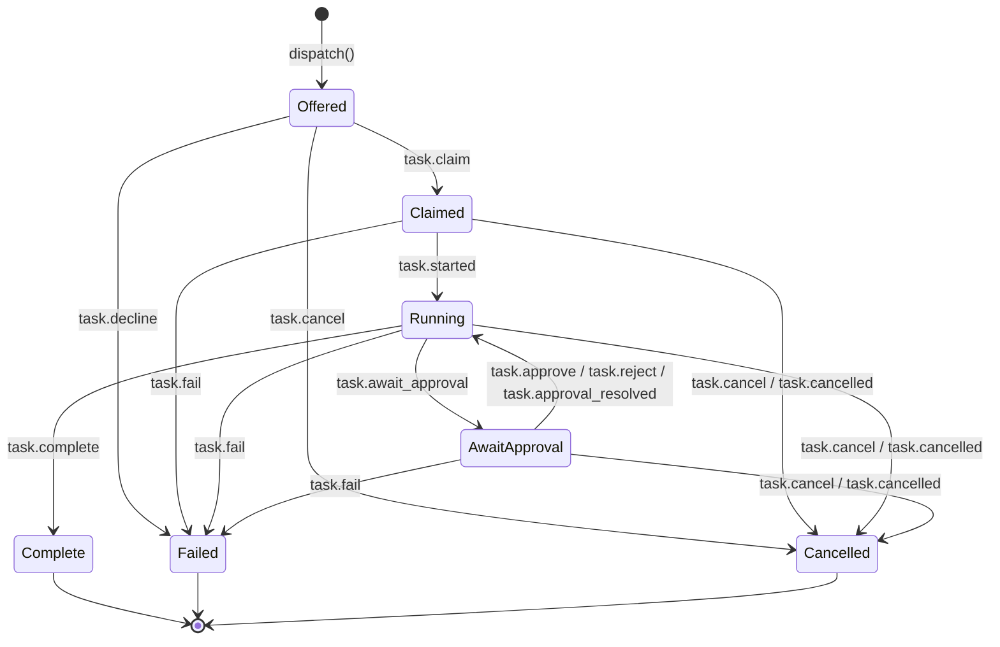

# BYOK SDK Wire Protocol

Normative contract for `@byok-sdk/protocol`. This is the single source of truth for
the M1-2 (server) and M1-3 (client) implementers — the schemas in
`packages/protocol/src/` are authoritative; this document explains the rules
those schemas encode and why.

Status: wire version `v:4`, **FROZEN**. The pi, claude, and codex runtime
adapters have all exercised the wire (M2); every M1/M2 protocol gap identified
along the way has been closed in place. From this point forward, this
document and the schemas in `packages/protocol/src/` describe a closed
contract — see "Freeze rule" immediately below for exactly what "frozen"
does and doesn't allow.

Only wire major `4` is currently supported. v4 completes the Agent-only
cutover (ADR-034) and removes the approval paths kept for peers that predate
approval ids:

- Every offer is Agent-bound, and there is one offer type. v4 removes
  `conn.ack` and the v3 runtime-only offers (`task.offer`,
  `task.offer_with_toolsets` and their sealed twins `task.offer_sealed` and
  `task.offer_with_toolsets_sealed`). The v3 Agent offers
  (`task.offer_for_agent`, `task.offer_for_agent_with_egress`,
  `task.offer_for_agent_with_egress_fresh`, `task.offer_prepared` and the three
  `task.offer_for_agent*_sealed` twins) merge into one `task.offer`, which
  reuses the name. Fresh versus resume is its required `session` (§1.3), a
  prepared Execution is its `preparation` field (§2.0), and an egress offer
  is its `egressPolicy` field (§2.1). The `strict-agent-only` capability flag
  is gone: every daemon runs Agent offers only, and a daemon without an Agent
  home declines every offer. The server answers the handshake in the
  long-poll response metadata (`EventsPollResponse`, §8.1).
- Sealed is a payload branch, not a message type. Every `*_sealed` type is
  gone. A sealed offer is a `task.offer` that carries `sealing`; a sealed
  steer or task output is the plaintext type (`task.steer`, `task.decline`,
  `task.progress`, `task.artifact`, `task.await_approval`, `task.complete`,
  `task.fail`, `task.cancelled`) with a `sealed` member (§2.5).
- `EnvelopeSchema` has 28 branches, down from 47 in v3.
- `approvalId` is required on `task.await_approval`, `task.approve` and
  `task.reject`, and a decision resolves only the approval it names (§5.3).
- `task.approval_resolved` is baseline: the daemon sends it for every
  approval it resolves locally, and every v4 server reads it (§5.2). A pending
  approval is resolved only by a decision or by that report, never inferred
  from later task activity. The `approval_resolved` server flag and the other
  approval capability flags of v3 are gone.

There is no v3 reader and no capability negotiation between v3 and v4. Every
envelope must carry major `4`. **Drain before upgrading**, exactly as for the
v2 → v3 cut below: stop new submissions, let every pending mailbox row be
processed and acknowledged, every in-flight execution reach a terminal, and
every daemon pending terminal be acknowledged by the server. There is no
receipt migration: a store a v3 build wrote is not supported, so start the v4
server side on a new store, together with the v4 daemons. A v3 daemon is
refused: its envelopes, `conn.hello` included, fail decode at the version
boundary as the v1 → v2 note below describes, and it receives no v4 offer. A
`conn.hello` whose `protocolVersions` omits `4` is refused with
`hello_protocol_version_unsupported`. A v4 daemon cannot use a v3 server. The
embedded server refuses to open a store with pending v3 rows
([SQLite startup check](#sqlite-startup-check-for-wire-major-upgrades)).

History: v3 made `schema` required on the
`terminalProjection.mode: 'result-document'` arm of the Agent offers: the
offer freezes a JSON Schema subset for the task's structured outcome
([§7.2](#72-taskcompletedocument--bounded-structured-terminal-result-additive-minor)). That
narrows a strict shape, so it was a wire major. There was no v2 reader and no
capability negotiation between the two result-document shapes; the v2
`result-document` capability flag is gone. The v2 → v3 cut used the same
drain: every pending mailbox row processed and acknowledged, every in-flight
execution terminal and every daemon pending terminal acknowledged, then the
server side (embedded server, `@byok-sdk/cloud`, `@byok-sdk/cloud-dataplane`)
and the daemons upgraded together. A v2 daemon received no v3 offer, and a v3
daemon could not use a v2 server. Schema decode rejects a major other than the
current one with `EnvelopeValidationError`, and the HTTP messages boundary,
the cloud inbound gate and client long-poll treat it exactly as the v1 → v2
note below describes. The SQLite startup check never rewrites or deletes a
pending row of another major.

History: v2 removed the task offer's
`policy` (`PermissionPolicy`), the runtime capability `permissionModes`, the
input-preparation `permissionMode`, the egress `metadata-status` activity mode
and the `sanitizer_rejected` drop reason
([ADR-037](architecture/adr-2026-10-07-minimal-guardrails.md)). There is no v1
reader: upgrade the server and the client together, and drain v1 mailbox rows
first. Every envelope must carry major `2` even when its message type and
payload happen to match a v1 shape. Schema
decode rejects another major with `EnvelopeValidationError`; the HTTP messages
boundary rejects the invalid batch before admission, and the exported cloud
inbound gate returns `rejected` before reserving the envelope identity. Client
long-poll keeps an unsupported executable envelope's cursor unacknowledged.
This enforces the existing supported set; it does not reinterpret a v1
envelope as v2. Package/application SemVer remains unrelated to wire admission.

> Current transport (WP3B Step 4b): the daemon uses authenticated long-poll
> HTTP only. `GET /byok/events` receives server envelopes and
> `POST /byok/messages` sends daemon envelopes; no socket transport or
> transport fallback is part of this contract.

## Freeze rule

`PROTOCOL_VERSION` is `4`. Every v4 change takes exactly one of three paths.
Compatibility is decided by `packages/protocol/src/__tests__/compat.test.ts`,
not by author judgment. No v4 release has been published yet, so there is no
published v4 decoder to run: until the first v4 release is registered and
pinned, the suite proves v4 self-consistency only and cross-release gates are
unproven (see the evidence list below).

1. **Version bump.** Bump `PROTOCOL_VERSION`; server and client upgrade
   together under "Server supports N and N-1" below. This is the only path
   for a change that narrows anything a release already shipped: removing or
   retyping a field, a message type, a capability flag, a task state or a
   transition; making an optional field required; adding a bound, a pattern,
   an enum restriction or strictness to an existing shape; or renaming a
   message type.
2. **Gated addition.** The addition is declared in `WIRE_ADDITIONS`
   (`packages/protocol/src/wire-additions.ts`) as `gated`, with a capability
   flag that older releases do not know. The sender refuses a message
   carrying the addition, before it creates the task or appends to the
   mailbox, unless the receiver durably advertised the flag (a device flag
   for server-to-daemon messages, a server flag for daemon-to-server ones).
   An older receiver therefore never sees it. Required for a new message
   type, for a field on a strict payload (the offers, control payloads and
   the `instruction` blob-ref), and for any field whose loss would change what
   the receiver executes or acknowledges. `homeAccess` on the Agent offers
   (`agent-home-readers`) is the worked example. Senders take their flags
   from `requiredReceiverCapabilities(type, payload)`, which reads the same
   table.
3. **Strip-safe addition.** A new optional field on a strip-unknown payload,
   a new `AgentEvent` variant, a new capability flag, or a new key inside
   `RuntimeInfo.capabilities`. An older receiver drops it. A new payload field
   on this path is declared in `WIRE_ADDITIONS` as `strip-safe`; the
   declaration says dropping it does not change what the receiver executes or
   acknowledges.

`compat.test.ts` holds the wire evidence:

- **Retired v2 evidence (negative oracle).** `golden/v2.envelopes.ndjson`,
  `golden/v2.http.ndjson` and the v2 registry `golden/releases.json` are
  byte-identical to the v2 cut and read-only. The current decoder rejects
  every v2 envelope line at the version boundary, and the v2 HTTP lines that
  carry envelopes too.
- **Retired v3 evidence (negative oracle).** `golden/v3.envelopes.ndjson`,
  `golden/v3.http.ndjson` and the v3 registry `golden/v3.releases.json`
  (0.27.0 through 0.30.2) are byte-identical to what the last v3 release
  shipped and read-only. The current decoder rejects every v3 envelope line
  at the version boundary, and the v3 HTTP lines that carry envelopes too.
  Rewriting only the version is not an upgrade: v4 removed, merged and
  renamed message types, moved the resume reference into `session`, and made
  `approvalId` required.
- **v4 self-consistency.** `golden/v4.envelopes.ndjson` and
  `golden/v4.http.ndjson` are append-only. The current decoder reads every
  line back to the committed JSON, and the current HTTP decoders read every
  literal body to its independently authored value (messages responses must
  account for their `batchLength`). The v4 corpus carries every message type,
  every `WIRE_ADDITIONS` entry, a result-document `task.offer` with `schema`
  for each offer lane (resume, resume with `egressPolicy`, fresh, prepared),
  and an `approvalId` on every approval request and decision. `golden/v4.releases.json` registers the published 0.31.0 corpus
  and has no `floor`. Each registered v4 entry pins both corpus
  prefixes, and the lines it covers are immutable.
- **Published rejection oracle.** `byok-protocol-previous` aliases the
  published 0.30.2 registry tarball, the last v3 release. It rejects every v4
  corpus line, a v4 `conn.hello` and the v4 HTTP lines that carry envelopes:
  a v3 peer cannot read v4 bytes. Nothing it produces is v4 evidence, and it
  never enters the v4 registry.

No published release reads v4, so no test proves the gated and strip-safe
declarations against a released decoder yet. That evidence starts with the
first registered v4 release.

v4 starts from the v3 table minus the server `approval_resolved` gate (every
v4 server reads `task.approval_resolved`) and minus the rows of the removed
runtime-only offers (`harnessId` on the v3 `task.offer` and
`task.offer_with_toolsets`, gated on `custom-harness`). The v3 Agent offer
types are one `task.offer` in v4, so each gate a v3 type carried is a type,
field or value row on `task.offer`:

| `task.offer` carries | Device flag |
| --- | --- |
| (every offer) | `agent-home-contract` |
| `dispatchSelection` | `dispatch-selection` |
| `requiredToolsets` | `toolset-selection` |
| `terminalProjection` | `terminal-projection-selection` |
| `homeAccess` | `agent-home-readers` |
| `harnessId` | `custom-harness` |
| `agentMemory` | `agent-memory-selection` |
| `agentMemory: 'read-if-admitted'` | `agent-memory-read-if-admitted` |
| `agentMemory: 'read-write-if-admitted'` | `agent-memory-read-write-if-admitted` |
| `egressPolicy` | `agent-egress-policy` and `agent-egress-reliable-ack` |
| `messageEgress` | `agent-message-egress` |
| `session.mode: 'fresh'` | `agent-egress-fresh-session` |
| `preparation` | `agent-input-preparation-v9` |
| `sealing` | `sealed-payload-v1` (generated from the split table, §2.5) |

The sealed rows of `task.steer` and the task outputs are generated the same
way (§2.5). Against the v3 table (0.30.2), admission differs in two places:

- An Agent offer naming a harness also needs the device's `custom-harness`
  flag. In v3 only the removed offers had that gate.
- A prepared offer also needs `agent-memory-selection`, because it always
  carries `agentMemory`; v3 had no such row on `task.offer_prepared`. A
  daemon advertises the flag together with `agent-home-contract`
  (`packages/client/src/daemon/create-daemon/support.ts:170`), and every
  device that takes a prepared offer has an Agent home, so admission does not
  change in practice.

Apart from `approval_resolved`, no flag became baseline in v4: the flags a
daemon advertises together with `agent-home-contract` and the egress flags
stay gates. The v3 reset already made the v2 strip-safe
rows and the v2 `result-document` gate baseline. `WIRE_ADDITIONS` keeps the
`gated` rows, most of which name device capabilities a daemon advertises only
when it is configured for the surface (Agent home, readers, egress, input
preparation, provisioning, memory intents). Senders still take admission
flags from `requiredReceiverCapabilities`.

Both `task.offer` branches are strict, and so is every nested control object
in them, `limits` included. The one exception is the shared `BlobRef` inside
an `instruction` blob reference, which strips unknown keys. A daemon that does
not know any other offer field stops its cursor on it (§2.0) instead of
stripping it. A daemon also checks the
gates on its own side: before it opens a sealed offer or starts any work, it
computes `requiredReceiverCapabilities('task.offer', payload)` on the wire
payload and declines non-retryably when a flag is missing from its own
`conn.hello`. The `reason` is `offer_capability_missing: this daemon does not
advertise <flags>`. A task whose `sealing.categories` includes `task-output`
is declined with the sealed code `sealed_key_unavailable` instead, because a
decline for such a task must take a closed sealed-code form (§2.5). Its
`reason` is that code alone; the missing flags appear only in the device log
(`packages/client/src/daemon/task-runner/offer-admission.ts:202-216`).

- Every recursive property path (array items, record values, each union
  branch) and every enum or literal value of each current payload schema
  appears in an envelope corpus line, and likewise for each scoped HTTP body
  schema in the HTTP corpus. The required set is derived from the current
  schemas' input JSON Schema. Envelopes nested in send batches are exempt
  from the HTTP side, because the envelope corpus already covers them; any
  further exemption must be typed and explained, and must prune at least one
  required path. The events page schema carries its entries undecoded
  (`events: unknown[]`, #386), so there is nothing below them to exempt: the
  suite pins that one undecoded path and decodes each page entry with
  `parseMessage`, both when reading the v4 corpus back and when rejecting the
  v2 and v3 ones.

That the server and hosted cloud actually refuse an undeclared receiver is
tested at the senders (for example
`packages/cloud/src/__tests__/wire-additions-admission.test.ts`).

**v2 HTTP release evidence (retired).** The 0.25.0, 0.26.0 and 0.26.1 v2
ledger entries are frozen envelope-only history; they never gain HTTP hashes.
The v2 suite's three typed private-client exclusions (`EventsPollResponse`,
`ChallengeResponse`, `TokenResponse`, bounded through 0.26.1) applied only to
running v2 HTTP bodies through published v2 decoders, which v3 stopped doing.
Those exclusions named the client-private parsers that releases through 0.26.1
still run on deployed devices. The current client has none: since #386 it
decodes the events page, the challenge response and the token response with
the protocol schemas.
Registration belongs to stable release preparation, not a feature-PR version
bump (see `docs/releases/README.md`).

**History note.** The "Landed additive minor" entries in this document, and
other sections that say a change landed with "no `PROTOCOL_VERSION` bump" or
name the `v1.*` golden files, record additive changes made under v1. v2, v3
and v4 kept every one of those shapes except the fields and message types the
status notes above list as removed. These entries keep the v3 type names: in
v4 the Agent offer types they name are one `task.offer`, with the resume
reference moved into `session` and the gates listed above, and each
`*_sealed` type is the sealed branch of its plaintext type. There is no in-place "tighten it a little" allowance post-freeze the
way pre-freeze M0→M1 had (§10).

**Scoped input-preparation cut:** the Owner-approved
[prepared memory contract](researches/2026-09-28-prepared-agent-memory-contract.md)
(superseded in part by [ADR-037](architecture/adr-2026-10-07-minimal-guardrails.md); see [the spec](spec.md#prepared-operations))
extends the earlier official-Pi exception to input-preparation v8. The strict
preparation request, receipt binding and the prepared offer require explicit
`agentMemory: 'none' | 'read' | 'read-write'`. `INPUT_PREPARATION_WIRE_VERSION` and
record schema were 8 at that cut; admission requires `agent-input-preparation-v8`. The outer
envelope was then v1 (it is v4 now). Binding and observation digests use domain v2. This is a paired
upgrade, with no old reader, mode default or dual token. Drain pre-cut preparation
requests and prepared Executions first. The exception does not change unrelated
strict messages; downstream deployment is separate from this source cut.

**Unknown observability remains ignorable; unknown executable work is not acknowledged.**
An unrecognized executable message has no durable disposition, so the daemon
freezes the mailbox cursor rather than silently losing the work. Unknown nested
observability fields and events retain the tolerance described below. **Server supports N and N-1.** A server negotiates the highest
protocol version common to its own supported set and the daemon's
`conn.hello.protocolVersions[]` list, and must continue accepting the
immediately-prior major version so a fleet of daemons can roll forward
without a hard cutover. (The v1 → v2 cut deliberately has no N-1 reader:
the server accepts only `v:2`, so server and client upgrade together. The
v2 → v3 and v3 → v4 cuts are the same: the server accepts only `v:3`, and
now only `v:4`.)

**The observability-vs-control asymmetry.** Unknown is TOLERATED for
observability data, but FAIL-CLOSED for control/security data:

- **Tolerated (observability):** an unrecognized `AgentEvent.type` inside a
  `task.progress` batch parses as an opaque passthrough placeholder instead
  of failing the whole batch (`AgentEventOrUnknownSchema`,
  `agent-event.ts` — see `isKnownAgentEvent`/`partitionAgentEvents` for how a
  consumer is expected to skip it). An unrecognized capability flag string
  (`CAPABILITY_FLAGS`, or an entry inside `conn.hello.capabilities[]`) is
  likewise just ignored, not rejected. An unknown top-level envelope field is stripped, not rejected
  (§1). This tolerance exists because this data only ever informs a UI or a
  log line — silently ignoring what you don't understand yet is safe.
- **Tolerated (open device vocabularies, #1121):** a device -> Host
  vocabulary a newer device may extend — `task.fail.failure.class`,
  `task.decline.code` and a denied `agent.content.receipt` `reason` — accepts
  any well-formed token (`[a-z][a-z0-9_-]{0,63}`) it does not know and keeps
  it verbatim, so the report is still recorded. Hosts read it as `unknown`
  with the raw token beside it (`readTaskFailure` → `reportedClass`,
  `readDeclineCode` → `reportedCode`); cloud `readTaskResult` and embedded
  task results carry those readings. A failure class it does not know may
  carry fields this version does not know either; they are kept too.
  Message types, decisions and outcomes that select a payload shape stay
  closed.
- **Fail-closed (control/security):** `instruction` rejects any shape it
  doesn't recognize outright — there is no passthrough-unknown fallback,
  unlike `AgentEventSchema`. A payload that would change what a runtime is
  asked to do must never be silently reinterpreted or dropped-and-ignored; it
  must fail validation loudly.

  Concretely, the `instruction` blob-ref variant (`{ blobRef: BlobRef }`) and
  the strict offer payloads are built with zod's `.strict()`, rather than the
  default strip-unknown-keys behavior: an unrecognized field is REJECTED
  outright, not silently discarded. A strict offer that still carries the
  removed `policy` is therefore rejected, not stripped. **Consequence:**
  adding a new field to one of these schemas post-freeze takes the
  version-bump or gated-addition path in the Freeze rule above, never the
  strip-safe path.

This asymmetry is enforced by the freeze-guard regression test
(`packages/protocol/src/__tests__/freeze-guard.test.ts`), not just documented
here — see that file for the executable version of every bullet above.

**`task.approval_resolved`: added as a gated message, baseline in v4.** A
daemon → server message that reports an approval resolved entirely on the
device (the daemon's own control-socket `approvals.resolve`, a fail-closed
`requestApproval` timeout, or a fail-closed finish/eviction rejection — see
`packages/client/src/daemon/task-runner.ts`'s `sendApprovalResolved`), with no
wire `task.approve`/`task.reject` exchanged for it. It landed under v1 as a new
message type gated on a server capability flag, `approval_resolved`. v4 makes
it baseline: every v4 server reads it, the flag is gone, and the daemon sends
it for every approval it resolves locally. The server never infers a local
resolution from later task activity. See §2's catalog entry and §5.2 for the
flow and the wire shape.

**Landed additive minor: `task.complete.document` + the `result-document`
capability flag (v1; the flag is retired in v3, where every server keeps
`document`).** A new OPTIONAL field on an existing payload plus a new
capability flag — the first and fourth bullets at the top of this section —
so both landed with `PROTOCOL_VERSION` still `1`. `document` carries the
task's structured terminal result (one JSON value the product consumes as
the task's actual output), bounded by `RESULT_DOCUMENT_MAX_BYTES`; the
server-advertised `result-document` flag (`CAPABILITY_FLAGS`, `version.ts`)
is what tells a daemon the other side will actually keep the field instead
of stripping it. Full contract, cap semantics, and the
`document`-vs-`artifactRefs` boundary: §7.2. The golden fixtures
(`packages/protocol/src/__tests__/golden/v1.frozen.json`, later `v2.frozen.json`, both since removed) were regenerated
deliberately for the fingerprint change, with the additive-only diff
recorded in `tasks/notes/20260812-0351-result-document-channel.notes.md` (untracked since #390);
the historical envelope corpus (`v1.envelopes.ndjson`) was NOT touched,
since a pre-`document` peer's committed bytes must keep parsing unchanged —
which is exactly what proves the change additive.

**Landed additive minor: terminal `usage`.** `task.complete`, `task.fail`,
and `task.cancelled` each gain the same OPTIONAL `TerminalInferenceUsage`
field. This is an observability-only fact attached to a terminal receipt, not
a capability, task-state transition, billing record, storage usage, quota, or
entitlement input. The field is optional so an old daemon's terminal payload
remains valid; a receiver that does not know it follows the ordinary
observability tolerance rule and strips it. The frozen fingerprint golden was
regenerated for this additive schema change, while the historical envelope
corpus remains a pre-usage compatibility witness.

**Landed additive minor: `task.complete.finalMessage`.** `task.complete`
gains an OPTIONAL string with the runtime's closing reply. It is the assistant
text after the last tool interaction. For a runtime whose `progress` events are
whole messages (Codex, and Claude, whose text blocks of one message count as
one), it is the last message only. `summary` does not change:
it still joins every `progress` text with no separator. The daemon omits the
field when the run ended with no closing text. No capability flag gates it. An
older server strips it, and the host then reads `summary` as before. The frozen
fingerprint golden was regenerated for this change.

**Landed additive minor: terminal `agentHomeProjection`.** `task.complete`,
`task.fail` and `task.cancelled` gain the same OPTIONAL
`TerminalAgentHomeProjection` evidence: the projection revision and hash that
an Agent Attempt started with (§2.2). It is observability only. No capability
flag gates it. An older server strips it. The frozen fingerprint golden was
regenerated for this change.

**Landed additive minor: Agent offer `homeAccess` and terminal
`agentHomeMemoryChange`.** The Agent offer variants (`task.offer_for_agent`,
`task.offer_for_agent_with_egress`, `task.offer_for_agent_with_egress_fresh`
and `task.offer_prepared`) gain an OPTIONAL `homeAccess: 'memory-reader'`
(§2.2). The offers are strict, so an older daemon cannot accept the field. A
host sends it only to a device that durably advertises the new capability flag
`agent-home-readers`; server and hosted cloud refuse it otherwise before task
creation or mailbox append. `task.complete`, `task.fail` and `task.cancelled`
gain the OPTIONAL `agentHomeMemoryChange` evidence of a reader Attempt. No flag
gates the terminal field: it is observability only, and an older server strips
it. The frozen fingerprint golden was regenerated for these additive changes.

**Landed additive minor: per-task Agent offer `agentMemory`.** The ordinary
Agent offers (`task.offer_for_agent`, `task.offer_for_agent_with_egress` and
`task.offer_for_agent_with_egress_fresh`) gain an OPTIONAL
`agentMemory: 'none' | 'read' | 'read-write'` (§2.2). The values are those of
`task.offer_prepared`, which keeps its own required `agentMemory`. The offers
are strict, so an older daemon cannot accept the field. A host sends it only to
a device that durably advertises the new capability flag
`agent-memory-selection`; server and hosted cloud refuse it otherwise before
task creation or mailbox append. An offer without the field does not change.

**Landed additive minor: `agentMemory: 'read-if-admitted'`.** The same three
ordinary Agent offers accept a fourth `agentMemory` value, `read-if-admitted`
(§2.2). `task.offer_prepared` does not accept it. A host sends the value only
to a device that durably advertises both `agent-memory-selection` and the new
capability flag `agent-memory-read-if-admitted`; server and hosted cloud refuse
it otherwise before task creation or mailbox append. The other values do not
change.

**Landed additive minor: `agentMemory: 'read-write-if-admitted'`.** The same
three ordinary Agent offers, and their sealed forms, accept a fifth
`agentMemory` value, `read-write-if-admitted` (§2.2). `task.offer_prepared`
does not accept it. A host sends the value only to a device that durably
advertises both `agent-memory-selection` and the new capability flag
`agent-memory-read-write-if-admitted`; server and hosted cloud refuse it
otherwise before task creation or mailbox append. The other values do not
change.

**Agent message drafts (additive v3).** `agent.message.draft` is gated on the
server's `agent-message-draft` flag. Its payload is strict. It has no reliable
ack or spool entry. `RuntimeCapabilities.messageDraft` is optional strip-safe
information in runtime/harness discovery and the claim snapshot. The three
paths name one shared field in `WIRE_ADDITIONS`. See the
[Agent message draft lane](spec.md#agent-message-draft-lane).

**Landed additive minor: `task.fail.failure` (#869).** `task.fail`, and so
its sealed branch, gains an OPTIONAL strict `failure: { class, resetsAt? }`.
`class` is a `RuntimeFailureClass` value: the vendored OAR
`FailureClass` (`auth`, `quota`, `rate_limited`, `billing`,
`model_unavailable`, `input_too_large`, `invalid_request`, `overloaded`,
`provider`, `runtime_exited`, `limit_reached`, `output_schema`, `unknown`).
The class is open (#1121): a well-formed class a Host does not know is
accepted and read as `unknown` with `reportedClass`; see the
observability-vs-control rule above.
`resetsAt` is an ISO 8601 UTC time, only on `quota`, and only when the runtime
reported when the limit resets. Adapters classify from structured runtime
fields only and never parse `reason`, which stays display text. `unknown`
means the runtime gave no structured evidence; a failure the daemon makes
itself is `unknown`. The field is gated on the server's new
`runtime-failure-class` flag, because the sealed branch is strict: a daemon
sends it only to a server that advertises the flag. Server flags are
live-only, so a terminal built while the daemon had no connection carries no
field. `failure` stays plaintext on a sealed `task.fail`. The reference server
and the hosted cloud advertise the flag and project the field as
`TaskResult.failure` and `TerminalResult.failure`.

## 1. Envelope

Every wire message is a single-line NDJSON envelope:

```ts
{
  v: number;            // protocol version, currently 4
  id: string;            // uuid, unique per envelope
  ts: string;             // ISO-8601 datetime with offset
  type: MessageType;       // e.g. "task.offer"
  task_id?: string;         // routing key — see rule below
  session_ref?: string;      // opaque session continuation token
  seq?: number;                // per-device redelivery cursor — see rule below
  payload: { ... };              // shape determined by `type`
}
```

Unknown top-level fields are stripped, not rejected (forward-compat). An
unrecognized `type` is a distinct error (`UnknownMessageTypeError`, not
`EnvelopeValidationError`) precisely so a daemon/server on an older minor
version can report an unfamiliar message type distinctly from malformed input.
An unknown executable type freezes its sequence; it is not an acknowledgement.

### 1.1 `task_id` is the sole routing key (M1 gap #1, #7)

**Rule: `task_id` is REQUIRED on every `task.*` envelope, and stays optional on
every `conn.*` envelope.** All `task.*` types route by task id; `conn.*` types
don't route to a task at all. This is enforced at the schema level (each
message type's envelope shape is built with either a required or an optional
`task_id`, per `envelope.ts`), not just documented — an omitted `task_id` on a
`task.*` envelope fails validation.

Before M1, `task_id` was optional everywhere and two payloads (`task.offer`,
`task.claim`) additionally duplicated a `taskId` field at the payload level.
That duplication is now removed: **`task_id` lives only on the envelope.** A
payload never carries its own `taskId` again.

### 1.2 `seq` is the per-device redelivery cursor (M1 Part B)

**Rule: `seq` is REQUIRED on every envelope type the *server* sends to the
daemon, and stays optional on every envelope the daemon sends to the server.**
`seq` is a per-device monotonically increasing counter the server assigns to
each outbound envelope, independent of and unrelated to task identity — it
exists purely so a reconnecting daemon can tell the server "replay anything
I might have missed after N." See [§9](#9-at-least-once-delivery--idempotency)
for the full redelivery procedure.

Server → daemon types (`seq` required): all `task.*` control messages,
`agent.egress.ack`, `agent.content.read`, and `agent.home.projection`.
Every daemon → server type leaves `seq` optional — M1 only specifies
server-to-daemon redelivery, not the reverse. The server sends no `conn.*`
message: its capabilities arrive on each long-poll response
(`EventsPollResponse.capabilities`, §8.1).

**Do not confuse this with `task.progress`'s payload-level `seq`.** That field
(`TaskProgressPayload.seq`) is unrelated — it orders progress batches *within
a single task*, was already required pre-M1, and is untouched by this change.
Two different counters happen to share the field name `seq` at two different
levels (envelope vs. payload) for two different purposes; keep them separate
in your head and in any redelivery/ordering code.

**`conn.*` envelopes never advance the redelivery cursor.** `conn.hello` is
submitted as the first daemon→server long-poll message and has no
cursor-advancing side effect. Server capability advertisement arrives in
`EventsPollResponse.capabilities`, and cursor accounting covers every server → daemon control that requires durable
handler completion, including `task.*`, `agent.egress.ack`,
`agent.content.read`, and `agent.home.projection`; it excludes `conn.*`.

### 1.3 `session_ref`

The session reference is an opaque continuation token the daemon maps to a
runtime session id (`claude --resume`, codex resume, pi session). Every
`task.offer` carries a required `session` (`SessionSelectionSchema`,
`packages/protocol/src/messages.ts`):

- `{ mode: 'resume', sessionRef }` resumes the named session. `sessionRef` is
  1 to 512 characters. A follow-up Agent task resumes by carrying the same
  `sessionRef` in a new offer, and the daemon admits it only when it matches
  the durable Agent-home handoff (§1.3.1).
- `{ mode: 'fresh' }` lets the selected runtime mint a new session after
  start. A fresh offer must carry `egressPolicy` (§2.1), and it is gated on
  the device's `agent-egress-fresh-session` flag.

`session` is required so that an offer without a resume reference is never
read as fresh. A prepared offer is always fresh (§2.0). The embedded server's
`dispatch()` only resumes, so it requires `agentRef` and `sessionRef` and
writes `session: { mode: 'resume', sessionRef }` itself; a fresh execution
goes through `executions.submit` with a required egress policy (§2.1).

#### 1.3.1 Strict Agent fresh versus resume authority

The published `0.7.0` strict egress path exposed a fresh-session deadlock:
its egress offer required `sessionRef`, while a fresh runtime cannot mint its
native session until after `start()`. The client must reject a missing,
preseeded, or invented Agent-home handoff, so task id or a server-side
reservation cannot substitute for the runtime session. The repair landed
under v1 as a separate fresh offer type; v4 carries the same two facts as the
two `session` modes of `task.offer`:

- `session.mode: 'resume'` is exact-resume-only. Its `sessionRef` must match
  the existing durable canonical Agent-home handoff; missing, stale,
  cross-Agent/profile, runtime, or cwd evidence fails closed and never becomes
  fresh execution.
- `session.mode: 'fresh'` carries no `sessionRef`. It is deliverable only to a
  device with the durable `agent-egress-fresh-session` capability, and a
  daemon without the flag declines it (Freeze rule).

The runtime, not cloud or task identity, owns a fresh native session. After the
fresh offer is claimed, the daemon starts the selected runtime without resume
arguments, receives the runtime-issued session, fsyncs the exact
`AgentRef/profileRevision/runtime/cwd/sessionRef` handoff in the canonical
Agent home, and only then sends `task.started` or exposes reliable egress. The
public reliable publisher re-reads and exact-matches that handoff before
append/send; receipt and ack are delivery facts, not session authority.

## 2. Message catalog

`S→D` = server sends, daemon receives. `D→S` = daemon sends, server receives.

| Type | Dir | `task_id` | `seq` | Payload | Sent when |
|---|---|---|---|---|---|
| `conn.hello` | D→S | optional | optional | `protocolVersions[]`, `capabilities[]`, `deviceId`, `productId`, `clientVersion?`, `runtimes?`, `configuredToolsets?`, `cursor?` | First message on an authenticated long-poll session (including after reconnect) |
| `task.offer` | S→D | **required** | **required** | `agentRef`, `session` (§1.3), `instruction` (absent on a prepared offer; may move into `sealed`, §2.5), `preparation?` (§2.0), `agentMemory?` (§2.2), `homeAccess?` (§2.2), `requiredToolsets?`, `runtime?`, `harnessId?`, `dispatchSelection?` (see below), `terminalProjection?`, `limits?`, `egressPolicy?` (§2.1), `messageEgress?`; sealed branch also `sealing`, `sealed?`, `routineRef?` (§2.5) | An Agent dispatch, execution or prepared Execution targets a device that advertises every flag its fields need (Freeze rule) |
| `agent.egress.ack` | S→D | optional | **required** | exact `agentRef`, `sessionRef`, `policyRevision`, `eventId`, `cursor`, `receiptId` | Cloud durably recorded one reliable Agent event |
| `agent.content.read` | S→D | optional | **required** | `requestId`, surface, actor, exact Agent/session/runtime/cwd, policy revision, relative target, MIME, decode mode, bounded policy | An independently authorized explicit content read is requested |
| `agent.home.projection` | S→D | forbidden | **required** | exact `requestId`, AgentRef/profile revision, SHA-256 projection identity, bounded opaque JSON | A durable task-free projection targets one exact capable device |
| `provider.provisioning.available` | S→D | forbidden | **required** | exactly `{ requestId }` (strict; nothing else) | A Host holds a sealed provider provisioning request for one exact device advertising `provider-provisioning.v1` (§2.3) |
| `agent.memory.intent.available` | S→D | forbidden | **required** | exactly `{ intentId, agentRef }` (strict; nothing else) | A Host holds an approved Agent memory intent for one exact device advertising `agent-memory-intent.v1` (§2.4) |
| `e2ee.key_package.available` | S→D | forbidden | **required** | exactly `{ scopeId, epoch }` (strict; nothing else) | A Host stored a scope key package for the member of one exact device advertising `sealed-payload-v1` (§2.7) |
| `task.approve` | S→D | **required** | **required** | `approvalId` (required — §5.3) | `TaskHandle.approve()` while `AwaitApproval` |
| `task.reject` | S→D | **required** | **required** | `reason?`, `approvalId` (required — §5.3) | `TaskHandle.reject()` while `AwaitApproval` |
| `task.cancel` | S→D | **required** | **required** | `reason?` | `TaskHandle.cancel()` from any non-terminal state |
| `task.steer` | S→D | **required** | **required** | `text` | `TaskHandle.steer()` while `Running` |
| `task.claim` | D→S | **required** | optional | `deviceId`, `agentId?`, `agentRef?`, `runtime?` (M5, additive — §3.1), `capabilities?` (S0, additive — §11.5) | Daemon accepts an offer (idempotent CAS) |
| `task.started` | D→S | **required** | optional | `{}` | Daemon actually starts the runtime session — `Claimed → Running` |
| `task.decline` | D→S | **required** | optional | `reason`, `retryable?`, `agentRef?`, `code?` | Daemon fail-closed-rejects an offer *before* claiming — `Offered → Failed` |
| `task.progress` | D→S | **required** | optional | `seq` (payload-level batch order — §1.2), `events[]` | Batches of normalized `AgentEvent`s |
| `task.artifact` | D→S | **required** | optional | `name`, `contentType`, `inline?`, `blobRef?` | An artifact is produced |
| `task.await_approval` | D→S | **required** | optional | `summary`, `approvalId` (required — §5.3) | A session or the control socket requested approval (§5) |
| `task.complete` | D→S | **required** | optional | `summary`, `finalMessage?` (additive — Freeze rule), `sessionRef`, `artifactRefs?`, `document?` (additive — §7.2), `agentRef?`, `agentHomeProjection?`, `agentHomeMemoryChange?` (additive — §2.2) | Runtime reached `turn_end` |
| `task.fail` | D→S | **required** | optional | `reason`, `retryable?`, `failure?`, `agentRef?`, `agentHomeProjection?`, `agentHomeMemoryChange?` | Task ends in error; `failure` is gated on the server's `runtime-failure-class` flag |
| `task.cancelled` | D→S | **required** | optional | `reason?`, `agentRef?`, `agentHomeProjection?`, `agentHomeMemoryChange?` | Task ends `Cancelled` (server- or daemon-initiated) |
| `task.approval_resolved` | D→S | **required** | optional | `approvalId`, `decision` (`'approve'\|'reject'`), `resolvedBy` (`'local'`), `at` | A pending approval was resolved entirely on the device (§5.2); baseline, no capability gate |
| `agent.message.draft` | D→S | **required** | optional | `agentRef`, `revision`, UTF-8 `offset`, `text` (≤ 16 KiB), `overflow?: true` | Display-only snapshot frames; server-advertised `agent-message-draft` gate |
| `agent.egress.reliable` | D→S | optional | optional | exact Agent/session/policy identity, stable `eventId`/`cursor`, payload hash and byte count | A locally fsynced reliable event is sent or retried |
| `agent.content.receipt` | D→S | optional | optional | exact request/actor/Agent/session/runtime/cwd/policy/target/MIME/decode identity; allowed includes hash/size/BlobRef, denied includes zero bytes and typed reason | Local content policy and audit completed |

`task.steer` and the seven task outputs (`task.decline`, `task.progress`,
`task.artifact`, `task.await_approval`, `task.complete`, `task.fail`,
`task.cancelled`) also have a sealed branch: the same type, with a `sealed`
member in place of the fields it seals (§2.5). The payloads above are the
plaintext branches.

**`task.offer` rules.** The plaintext and the sealed branch share these
cross-field rules (`offerRule`, `packages/protocol/src/messages.ts`):

- A prepared offer (`preparation`) carries no `instruction`, has
  `session.mode: 'fresh'`, carries an `egressPolicy`, and selects a prepared
  `agentMemory` mode (`none`, `read` or `read-write`).
- A plaintext offer that is not prepared carries an `instruction`. A sealed
  offer carries it in `sealed` or in plaintext, as its `sealing` says (§2.5).
- A fresh or prepared offer carries an `egressPolicy`.
- `messageEgress` needs an `egressPolicy`.
- `routineRef` appears only on a fresh sealed offer.

Both branches are strict, and so is every nested control object, `limits`
included, except the shared `BlobRef` inside `instruction`. Each optional
field is gated on a device flag; the Freeze rule
lists the rows and the daemon's own check of them.

### 2.0 Prepared Executions

A prepared offer is a `task.offer` with `preparation`. It is strict control
data. In long-poll, unknown executable message types and unknown strict payload
keys both freeze the cursor. Enqueue requires `agent-home-contract`,
`agent-input-preparation-v9`, `agent-memory-selection`, `agent-egress-policy`,
`agent-egress-reliable-ack` and `agent-egress-fresh-session`; when
`messageEgress` is present it also requires `agent-message-egress`. These
gates run before allocating any task or mailbox row. A prepared offer is never
sealed: the split table forbids `preparation` on the sealed branch (§2.5). The host-only `agentMessageContext` is recorded with the
immutable message requirement and is never sent to the daemon.

The v8 cut retains Host-owned `prompt.systemPrompt`, official closure identity and
envelope v4, and requires explicit `agentMemory`. The v9 cut (ADR-037) removes
`permissionMode`, replaces `toolImplementationKinds` with `toolNames` and removes
`executor_identity_unproven`; the device record was version 10. K7 wire v3 advances the record to 11,
retaining the optional frozen result selection and its one schema-bound
`submit_result` tool; admission compares the selection before pin or claim. Memory-only
preparation accepts empty requiredToolsets; the corresponding offer omits that field.
From 0.24.0 the same holds with `agentMemory: 'none'`: a tool-less preparation (empty
requiredToolsets, no memory) is admitted and launched with zero tools, and its offer
omits `requiredToolsets` (an offer's own `requiredToolsets` stays `.min(1)`). No wire,
record, digest or capability changes. Required
`egressPolicy` and optional `messageEgress` remain, with no dual token/read. **Precondition:** drain preparation requests,
prepared Executions and required message dispositions, ensure device cursors have
passed all old entries, then upgrade cloud and device together. Existing pre-v8
preparations are not read forward; recreate them. The capability gate protects new
admission only: an already-enqueued old offer without `egressPolicy` fails strict
parsing and stalls its mailbox. Paired upgrade alone does not repair that old
payload; operator handling is required if the drain was skipped.

Prepared offers inject no message tool. Selected SDK memory tools are counted and
sealed using their own descriptor; the SDK does not attest them (ADR-037). They are
not Host MCP toolsets. After pin and claim, a private task token carries the sealed
read/read-write ACL, checked again by the daemon. Their message body is
daemon-authored from final Pi text at turn end, after usage validation and selected
result-document extraction. Missing/unreadable usage or context overflow fails
before publish. The outbox waits for exact `accepted` before emitting `task.complete`
with `preparedObservation`; outbound activity/terminal envelopes go to the Host as is.
Selected memory schemas and executors enter D and its existing admission comparisons;
the memory selection is compared explicitly as well. The message tool stays outside D.
A prepared session launches no native tool. Host MCP toolsets may be empty only when selected memory
tools make the combined surface nonempty; with `agentMemory:'none'` they remain required.

It carries no `instruction`: the user request is already inside the frozen
envelope the referenced record retained. Its `session` is always
`{ mode: 'fresh' }` — a prepared Execution never resumes, because resuming
binds the frozen request to a history nobody counted.

Nothing under `preparation` is authority. Every value is the Host re-presenting
what the device's own receipt told it, and the device compares each one against
its durable record before admitting an Execution. A difference declines the
offer non-retryably with a reason naming the item that differed; the device
never reconciles, narrows or re-derives.

### 2.1 Agent egress and explicit content reads

An egress offer is a `task.offer` with `egressPolicy`. Server and hosted
cloud require `agent-home-contract`, `agent-egress-policy`, and
`agent-egress-reliable-ack` before allocating the task/mailbox row. The offer
is strict, so a daemon that does not know the field cannot strip the policy
and continue with task-only semantics.

A fresh offer (`session.mode: 'fresh'`) always carries `egressPolicy`. Server
and hosted cloud require the same Agent/egress declarations plus durable
`agent-egress-fresh-session` before allocating its task/mailbox row. The fresh
`session` has no `sessionRef`; the runtime mints that value after
claim/start, and the client must fsync the exact Agent-home handoff before
`task.started` or any reliable egress. A resume offer stays
exact-resume-only and never falls back to fresh when its handoff is absent or
mismatched.

Host-facing APIs mirror those two wire facts. Hosted cloud exposes
`submitAgentExecution(tenant, input)`, and the reference server exposes
`executions.submit(input)`, both using AgentExecutionInputSchema. The Host supplies
and persists taskId, exact deviceId, runtime, AgentRef, egressPolicy and
terminalProjection; messageEgress is optional, with message context and consumer
required only when selected. Existing egress resume dispatch rejects a missing
sessionRef instead of sending a fresh offer.

Each lane keeps its own Host method: `enqueueAgentOffer`,
`enqueueAgentEgressOffer`, `enqueuePreparedOffer`, `submitAgentExecution` and
their sealed counterparts `enqueueSealedAgentOffer`,
`enqueueSealedAgentEgressOffer` and `submitSealedAgentExecution`. Every one
sends a `task.offer`. The Host input payload is the wire payload: the Host
writes `session` itself (`{ mode: 'resume', sessionRef }` on the resume lanes,
`{ mode: 'fresh' }` on the execution and prepared lanes), and each lane
refuses a payload whose `session` does not match it. The offer read back
(`readTaskOffer`, `tasks.offer`) has `type: 'task.offer'` and a payload equal
to the one the Host submitted.

The policy has one exact `policyRevision`. Activity is `latest-value` with
positive coalesce and event-byte bounds. Every event passes the same bounds;
of the accepted events in one `task.progress` batch, each `error` is sent in
its place and the others coalesce to their last. An `error` reports a failure,
such as an artifact the daemon refused or could not upload, not a value that
a later event supersedes. The daemon sends Agent events as the
runtime produced them. It does not filter, redact or omit them. Reliable quotas are positive and independently bound per Agent and
authenticated tenant. Workspace, transcript and artifact transfers are each
`disabled` or carry an explicit MIME/byte policy; no surface inherits another
surface's capability.

`agent.egress.reliable` is at-least-once. The daemon appends/fsyncs before the
first send and retains the stable id/cursor until an exact
`agent.egress.ack`. A duplicate exact event returns the existing durable
receipt; a changed AgentRef, profile revision, session, policy, id, cursor,
hash or bytes fails closed. It never degrades to latest-value activity.

`agent.content.read` is task-independent but cursor-tracked and redeliverable.
Its target is a portable relative path (no absolute path, dot segment or
backslash); cwd is absolute. The daemon derives the capability from the
surface, binds tenant/device from authenticated local state rather than the
payload, and applies its own narrower root/text/sensitive-name policy. Allowed
bytes travel only through the authenticated blob channel. The
`agent.content.receipt` contains required stable `eventId`/positive
`cursor`. It is fsynced to the same Agent-local reliable spool before first
send and retires only after an exact `agent.egress.ack`; restart replay and
duplicate re-ack preserve that identity. An allowed receipt contains a
`BlobRef` whose hash, size and content type exactly match the receipt; denial
carries `byteCount: 0`. The receipt is content-free metadata and does not make
cloud a transcript authority.

### 2.2 Task-free Agent-home projection

`agent.home.projection` is gated by the additive `agent-home-projection`
capability in addition to the base `agent-home-contract`. It is not a task and
forbids `task_id`. The opaque JSON payload is at most 64 KiB and has no
credential-specific field; the embedding producer remains responsible for
excluding secret values because this boundary is not a DLP scanner.

Cloud persists the immutable desired fact before appending the exact-device
mailbox row. Duplicate request identity and exact body are idempotent; changed
immutable bytes conflict. Offline delivery remains pending and is never
rerouted. The daemon applies the local ordering contract under the canonical
Agent-home lease. The host consumer is an atomic/idempotent ensure of opaque
product-derived bytes. A new request with the exact current revision/hash runs
that consumer again and returns `idempotent`; stale or same-revision/different-
hash requests never invoke it. Consumer, containment or lease failure leaves
the request pending and the cursor behind. After a successful local outcome the
daemon calls:

```text
PUT /byok/agent-home-projections/:requestId/completion
{ requestId, agentRef, projectionHash, outcome }
```

The endpoint authenticates the enrolled device, exact-matches the stored
request, writes a first-terminal immutable completion receipt, and returns the
full tenant/device/request/AgentRef/hash/outcome readback. Unknown or
cross-device request is `404`; identity mismatch is `422`; changing a terminal
fact is `409`. Handler failure or non-exact readback does not advance the
server-to-daemon cursor.

**Offer revision and projection revision.** An Agent task offer's
`agentRef.profileRevision` and the applied projection revision are two
different facts. The daemon does not require them to be equal, and it does
not decline an offer because of a difference. A projection can arrive after
the offer that expected it, and an old offer can run after a newer projection.
Instead, each terminal of an Agent Attempt (`task.complete`, `task.fail`,
`task.cancelled`) carries the optional `agentHomeProjection`:
`{ profileRevision, projectionHash }` of the projection that was applied when
the Attempt started. The Attempt holds the canonical-home lease, so no new
projection is applied while it runs. The field is absent when the home has no
applied projection record. The host compares it with the terminal `agentRef`
and decides whether the result is usable. The cloud read model
(`readTaskResult`) projects it verbatim.

**An Agent offer's `dispatchSelection` is the authoritative LLM target when
present.** It is a strict discriminated union:

- subscription: `{lane:'subscription', runtimeId:'claude'|'codex',
  providerId:null, modelId:string}`;
- BYOK: `{lane:'byok', runtimeId:'pi', providerId:string, modelId:string}`.
- exact local profile: `{lane:'byok-profile', runtimeId:'pi',
  providerProfile:{profileRef,profileRevision,profileHash,modelId,
  requiredCapabilities}}`.

Every id is non-empty, bounded to 160 characters, and rejects NUL/CR/LF. The
server derives the task's requested runtime from `runtimeId`; if the legacy
optional `runtime` field is also present, disagreement is rejected before task
creation. The Agent offers are strict, so a daemon that does not know the
field refuses the offer; the server first requires the target device to
advertise the `dispatch-selection` capability (`WIRE_ADDITIONS`), and absence
rejects before task creation instead of degrading to an offer without a
selection. The daemon repeats the runtime
check before claim and selects the adapter
from `dispatchSelection.runtimeId`. Adapters then pass the exact model (and, for
Pi, provider) to the runtime. No layer may infer a missing provider/model or
fall back to another target. Offers that do not use provider selection keep
the `runtime?` behavior, but the selection path never degrades into it after a
selection was supplied.

The `byok-profile` lane additionally requires the target daemon to advertise
`provider-profile-binding`. Its ref is an opaque device-local identity, its
revision is canonical decimal, and its hash is lowercase SHA-256 over the
normalized non-secret runtime profile. Base URL, auth mode, and credential
bytes never enter the offer. The daemon validates ref/revision/hash/model and
required capabilities against the read-only local authority before claim, and
the credential-custody launcher rechecks the same binding before credential
access and Pi spawn. Missing or stale state is a fail-closed refusal, never a
fallback to `providerId` or provider kind.

**An Agent offer's `requiredToolsets` names the Host MCP toolsets the task
needs.** It carries only bounded logical ids (1–16) such as `salesko.crm`; it
never carries an executable command, environment, header, token, cookie, or
connector credential. The daemon resolves every id against its operator-owned
local `mcpToolsets` configuration before claiming the task. Missing ids,
duplicate MCP server names, an empty resolved set, or a runtime without
`mcpToolsets` support all produce `task.decline` and no child process starts.

The field is gated on the device's `toolset-selection` capability
(`WIRE_ADDITIONS`): the server and hosted cloud refuse an offer that carries it
before creating the task unless the target device advertises the flag. All
three bundled runtimes advertise `mcpToolsets`. Claude gets the selected local
stdio servers in one task-scoped `--mcp-config`, and the user's own MCP
configuration also loads; Codex gets them in the `thread/start` or
`thread/resume` config (`mcp_servers`); Pi starts them from its task-scoped
pool.

**No offer carries a workspace hint.** The reserved `workspaceHint` existed
only on the runtime-only offers that v4 removed; no reader ever consumed it.
An Agent Attempt's working directory follows from the Agent home and
`homeAccess` below. See `docs/architecture/sdk-architecture.md` ADR-023.

**Every `task.offer` is the strict Agent-home path.** Its required
`agentRef` contains a bounded single-segment `agentId` and bounded
`profileRevision`; both are limited by UTF-8 byte length. The target device
must have durably declared `agent-home-contract` before the server/cloud creates
or enqueues the task, and a daemon without an Agent home declines every
offer, so no instruction runs outside an Agent home. `agentId` must also be a portable
Windows pathname segment: reserved device names and trailing dot/space are
rejected. A strict Agent `taskId` is reserved exactly once; any later enqueue
with that id fails closed instead of appending a second offer.

The daemon accepts an absolute `hostStorageRoot` from its local host config and
the SDK exclusively composes `<hostStorageRoot>/agents/<agentId>`. It then
requires exact AgentRef/profileRevision/session/runtime/cwd agreement for
resume and echoes exact AgentRef through claim/decline/terminal messages
(`task.claim`, `task.decline`, `task.complete`, `task.fail`,
`task.cancelled`). Profile contents and non-`.byok` Agent files are opaque; `artifacts` is
not a protocol field, schema, index, or required directory.

**`homeAccess: 'memory-reader'` runs a reader Attempt.** An Agent offer without
`homeAccess` is the writer: it runs in the canonical home, and one home has at
most one writer at a time. A reader runs in its own run directory,
`<home>/.byok/runs/<taskId>/`, beside up to
`maxConcurrentReaderAttemptsPerAgentHome` (default 4) other readers and the
one writer. The two counts are independent; an offer over either limit gets a
retryable decline. The home is an ancestor of the reader cwd, so the runtime
still finds the persona and memory. A fresh reader's `taskId` must be one plain
path segment (`[A-Za-z0-9._-]`, at most 128 characters); otherwise the offer
gets a non-retryable decline. Durable Pi runs only in the canonical home and
declines a reader offer without retry.

A reader session resumes in the run directory that its handoff recorded. The
handoff binds `homeAccess`, so a reader session never resumes as a writer, and
a writer session never resumes as a reader: a mismatch is a non-retryable
decline. When the run directory of a resumed reader session is gone, the
offer gets a non-retryable decline that names the session. The device keeps a
run directory after the terminal. When a fresh reader starts, retention
removes run directories older than 7 days and then the oldest ones above 32
per home. It never removes the directory of an active reader, and it keeps a
directory that a reader session handoff points to until that record is older
than 7 days.

The SDK does not make memory read-only. Each reader terminal carries
`agentHomeMemoryChange`. The device fingerprints `MEMORY.md` and every entry
under `notes/` (at most 256 entries, directories included, and 16 MiB, never
following a symbolic link) at reader start and at the terminal decision:

| `outcome` | Meaning | `paths` |
|---|---|---|
| `unchanged` | The fingerprints are equal | absent |
| `reader-attributed` | They differ, and no writer Attempt of the home overlapped this reader. A reader changed memory: this one or an overlapping reader | changed files, relative to the home |
| `unattributed` | They differ, and a writer Attempt overlapped this reader | changed files, relative to the home |
| `unmeasured` | A bound was exceeded, an entry is not a directory, regular file or link, or a read failed | absent |

Agent content reads never open `.byok`, so a host cannot read a reader run
directory through them. A reader returns its output in the terminal
`finalMessage` and `summary`, a result document, or task artifacts. The device
sees only Attempts it runs. A host that writes memory files itself
while readers run makes the attribution ambiguous. The field is absent on a
writer terminal and on a claimed failure before the Attempt became active. The
cloud read model (`readTaskResult`) projects it verbatim.

**`agentMemory` selects the Agent memory of one ordinary task.** Without the
field, the daemon admission decides, as before. `none` binds no SDK memory MCP
and adds no memory guidance, so memory alone requires no adapter MCP support;
a reader keeps only the line that puts its result in the final reply. `read`
binds the memory MCP sealed `read`, so the model has only `memory_recall`.
`read-write` is the writer default. A `memory-reader` offer that selects
`read-write` gets a non-retryable decline (`agent_memory_selection_invalid`);
the reference server refuses that dispatch before the task exists. `read` or
`read-write` on a daemon that does not admit the memory MCP gets a
non-retryable decline (`agent_memory_unavailable`); the daemon never changes
the selection to `none`. `read-if-admitted` runs as `read` when the daemon
admits the memory MCP and as `none` when it does not, for a writer and a
reader; it never gets `agent_memory_unavailable`. `read-write-if-admitted`
runs as `read-write` when the daemon admits the memory MCP and as `none` when
it does not; it never gets `agent_memory_unavailable`. A `memory-reader` offer
that selects it gets `agent_memory_selection_invalid` whatever the admission,
and the reference server refuses that dispatch before the task exists. The
daemon reads its admission once per offer and binds the memory MCP from that
one answer. The terminal does not report which mode ran. A daemon advertises
`agent-memory-selection`, `agent-memory-read-if-admitted` and
`agent-memory-read-write-if-admitted` whenever it has an Agent home, whatever
its memory admission.

### 2.3 Task-free sealed provider provisioning notice

`provider.provisioning.available` is an additive message type gated by the
additive device capability `provider-provisioning.v1`
(`PROVIDER_PROVISIONING_CAPABILITY`). A daemon advertises it only while its
Host injected a `providerProvisioning` handler, and a Host must not enqueue the
notice to a device whose durable capabilities lack it. It forbids `task_id`,
requires `seq`, and its payload is `.strict()` with exactly one field:

```text
{ requestId }   // UUID; any other field is a validation failure, never stripped
```

The notice is deliberately notice-and-fetch. Configuration, sealed provider
secret and every provider or Agent identity travel only over the Host's own
device-authenticated routes, which this SDK does not define. A mailbox retains
unacknowledged rows and the daemon journals ordinary rows before it
acknowledges them, so ciphertext inside the envelope would outlive the
provisioning window in two places; the strict one-field payload makes that
unrepresentable. The daemon consumes the notice ahead of the journal append and
never records it there.

The daemon hands the handler a fresh `{ requestId }` and waits for the Host's
durable terminal readback (`ProviderProvisioningReadbackSchema`):

```text
{ tenantId, deviceId, requestId,
  disposition: recorded | idempotent | conflict | host_terminal,
  completion,            // the terminal fact the Host has STORED
  completedAt }
```

`completion` (`ProviderProvisioningCompletionSchema`) is the credential-free
result the device reported, discriminated by `outcome`. Both arms carry
`requestId`, `operation` (`configure | update_model | replace_secret |
delete`), the non-secret monotonic `operationGeneration` (canonical positive
decimal, at most the PostgreSQL BIGINT maximum) and `operationDigest`
(lowercase `sha256:`). `operationDigest` is pinned to the `@byok-sdk/core`
`providerProvisioningRequestDigest(request)` of the immutable sealed request,
the same value `@byok-sdk/keys` returns as `result.requestDigest`; a Host
compares completions and stores its receipt against that value and no other
digest. `applied` adds `providerStatus` (`profileRef`,
`providerKind`, `modelId`, `capabilities`, `secretConfigured`; no endpoint,
auth mode or secret) and the exact `ProviderProfileBinding`, both `null` for
`delete` and only for `delete`; `configure` and `replace_secret` must report
`secretConfigured: true`, and `replace_secret` reports the unchanged binding.
Every `applied` result also carries the required hint `keyCheck: { result }`,
one of `ok | credential_rejected | rate_limited | quota_or_billing |
model_not_permitted | provider_error | unreachable | timeout | not_run`: the
device's single post-apply vendor check of the stored key, with no vendor
text, status or detail. It is advisory for the Host UI and never a readiness input; `delete`
must report `not_run`.
`rejected` adds one closed-set `code`; codes name the failed check and never a
value. The set (`PROVIDER_PROVISIONING_REJECTION_CODES`) is `request_invalid`,
`request_conflict`, `request_expired`, `request_not_yet_valid`,
`request_window_invalid`, `sealing_key_rotated`, `enrollment_mismatch`,
`agent_not_placed`, `config_digest_mismatch`, `operation_generation_stale`,
`profile_changed`, `profile_not_found`, `credential_scope_mismatch`,
`provider_kind_unsupported`, `pi_model_invalid`, `capabilities_invalid`,
`seal_open_failed`, `secret_invalid`, `local_commit_interrupted` (also any
request that finds an operation still pending locally) and
`secret_store_unavailable`. Re-sending an identical completion yields `idempotent` with the stored
result and no rewrite; a different digest or result yields `conflict` with the
stored result unchanged. `host_terminal` is valid only for a rejected
completion the Host recorded on its own authority (`request_expired`,
`sealing_key_rotated`), for example a request that expired before the device
fetched it.

Every readback is terminal; there is no `pending`. The cursor advances exactly
when the handler resolves with a readback that validates and names this
daemon's tenant, device and request, including expired, rotated, rejected and
conflicting outcomes, so a notice can never wedge the mailbox on a
deterministic end state. A missing handler, a handler throw (transport or other
unknown failure), or an invalid or mismatched readback leaves the row
unacknowledged and the cursor behind it.

The handler answers a redelivered or retried notice receipt-first: before it
needs any ciphertext, sealing key or placement, it reads the device's durable
local result for `requestId` + `requestDigest` (`@byok-sdk/keys`
`readSealedProvisioningResult`) and reports that stored result. The Host's
device-authenticated fetch response for a request therefore must return
`{ requestId, requestDigest }` for every request it still knows, including a
terminal request whose ciphertext the Host has already deleted; only the sealed
secret may be absent from such a response, never the request identity or its
digest.

The device-proof operation a device signs when it registers its provider-secret
sealing public key is `provider-secret-sealing-key.register`
(`PROVIDER_SECRET_SEALING_KEY_REGISTER_OPERATION`); a client-based device signs
it with `createStoredDeviceProofSigner`. Assertion audiences and route paths
are Host vocabulary and are not part of this protocol.

`expectedEnrollmentRevision` is the decimal string of the device-proof key
epoch the device's enrollment key is registered under: the Host issues
`String(proof_key_epoch)` from its device row, and a client-based device reads
the same value as `enrollmentRevision` from `readDeviceEnrollmentIdentity`
(together with `tenantId`, `deviceId`, `proofKeyId` and `proofKeyEpoch`). It is
monotonic across proof-key rotation for one device id; re-pair mints a new
device id.

A Host built on `@byok-sdk/cloud` appends the notice with
`enqueueProviderProvisioningNotice(tenant, deviceId, { requestId })`. It
validates the strict payload first, then refuses (`agent_capability_missing`,
no mailbox row) a device whose durable capabilities lack
`provider-provisioning.v1`. The mailbox message id is derived from
tenant, device and `requestId`, so a retried enqueue returns the existing row
and seq. Cloud records no provisioning receipt: completion and readback are Host
authority.

### 2.4 Task-free Agent memory intent notice

`agent.memory.intent.available` is an additive message type gated by the
additive device capability `agent-memory-intent.v1`
(`AGENT_MEMORY_INTENT_CAPABILITY`). Both fall under the Freeze rule's additive
bullets: `PROTOCOL_VERSION` stays `1` and input-preparation v8 is unchanged.
It forbids `task_id`, requires `seq`, and
its payload (`AgentMemoryIntentAvailablePayloadSchema`) is `.strict()` with
exactly two fields:

```text
{ intentId,   // UUID the Host minted when the owner approved the intent
  agentRef }  // strict { agentId, profileRevision }; profileRevision is a
              // canonical positive decimal; any other field is a validation
              // failure, never stripped
```

The Host is the only approval authority for a memory intent; the device-local
Agent home (`MEMORY.md`, `notes/**`) remains the only memory content
authority. The notice is notice-and-fetch for the same reason as §2.3: path,
operation, revisions and content never ride the mailbox or the device journal.
The daemon consumes the notice ahead of the journal append and never records
it there. `agentRef` only routes the Agent-home lease and the local ledger; it
must equal the fetched intent's `agentRef`. Design record:
device memory CAS contract (`docs/researches/2026-09-28-hermes-device-memory-cas-contract.md`, untracked since #390).

**Intent and digest.** The immutable intent (`AgentMemoryIntentV1Schema`) is
`{ intentId, agentRef, path, operation: replace | delete, baseRevision,
targetRevision, content?, approvalRef, operationDigest }`. Revisions are
lowercase `sha256:` over the file bytes, and a missing file has the
empty-bytes digest. `replace` requires `targetRevision` different from
`baseRevision`. `delete` requires `targetRevision: null` and never has
`content`. `content` (well-formed Unicode, at most 256 KiB as UTF-8) appears only
on a `release` of a `replace`. `path` is only syntactically bounded on the wire
(1–1024 printable ASCII characters without quote or backslash); the device
applies its own memory path rule. `approvalRef` (1–128 characters of
`[A-Za-z0-9._:-]`) is recorded and never evaluated. `operationDigest` is
`@byok-sdk/core` `agentMemoryIntentOperationDigest(...)`: `sha256:` over
`canonicalizeJson({ v: 'byok-agent-memory-intent-v1', tenantId, deviceId,
intentId, agentRef, path, operation, baseRevision, targetRevision,
approvalRef })`, where `tenantId` and `deviceId` are the SDK tenant and device.

**Fetch.** A Host injects `DaemonConfig.agentMemoryIntents`, a transport with
`fetch` and `complete`. It authenticates the device on its own routes, and
audiences and route paths are Host vocabulary. The daemon calls
`fetch({ intentId, agentRef, reservation })`. `reservation` is `held` when the
device reserved a ledger slot and `none` when it could not. The answer is copied
into inert plain data and parsed with
`agentMemoryIntentFetchResponseSchemaFor(reservation)`:

| `disposition` | Allowed for | Carries |
|---|---|---|
| `release` | `held` | `intent`; `content` only for `replace` |
| `withheld` | `held` | `intent` without content and one Host code: `intent_revoked`, `intent_expired`, `placement_changed` or `profile_revision_changed` |
| `terminal` | `held`, `none` | `intent` without content and the Host's stored `readback` |
| `deferred` | `none` | `intent` without content; the Host changed nothing and released nothing |

**Device processing.** Every intent of one Agent is processed serially in the
daemon process. Network I/O never runs while the Agent-home writer lease is
held. The lease is the same task-free lease `agent.home.projection` uses, so an
active execution in that home makes the device report `home_busy`. The device
ledger `.byok/agent-memory-intents-v1.json` is the at-most-once authority. A
serialized record is at most 2048 bytes and the ledger holds at most 511
records. An append prunes only records whose `ackedAt` is durable, oldest
first, so an unacknowledged record is never evicted.

1. With the lease held, the daemon looks up `intentId`. A stored terminal is
   rewritten as a durable barrier and completed again. A leftover `applying`
   record is never re-executed: it becomes `uncertain` with the current file
   observation. Without a record, the daemon fetches with `held`, or with
   `none` when the ledger is full.
2. Identity gate: this check runs first for every `release` and `withheld`
   answer, before any body check. The intent's `agentRef` must equal the
   notice, and `operationDigest` recomputed with this device's enrolled tenant
   and device must equal the intent's value. Any mismatch is `fetch_invalid`:
   zero ledger writes, zero CAS, no completion, and the notice is not
   acknowledged.
3. After the gate, a path outside the memory path rule, a `delete` of
   `MEMORY.md`, or a body that is missing, oversized, not well-formed or whose
   `sha256(utf8(content))` differs from `targetRevision` becomes a durable
   `rejected` record with `path_invalid`, `memory_md_not_deletable` or
   `content_invalid`. A `withheld` Host code becomes a `rejected` record with
   that code. A rejected intent has zero memory writes.
4. Otherwise, with the lease held, the daemon makes `applying` durable, runs
   the existing sha256 CAS once with `baseRevision` as the expected revision,
   and makes the terminal durable: `applied`, `conflict` or `uncertain`.
   `applied` requires the result to match the operation. For `replace` that is
   `exists: true` and revision `targetRevision`; for `delete` it is
   `exists: false` and the empty-bytes digest. Any other CAS result, or any
   failure other than a revision conflict, is `uncertain` with the current
   observation. A revision conflict is `conflict` only on a backend that proves
   a conflict renamed nothing. The CAS directory fsync is strict, as for the
   ledger. A refused directory fsync after the rename, `EINVAL` and `EPERM`
   included, is such a failure. The Host never receives `applied` for a memory
   result that no barrier made durable.
5. The completion (`AgentMemoryIntentCompletionSchema`, content-free) goes to
   the Host only after its terminal record was durably written.
6. The Host answers with its durable readback (`AgentMemoryIntentReadbackSchema`):
   `{ tenantId, deviceId, intentId, disposition: recorded | idempotent |
   conflict | host_terminal, completion, recordedAt }`. It must name this
   tenant, device, intent and completion identity. For `recorded` and
   `idempotent`, `completion` must equal what was sent; otherwise the reason is
   `readback_mismatch`. A `conflict` readback, or `host_terminal` against a
   local terminal, contradicts the device fact. The daemon writes a
   metadata-only integrity audit and reports the
   `agent-memory-intent-integrity` daemon event.
7. With the lease held again, the daemon rewrites the record with `ackedAt` as
   a durable barrier. Only then does the handler resolve and the mailbox cursor
   advance.

A `terminal` fetch answer is used only when the device has no record. It is
accepted only for this tenant, device, intent, Agent and recomputed digest.
The only accepted dispositions are `host_terminal`, `recorded` and
`idempotent`; a `conflict` readback is `readback_invalid`. An `applied` result
must also match the operation. An accepted `terminal` resolves the notice with
zero ledger writes. A `deferred` answer is `ledger_full`.

`rejected` codes form a closed set (`AGENT_MEMORY_INTENT_REJECTION_CODES`). This
device produces only `path_invalid`, `memory_md_not_deletable`,
`content_invalid` and the four Host codes. `intent_invalid`,
`intent_digest_mismatch`, `agent_ref_mismatch` and `agent_home_unavailable`
remain in the wire enum, but this device does not produce them. An identity or
digest mismatch is handled by the identity gate as `fetch_invalid`, with no
completion. A notice is left unacknowledged, with the row and cursor kept for
redelivery, with exactly one of these reasons: `transport_unconfigured`,
`filesystem_unavailable`, `home_busy`, `fetch_failed`, `fetch_invalid`,
`complete_failed`, `readback_invalid`, `readback_mismatch`, `local_io_failed`,
`ledger_full` or `ledger_invalid`. The error carries only the reason and
`intentId`.

**Advertisement.** A daemon advertises `agent-memory-intent.v1` only when all
of these hold: the Host configured `agentMemoryIntents`, `agentHome` is
configured, the platform's secure memory filesystem is available, and the
backend's ledger write is a proven durable barrier (temp-file fsync, rename,
directory fsync). For the native Linux descriptor backend, the last condition
also needs a startup probe showing that the Agent-home storage root honors a
directory fsync. On macOS, the SDK verifies its release helper and probes the
actual Agent-home volume with strict `F_FULLFSYNC`. The verified helper provides
the ledger barrier and conflict-before-rename ordering, so that daemon can
advertise. Missing or invalid helper assets cannot admit memory tools. An
explicit intent configuration with invalid assets fails before startup.
Windows does not advertise. The Windows x64 SDK helper admits the memory
tools, but its backend reports no strict ledger barrier. For Windows B, the
accepted model S covers process crash, OS crash and power loss. The proposed
domain is local NTFS on an explicit OS build with a normal user token and
storage that honors flush.
It excludes SMB, synced directories and other file systems. Windows B stays
false until the ledger, memory replace/delete, metadata, name changes and new
parent directories meet the full recovery contract. A successful file flush,
process kill test or readback does not grant B. Sections 3 and 7 of
`docs/plans/2026-10-19-windows-ntfs-ledger-barrier-decision.md` define that
contract and its fallible acceptance. The Windows requirement of Q14 stays
open. A notice that reaches a daemon without
the capability fails `transport_unconfigured` or `filesystem_unavailable`
before any fetch. There is no control-socket method for intents.

A Host built on `@byok-sdk/cloud` appends the notice with
`enqueueAgentMemoryIntentNotice(tenant, deviceId, { intentId, agentRef })`.
It validates the strict payload first, so an extra or missing field is a
validation failure before any admission read. It then refuses, with
`agent_capability_missing` and no mailbox row, a device whose durable
capability snapshot lacks `agent-memory-intent.v1` or whose device row is
missing or revoked. The mailbox message id is derived from
`sha256({ domain: 'byok:agent-memory-intent-notice', tenant, deviceId,
intentId })`, so while the original mailbox row is retained a retried enqueue
returns the existing row and seq, and a retry that names a different `agentRef`
for the same intent fails `mailbox_receipt_mismatch`. After acked-row retention
cleanup (`mailboxAckedRetentionMs`) or a dead-letter reap
(`mailboxDeadLetterRetentionMs`) a retry appends a new row with a new seq
and `agentRef` is no longer compared, so the Host must keep `agentRef` fixed
per `intentId`. The device replays safely (ledger idempotent readback, or the
terminal fetch after prune). A mismatched `agentId`, or a mismatched
`profileRevision` once the device ledger row is pruned, fails closed
(`fetch_invalid` or `readback_invalid`); while the row is live the device
replays its stored completion without comparing the notice's `profileRevision`
(no memory write, no second CAS). Cloud records no intent receipt: approval, release,
completion and readback are Host authority on Host routes.

### 2.5 Sealed payload v1 (#654, gated addition)

Sealed payload v1 lets a member seal task input and task output, so that the
Host stores only ciphertext for these categories. The design is
[docs/plans/2026-10-22-654-hosted-wire-e2ee.md](plans/2026-10-22-654-hosted-wire-e2ee.md).
`@byok-sdk/core/sealed-payload` seals and opens the bytes.
`packages/protocol/src/sealed-payload.ts` and `sealed-split-table.ts` hold the
wire rules. This section states the wire rules.
The Host keeps each sealed member as it gets it and returns it from its read
interfaces. What a sealed task still shows the Host, and what sealing does not
protect, is in [security.md, Sealed tasks](security.md#sealed-tasks).
`SEALED_PAYLOAD_CATEGORIES` also names `agent-message` and
`memory-projection`, but they are reserved values: `TaskSealingSchema` accepts
only `task-input` and `task-output` (`SEALED_PAYLOAD_V1_CATEGORIES`), so v1
seals no Agent message and no memory projection.

**Sealed branches.** Sealed is a branch of a message type's payload, not a
message type. Each sealable type's payload schema is the union of a
plaintext branch and a sealed branch. A marker field picks the branch:
`sealing` on `task.offer`, `sealed` on every other sealable type. The
plaintext branch declares both `sealed` and `sealing` never-present, so the
marker alone decides, and the schema never strips a sealing policy or sealed
content. In TypeScript, narrow with `payload.sealing !== undefined` on
`task.offer` and `payload.sealed !== undefined` elsewhere, or call
`isSealedPayload(type, payload)`. The `type` stays plaintext, so the Host
moves the task lifecycle by `type` as before.

| Type | Marker | Category | Identity | Moved into `sealed` | Dropped in v1 |
| --- | --- | --- | --- | --- | --- |
| `task.offer` | `sealing` | `task-input` | | `instruction` | `preparation` |
| `task.steer` | `sealed` | `task-input` | `steerId` | `text` | |
| `task.complete` | `sealed` | `task-output` | | `summary`, `finalMessage`, `document` | `artifactRefs`, `preparedObservation` |
| `task.fail` | `sealed` | `task-output` | | `reason` | `preparedObservation` |
| `task.decline` | `sealed` | `task-output` | | `reason` | |
| `task.cancelled` | `sealed` | `task-output` | | `reason` | |
| `task.progress` | `sealed` | `task-output` | `seq` | `events` | |
| `task.artifact` | `sealed` | `task-output` | `artifactId` (UUID, required) | `inline` | `blobRef` |
| `task.await_approval` | `sealed` | `task-output` | `approvalId` (required) | `summary` | |

A sealed branch is its plaintext branch without the moved and dropped fields,
plus `sealed` (and, on `task.offer`, `sealing` and `routineRef`). The
receiver opens `sealed`, merges the opened object back, and validates the
result as the plaintext branch. The opened object carries only moved fields.
The identity fields name the write in the AAD and the content MAC, after the
envelope `task_id`. The AAD and the content MAC bind the wire `type` as the
family: `task.offer` for a sealed offer, and the type itself for a steer or a
task output. A sealed offer's `session`, `egressPolicy` and other plaintext
fields are not part of the family; they are Host-written plaintext, as
`sessionRef` already was in v3. `steerId` and `artifactId` are required
fields of the sealed branches only. Two artifacts of one task can share a
`name`, so `name` is not the artifact identity. A sealed branch carries no
plaintext blob reference, because blob bytes have no sealing rule yet.
`SEALED_SPLIT_TABLE` (`packages/protocol/src/sealed-split-table.ts`), keyed
by the plaintext type, is the one authority for this table; its `marker`
names the marker field.

**Capability.** The marker of each sealed branch is gated on
`sealed-payload-v1` (`WIRE_ADDITIONS`, generated from the split table). The
device advertises the flag for `task.offer` and `task.steer`. The server
advertises it for the task outputs. A sealed branch shares every other row of
its type, and a field it moves or drops is absent from it, so sealing never
removes a gate the same fields would need: `requiredToolsets` on a sealed
offer still needs `toolset-selection`. A sealed task output that names its
ciphertext blob (`sealed.ciphertextRef`) also needs the server flag
`sealed-output-ciphertext-ref`. The split table marks `task.progress` and
`task.await_approval` `inlineOnly`, so their sealed branches have no such
gate: they are always inline. A daemon that receives a sealed offer without
advertising `sealed-payload-v1` declines it before opening it (Freeze rule).

A prepared offer (`preparation`), input preparation, Agent messages, egress,
drafts and memory projections are not sealed in v1. The split table forbids
`preparation` on the sealed `task.offer` branch.

**Sealing policy.** A sealed offer carries `sealing: { scopeId, epoch,
categories }`. `categories` is a non-empty, ordered subset of `task-input` and
`task-output`. The policy is frozen for the task. The offer carries `sealed`
exactly when `categories` includes `task-input`. Then it carries no
`instruction`, and `sealed.scope` is `{ id: scopeId, epoch }`. An offer that
seals only `task-output` keeps its `instruction` in plaintext and has no
`sealed` member. Its `sealing` still puts it on the sealed branch, so a
device without the flag never receives it.

**Device rules (#654 E2d-3, E2d-4).** The daemon opens and seals with the scope keys
of its own verified member (§2.6, §2.7). It advertises `sealed-payload-v1`
only while it holds a verified member and the deployment declares both
`e2ee.member` and `e2ee.member.kem-epoch` (#654 E5b-2). With only the first,
it logs that E2EE stays off until the Host is upgraded. The first
`conn.hello` of a run never carries the flag; a refreshed hello adds it, and
removes it again when the member is lost.

- **Usable scope.** The scope must be in the verified chain state (a shred
  removes it), and its latest `scope-policy` must hold the device and no
  other device (design §7.9, requirement 1). Else the offer is declined with
  `sealed_key_unavailable`.
- **Policy floor.** The offer's `sealing.categories` must include every
  category of the scope policy (design §6.2). Else `sealing_policy_mismatch`.
  This also covers a routine template; a template's old epoch or chain head
  is only a hint.
- **Sender view.** After each open (offer, steer, routine template), the
  header's `chainHead` must be on the verified chain (the daemon catches up
  when it is ahead), and its `sender` a current member in the scope policy
  at that head. Else the offer is declined with `sealed_open_failed`, and a
  steer is dropped. The usable-scope and policy-floor checks then run again
  against the caught-up view, with the same codes; a steer that fails them
  is dropped.
- **Freshness (owner §50d).** Each accepted header records its `chainHead` as
  the freshness point of its scope epoch. The daemon seals output at the
  newest epoch, at or after the offer's `epoch`, that has a point with no
  `remove` of a scope member and no member-dropping `scope-policy` after it.
  It checks this before the task runs; without such an epoch it rotates
  first (below). The sealed header names the device member and its verified
  head. An epoch that the recheck after the key read finds stale declines
  that seal; the next seal chooses again and may rotate.
  The points live in memory. A start after a stop in the same process keeps
  each point that is on the new run's verified chain; after a process
  restart they come back from the next opened content.
- **Device rotation (#654 E2d-4, design §7.5).** With no fresh epoch, the
  device is the next sender. It catches the chain up and starts from the
  newest epoch it knows: the offer's, one it holds a key or a freshness
  point for, or one the Host showed taken in this run. It reads the scope
  head (`GET /byok/e2ee/key-packages?scopeId=&afterEpoch=`, §2.6) and takes
  the epoch after the newer of the two. The device wraps a new scope key to
  every current member of the scope policy, each at the KEM epoch of its
  bundle on the verified chain, and puts the packages
  (`POST /byok/e2ee/key-packages`). After the put, the verified head it chose
  the recipients at is the new epoch's freshness point, so a `remove` that
  landed during the put makes it stale. So does a member added to the scope
  policy or a member `rotate` of its KEM key after the seq the packages were
  wrapped at, because the packages name the members and KEM keys at that seq.
  The count starts at the wrap seq even after opened content moves the
  freshness point forward. The wrap seq is kept within one process only (a
  start after a stop carries it); after a process restart, only the `remove`
  and member-dropping policy rules apply to that epoch. A Host that holds
  that epoch under another `keyId` refuses the put with
  `e2ee_scope_key_conflict`; the next rotation starts above that epoch. A
  Host that holds a newer KEM epoch of a recipient, from a `rotate` the
  device had not walked, refuses it with `e2ee_scope_key_package_stale`; the
  device keeps no key, and the next seal catches up and rotates again. A
  policy that leaves no current member but the device is not rotated,
  because no client could open the output. Then, and on any other failed
  rotation, the offer is declined with `sealed_key_unavailable`. Concurrent
  seals of one scope share one rotation; a seal that joined another seal's
  rotation checks the result and may rotate again.
  So an output-only task (`categories: ['task-output']`), which carries no
  sealed input, seals at the new epoch. The Host notifies the device of its
  own new package as of any other.
- **Recovered terminals.** A terminal that the startup replay builds from the
  journal for a task that seals output is always in a closed plaintext form:
  `daemon_interrupted` stays as it is, and a result-reply failure becomes
  `task.fail` with `reason` `sealed_key_unavailable`. The replay runs before
  the member resumes, and the freshness points live in memory, so the Host
  never learns the real failure reason. The replacement of a refused terminal
  (below) waits for the member instead. A terminal that the same process
  still holds for commit after a failed stop seals with the next run's
  member, once that run's start and member resume are over, and only when
  that run has the same tenant, device and member as the run that owned the
  task; otherwise it is in the closed form, and a terminal that already is a
  closed plaintext form keeps its fields. The owning run's member is the one it
  bound when the member became ready, so a terminal made after that member
  retired at shutdown still seals with the next run's same member.
- A key is fetched on its first miss, so a notice that came before the
  advertisement needs no redelivery.

**Routine template.** A sealed fresh `task.offer` (`session.mode: 'fresh'`,
with `sealing`) can carry a plaintext
`routineRef: { routineId, definitionVersion, notAfter }`.
Its `sealed` member is then a routine template: the member sealed it once, as
family `routine.template`, for every occurrence of one routine version (design
§6.3). A resume offer and the plaintext branch refuse `routineRef`, and the
offer must seal `task-input`.

- The device rebuilds the template binding from the offer: identity
  `{ routineId, definitionVersion }`, no `deviceId`, the offer's `agentRef`
  and `sealing.categories`, and `notAfter`. The binding names no task, so the
  same template opens for each occurrence.
- `definitionVersion` is a non-negative integer, because the binding tells
  `4` and `"4"` apart. `notAfter` is a canonical UTC instant
  (`YYYY-MM-DDTHH:mm:ss.sssZ`), the form that core binds. The AAD binds
  `notAfter`, so it travels in plaintext.
- The offer's `sealing.epoch` is the template's epoch, so `sealed.scope` is
  `{ id: scopeId, epoch }` as for every sealed offer. The device seals the
  task output at its current epoch, which is at or above it.
- The device, not the Host, compares `notAfter` with its clock. It declines a
  passed `notAfter` with `sealing_policy_mismatch`. A changed routine, Agent
  or category list fails the AEAD, and the device declines with
  `sealed_open_failed`.
- A template sealed before the scope's `scope-policy` raised its categories
  names fewer categories than the policy. The device refuses it until the
  member renews it.
- The Host comparison projection keeps `routineRef` and the template's
  `contentMac`. So another `routineRef` or another template under the same
  task id fails with `coordination_input_invalid`.
- Release rule: the first release whose daemon advertises
  `sealed-payload-v1` must include `routineRef` and the daemon template check
  (#654 E3d-3). A daemon without the check would open a template under the
  task binding and decline every routine occurrence.

**Sealed member.** `sealed` has the outer fields of a sealed content: `v` (1),
`suite` (`byok-sealed-v1.hkdf-sha256.aes-256-gcm`), `category`, `scope`
(`id`, `epoch`, `keyId`), `chainHead`, `sender`, `salt`, `nonce`,
`paddedLength` and `contentMac`. It carries the ciphertext in one form only:

- `paddedLength` up to 256 KiB: inline `ciphertext`, canonical unpadded
  base64url of `paddedLength + 16` bytes.
- `paddedLength` above 256 KiB: `ciphertextRef`, a `BlobRef` without `url`
  whose `size` is `paddedLength + 16`.

**Host check of a `ciphertextRef`.** A sealed hosted entry, and a sealed
daemon output, is accepted with a `ciphertextRef` only when the object with
its `contentHash` is `committed` in the same tenant, with the declared `size`
and `contentType`. Otherwise a hosted entry fails with
`coordination_input_invalid`, and a daemon output is refused with
`payload_invalid`, before any task, receipt or mailbox write. The check binds
a `ciphertextRef` to the tenant, not to the device that uploaded the object.
The receiver checks that the SHA-256 of the bytes it fetches by
`blobId` equals `contentHash`, before it opens them. The task then holds an
object reference to the object (kind `sealed-task`, id the task id), so
orphan GC keeps the ciphertext while the task lives. `redactTasks` releases
the reference. It deletes the object when a stored row of the task still
names it. Retention can prune the mailbox row of a delivered steer, and the
cloud stores no artifact. Then no row names the object, and orphan GC deletes
it later. `redactTasks` releases the references again after it replaces the
bodies, so a report that adds a reference while redaction runs holds nothing
afterwards, and orphan GC deletes its object. Tenant erasure also releases the
reference. A terminal that loses to the first terminal releases its
reference only when no reference held the object before it, so one that names
the task's offer or steer blob leaves that reference in place. A terminal that loses to a redaction tombstone always releases its reference. A losing terminal that names a blob another task holds keeps its own hold until this task is redacted. An artifact that arrives once its task is terminal changes no
reference: a new one holds nothing, and a replay keeps the reference of its
earlier delivery. A terminal replayed after redaction is complete as received,
so the Host does not check its blob. A terminal replay that arrives after
redaction deleted the object but before it committed its audit receipt fails
the object check with `payload_invalid`, and the daemon treats that terminal
as rejected.

**Host comparison of a sealed retry.** The Host compares two sealed
submissions of one identity by their comparison projection: the plaintext
fields, plus `v`, `suite`, `category`, `scope`, `paddedLength` and
`contentMac` of `sealed`. The salt, the nonce, the ciphertext, the
`ciphertextRef`, `chainHead` and `sender` do not count. An equal projection
is a duplicate, and the first ciphertext stays. A different projection fails
with `coordination_input_invalid`. For an offer, the identity is the task id.
For a sealed `task.steer`, it is the task id and the `steerId`: one `steerId`
names one steer row in the mailbox. A sender still seals once and retries
with the same bytes. The projection keeps a retry safe when it did not.
The Host check holds while the mailbox keeps the row. Mailbox retention
deletes an acknowledged row, also while its task runs. A later retry under
the same `steerId` then appends a new row, and the Host does not see a
conflict. So the device keeps the `steerId`s it has opened for each active
task, and drops a steer whose `steerId` it has seen (decision 12a).

`paddedLength` is the one legal padded length of the content: the next
multiple of 256 bytes up to 16 KiB, Padmé above. The plaintext limit is 2 MiB
of canonical JSON for each v1 category, so `paddedLength` is at most
`pad(4 + 2 MiB)`. A message type fixes its category, as the table shows. The
schema rejects every other value, an unknown `v` or `suite`, and every
malformed field.

**Digest fields (D16).** The split table gives each field of the plaintext
branch whose name contains `digest`, `hash` or `revision` one rule:
`ciphertext-sha256`, `keyed-mac`, `sealed` (moved with its parent), `plain`
(not derived from sealed content) or `forbidden`. A schema test requires a
rule for every such field, and checks the rule against the sealed branch.

**Fail closed.** A receiver never falls back to plaintext. A device that
refuses sealed task input declines non-retryably with one of the closed codes
`sealed_key_unavailable`, `sealed_open_failed`, `sealed_content_mac_mismatch`
or `sealing_policy_mismatch` in `code`. These codes go only on the plaintext
`task.decline`, and its `reason` is then the code itself. On the plaintext
`task.decline`, each code is a value gate on the server flag.
The sealed `task.decline` branch refuses them: a device that cannot open or
use the scope key often cannot seal a reply either, so one outcome has one
encoding.

**Merge limits (decision 12b).** After the merge, the receiver validates the
plaintext branch, except that a moved field listed in the split table's `limits`
takes that limit instead of the plaintext one. The sealed `task.artifact` lists
`inline` at 2 MiB (the plaintext `task.artifact.inline` limit is 64 KB). The
category limit of 2 MiB still bounds the whole opened content.

**Host rule for task output.** The Host reads the frozen `sealing` of the
task from its offer. When `categories` includes `task-output`, the device
reports every output sealed. A plaintext output is legal only when each field
that its sealed branch moves or drops is absent or holds a closed code of
`SEALED_TASK_PLAIN_CODES`, by exact match:

- `task.fail`: `reason` is `daemon_interrupted` or `sealed_key_unavailable`,
  and there is no `preparedObservation`. An interrupted task always reports
  `daemon_interrupted` in plaintext with `recovery`, so a sealed `task.fail`
  never carries `recovery`.
- `task.decline`: `reason` is one of the sealed decline codes, and equals
  `code`.
- `task.cancelled`: no `reason`.
- `task.complete`, `task.progress`, `task.artifact` and
  `task.await_approval` have no plaintext form.

The Host refuses any other plaintext output with `sealed_output_required`.
When the task did not seal `task-output`, it refuses every sealed output with
`sealed_payload_unsupported`. A sealed terminal takes the status of its
type, and the first terminal wins. `task.terminal_cause` keeps only
a closed code: the `code` of a sealed `task.decline`, or the code of a legal
plaintext terminal. `readDeviceTerminal` returns the sealed terminal with its
sealed member. `readTaskResult` gives only its plaintext fields. The cloud
does not store a sealed artifact.

A sealed `task.progress` batch is one activity tail entry. It has `sealed` in
place of `event`, and `eventIndex` 0, so the tail capacity counts it once. A
sealed `task.await_approval` is one approval timeline request with
`approvalId` and `sealed`, and no `summary`. The Host resolves it by
`approvalId`, the same as a plaintext request. A replay under the same source
envelope is the same entry when its comparison projection (above) is the
same. A sealed terminal or sealed `task.artifact` carries `ciphertextRef`
above the inline limit, and the task holds its blob (above), so the
plaintext limit of each is 2 MiB. A sealed `task.progress` and a sealed
`task.await_approval` are inline only (`inlineOnly`): their tail rows
expire, so the cloud refuses either one with `ciphertextRef`
(`sealed_payload_unsupported`). The device uploads a ciphertext blob first.
If the device sends the terminal more than one day after the upload, orphan
GC may have deleted the blob, and the Host then refuses the terminal.
When the Host refuses a terminal sent by `ciphertextRef` (a `rejected`
outcome, for example because it no longer declares
`sealed-output-ciphertext-ref`, or because orphan GC has deleted the blob after
the device was offline for more than 24 hours), the daemon replaces that
terminal once and sends the replacement (owner batch §77b). The Host records
nothing for a refused terminal, so it receives exactly one terminal for the
task. The replacement is the sealed `task.fail` with `reason`
`terminal_result_unsealable` when the member that sealed the refused terminal
is ready in this run. Otherwise it is the closed plaintext form, `task.fail`
with `reason` `sealed_key_unavailable`. The journal replaces the refused
terminal in place, keeps its hash as a transition of the task, and ignores a
late acknowledgement of the refused bytes. A refusal journaled before a restart
is replaced after the start and the member resume. The replacement is inline, so a refused
replacement settles once, and a refused inline terminal is not replaced. No
answer, or a non-2xx answer, of `POST /byok/messages` is not a refusal: the
daemon sends the same bytes again.

The cloud advertises `sealed-payload-v1` in `EventsPollResponse.capabilities`,
because it accepts the sealed branch of all seven task outputs. It also advertises
`sealed-output-ciphertext-ref`, because it holds the blob of a sealed
terminal or artifact. A device sends a sealed output by `ciphertextRef` only
to a server that advertises this flag. Without it, the device keeps every
sealed output inline: a terminal over the inline frame becomes the sealed
`task.fail` with `reason` `terminal_result_unsealable`, and an artifact over
it becomes an error event. A terminal whose ciphertext blob the server
refuses for good also becomes that sealed `task.fail`: a 4xx other than 408
or 429, except a 401 or 403 from the signed content URL, which the device
retries with a new reservation. §7.1 answers 401 for a missing, malformed or
expired signature; an external presigned store may answer 403 instead.

**Drafts and `cloud-do`.** An `agent.message.draft` is plaintext. So the Host
refuses a draft for a task whose offer has any `sealing`, with
`agent_message_draft_invalid`. A sealed task must not go to
`@byok-sdk/cloud-do`: it runs the model with platform keys, so it reads the
instruction and the output in plaintext.

### 2.6 E2EE member routes (#654 E2c-2)

These HTTP routes let a device store and read E2EE member state on the Host.
They add no envelope type. The Host checks shapes and the first-writer rules
only; members verify every signature (design §7.3). A deployment mounts the
routes only when its capability declaration has `e2ee.member` and the
composition supplies an `E2eeMemberStore`. Declaring `e2ee.member` without a
store, or supplying a store without declaring it, fails at construction. The
embedded `createByokServer` supplies none (#1096). `fullCapabilityDeclaration()` leaves it out
unless `includeE2eeMember` is set.

`e2ee.member.kem-epoch` (#654 E5b-2, owner batch §77a) is declared exactly
when `e2ee.member` is. It says the Host takes version 2 key packages only,
keeps a KEM floor per member from `rotate` entries, and serves the paged
package read with the scope head. A 0.30.1 or older Host declares
`e2ee.member` without it.

The three writes are device-proof routes (`x-byok-device-proof`). The proof's
`operation` is the constant in the table, and its `resource` is the route path.
The tenant and device come from the proven device row. The body may be at most
`maxE2eeRequestBytes` (default 4 MiB + 64 KiB, room for one append of 64
entries of 64 KiB); a larger body gets 413 before the proof is checked.

| Route | Class | Operation | Body | 200 response |
| --- | --- | --- | --- | --- |
| `POST /byok/e2ee/member-key` | proof | `e2ee-member-key.register` | `{ member, mac }` | `{ memberId }` |
| `POST /byok/e2ee/chain` | proof | `e2ee-member-chain.append` | `{ entries }` | `{ appended, replayed }` |
| `POST /byok/e2ee/key-packages` | proof | `e2ee-scope-key-package.put` | `{ packages }` | `{ stored, skippedDeviceIds }` |
| `GET /byok/e2ee/chain?afterSeq=&limit=` | device | — | — | `{ entries }` |
| `GET /byok/e2ee/key-packages?scopeId=&epoch=` | device | — | — | `{ packages }` |
| `GET /byok/e2ee/key-packages?scopeId=&afterEpoch=` | device | — | — | `{ packages, scopeHeadEpoch }` |
| `GET /byok/e2ee/pairing-mac` | device | — | — | `{ mac, member, chainHead }` |

- **Registration.** `member` is the device's own member key bundle, so its
  `deviceId` must be the proven device; `mac` is the device pairing MAC
  (§7.2 step 3). The first registration of a device wins. A retry with the
  same bundle succeeds, also with a different `mac`, and replaces the stored
  MAC and its expiry. The MAC is kept for one pairing window
  (`PAIRING_CODE_TTL_MS`) from the last registration.
- **Writes.** Each write body holds only the fields in the table; any other
  top-level field gets 400. The chain append and the package put run the
  same checks as the Host control plane calls `appendMemberChainEntries` and
  `putScopeKeyPackages`.
- **Shred.** A chain entry with `op: 'shred'` must have exactly the subject
  `{ scopeId }` (a nonempty string); any other subject gets 400. A `scopeId`
  over 512 UTF-16 code units names no Host scope, so the Host stores that
  entry and does nothing else for it. When the append newly stores a `shred`
  entry for a shorter `scopeId`, the Host, in the same transaction,
  deletes the scope's key packages and epochs, records the scope as
  shredded, and writes the receipt `e2ee-scope-shred:<scopeId>` (an identity
  receipt) with the entry's seq, the time and who appended it. A replayed
  `shred` entry deletes nothing again, and a later `shred` of the same scope
  keeps the first receipt. After a shred, a package put that names the scope
  gets 409 `e2ee_scope_shredded` and stores nothing, for any epoch. The Host
  verifies no signature, so any paired device of the tenant can shred a
  scope on the Host ([security](security.md#deletion-paths)). The Host
  control plane `appendMemberChainEntries` does the same.
- **Package version and KEM floor.** A put takes version 2 packages only,
  which carry the signed `recipientKemEpoch`; a version 1 package gets 400
  like any other bad shape. Reads return stored version 1 packages as they
  are. A chain entry with `op: 'rotate'` must have exactly the subject
  `{ memberId, kemPublicJwk, kemEpoch, kemSig }`; any other subject gets
  400. When the append newly stores a `rotate` entry, the Host raises that
  member's KEM floor to its `kemEpoch` in the same transaction; a floor never
  falls, and a replayed entry raises nothing. A package put in which any
  package has a `recipientKemEpoch` below its recipient's floor gets 409
  `e2ee_scope_key_package_stale` and stores nothing: the sender reads the
  chain again and seals again. The shred check runs first, then the floor
  check, then the `keyId` check. In Postgres a `rotate` and a put to its
  member take the same member lock, after the scope locks, so a put commits
  either before the floor rises or not at all. The Host verifies no
  signature, so any paired device of the tenant can raise a member's floor
  with a well-shaped `rotate`, as it can shred a scope.
- **Proof replay.** The proof's `requestId` is single-use per device on the
  three writes, as on the truth put (owner batch §41a A). The Host records
  the `requestId` with its binding (`operation`, `resource`, `bodySha256`,
  `bodySize`) and the write's result, in the same transaction as the write;
  in Postgres this is `proof_request_receipt`, the table the truth put uses,
  so a `requestId` is single-use across both. A request with a recorded
  `requestId` and the same binding writes nothing and gets the recorded
  result: a replayed registration does not touch the pairing MAC or its
  expiry, a replayed package put does not overwrite a newer package, and a
  replayed chain append returns the first counts. A replayed package put
  still sends the key package notices again, as any successful put does. A
  recorded `requestId` with another binding gets 409 `proof_request_conflict`
  and writes nothing. A refused write (any 4xx) records nothing, so the same
  request can succeed later. A Host control-plane write has no proof and
  records nothing. A `requestId` is single-use within the deployment's
  proof receipt retention (24 hours by default, at least 15 minutes). The
  verifier refuses every proof a receipt can bind before that retention ends,
  so maintenance then deletes the receipt. The memory composition keeps
  every receipt for the life of the process.
- **Reads.** A device route checks the bearer against the device row, so a
  revoked or superseded device gets 401. The package read returns only the
  packages addressed to the device's registered member; a query names no
  recipient. A query accepts only the names in the table, each once. The
  package read checks its query before the registration, so a bad query gets
  400 also from an unregistered device.
- **Package reads.** The package read takes `scopeId` and exactly one of
  `epoch` (a positive safe integer: the package of that epoch, or none) and
  `afterEpoch` (a nonnegative safe integer, starting at 0). A read with
  neither or both gets 400. The paged form returns this member's packages
  with `epoch > afterEpoch`, ascending, at most 16
  (`E2EE_SCOPE_KEY_PACKAGE_PAGE_MAX`); fewer than 16 means the last page.
  `scopeHeadEpoch` is the newest epoch of the scope, whoever its packages
  are for, or `null` when the scope has no epoch, also after a shred. The
  two parts are read without one snapshot, so the head can be newer than the
  page; a put of an epoch someone else took gets 409
  `e2ee_scope_key_conflict`.
- **Errors.** Every error body is `{ error }`:

  | Status | `error` |
  | --- | --- |
  | 400 | `coordination_input_invalid`, or an unreadable body |
  | 401 | `unauthorized` |
  | 404 | `e2ee_pairing_mac_not_found` |
  | 409 | `e2ee_member_chain_conflict`, `e2ee_scope_key_conflict`, `e2ee_scope_shredded`, `e2ee_scope_key_package_stale`, `e2ee_member_key_conflict`, `e2ee_member_not_registered`, `proof_request_conflict` |
  | 413 | the body is over `maxE2eeRequestBytes` |
  | 500 | `e2ee_member_state_unreadable` |

**Device enrollment (#654 E2d-1).** A device becomes a member only when it
pairs with the pairing verification secret `pv` (design §7.2):
`Daemon.pair(code, { verificationSecret })`, `enrollment.pair
{ pairingCode, verificationSecret }`, or `byok-agent pair --e2ee
<code>.<pv>`. The CLI splits on the last `.` only under `--e2ee`, because a
Host's own pairing code may hold a `.`. `pv` never reaches the Host.

A string `<code>.<pv>` that was used once without `--e2ee` is burned. Without
`--e2ee` the CLI sends the whole string to the Host as the pairing code, so the
Host learns `pv`. Do not retry that string with `--e2ee`: start a new
registration from the Host, which gives a new code and a new `pv`. A Host's
pairing page shows the complete command, with `--e2ee`, so that users copy the
command and not only the string.

- At pair time the device creates its member keys for the new enrollment,
  stores `pv` with a 10-minute deadline and its bundle in its OS credential
  store, and registers the bundle. A failed registration is retried at start
  with the same bundle until the deadline.
- The started daemon polls `GET /byok/e2ee/pairing-mac` with a backoff from
  2 s to 15 s until the deadline. It verifies the client MAC, pins the
  client's signing key, and walks the chain from seq 1 to the `add(device)`
  that key signed. It stores the anchor and the verified head, then deletes
  `pv`. A relay that does not verify only waits for the next one.
- Each member request is cut off after 60 s
  (`MEMBER_REQUEST_TIMEOUT_MS`), and a request of the pairing steps is also
  cut off at the deadline. An answer that comes back at or after the
  deadline is not used. The device reads at most 16384 chain entries
  (`MEMBER_CHAIN_MAX_ENTRIES`, 64 full pages); a longer chain fails closed.
- Each answer body has a byte cap, and a longer body is cut off unparsed: a
  chain page at 256 times the largest entry (`MEMBER_CHAIN_PAGE_MAX_BYTES`),
  a key package, relayed MAC or registration answer at 8 KiB
  (`MEMBER_OBJECT_MAX_BYTES`), a page of own key packages at 85760 bytes
  (`MEMBER_PACKAGE_PAGE_MAX_BYTES`, 16 packages with the longest scope and
  tenant ids escaped), an error body at 1 KiB. A key package
  read that returns more than one package is refused, and so is a page with
  more than 16 packages, packages not in ascending epoch order above
  `afterEpoch`, or no valid `scopeHeadEpoch`, or one below the newest
  package of the page.
- Each later start walks the chain from seq 1 again. The stored head must be
  on the new walk, with the same hash at the same seq. A shorter chain or
  another history keeps E2EE off for that run, so a Host cannot rewind the
  chain to hide a `remove`. The start retries the chain read for 10 minutes
  (`MEMBER_REWALK_TIMEOUT_MS`), then keeps E2EE off for that run. It also
  deletes a `pv` left over from a pairing whose delete failed.
- Without `pv`, or with an expired one, the device is no member. Missing or
  malformed member keys are never replaced: the Host keeps the first bundle
  per device, so the recovery is a re-pair, which mints a new device id.
- The device signs `e2ee-member-key.register`, and
  `e2ee-scope-key-package.put` when it rotates a scope epoch (§2.5, device
  rules) or re-wraps its packages. It appends only the `rotate` entry of its
  own KEM rotation (`e2ee-member-chain.append`).

**Device KEM rotation (#654 E2d-5, E5b-2, design §7.5).** The device
member's KEM key rotates by epoch; its member id does not change. The steps:

1. The device stores a next KEM key at `kemEpoch + 1` in its member key
   record, beside the current key. A crash leaves both, and the next
   rotation resumes with the same next key.
2. It signs `rotate { memberId, kemPublicJwk, kemEpoch, kemSig }`, walks it
   on its verified chain first, and appends it. A seq conflict is caught up
   and tried once more. If the verified chain already names the next key,
   it appends nothing. Once the Host stores the entry, it refuses every
   package wrapped to an older KEM epoch of this member (§2.6).
3. For each scope it may use now (device rules, §2.5), it reads its own
   packages page by page (`GET /byok/e2ee/key-packages?scopeId=&afterEpoch=`),
   16 per page, from epoch 1. The rotation stops, and keeps the old key,
   when a scope holds more than 4096 of them (`KEM_REWRAP_MAX_EPOCHS`). It
   re-wraps to the next key each package that opens with the old key and
   whose sender is a current member of the scope policy, the rule a fetch
   applies, with the device as the sender, and puts them. A package from a
   removed member or another sender, or one that opens with neither key,
   stays as it is, so it never gains the device's signature. After step 6
   the device no longer opens it. Each epoch whose key the run holds (it
   opened it, or rotated to it) must be found and opened, and each epoch
   with a freshness point must be found; otherwise the rotation stops before
   any put of that scope. A package found at a fresh epoch from a sender a
   fetch refuses does not stop it: that epoch gives the device no key either
   way. The senders are checked against one verified view; when a catch-up
   moves the view before the put, the scope starts again, at most three
   times.
4. It reads the scope's packages again. Each epoch it re-wrapped or found
   already wrapped to the next key must open with the next key under its
   `keyId`, the epochs of step 3 whose key the run holds or that have a
   freshness point must still be found, and no package from an accepted
   sender may still open only with the old key. Otherwise the rotation stops
   and keeps the old key.
5. Once every scope is done, it catches up and reads back every scope it
   may use at the new head as in step 4. Each epoch whose key the run holds
   and each epoch with a freshness point must still be found, also when the
   run opened it or gained the point during the rotation; a missing one
   stops the rotation with `key_package_missing`. No package from an
   accepted sender may open only with the old key, such as one put before
   the `rotate` that step 3 skipped because its scope or its sender was not
   usable then. Otherwise the rotation stops and keeps the old key, and the
   next rotation re-wraps that package. Each failed check logs the scope id
   and the epoch.
6. Only then does it drop the old private key from the record.

A rotation reads each usable scope's pages three times (steps 3 to 5). A
scope that starts step 3 again after the chain moved is read once more each
time. Every Host request of the rotation, the reads, the `rotate` append
and the puts, is cut off after `MEMBER_REQUEST_TIMEOUT_MS`; a cut-off
request throws and leaves the rotation to resume.

**When the device rotates (owner §74c).** The member owes a KEM rotation
after a `shred` of a scope whose policy held it, later than its own latest
`rotate` entry or its `add`, and while its record holds an unfinished
rotation. The keyring derives this from the verified chain, so a restart
does not lose it. Where the Host declares `e2ee.member.kem-epoch`, it starts
the owed rotation in the background after a catch-up and when the daemon
reads the capability declaration. One rotation covers every shred before
it. A failed one keeps the old key and is not retried in the same run; the
next `shred` or the next run starts it again. A shred also drops the
scope's freshness points and the epochs the run rotated to or found taken.
The daemon reads the chain only when it fetches a key, seals, or gets a
notice, and the Host sends no notice for a shred, so an idle device sees a
shred at its next sealed task or its next start.

Known limitation: a scope that the device may not use during the rotation
(for example one shared with another device at that time) is not read or
re-wrapped, so its packages wrapped to the old key do not open if the scope
becomes usable again after step 6.

Until step 6, a package opens with either key, so a client that already
wraps to the new key loses nothing. Each start checks that the record holds
the KEM key the verified chain names for the device: the current key, or the
next key of a rotation whose `rotate` entry is on the chain. Otherwise E2EE
stays off for that run.

### 2.7 E2EE key package notice (#654 E2c-3)

`e2ee.key_package.available` is an additive server-to-daemon message type,
gated as a whole type by the device capability `sealed-payload-v1`
(`SEALED_PAYLOAD_CAPABILITY`, §2.5). It forbids `task_id`, requires `seq`,
and its payload (`E2eeKeyPackageAvailablePayloadSchema`) is strict:

```text
{ scopeId,  // string of 1 to 512 UTF-16 code units (E2EE_SCOPE_ID_MAX_LENGTH)
  epoch }   // positive safe integer
```

The notice is notice-and-fetch: it never carries the package. The device
fetches the packages addressed to its member from
`GET /byok/e2ee/key-packages?scopeId=&epoch=` (§2.6).

- **Who gets it.** After a key package put commits (the control plane
  `putScopeKeyPackages` or the device route), each recipient that is a
  registered device gets one notice per scope epoch. A replayed put enqueues
  again, because a crash between the commit and the notice must not lose the
  notice. The mailbox message id is derived from the domain
  `byok:e2ee-key-package-notice`, the tenant, the device, `scopeId` and
  `epoch`, so a repeat returns the same mailbox row.
- **A device without `sealed-payload-v1`.** The put stores its packages, sends
  it no notice and lists it in `skippedDeviceIds`. A recipient with no device
  registration (for example a browser member) has no mailbox: it gets no
  notice and is not listed.
- **Direct enqueue.** `enqueueScopeKeyPackageNotice(tenant, deviceId,
  { scopeId, epoch })` sends one notice. It validates the strict payload
  first, then refuses (`agent_capability_missing`, no mailbox row) a device
  whose durable capabilities lack `sealed-payload-v1`.
- **Partial failure.** Devices are notified one after another. If one
  device's mailbox append fails, the put throws and the later devices get no
  notice; a retry of the same put stores nothing new and sends them all again.
- **Release rule.** No release may ship a daemon that advertises
  `sealed-payload-v1` unless that release's protocol has this type and the
  daemon handles it. Otherwise a daemon that advertised the flag gets a type
  it cannot decode.

**Device handling (#654 E2d-2).** The daemon consumes the notice before its
journal, like `provider.provisioning.available`, and never journals it.

- It first catches the member chain up from its verified head, and stores
  the new head. An invalid entry, or a chain that no longer holds the device
  as a current member, ends the member for that run.
- It then reads the packages for `(scopeId, epoch)`. It opens one only when
  the scope is in its verified chain state and the scope's latest
  `scope-policy` holds both the device and the sender. The sender's signing
  key comes from the verified chain. The opened key stays in memory.
- Each Host read is cut off after 60 s (`MEMBER_REQUEST_TIMEOUT_MS`).
- It keeps the row (does not acknowledge) only while the member is still
  resuming at start, or when a Host read fails or times out. It acknowledges
  every other end with a log line: no member, an unknown scope, a missing
  package, a package that does not open, or a final Host answer (a 4xx other
  than 429, a chain or body past its cap, more than one package). The first
  open or seal at that epoch fetches again on its cache miss (E2d-3).

## 3. Task state machine (M1 gap #2, #5, #6)



| From | Legal targets |
|---|---|
| `Offered` | `Claimed`, `Cancelled`, `Failed` |
| `Claimed` | `Running`, `Failed`, `Cancelled` |
| `Running` | `AwaitApproval`, `Complete`, `Failed`, `Cancelled` |
| `AwaitApproval` | `Running`, `Failed`, `Cancelled` |
| `Complete` / `Failed` / `Cancelled` | none (terminal) |

The table above is the shared wire task state machine. The hosted cloud also
has one control-plane attempt state, lower-case `cancel_requested`, which is
not a new envelope value and does not extend `TaskState`. It means a host
cancellation tombstone is durable for a leased attempt but the device has not
yet acknowledged `task.cancel` with `task.cancelled`. An unleased hosted offer
goes directly to `cancelled`; a leased one goes
`running → cancel_requested → cancelled` at the attempt-store boundary.

Task activity (`task.progress`, `task.artifact`) that arrives while a task is
`AwaitApproval` is applied, but it neither resolves the pending approval nor
moves the task out of `AwaitApproval`. Only a decision (`task.approve`,
`task.reject`) or the daemon's `task.approval_resolved` report resolves it
(§5).

### 3.1 Claim no longer implies Running (M1 gap #2)

Before M1, receiving `task.claim` was treated as claiming *and* immediately
running — there was no wire message for "I actually started." That collapsed
two distinct facts ("this device owns the task" and "the runtime session is
up") into one. M1 adds `task.started`: the daemon claims first
(`Offered → Claimed`), does whatever local setup it needs (workspace
creation, adapter `start()`), and only then reports `Claimed → Running`
explicitly. A server must not advance a task to `Running` on `task.claim`
alone.

`task.started` is idempotent the same way `task.claim` is: a repeat
`task.started` from the device that already owns a `Running` task is a
no-op, not an illegal-transition error.

**`task.claim.runtime` (M5, additive minor): the ACTUALLY-selected runtime,
distinct from the offer's `runtime`/`TaskSnapshot.runtime` (the merely
REQUESTED one, unchanged by this addition) — when an offer names no runtime
the daemon auto-selects in `claude → codex → pi` order (pi is the fallback,
tried last, only once nothing more capable is available; overridable
per-daemon via `DaemonConfig.runtimePreference`), and this field is what lets
the server finally learn which adapter it picked, recorded separately as
`TaskSnapshot.claimedRuntime`.**

**Attempt phase instants (#980, cloud only).** `@byok-sdk/cloud` records four
write-once instants on its `TaskAttempt`, from the same clock and in the same
format as `updatedAt`:

- `offeredAt`: the offer that creates the attempt.
- `claimedAt`: the winning `task.claim`, written with `claimedRuntime`; a
  redelivered or losing claim leaves it as it is.
- `firstOutputAt`: the first `agent.message.draft` with text, or the first
  `agent.message.publish`, after the claim. `task.progress` is not output, and
  output before the claim is not recorded, so it is never earlier than
  `claimedAt`. The body is stamped in the write that reserves it; the draft is
  stamped in a separate write after the draft lands, so a crash between the
  two leaves the instant to a later output, never to a time with no output.
- `terminalAt`: the first entry into `Complete`, `Failed` or `Cancelled`,
  including a cancellation of an unclaimed attempt.

Like `claimedRuntime`, each stops changing at the transition that sets it, so
none is the execution state ADR-028 keeps out of cloud. An instant that was
not recorded is absent: attempts stored before these fields are not backfilled, and
a reader reports no duration that needs a missing instant. The wire is
unchanged.

**Admission timings (#1014).** The one `task.claim` or `task.decline` that
the daemon's task runner sends for an offer carries `admission`
(`OfferAdmissionTimings`, strict): how long the device took, in whole
milliseconds of its monotonic clock, from receiving the `task.offer` to
sending that message. Opening a sealed offer counts. A sealed task's decline
carries it too, in plaintext, including a decline for a sealed offer that
could not be opened, the offer gate self-check decline, and the closed
`sealed_key_unavailable` decline sent when the output cannot be sealed. A
decline sent outside the task runner carries none: the refusal of an
over-bound offer by the inbound journal, and a decline sent while recovering
after a restart.

```ts
interface OfferAdmissionTimings {
  totalMs: number;                    // required
  agentHomeWaitMs?: number;           // waiting for a finishing Attempt in the same Agent home
  messageHelperPreflightMs?: number;  // the Agent message helper preflight
  resultHelperPreflightMs?: number;   // the Agent result helper preflight
  toolsetProbeMs?: number;            // the MCP toolset tools/list probes, together
  runtimeLaunchMs?: number;           // resolving the runtime launch
}
```

A phase is present only when it ran, whether it succeeded or failed. Each
value is rounded down, so the phases never sum past `totalMs`; the rest of
`totalMs` (runtime detection, `prepare()`, the workspace, `beforeClaim`) is
the difference. Every value is a non-negative integer of at most seven days
(`OFFER_ADMISSION_MAX_DURATION_MS`); a device whose total is past that cap
sends no `admission`. These are device durations, never instants: they share
no clock with the `claimedAt` above, so the gap between `offeredAt` and
`claimedAt` minus `totalMs` is roughly transport and queueing, not an exact
value.

### 3.2 Declined vs. Failed (M1 gap #5)

`task.decline` lets a daemon fail-closed a pre-claim offer (no compatible
runtime, a requirement the selected runtime cannot honor, unsupported instruction shape,
etc.) instead of silently dropping it or being forced to claim first just to
have somewhere to report failure.

**Decision: declining does not introduce a new `Declined` terminal state.**
It maps onto the existing `Failed` state via a new `Offered → Failed`
transition. Both `TaskDeclinePayload` and `TaskFailPayload` carry
`reason` and optional `retryable`. Rationale: a pre-claim decline and a
post-claim failure are the same outcome from the dispatcher's point of view —
this attempt produced no result, here's why, here's whether retrying (e.g.
offering to a different device) makes sense. Adding a distinct `Declined`
state would fork every terminal-state consumer (dashboards, retry logic,
`TaskSnapshot` readers) into "handle `Failed` *and* `Declined`, identically"
for no behavioral gain. Keeping the state machine at 7 states (not 8) was the
deciding factor.

Home-busy declines carry optional `code`: `agent_home_writer_busy` or
`agent_home_reader_busy` (open since #1121: a code a Host does not know is
read as `unknown` with `reportedCode`), selected by the rejected
Attempt's requested home access. This includes capacity, lease acquisition,
reader resume/run-directory and home initialization conflicts reported as
`AgentHomeBusyError`. Other declines omit `code`. Hosts classify busy by
`code`; `reason` is display text only. Cloud `readTaskResult` reads the code
(`readDeclineCode`), and `readDeviceTerminal` / embedded `tasks.deviceTerminal`
preserve it verbatim in the canonical envelope.

Landed additive minor: `task.decline.code` (#471) was an optional v2 field,
registered as strip-safe in `WIRE_ADDITIONS`. It is part of the v3 baseline.

Both decline branches accept `admission` (§3.1, which says which declines
carry it). It is plaintext on a sealed decline: only `reason` moves into the
ciphertext.

### 3.3 Cancelled is its own message, not `task.fail(reason:'cancelled')` (M1 gap #6)

**Decision: `task.cancelled` is an explicit new daemon → server message —
prefer the explicit message over overloading `task.fail`.** `Cancelled` was
already a distinct `TaskState` before M1; what was missing was a proper wire
message for it. The M0 daemon reported cancellation via
`task.fail({ reason: 'cancelled', retryable: false })`, a magic-string
convention that hid a semantically distinct outcome (intentional stop) inside
the error-reporting message (unintentional failure). `task.cancelled`
supersedes that convention as the canonical way to report a `Cancelled`
outcome.

`task.cancelled` is dual-purpose on receipt, and a server must handle both:

- **Server-initiated cancel already landed** (the common case — see
  [§4](#4-cancelapprovereject-wire-semantics-m1-gap-3)): the server's record
  is already `Cancelled` by the time this arrives. Treat it as an idempotent
  no-op ack.
- **Daemon-observed cancellation the server didn't know about** (e.g. a local
  stop action in the branded CLI's UI): the server's record is still
  `Claimed` / `Running` / `AwaitApproval`. This message is the authoritative
  trigger — apply the transition to `Cancelled`.

## 4. Cancel/approve/reject wire semantics (M1 gap #3)

**Rule: an accepted host decision is authoritative at its owning boundary.**
For approvals, `cloud.approveTask` / `cloud.rejectTask` record
`approval_resolved` with `resolvedBy: 'host'` in the approval timeline and
enqueues the named `task.approve` / `task.reject`. The embedded server's
`approvePendingApproval` / `rejectPendingApproval` project the task back to
`Running`. Rejecting an approval does not itself record a `Failed` terminal;
the daemon decides the runtime effect and reports any terminal outcome.
Each committed `task.await_approval` emits one approval-request notification (even when a fresh envelope repeats the same `approvalId`); an exact envelope replay emits none.

Cancellation has its own terminal authority. The embedded server's
`TaskHandle.cancel()` projects `Cancelled`. The hosted cloud's tenant-scoped
`cancelTask(taskId, reason?)` atomically records a cancellation tombstone and
durable mailbox delivery; an unleased attempt becomes `cancelled`, while a
leased attempt exposes `cancel_requested` until the daemon acknowledgement.
Neither surface waits for the daemon before accepting the host decision, and
the accepted hosted tombstone outranks a racing late success in the product
result projection. The corresponding wire message
(`task.cancel` / `task.approve` / `task.reject`) sent to the daemon is a
**best-effort notification**, not a request awaiting a reply, and **there is
no new ack message type**. The daemon's existing message stream is the
observable proof of the daemon-side effect:

- `task.approve` → daemon resumes the paused session; proof is `task.progress`
  resuming (or `task.fail` / `task.cancelled` if resuming turns out to be
  impossible).
- `task.reject` → daemon resolves the named approval. A task-terminal
  approval stops the session and produces `task.fail`; a tool-authorization
  approval returns `tool_authorization_denied` as the tool error and the turn
  continues ([Tool authorization](spec.md#tool-authorization-auto-and-all-1061)).
- `task.cancel` → daemon stops the session; proof is `task.cancelled`
  ([§3.3](#33-cancelled-is-its-own-message-not-taskfailreasoncancelled-m1-gap-6)).

This is deliberate, not an oversight: a flaky or slow daemon connection must
never be able to block the server's own state machine, and a dedicated ack
message would only restate information the existing terminal/progress
messages already carry.

For hosted cancellation, “best-effort” describes when an online device acts,
not whether the command survives disconnection: the tombstone and
`task.cancel` mailbox row commit together, the original unleased offer is
filtered from subsequent delivery, and reconnect redelivers the cancellation.
`task.cancelled` remains the existing acknowledgement. A late
`task.complete` may be retained as raw receipt evidence but cannot overwrite
the accepted cancelled result or trigger downstream business projection.

**`task.cancel`/`task.reject` remain durably redeliverable.** The mailbox is
an at-least-once delivery log, not a task-state-derived relevance view.
`GET /byok/events` filters an offer after its task has an accepted
cancellation; it retains every other owed mailbox row, including control
messages whose task subsequently becomes terminal. This also applies to
`task.approve` / `task.steer`: no special terminal-task exemption is needed.
Cancellation may already be authoritative before delivery, while rejecting
an approval resolves that approval without making the task terminal. Late or
duplicate decisions still pass through the daemon's approval-id and task
lifecycle guards.

## 5. Approval flow (M1 gap #8)

The full round trip from a runtime pausing for human input to it resuming:

1. The session calls `approvalChannel.request(summary)` (§5.1) and waits, a
   custom adapter's helper calls the control socket's `approvals.request`, or
   an `auto` tool-authorization gate requests approval for a high-risk call
   ([Tool authorization](spec.md#tool-authorization-auto-and-all-1061)).
2. The daemon registers the approval under its own `approvalId` and sends
   `task.await_approval { summary, approvalId }`. Server: `Running → AwaitApproval`.
3. The server-embedding SaaS surfaces the summary to a human (or automated
   policy) and calls `TaskHandle.approve()` or `.reject(reason?)`.
4. Cloud records `approval_resolved` (`resolvedBy: 'host'`) in the approval
   timeline and enqueues `task.approve` / `task.reject`, each naming the
   pending `approvalId`. The embedded server projects `AwaitApproval → Running`
   for either decision; rejection does not itself fail the task. Delivery is
   a best-effort notification of the durable decision
   ([§4](#4-cancelapprovereject-wire-semantics-m1-gap-3)).
5. Daemon reacts: it resolves the named approval in its registry, which
   hands the decision to the waiting requester. On approve normal runtime
   work continues. On reject, the local approval kind determines the effect:
   a task-terminal approval stops the session and sends `task.fail`; a
   tool-authorization approval returns a tool error and the turn continues
   ([Tool authorization](spec.md#tool-authorization-auto-and-all-1061)).

An approval can also resolve on the device without a wire decision; the
daemon then reports it with `task.approval_resolved` (§5.2). Nothing else
resolves a pending approval: task activity while the task awaits approval is
applied but leaves the approval pending (§3).

### 5.1 One request owner, one resolution point

`task.await_approval`, `task.approve`/`task.reject` and
`task.approval_resolved` are the approval messages of the v4 wire; no
`AgentEvent` requests or carries an approval. On the device an approval has
one entry point and one resolution point:

- **Entry:** the shared `requestApproval` function in
  `packages/client/src/daemon/task-runner/approvals.ts`. The daemon binds it
  to the task as `RuntimeOperationStartInput.approvalChannel.request(summary)`
  only for an adapter declaring `approvalInteractive: true`. The control
  socket's `approvals.request` reaches it through `TaskRunner.requestApproval`.
  These requests are task-terminal approvals. The `auto` tool gate uses the
  same owner with the local tool-authorization kind; the kind is preserved
  through queueing and dispatch and is not selected by the wire decision.
- **Resolution:** the daemon's approval registry. A wire `task.approve`/
  `task.reject`, a local `Daemon.approve`/`reject`, the CLI's
  `approvals.resolve`, the fail-closed timeout, task finish and registry
  eviction each resolve the named approval there, and the first resolution
  wins.

Bundled adapters declare `approvalInteractive: false` and are not handed
`approvalChannel`. Supported `auto` runtimes instead ask the daemon's
pre-execution tool gate, which may request approval through the same flow
above; `all` runs tools without blocking. This is independent of the retired
adapter permission modes ([ADR-037](architecture/adr-2026-10-07-minimal-guardrails.md)).
v2 removed the `PermissionMode` enum with the offer `policy`.

`RuntimeInfo.capabilities.approvalInteractive` reports whether a runtime's
sessions use `approvalChannel`; it is separate from `toolAuthorizationAuto`.
There is no connection-level approval capability flag.

### 5.2 `task.approval_resolved` — local-resolution report

The approval flow has two resolution paths: the wire `task.approve`/
`task.reject` (server-authoritative, §4) and a resolution on the device
itself (device-owner-authoritative). **`task.approval_resolved` (D→S) reports
the second.** The daemon sends it for every approval it resolves locally —
`Daemon.approve`/`reject`, the control socket's `approvals.resolve` RPC, a
fail-closed `requestApproval` timeout, or a fail-closed finish/registry-eviction
rejection
(`packages/client/src/daemon/task-runner.ts`'s `sendApprovalResolved`) —
and *never* for a resolution that arrived over the wire (`task.approve`/
`task.reject`): the server already knows its own decision, so it is never
echoed back. Payload: `approvalId` (the resolved `ApprovalRegistry` entry
id), `decision` (`'approve'` or `'reject'`), `resolvedBy` (currently always
`'local'` — a single-value enum, so a later value can be added as a gated
addition), and `at` (ISO-8601 datetime). Envelope `task_id` is required
(routes by task, like every other `task.*` type); `seq` stays optional
(daemon → server).

The message is baseline in v4: there is no capability gate, and every v4
server reads it. The server appends every report to the task's durable
approval timeline (`ApprovalTimelineStore`, `packages/cloud/src/inbound.ts`).
A report naming the pending approval resolves it, and the task leaves
`AwaitApproval` (the same edge `approve()` uses). A report naming any other
approval resolves nothing: the pending approval stands, and the task's read
state (`TaskSnapshot`, `packages/server/src/snapshot.ts`) stays
`AwaitApproval`. After the task's terminal, a report changes no task state;
it is never force-failed. The embedded server's event feed
(`packages/server/src/relay.ts`) emits a `task.approval_resolved`
`ByokServerEvent` carrying `approvalId`/`decision`/`resolvedBy` for each
committed report.

The server never infers a local resolution. Until the report arrives, the
task stays `AwaitApproval` even when the daemon has already moved on and its
progress or artifacts arrive in the meantime.

**Residual race (by design — narrowed, not eliminated):** a SaaS decision
(`TaskHandle.approve()`/`.reject()`) already in flight on the wire when the
local resolution happens can still land on the server FIRST and move the
record before `task.approval_resolved` arrives. When that happens, the report
names an approval that is no longer pending and resolves nothing, and the
daemon independently treats the crossing `task.approve`/`task.reject` as a
stale, audit-only no-op (an `approvalId` that is no longer its pending one —
§5.3). Both sides treat the loser as a stale
no-op; neither crashes or double-applies anything. The window is
network-latency-sized (however long `task.approval_resolved` takes to reach
the server), and the only possible divergence is the kind §4 already accepts:
the server's approval view temporarily lagging the daemon's resolved
approval and runtime activity. A task-terminal rejection may already have
stopped the session, while a tool-authorization rejection denies only the
call and lets the turn continue; rejection alone does not determine a server
terminal.

### 5.3 `approvalId` targeting

**Problem this closes:** a task can have more than one approval in its
lifetime, and a decision can arrive after the approval it was meant for is
gone. For example, approval A resolves entirely locally (the control socket's
`approvals.resolve`), the daemon dispatches approval B for the same task, and
only THEN does a slow or queued server-side decision for A arrive as a wire
`task.approve`/`task.reject`. Without an identity on the decision, the daemon
could not tell A's decision from B's and would apply it to B.

**`approvalId` is required on `task.await_approval`, `task.approve` and
`task.reject`;** the schemas reject each of them without it.
`task.await_approval.approvalId` is the daemon's own generated id for the
approval it reports (`ApprovalRegistry`, `packages/client`'s `approvals.ts`).
`task.approve.approvalId`/`task.reject.approvalId` name the approval the
decision resolves. **A decision resolves only the approval it names.** A
decision naming no pending approval is stale and resolves nothing.

- **Daemon** (`TaskRunner.handleApprove`/`handleReject`, `task-runner.ts`):
  an incoming `task.approve`/`task.reject` whose `approvalId` does not match
  this task's currently dispatched `ActiveTask.pendingApproval.approvalId` is a stale,
  audit-only no-op — logged via the `onStaleApprovalDecision` hook, never
  resolving anything and never tearing the task down. The daemon-side check is the AUTHORITATIVE gate — see the
  residual race below for why.
- **Server** (`packages/cloud/src/approval-control.ts`; the embedded server
  projects the same fold as `TaskSnapshot.pendingApprovalId` in
  `packages/server/src/snapshot.ts`): the pending approval is derived from
  the durable approval timeline. A `task.await_approval` sets it, superseding
  any earlier one; a decision or a `task.approval_resolved` naming it clears
  it. `approveTask`/`rejectTask` validate BEFORE any state change or mailbox
  row: no pending approval is `task_not_awaiting_approval`, checked first; a
  caller-supplied `approvalId` that names a different approval throws a typed
  `StaleApprovalError` (no transition, no wire send). The outgoing decision
  names the pending approval's id.

**Residual race (by design — narrowed, not eliminated): the server knows a
task's pending approval only up to its LAST delivered `task.await_approval`.**
The server's record of "the current approval" always LAGS the daemon by at
least one round trip: the daemon can locally resolve its current approval and
dispatch a new one at any instant the server cannot observe until the next
`task.await_approval` arrives. A server-side `approveTask`/`rejectTask` call
issued in that gap has nothing stale to compare against yet — the
`StaleApprovalError` check only catches a mismatch the server ALREADY knows
about. The DAEMON-side exact-match check (`ActiveTask.pendingApproval.approvalId`) is
therefore the authoritative gate: the wire decision still names the approval
the server believed was current, and the daemon's own up-to-the-instant
comparison resolves it as a no-op when the daemon has already moved past it.
A late or crossing decision for a superseded approval is a detectable no-op
on at least one side (usually both), never a silent misapplication.

## 6. Auth flows

HTTP bodies for these live in `src/http-api.ts`; they are plain HTTP
request/response shapes, not wire envelopes. `v:1` is unaffected — pairing and
token renewal are out-of-band calls that happen before or alongside the
authenticated long-poll session.

Device identity is a locally generated Ed25519 keypair. The complete local
enrollment record—authenticated device/tenant/public-key metadata, token,
expiry, and private key—is one atomically replaceable OS credential authority
(macOS Keychain, Windows Credential Manager, or Linux Secret Service). The
bounded `device.json` file is only a non-secret deterministic projection. There
is no plaintext secret fallback. It is
completely separate from runtime credentials (`~/.claude`, `~/.codex`) — the
daemon never reads, proxies, or forwards those.

### 6.1 Pairing — `POST /byok/pair` (v2)

One-time exchange. An out-of-band pairing code (minted by the SaaS's own
auth/device-flow UI, outside this protocol's concern) plus a freshly
generated device keypair register the device and mint its first token.

```
Request  (PairRequestSchema):  { pairingCode, deviceName, devicePublicKey, machineId? }
Response (PairResponseSchema): { deviceId, accessToken, tenantId, refreshHint?, expiresIn? }
```

- `devicePublicKey`: Ed25519 public key, base64url-encoded.
- `machineId`: OPTIONAL client-hashed machine identity — lowercase hex SHA-256
  of the product id and an OS-provided machine identifier (macOS
  `IOPlatformUUID`, Linux `/etc/machine-id`, Windows `MachineGuid`), never the
  raw identifier. When a pairing carries it, the server DELETES every prior
  device row of the same `(tenantId, productId, machineId)` before registering
  the new one, so one physical machine holds one device row per product. The
  superseded device is gone, not flagged: its next `/byok/challenge` gets the
  same `401` an id that was never registered gets. It carries no tenant or
  product of its own — those still come
  only from the redeemed pairing code's claims — and a client that cannot
  resolve one omits the field, in which case no supersession happens at all.
- `accessToken`: JWT, ~1h lifetime.
- `tenantId`: required opaque, non-secret tenant binding copied exactly from
  the authenticated redeemed pairing-code/device row. It is bounded to 1–200
  characters, rejects leading/trailing whitespace and NUL, and has no
  product-specific format. It is never accepted in `PairRequest` and must not
  be derived from or parsed out of the access token.
- This required field is part of the 0.7.0 HTTP auth contract. Pairing is an
  out-of-band HTTP DTO, so `PROTOCOL_VERSION` remains `1` and the frozen v1
  envelope corpus is unchanged; the v4 HTTP corpus
  (`golden/v4.http.ndjson`) pins this required field with its `PairResponse`
  line.
- `refreshHint`: opaque hint for when/how to renew; not itself a credential.
  **Pinned semantics: the reference server always sets `refreshHint` to the
  freshly-minted token's own ISO-8601 `expiresAt`** — the same value
  `/byok/token` reports on every renewal (§6.2). It is kept for published
  devices (0.31.0 and earlier read it as the first token's expiry). The
  current reference client does not read it.
- `expiresIn`: lifetime of `accessToken` in whole seconds (positive integer),
  relative to when the device receives the response (#1114). It is the
  device's only lifetime authority: the client stores receipt time +
  `expiresIn` as a device-local expiry and never compares a server timestamp
  with its own clock, so a device clock that is hours fast or slow renews on
  the same schedule. The schema keeps it optional because published v4 hosts
  omit it; the current client refuses a pair response without it, so a Host
  must be upgraded before its devices. The server derives `expiresIn` and
  `refreshHint` from the same TTL. Like the token response's, the field is a
  strip-safe HTTP addition in `WIRE_ADDITIONS`.

**Claims flow (S1, 2026-08-07).** A pairing code is not an anonymous ticket:
the server mints it already bound to a `{tenantId, productId}` pair
(`createPairingCode({tenantId, productId})` in the reference server's
`pairing.ts`), and redeeming it returns exactly those claims. `PairRequest` is
unchanged and deliberately carries neither field — a device cannot name, hint
at, or influence the tenant it lands in; the only way tenant identity enters
the system is the code the SaaS minted out of band. On redemption the claims
are written into the device row (`DeviceRecord.tenantId` / `.productId`, both
required), and the first access token is minted from that same pair. Redeem
and row-write happen in one step, and the code's single-use semantics are what
make it exclusive: a second redeem is rejected before any row is written.
From that point the device row — not any token payload — is the authority on
which tenant and product a device belongs to.

### 6.2 Token renewal — `POST /byok/challenge` + `POST /byok/token`

The access token from pairing expires in ~1h. Renewing it does not require
re-pairing: a two-step challenge/response proves possession of the device
private key without ever transmitting it.

```
POST /byok/challenge
  Request  (ChallengeRequestSchema):  { deviceId }
  Response (ChallengeResponseSchema): { nonce }

# client signs `nonce` locally with the device private key, then:

POST /byok/token
  Request  (TokenRequestSchema):  { deviceId, nonce, signature }
  Response (TokenResponseSchema): { accessToken, expiresAt, expiresIn? }
```

The reference client decodes both responses with these schemas (#386).
`expiresAt` must be an ISO 8601 timestamp with `Z` or a numeric UTC offset. A
response that fails its schema fails the renewal and leaves the prior
credential unchanged; it is not treated as a revocation.

`expiresIn` is the token lifetime in whole seconds (positive integer),
relative to when the device receives the response (#1114). It is the device's
lifetime authority: the client records receipt time + `expiresIn` as a
device-local expiry and never reads `expiresAt` for lifetime, so device clock
skew does not move its renewal point. The server derives both fields from one
TTL and one clock read, and keeps sending `expiresAt` because published
devices (0.31.0) read it. The field is a strip-safe HTTP addition in
`WIRE_ADDITIONS` and optional in the schema, since published v4 hosts omit
it; the current client fails a token response without it with
`AuthResponseInvalidError` and keeps the prior credential. Upgrade the Host
before its devices.

The HTTP `Date` header of the pair and token responses is the one server-time
reading the client takes. It only feeds the clock-skew measurement that
`byok-agent doctor` reports (#1114) and never sets a token lifetime; a response
without a parseable `Date`, or one during which the device clock was set back,
leaves that measurement unknown.

`signature` is the Ed25519 signature over the **domain-separated** nonce,
base64url-encoded. **Pinned encoding (changed 2026-08-07, S1 — this replaces
the previous raw-nonce pin and is a breaking change): the signed message is
the UTF-8 bytes of the domain prefix `byok-nonce-v1\n` followed by the UTF-8
bytes of the `nonce` string**, i.e. `sign("byok-nonce-v1\n" + nonce)`. Both
ends apply the same literal: the reference client (`signNonce`:
`crypto.sign(null, Buffer.from(NONCE_SIGNING_DOMAIN + nonce, 'utf8'), privateKey)`)
and the reference server (`verifyNonceSignature`, which applies the prefix
internally so no route can be written that checks an undomained message).

A signature over the bare nonce — the pre-S1 encoding — is rejected with
`401`. There is no dual mode: no flag, fallback, negotiated version, or grace
window makes the old encoding acceptable, and the server holds exactly one
nonce-signature check. Any other encoding (e.g. base64url-decoding the nonce
before signing its bytes, or omitting the trailing newline of the prefix) is
likewise rejected.

Why the break: the device key is a long-lived identity key that later planes
(S6 device proof) will also use to sign structured messages. Without a domain
tag, a signature produced for one purpose is a valid signature for another —
an attacker who can induce a device to sign anything nonce-shaped would hold
a token-renewal credential. Domain-separating now, before any second signing
purpose exists, is what keeps that cross-protocol reuse door closed. Since
the packages carry no published compatibility contract yet, the recovery path
for a device on the old encoding is a re-pair, not a server-side shim.

A nonce is single-use; the server must reject a replayed nonce. The nonce is
consumed only on a fully-verified success, so a bad signature does not burn
the legitimate device's outstanding nonce.

The renewed token, like the one from pairing, carries the identity triple
`{tenantId, productId, deviceId}`. Those claims are lookup keys, not
assertions: the server resolves the device row by them and the row is the
authority. `/byok/challenge` and `/byok/token` are pre-tenant by construction
— their pinned request shapes carry only a `deviceId` — so the row is what
tells the server which tenant and product the renewed token gets bound to.

### 6.3 Revocation

Revocation is server-side only — a dashboard/API action against the SaaS's
own device registry. There is no wire message announcing it. A revoked
device's next `/byok/challenge`, `/byok/token`, or authenticated long-poll
request gets a `401`. On `/byok/challenge` and `/byok/token` that `401` carries
the one typed body `DeviceNotRegisteredResponseSchema`:
`{ error, code: "device_not_registered" }`. An unknown device id gets the same
body. Every other `401` on those routes (a bad signature, a used or expired
nonce) stays untyped. The reference client halts as revoked at once on the
typed body. On an untyped `401` it backs off, runs the challenge once more,
and halts only when that retry is rejected with a `401` again. The daemon's
only recourse is to re-run `/byok/pair` from scratch (a
fresh device keypair is not required, but re-registering the existing public
key is the simplest implementation and is an acceptable choice for M1).

**Revocation DELETES the device registration (changed 2026-08-29).** It does
not mark the row revoked and leave it in place. Afterwards the device id is
byte-for-byte an id that was never registered: it is absent from the device
listing and from the tenant readiness projection, it resolves to nothing on
the pre-tenant `/byok/challenge` and `/byok/token` paths, and the
device-scoped state it owned — its presence hint, its outstanding challenge
nonces, its inbound-dedup entries, its assertion-replay entries — is deleted
in the same transaction. What the device DID is not revocation's business and
survives untouched: the task, egress, and proof-receipt records keyed by its
device id are history, not credentials. Nothing observable on the wire
changes, because `401` was already the answer for both a revoked device and
an unknown one (§12.6, no existence oracle); what changes is that there is no
longer a stored row whose `revoked` flag every read path has to remember to
exclude. The daemon's contract is unchanged: it sees the `401`, surfaces
`revoked`, and must re-pair.

The revocation surface is tenant-first (S1): the reference server's public
action is `devices.revoke(tenantId, deviceId)`, and the tenant is part of the
lookup rather than a check applied afterward — a caller holding one tenant's
credentials cannot revoke, or even confirm the existence of, another tenant's
device. Revoking a device that the named tenant does not own deletes nothing
and is silently indistinguishable from revoking one that does not exist at
all. Pairing is the one other path that revokes: per §6.1, a `POST /byok/pair`
carrying `machineId` supersedes — that is, deletes — that same machine's prior
rows within the tenant and product the redeemed pairing code chose, and the
caller still cannot name, or otherwise learn of, the rows it removes.

## 7. Blob flows

`BlobRef` (`src/blob.ts`) is unchanged. These are the three bearer-authenticated
metadata calls around the presigned byte transfer. `Idempotency-Key` is the
reservation/request id: create and finalize for one upload use the exact same
non-empty value. It is a load-bearing header, not a request-body field, so the
frozen `CreateBlobRequest`/`CreateBlobResponse` bodies remain unchanged.

```
POST /byok/blobs
  Header: Idempotency-Key: <reservation-id>
  Request  (CreateBlobRequestSchema):    { size, contentType, contentHash }
  Response (CreateBlobResponseSchema):   { blobId, uploadUrl }

POST /byok/blobs/:id/finalize
  Header: Idempotency-Key: <same reservation-id>
  Response: 204 No Content

GET /byok/blobs/:id/url
  Response (BlobDownloadUrlResponseSchema): { downloadUrl }
```

The lifecycle is `POST create → presigned PUT → POST finalize → GET url`.
Create reserves quota before minting the PUT. Finalize binds tenant, blob
resource, and reservation; hosted object storage observes only existence,
size, and content type, then commits manifest/reservation/usage atomically.
Before finalize, `GET .../url` returns 404 even when bytes already landed.
Replaying finalize after its response was lost returns the same 204 without
double-accounting. Reusing one key for a different declaration or blob is a
422 `storage_integrity_mismatch`; an unknown key is 404. Hosted create also
requires the tenant's host-issued storage entitlement to exist; otherwise it
returns 409 `storage_entitlement_missing` before minting any upload grant.
Because cloud does not rehash R2 bytes (ADR-024), a consumer claiming download
integrity must hash the downloaded bytes itself; `BlobClient` compares both
SHA-256 and byte length against `BlobRef` before returning instruction text.

### 7.1 Content transfer — signed-URL-only, not bearer (resolves a carried-forward pin)

The `uploadUrl`/`downloadUrl` produced above point at the reference server's
own content endpoints:

```
PUT /byok/blobs/:id/content?sig=...&exp=...   — upload the blob's bytes
GET /byok/blobs/:id/content?sig=...&exp=...   — fetch the blob's bytes
```

**These two `/content` routes are authenticated ENTIRELY differently from
every other route in this document: signed-URL-only (an HMAC `sig` +
expiry `exp` query pair), never a bearer token.** The bearer
`Authorization` header is what gates the three metadata calls above (`POST
/byok/blobs`, `POST /byok/blobs/:id/finalize`, `GET /byok/blobs/:id/url`) — the URLs those calls hand back
already encode their own short-lived authorization, precisely so the content
itself can be `PUT`/`GET` directly (e.g. from a browser, or any HTTP client
that never sees the device's JWT) without needing to attach or even possess
a bearer token. A request to either `/content` route with a missing,
malformed, or expired `sig`/`exp` pair is rejected (401) regardless of
whether it also happens to carry a valid bearer header — the two auth models
are not interchangeable, and a valid access token is neither necessary nor
sufficient here.

A blob accepts one upload at a time: while one `PUT` of a blob is in flight, a
second answers `409 { "error": "upload_in_progress" }` without reading its
body; retry after the first finishes. A body larger than the declared size
answers 413. The server buffers only the bytes that arrive, never the
declared size up front.

`contentHash` enables content-addressed dedup on the server side (out of
scope for this doc — server implementation detail) and is pinned to a single
canonical format: **`sha256:<64 lowercase hex characters>`** — a SHA-256
digest, explicit algorithm prefix, lowercase hex digits, no other form
accepted. This is enforced at the schema level on both `BlobRefSchema`'s and
`CreateBlobRequestSchema`'s `contentHash` field; the server rejects anything
else outright (`POST /byok/blobs` 400s on a malformed `contentHash`) with no
normalization step for alternate forms (bare hex, uppercase, a different
algorithm prefix) — this was tightened in place during the pre-freeze M1
wave, before any compatibility shim would have been needed. A client must
always emit this exact form when declaring or referencing a blob.

Inline payloads stay under the existing 64KB limit (`task.artifact.inline`,
the Agent offers' `instruction` string form); anything larger goes through blobs.
Default per-product size ceiling: 100MB (server-enforced, not schema-enforced).

### 7.2 `task.complete.document` — bounded structured terminal result (additive minor)

`task.complete` carries three different KINDS of output, and the difference
matters:

| Field | Carries | For |
|---|---|---|
| `summary` | Prose | A human reading what happened |
| `finalMessage` | Prose | The runtime's closing reply, without earlier commentary |
| `artifactRefs[]` | Files (inline or blob) | Multi-file, binary, or oversized output |
| `document` | ONE JSON value | The product's structured terminal result |

**The `document` field is schema-neutral on the wire.** It is typed
`z.unknown()` (`TaskCompletePayloadSchema`, `messages.ts`). Any JSON root is
legal there (object, array, string, number, boolean, `null`), bounded only by
the plain-JSON rule and the 1 MiB cap below. What a document must look like is
decided per offer, by the offer's frozen schema.

**Result-document offers freeze a schema (wire v3).** Strict Agent offers may
carry an offer-scoped `terminalProjection`. `{mode:'none'}` selects no
structured result. `{mode:'result-document', contract, schema}` requires one:
`contract` is an opaque lowercase id, and `schema` (required since v3) is the
JSON Schema the outcome must satisfy. The daemon exposes that schema to the
runtime as the `inputSchema` of the SDK-reserved `submit_result` tool, stages
the validated outcome, and delivers it only as `task.complete.document`
([ADR-038 decision 12](architecture/adr-2026-10-13-bot-platform.md)). A
successful runtime that staged no outcome ends in a non-retryable `task.fail`;
failure, cancellation and interruption never carry a document.

`schema` is a restricted subset of JSON Schema 2020-12, checked by one guard,
`checkResultSchema` (`result-schema.ts`). The zod refinement on the offer calls
it, so every decode (Host submit, server and cloud parse, daemon admission)
applies the same rule:

- Allowed keywords only: `type`, `properties`, `required`,
  `additionalProperties`, `items`, `enum`, `const`, `oneOf`, `minLength`,
  `maxLength`, `minItems`, `maxItems`, `minimum`, `maximum`, `description`.
  Anything else (`$ref`, `$defs`, `$schema`, `pattern`, `format`,
  `patternProperties`, `allOf`, `anyOf`, `not`, `if`, `title`, `default` …) is
  refused at any depth. `const` and `enum` values are data and are not
  inspected as schemas; `properties` keys are names, not keywords.
- `additionalProperties` may only be `false`, wherever it appears.
- The root must declare `type: 'object'`. A root `oneOf` beside it is allowed.
- Every subschema is a JSON object (no boolean schemas). `items` is one
  subschema; `oneOf` and `enum` are non-empty arrays; the length and item
  bounds are non-negative integers; `minimum` and `maximum` are numbers; `type`
  is a type name or a non-empty array of unique type names.
- The schema is plain JSON data in well-formed Unicode, at most
  `RESULT_SCHEMA_MAX_BYTES` = 16 KiB (16 384) of canonical JSON UTF-8, with
  subschema nesting at most `RESULT_SCHEMA_MAX_DEPTH` = 32 below the root and
  JSON container nesting at most `RESULT_JSON_MAX_DEPTH` = 128.

A failed check returns capped issues: at most `RESULT_ISSUES_MAX_COUNT` = 20
and `RESULT_ISSUES_MAX_BYTES` = 4 KiB as JSON. Each issue is
`{ pointer, keyword, message }` with an RFC 6901 pointer into the checked
document; `truncated` says issues were dropped.

`validateResultOutcome(schema, outcome)` is the outcome check. It re-runs the
guard first (a refused schema is `schema-not-admitted` and never reaches the
validator). The outcome must then be plain JSON data in well-formed Unicode of
at most `RESULT_OUTCOME_MAX_BYTES` = 64 KiB (65 536) canonical JSON UTF-8 and
JSON nesting at most 128. Only then is it validated with
`@cfworker/json-schema` (exact pin 4.1.1, draft 2020-12, interpreted: no code
generation and no Node builtins in the protocol closure). Property presence is
own-property only. Validation stops at the first failing path at each level,
so the issue list stays short. Input size and depth are bounded; the CPU cost
of nested `oneOf` over a 64 KiB outcome is bounded by schema nodes times
outcome nodes, not by a measured timing.

Sending `terminalProjection` is gated by the device capability
`terminal-projection-selection` (`WIRE_ADDITIONS`). A
`messageEgress.mode:'required'` offer with no second terminal selection is
itself message-only authority; an offer can request both lanes only by
explicitly selecting `result-document`. Delivery of that one required message is the
daemon's obligation, not the model's: when the runtime never publishes
through the SDK-owned tool, the daemon sends on the message lane the
assistant text after the last tool interaction (falling back to the whole
run's text) — the `progress` text emitted after the last `tool_use` or
`tool_result` event, concatenated and trimmed, so
intermediate narration about work still to be done never reaches the user;
when that run is empty (the turn ends on a tool call with no closing text)
the whole run's concatenated text — the same prose `summary` carries — is
sent instead. It never includes tool calls, tool results or thinking, and
`summary` itself remains the whole run either way. An empty trimmed body
fails the task.

**A document must be PLAIN JSON DATA — equal to its own JSON round trip.**
Not merely "a value `JSON.stringify` accepts", which is a much weaker bar
that lets two real failures through:

- **Silent lossiness.** An `undefined`-valued key, a `NaN`, a function-valued
  property, or a `Date` all serialize "successfully" while becoming something
  else (dropped, `null`, a string). The result is a well-formed, under-cap
  document that is *not what the producer had* — a confidently wrong terminal
  result, the worst outcome this channel has.
- **Contextual serialization.** `toJSON(key)` receives the key it is being
  serialized under, so a value can legally answer one way at the root (where
  a naive check would measure it) and another way nested under `document`
  (where the codec actually writes it). A root-only measurement is then no
  bound on the wire bytes at all. The same hole exists for any getter that
  answers differently on a second read.

So `checkResultDocument` (`messages.ts`) — the single authority both ends
call — canonicalizes rather than merely measuring: it serializes, checks the
byte cap, `JSON.parse`s the result into a **canonical snapshot**, and
requires the original to be structurally equal to that snapshot (recursively:
own enumerable string keys must match, arrays by length and element,
primitives by strict equality, so `NaN` can never pass). Any mismatch is a
rejection, never a silent transformation. **On success the snapshot — not the
original object — is what a sender puts on the wire.** Pure data serializes
identically at the root and nested, so what was measured is necessarily what
is sent, and both holes above close together. Re-running the check on an
already-parsed payload is idempotent, which is why the server's schema
refinement and the daemon's pre-send gate always agree.

One case structural comparison alone cannot see gets its own rule. An object
whose data does not live in its own enumerable string keys is invisible to
JSON: a populated `Map` or `Set` serializes to `{}`, and would compare equal
to that `{}` — an empty document delivered as the task's real result. **An
object with no own enumerable string keys whose prototype is neither
`Object.prototype` nor `null` is therefore rejected**, at every node, so a
nested `Map`/`Set`/exotic instance dies exactly like a top-level one. The
boundary this draws: a class instance WITH own enumerable fields is accepted
(its data genuinely survives the round trip), and `Object.create(null)`
carrying data is accepted (a null prototype is still plain data) — but a
class whose values come from PROTOTYPE-level getters is not, because those
are invisible to JSON and such an instance is therefore not plain JSON data
by definition. Hand this channel data, not objects with behavior.

**Cap: `RESULT_DOCUMENT_MAX_BYTES` = 1 MiB (1 048 576).** Measured as the
UTF-8 byte length of the canonical form serialized at the root — canonical
JSON bytes, not keys, not nodes, not characters (a 2-byte character counts as
2). The daemon-side pre-send gate imports and calls the same
`checkResultDocument` rather than re-deriving the rule, so the two ends
cannot disagree about what fits. **Producers should stay at or under ~512
KiB.** The extra headroom to 1 MiB exists because raising a protocol cap
later is additive while lowering one is breaking — it is not an invitation to
fill it.

**Reject at the boundary; never truncate.** An over-cap, non-serializable,
or not-plain-JSON document is refused at every layer that touches it:
`createEnvelope` throws before such a frame can be built, the server's
schema validation rejects the payload, and the daemon fails the task before
sending anything. Truncating is not on the table — a truncated JSON document
is not valid JSON, so "shrinking to fit" can only deliver garbage to a
consumer that has no way to tell. A result genuinely too big for this
channel is an artifact, not a document.

**No capability gate (wire v3).** v1 and v2 gated emission of `document` on a
server-advertised `result-document` flag, because a pre-`document` server
silently strips the field. Every v3 server keeps it, and v3 has no reader for
another major, so the flag and its gate are gone. On the server, `document` is
projected verbatim into `TaskResult.document` (`packages/server/src/snapshot.ts`) and persists inside
the same `result_json` record that already carries `summary`/`artifactRefs`:
no new column, no migration, no second authority.

### 7.3 Terminal inference usage — bounded observation, never accounting (additive minor)

Every terminal payload MAY carry the same optional object:

```ts
interface TerminalInferenceUsage {
  runtime: 'pi' | 'claude' | 'codex';
  provider?: string;
  model?: string;
  promptTokens?: number;
  completionTokens?: number;
  durationMs?: number;
  clientVersion: string;
  reportedAt: string; // canonical UTC, e.g. 2026-08-21T10:00:02.500Z
}
```

`runtime` is the adapter that actually started the task. `provider` and
`model` are absent unless that adapter itself observed them; an offered
`dispatchSelection` is a requested target, not an observation, and must never
be echoed as telemetry. `clientVersion` is copied only from the process-
immutable `localAgentRelease.version` that the Local Agent distribution owns;
it is never inferred from a runtime version, package metadata, lockfile,
filesystem path, or network lookup. An implementation that lacks that
immutable value omits the entire optional block rather than creating a second
identity authority.

All counts are non-negative safe integers. `promptTokens` and
`completionTokens` each cap at 1,000,000,000; `durationMs` caps at seven days;
provider/model each cap at 160 characters; `clientVersion` caps at 128
characters. `reportedAt` must be a valid ISO-8601 UTC instant with exactly
millisecond precision and `Z` suffix. Negative, fractional, unsafe,
over-cap, or malformed values reject the terminal envelope at the protocol
boundary; they are never normalized, clamped, or zero-filled.

The token fields have **last-observed**, not accumulated semantics: a daemon
retains the last normalized runtime `usage` observation before the terminal
signal for that task run. It must not add multiple events or derive totals.
The Codex adapter maps its native `turn.completed.usage`; Claude maps its
terminal `result.usage`; both place that event before their terminal signal.
Pi reports one native usage observation per provider call, at each assistant
`message_end`, with `inputTokens = input + cacheRead + cacheWrite` because
Pi's own `input` already excludes both cache figures
(`packages/client/src/adapters/pi/events.ts`). Pi's block therefore carries
the last call's figures. A Pi run that reported no usage omits the optional
block rather than fabricating a usage observation from runtime, device
elapsed time, or `reportedAt`. Missing is unknown, not zero. When reported,
device elapsed time and `reportedAt` are local observations, never provider
invoice data.

`model` is the last observation's `usage.model` (§11.3), the model the
provider served as the runtime reported it. A last observation that reports a
model but no token counts still yields the block, with `model` and no counts;
one that reports neither omits it.

Hosted storage records the canonical first terminal exactly as it does every
other terminal fact. Its typed result read model projects this object from the
winning receipt unchanged; a later terminal cannot replace it. No raw-receipt
consumer parses this object, and no `TenantStorageUsage` type is reused.

## 8. Long-poll transport

Authenticated long-poll HTTP is the daemon's sole bidirectional transport.
The same session carries server-to-daemon delivery and daemon-to-server
control messages; it is the normal operating mode, not a degraded or alternate
path.

### 8.1 Receive — `GET /byok/events?cursor=N`

```
GET /byok/events?cursor=N
  Query    (EventsPollQuerySchema):    { cursor?, afterSeq? }
  Response (EventsPollResponseSchema): { events: unknown[], cursor, capabilities: string[], ingress: ActivityIngress }
```

The page schema decodes the page only. Each `events` entry is decoded on its
own with `parseMessage` (#386), so one unknown or invalid entry stalls its own
sequence (§13) instead of failing the page. The client also refuses a page
`cursor` that is not a safe nonnegative integer or that is below the requested
cursor.

Authed (bearer access token); holds the request open for ~50 seconds waiting
for new events before returning an empty `events` array. Every poll holds;
readiness never waits on a poll (see the handshake below). `cursor` in the query
is the last reliably processed sequence and is the sole durable ACK.
`afterSeq` selects the next read position without acknowledging it; omission
reads from the ACK. The response `cursor` is a navigation position only.
Servers advertise `mailbox-read-ahead`; a client must observe it before sending
`afterSeq > cursor`, and fail observably if support disappears. Navigation must
be a safe integer between ACK and the previously delivered watermark, at most
4096 sequences ahead of ACK. The client sweeps that window (plus one returned
page), then backs off and replays from ACK if the gap persists. At mailbox head
and after reconnect/failure it also resets navigation to ACK. Controls inside
this window can reach unfinished offers; a full window remains an observable
capacity limit, not a promise of unbounded control bypass. Retention validation
always uses ACK, so navigating ahead cannot conceal an expired replay gap.

**Handshake and readiness.** The daemon establishes each session through the
HTTP layer's bearer auth and a lone `POST /byok/messages` carrying only the
bounded `conn.hello` capability snapshot. The route accepts that one non-task
envelope only when its device, product, and protocol version exactly match the
authenticated principal. The server accepting it is what "open" means: it
proves the credentials, the enrollment, and the product and protocol match in
one round trip, without waiting for work or a held poll. The answer carries
the same `capabilities` advertisement a poll does (§8.2). Only an open session
polls and sends other messages, so `conn.hello` is the first message of every
session, including after every reconnect. Any route failure (a failed or
unusable poll, a failed send) ends the session; the daemon's one reconnect
loop handshakes again after a deterministic fleet-jittered delay. A rejected
hello, a revoked device (§6.3), or a lost replay cursor (§9) ends the
daemon's run as halted instead; it does not reconnect.

`capabilities` on a poll is the server capability advertisement for THIS
response, is refreshed on every successful poll, and is applied before the
response's events are delivered. It is required (since wire v3); an empty list
advertises nothing, and a page without it is a route failure.
An HTTP/network/response-validation failure ends the session and withdraws
the last advertisement immediately: no earlier request remains authoritative
after that failure.
Anything a server needs for a per-task decision must therefore
travel on a `task.*` message, not be inferred from connection state — this is
exactly why claim-time capabilities ride `task.claim` (§11.5) rather than
`conn.hello.runtimes[]`. The event *shapes* returned are identical `Envelope`
values for every long-poll response.

### 8.1.1 First-hop presence — `PUT /byok/presence`

In addition to the authenticated `conn.hello` admission snapshot, a daemon
publishes the same lossy first-hop presence snapshot:

```
PUT /byok/presence
  Request (PresencePublishRequestSchema):
    { level, detail?, configuredToolsets?, clientVersion?,
      protocolVersions?, runtimes? }
```

`clientVersion` is the U4a `localAgentRelease.version` value and is never
derived from a package, runtime executable, or host. `runtimes[]` contains
only the version/auth facts returned by the daemon's real local probe;
unavailable fields are omitted. The `conn.hello` and this first HTTP presence
publication use one frozen per-start snapshot, so identity has one authority.
Presence remains a lossy TTL hint and is not an execution or admission signal.

### 8.2 Send — `POST /byok/messages`

```
POST /byok/messages
  Request  (MessagesSendRequestSchema):  { messages: Envelope[] }   // capped at 256 per batch
  Response (MessagesSendResponseSchema): { accepted: number, rejected?: number, capabilities?: string[], outcomes: Outcome[], ingress?: ActivityIngress }
```

`capabilities` is present only on the answer to a batch whose `conn.hello`
the server accepted (the §8.1 handshake), and carries the same advertisement a
poll response does. Every other answer omits it, and absence means "no
update", never an empty list. The field is additive and optional; the schema
is non-strict, so an N-1 daemon ignores it.

Authed (bearer access token). Each envelope in `messages` is routed through
the server's single inbound gate (the reference implementation's
`handleInbound`). The same gate applies to every daemon-to-server message; it
is not a parallel or lesser-validated path.

#### Agent-initiated message lane

`agent-message-egress` is a distinct content lane for one bounded
user-visible Agent message. A strict fresh or resume Agent egress offer may
declare `messageEgress: {mode:'required', contract, contentType, maxBytes}`;
presence is capability-gated before task/mailbox allocation.

The daemon, not the model, is responsible for delivering that message: if the
runtime's turn ends without a publish through the SDK-owned tool, the daemon
authors the one immutable draft from the assistant text after the last tool
interaction (falling back to the whole run's text) — the `progress` text
emitted after the last `tool_use` or `tool_result` event,
concatenated and trimmed, or, when that run is empty, the whole run's text
(the prose the task's `summary` carries), never tool calls, tool results or
thinking — and sends it on this lane; an empty trimmed body fails the task
instead of waiting. `summary` is unaffected: it always carries the whole
run.

The SDK-owned task MCP tool accepts only `body` and optional `contentType`.
Its local control call carries a daemon-issued, single-task sealed context
token rather than a caller-selected task id. Tenant, device, task, `AgentRef`,
session, and destination identity are bound by authenticated task context and
cannot be model-authored. The host supplies a bounded opaque
`agentMessageContext` at enqueue/dispatch; it remains server-side, never enters
the Agent offer or message envelope, and is revealed only to the authenticated
product consumer after exact device/task/Agent/session matching. The daemon
fsyncs the body under the canonical Agent home before sending
`agent.message.publish`. The exact `agent.message.disposition` binds message
id, cursor, hash, AgentRef and session. Any exact disposition stops transport
replay and is cached idempotently. Only `accepted` retires local bytes and
unblocks a required `task.complete`; `held` and `refused` retain the draft for
a separate authenticated product action, while mismatch, disconnect, and
restart retain it for transport retry. This lane does not authorize raw
activity, workspace, transcript, or artifact transfer.

`mode:'required'` means exactly one immutable message per task. The daemon
revokes the sealed local context on exact acceptance, while server/cloud lock
the first task-scoped message identity and reject a second message id/body;
only an exact replay is idempotent. Agent-local records also bind the
authenticated enrollment tenant, so restart recovery cannot replay content
after a cross-tenant re-pair. Activated drafts retry after loss, reconnect, or
process restart only while no exact disposition has resolved transport delivery.

Required-message tasks are message-only at terminal projection unless the
offer also supplies an explicit `terminalProjection.mode:'result-document'`.
A structured outcome is therefore a per-offer choice: only an offer that
selects `result-document`, with its frozen `schema`, produces one, and a task
that genuinely requires both an accepted message and a structured result keeps
a typed, fail-closed path.

**Only daemon → server `task.*` types are accepted here.** A `type` outside
that set — a server → daemon type (`task.offer`, `agent.egress.ack`, etc.) arriving
inbound, or anything unrecognized — is rejected per-envelope: not dispatched
to any handler, and not counted toward `accepted`. This never 400s the rest
of the batch. Neither does an envelope that fails schema validation: the
request schema (`MessagesSendRequestSchema`) checks only the frame, and each
entry is decoded on its own, so an undecodable entry is answered
`rejected: payload_invalid` and the rest of the batch applies (#1121). The
frame is what still 400s the whole request: a body that is not
`{ messages: [...] }`, an entry whose `v` is not this wire major (the sender
could not read this version's outcomes), an entry without a UUID `id` its
outcome could be correlated by, or more than 256 entries.

**`accepted` counts every envelope the server took in and will not ask the
daemon to resend** — including one it recognized as an already-processed
duplicate ([§9](#9-at-least-once-delivery--idempotency)'s per-`(deviceId,
id)` dedup window). It does not mean "freshly processed": a redelivered or
retried envelope this device already sent once is counted `accepted` again
on retry, even though no handler reran for it that second time. `rejected`
is a separate, additive count — every envelope the server refused — present
in the response only when nonzero. Every v3 answer also carries `outcomes`
(below); a counts-only answer is not a v3 response. The type-allow check above and the ownership check
(§9) are only two of the causes. An envelope is also rejected, among other
reasons, for a device that is revoked or lacks the
capability the type requires; for a missing or mismatched Agent or harness
identity; for a `task.claim` that does not win ownership or contradicts the
sealed offer; for a `task.progress` events batch or approval event that is
over its bound or invalid (for example `task.progress` events whose JSON
exceeds 64 KiB); for a replayed reliable-egress or content receipt that
conflicts with the stored one, or a content receipt for a request the server
does not know; for an `agent.message.publish` the server refuses (binding
mismatch, `byteCount` over `maxBytes`, a reservation conflict, or admission
that cannot be confirmed); for a `task.fail` whose recovery report is
refused; for a terminal whose task already holds a stored terminal receipt the
server cannot read back (`state_conflict`, rather than a 500 for the whole
batch); and for a `conn.hello` with a product mismatch or whose
capabilities the server fails to record. These are examples, not an
exhaustive list. `outcomes` is required and contains exactly one result per
request envelope: `{ id: uuid, outcome: 'accepted' | 'duplicate' | 'rejected', reason?: string }`.
Its id set and counts must match the request and the aggregate counts (duplicates
count as accepted). `reason` is required on a rejected outcome and absent on any
other. An answer without `outcomes`, or one that is unreadable or inconsistent,
is a route failure: the client retains the original bytes for retry. `outcome` is closed control data; an unknown refusal reason is
observational and becomes `unknown`. Reason strings are bounded to 64 characters.
The coarse wire reasons are `payload_invalid`, `not_permitted`, `limit_exceeded`,
`state_conflict`, and `unsupported`. Unknown tasks, wrong owners, harness and
Agent identity mismatches all use `not_permitted`; internal reason names remain
server-local in `ByokCloudObserver.onInboundRefused`.

Every events response, and every answer whose `conn.hello` the server accepted
(or recognized as a duplicate), carries the required `ingress`
`{ activityMaxEvents, activityMaxBytes }`, derived from the same bounds the gate
enforces. A page or handshake answer without it is a route failure. Bytes mean
UTF-8 `JSON.stringify(events)`, including array brackets. There is no
client-side default: a session opens only on an accepted handshake, so work
never runs before an advertisement. The reference cloud's deployment default is
50 events and 65536 bytes (`DEFAULT_ACTIVITY_BOUNDS`). The latest advertisement applies to new progress pushes; oversized
progress text splits at code point boundaries, preserving the concatenated text.
Non-splittable oversized events fail explicitly. The public Host byte-budget
option is removed; timing and a smaller event count remain Host choices.

Wire v3 makes `outcomes` and `ingress` required where the server produces them
and removes the v2 fallbacks: there is no counts-only bisection, no `unspecified`
refusal reason and no default ingress. An unrecognized reason string is still
tolerated and becomes `unknown`.

A daemon sends every D→S envelope this way; there is no alternate socket
queue or transport selection to reconcile.

**A spent rate budget answers 429 `{ "error": "rate limit exceeded" }`** with
`Retry-After` in whole seconds. The batch is charged one token per envelope as
one admission before any envelope applies, so a refused batch applied nothing
and resending it later is its first application. An admission needs one token
of the device's budget and then charges the whole batch, so a batch larger than
the burst is admitted and the device's next request waits for that debt.

**A full mailbox answers 507 `{ "error": "storage_quota_exceeded" }`.** Some
envelopes make the server append a reply to this device's mailbox (an
`agent.egress.ack` for reliable egress or a content receipt, an
`agent.message.disposition` for a published message). That append is admitted
against the tenant's `mailboxLimitBytes`; when it does not fit, the whole
request answers HTTP 507 with that body, which is the storage error mapping of
§12.7.7. Envelopes earlier in the batch, and the envelope whose reply was
refused, may already have taken effect; there is no rollback. Resending the same batch is safe: each already-processed envelope is
counted `accepted` as a duplicate (§9) and its idempotent reply is appended
once the mailbox has room, so nothing executes twice. The remainder of the
batch waits until there is room.

**A tenant with no storage entitlement answers 409
`{ "error": "storage_entitlement_missing" }`.** The same reply append is
refused closed when the Host never issued the tenant a storage entitlement (the
status the blob routes use for the same condition, §7). Unlike 507 this does not
clear with time: it needs operator action, because the Host has to issue the
tenant a storage entitlement. The daemon keeps the batch unchanged and resends
it with backoff; resending is safe for the same reason as for 507, and it
succeeds once the entitlement exists. The distinct status lets operators and
Hosts tell this case apart from a full mailbox (507) and from a server fault
(500).

**Chunking an oversized outbound queue is a client-side implementation
detail, not a new wire rule.** A daemon that has accumulated more than
`MAX_MESSAGES_PER_BATCH` queued envelopes (e.g. after an extended outage),
or more than `MESSAGES_SEND_MAX_BODY_BYTES` (2 MiB) of encoded request body,
must split them across multiple `POST /byok/messages` calls, each within
both caps, rather than send one oversized batch and have the server reject
the whole thing outright (400 above the count, 413 above the bytes) — and
then, if it naively retried the identical oversized batch unchanged, stall
permanently. The reference client (`ConnectionManager.drainOutbox`) does
this by importing the same constants the server enforces (exported from
`@byok-sdk/protocol`, not hard-coded copies), so the two can never drift
apart. One envelope always goes, so an envelope above the byte cap alone is
sent alone.

### 8.3 Historical transport note (pre-WP3B Step4b)

> Historical (pre-WP3B Step4b; non-normative): older releases implemented a
> WebSocket transport alongside long-poll and specified that the two were
> mutually exclusive, with the newest connection taking over. That socket
> implementation, transport selection, and fallback behavior were removed in
> WP3B Step 4b. Current daemons use only this section's long-poll contract;
> this note remains only to explain older release notes and artifacts.

## 9. At-least-once delivery & idempotency

**Delivery is at-least-once, never at-most-once, in the server → daemon
direction.** A daemon must be able to safely process (or safely ignore, if
already processed) a redelivered envelope.

### Reconnection procedure

1. Daemon reconnects and sends `conn.hello` as the first
   `POST /byok/messages` envelope, with `cursor` set to the highest `seq` it
   has successfully processed from this server (omitted on a device's
   first-ever connection).
2. The daemon issues an authenticated `GET /byok/events?cursor=N`; the
   response advertises current capabilities and contains the redelivery page.
3. The server redelivers owed durable mailbox rows with `seq > cursor`, in
   `seq` order and within the retained window. `GET /byok/events` omits an
   offer whose task has an accepted cancellation. It does not otherwise
   filter rows by the task's terminal state: controls such as `task.cancel`,
   `task.reject`, `task.approve` and `task.steer` remain deliverable even if
   their task has since become terminal
   ([§4](#4-cancelapprovereject-wire-semantics-m1-gap-3)). The daemon applies its
   lifecycle and approval-id guards to late or duplicate controls.
4. Normal traffic resumes.

This requires the server to retain enough state per device to reconstruct
"everything sent since seq N" (e.g. keep the last K envelopes per device, or
regenerate from current task state) — an implementation detail for the M1-2
server worker, not specified further here.

**Cursor scope (client-side rule — see §1.2).** Every durable server control
(`task.*`, `agent.egress.ack`, `agent.content.read`, and
`agent.home.projection`) counts toward the cursor a daemon reports as
`conn.hello.cursor` in step 1 —
`conn.*` never does. The poll response's `cursor` and `capabilities` are
transport metadata, not tracked envelopes; a daemon advances its durable
cursor only from successfully handled server control messages. A client that
treated a connection announcement or response metadata as a task sequence
could drop its own redelivered backlog as already seen.

Before the first tracked handler side effect, the daemon durably writes a zero
resume baseline. Zero is not an acknowledgement; it ensures that a crash or
failure on the first tracked message reconnects with `cursor: 0` rather than
omitting the cursor and looking like a first-ever connection.

**Cursor advance timing (client-side rule).** A daemon must persist its
redelivery cursor only *after* it has finished successfully whatever a
tracked envelope asked for — never past it before the handler succeeds, and
never for an
envelope whose handling raised an error. Persisting eagerly (e.g. the moment
the envelope arrives, before its handler even runs or resolves) turns a
single failed or still-in-flight handler into a permanent gap: the daemon's
own reported cursor tells the server that envelope no longer needs
redelivering, yet the daemon never actually completed it, and it is not
redelivered on any future reconnect either. Inbound envelope processing for
one device is expected to happen one at a time, in arrival order (a
per-connection FIFO) — this is what makes "a handler failed, leave the
cursor where it was" a safe, sufficient recovery: the next reconnection's
redelivery re-attempts starting from the last envelope that actually
succeeded, relying on the idempotency guarantees below for anything at or
above it that had already succeeded once.

**Stalled-cursor re-poll backoff (client-side rule).** While a daemon has a
`task.*` envelope whose handler failed and hasn't yet been successfully
reprocessed, the cursor it reports (`conn.hello.cursor`, or the `cursor`
query param on a long-poll `GET /byok/events`) stays frozen at the last
successfully-advanced value — that's what makes the failed envelope's own
redelivery possible at all (see the rule above). One consequence on
long-poll specifically: every cycle re-pulls the WHOLE post-cursor backlog
again, not just new events, for as long as the stall lasts. This is
expected, not itself a bug, but a daemon must apply the same backoff a
failed HTTP attempt gets to this case too — a non-empty response that made
no cursor progress — not only to a genuinely empty one; otherwise a
persistently-failing handler spins the poll loop at RTT against the
server. A daemon must also not re-invoke a handler for a seq that's still
in flight (its previous attempt hasn't settled yet) or that already
succeeded this session, even though the frozen watermark alone can't
distinguish either case from "never yet attempted" — the reference client
tracks both in memory for exactly this reason. That in-memory bookkeeping
resets on every reconnect/restart, though, so it is not a substitute for
handlers themselves being safely repeatable against an already-active or
already-finished target (e.g. a redelivered Agent offer for a task the
daemon already claimed or finished must be a no-op, not a second attempt) —
see the per-type idempotency notes below.

### Ownership

**Every inbound daemon → server envelope is checked against the task's
recorded owner before it's dispatched to anything.** If `task_id` names a
task that exists and already has an owning device on record, and that
owner is a *different* device than the one the envelope arrived from, the
server drops the envelope (and logs it) instead of processing it. A task
with no owner on record yet, or that doesn't exist at all, is not rejected
by this check — the latter is already covered by every handler's own
no-op-on-missing-task behavior.

An `AgentRef` mismatch is likewise refused as `agent_identity_mismatch` (wire outcome `not_permitted`), without writing a terminal or changing the legitimate task.

**The mismatch is dropped, never force-failed.** Forcing the task to
`Failed` on an ownership mismatch would turn this authorization check into
a denial-of-service primitive: any client that can merely *guess* or observe
another device's `taskId` could kill that device's real, legitimate task by
sending one bogus envelope for it — no valid credential for the victim
device required, since the attack only needs the id, not the victim's
token. Dropping is side-effect-free and closes that hole; the legitimate
owner's task is completely unaffected by a mismatched envelope arriving for
it from elsewhere.

This check applies uniformly to all nine daemon → server types (§2) — it is
not specific to `task.claim` or any other single type — and runs ahead of
both the dedup window and the per-type handler described below.

### Idempotency

**Per-`(deviceId, id)` dedup window.** Every envelope carries a
schema-validated, unique `id` ([§1](#1-envelope)). The server retains a
bounded, per-device window of recently-seen envelope ids (the reference
implementation: a capped ring, oldest evicted first once full) and checks
it before dispatching an inbound envelope to any handler. An `id` already
in that window is a no-op the second (and every subsequent) time it
arrives: no handler reruns, no state changes, nothing is re-emitted. This is
what turns the wire's at-least-once guarantee (this section's opening rule)
into **at-most-once processing on the server side** — a daemon that resends
an envelope it isn't sure landed (a dropped connection mid-send, an
ambiguous timeout, a redelivered backlog entry it re-derives locally, etc.)
never risks a second application of its effect, no matter which of the nine
daemon → server types it is.

This dedup window is a generic, id-level mechanism and is complementary to
— not a replacement for — the per-type semantic idempotency rules below,
which protect against a *logically* repeated action arriving under a
*different* envelope `id` (e.g. two independent `task.claim` attempts from
the same already-owning device, or a daemon-side retry that regenerates a
fresh envelope rather than resending the exact original bytes):

- **`task.claim` is an idempotent CAS**: a claim from the device that already
  owns the task (state `Claimed` or `Running`) is a no-op, not an
  illegal-transition error. A claim from any other device is rejected (see
  "Ownership" above). This was already true pre-M1 and is unchanged.
- **`task.started` is idempotent** the same way (§3.1): repeated from the
  owning device while already `Running`, it's a no-op.
- **`task.await_approval` is idempotent** the same way: repeated while the
  task is already `AwaitApproval` causes no state transition, not an illegal
  self-transition forced to `Failed`. A repeat with a new `approvalId`
  replaces the pending approval (§5.3). (`AwaitApproval → AwaitApproval` is deliberately not a
  transition in [§3](#3-task-state-machine-m1-gap-2-5-6)'s table — this
  idempotency is handled as an explicit guard ahead of the transition
  attempt, the same shape as `task.started`'s, not by adding a self-loop to
  the state machine.)
- **`task.cancelled` is idempotent** (§3.3): if the server already moved to
  `Cancelled` on its own action, a `task.cancelled` arriving afterward is a
  no-op ack, not an error.
- Terminal messages (`task.complete`, `task.fail`, `task.cancelled`) arriving
  for an already-terminal task should be treated as stale/duplicate and
  dropped, not re-applied.

## 10. M0 → M1 breaking changes

> Historical (M0→M1; non-normative): this section records the earlier wire
> migration and its implementation fallout. The current transport and server
> composition are defined in §§3 and 8 above.

Wire is pre-freeze (`v` stays `1`); these are schema/behavior changes within
that pre-freeze latitude. Every item below breaks the M0 server and/or
client packages at compile time or at runtime — **this wave intentionally
does not fix server/client**; that is M1-2/M1-3's job against this document.

| # | Change | Was (M0) | Now (M1) |
|---|---|---|---|
| 1 | `envelope.task_id` requiredness | Optional for every type | **Required** for every `task.*` type; stays optional for `conn.*` |
| 2 | `envelope.seq` requiredness | Always optional | **Required** for server→daemon types (then `conn.ack`, `task.offer`, `task.offer_with_toolsets`, `task.approve`, `task.reject`, `task.cancel`, `task.steer`; v4 removed `conn.ack` and `task.offer_with_toolsets` and reuses the name `task.offer` for the one Agent offer); stays optional for daemon→server types |
| 3 | `TaskOfferPayload.taskId` | Present (duplicated routing key) | **Removed** — envelope `task_id` is the sole routing key |
| 4 | `TaskClaimPayload.taskId` | Present (duplicated routing key) | **Removed** — envelope `task_id` is the sole routing key |
| 5 | `ConnHelloPayload.agents` | `unknown`, untyped, best-effort-normalized by the server | **Renamed and retyped**: `runtimes?: { id: 'pi'\|'claude'\|'codex', version?, authPresent? }[]` |
| 6 | `ConnHelloPayload.cursor` | Did not exist | **Added**, optional — redelivery cursor (§9) |
| 7 | `task.started` | Did not exist; `task.claim` implied `Running` | **New message type**; claim no longer implies running (§3.1) |
| 8 | `task.decline` | Did not exist; fail-closed pre-claim rejections had to claim-then-fail | **New message type**; `Offered → Failed` (§3.2) |
| 9 | `task.cancelled` | Did not exist; cancellation reported via `task.fail({reason:'cancelled'})` | **New message type**, canonical for the `Cancelled` outcome (§3.3) |
| 10 | `TASK_TRANSITIONS.Offered` | `['Claimed', 'Cancelled']` | `['Claimed', 'Cancelled', 'Failed']` |
| 11 | `src/http-api.ts` | Did not exist | **New module**: pair/challenge/token/blob/events-poll HTTP schemas (§6–8) |

### Fallout at the time (since resolved by M1-2/M1-3)

> Historical (M0→M1; non-normative): the implementation paths named in this
> subsection describe an earlier release and are retained as migration
> archaeology. They are not current runtime components or current transport
> requirements.

This subsection is a historical migration record, not a statement of current
build health. At the time this change landed, `pnpm -r typecheck` was run
from the repo root: `@byok-sdk/protocol` itself was green, but both
`@byok-sdk/client` and `@byok-sdk/server` failed to compile (verified by running
each package's `typecheck` script in isolation — the concurrent `pnpm -r`
run's failure-abort behavior truncates one package's output when both fail
around the same time, so isolating per-package was needed to see the full
list). M1-2 and M1-3 subsequently fixed both packages against this document;
none of the items below reflect the state of `packages/server` or
`packages/client` at PR tip.

**`packages/server`** (4 files) — fixed by M1-2:

- `src/hub.ts` — `onClaim` read `payload.taskId` (removed by this change) at
  four call sites (`get`, `forceFailOrDrop`, two `applyOrFail` calls);
  `dispatch()` built a `task.offer` payload literal that still included
  `taskId`. Fixing the field removal also required threading a `seq` value
  through every server→daemon `createEnvelope` call in this file (`dispatch`,
  `cancelTask`, `approveTask`, `rejectTask`, `steerTask`) — i.e. a new
  per-device monotonic counter, not just a one-line fix.
  `registerConnection`'s `agents: unknown` parameter (and the
  `normalizeRuntimes` helper that read it) no longer received anything
  meaningful once `ws-server.ts` dropped its `agents` field. The class-level
  doc comment (describing "no distinct task-started message" and "payloads
  carry no taskId of their own") had gone stale.
- `src/ws-server.ts` — passed `payload.agents` (a field this change removed)
  into `registerConnection`.
- `src/__tests__/test-support.ts` — `connectFakeDaemon`'s `conn.hello`
  fixture passed `agents: opts.agents`; the `opts` parameter type itself
  (`{ agents?: unknown }`) needed to become `{ runtimes?: RuntimeInfo[] }`.
- `src/__tests__/integration.test.ts` — five call sites constructed
  `task.offer`/`task.claim` payloads with a `taskId` field this change
  removed.

**`packages/client`** (3 files) — fixed by M1-3:

- `src/daemon/task-runner.ts` — `handleOffer` read `payload.taskId` (removed
  by this change); the `task.claim` it sent still included `taskId` in the
  payload literal. Beyond the compile fix, this file's whole fail-closed
  path needed rework against the new contract: its own header comment had
  explicitly documented claim-then-fail and `task.fail(reason:'cancelled')`
  as deliberate workarounds for gaps this change closed. Concretely: the
  pre-claim rejection branches in `handleOffer` (unsupported instruction
  shape, unknown/disallowed runtime, rejected policy) needed to send
  `task.decline` instead of claiming first; a successful claim needed to be
  followed by `task.started` once the adapter session actually started;
  `handleCancel` needed to send `task.cancelled` instead of
  `task.fail({reason:'cancelled'})`.
- `src/__tests__/daemon-task-loop.test.ts` — seven call sites constructed
  `task.offer` payloads with a `taskId` field this change removed.
- `src/__tests__/pi-adapter.test.ts` — one fixture did the same.

**Flagged at the time as not broken, but worth a look once the above
landed:** `packages/client/src/daemon/ws-transport.ts` constructed
`conn.hello` without an `agents` field even under M0 (so it didn't newly
break), but it also never populated the new `runtimes`/`cursor` fields — its
own doc comment already flagged "at-least-once redelivery with cursors is
M1," i.e. this was exactly the gap M1-3 was expected to close, not a
regression from this change. `examples/basic` typechecked clean at the time,
but only because it consumed `@byok-sdk/server`'s prebuilt (stale) `dist/`, not
its source — it didn't construct any envelope/payload directly (it only
touched `TaskHandle.taskId`, an unrelated server-side identifier), so it was
expected to remain unaffected once `@byok-sdk/server` was fixed and rebuilt.
M1-2, M1-3, and the subsequent examples adaptation have since landed,
closing this out.

## 11. Runtime capabilities (M2)

### 11.1 No SDK permission policy (v2)

v2 removed `PermissionPolicy` (`permission.ts`): there is no offered mode,
`allowTools`/`denyTools`, `network` or `workspaceRoot` any more
([ADR-037](architecture/adr-2026-10-07-minimal-guardrails.md)). Sessions run
YOLO in the Agent home (since wire v4, the only task cwd). Each local agent applies its own
guardrails and the user's own configuration: Claude `~/.claude`, Codex
`config.toml` (sandbox per `DaemonConfig.codexSandbox`), Pi agentDir and
extensions.

**Rule: a runtime that cannot honor a field it was offered MUST refuse it —
decline the offer, refuse to start — never silently drop or approximate it.**
`limits.maxTokens`, which no bundled adapter counts, is the current example.

### 11.2 Per-runtime capability matrix

Source of truth: each adapter's own `capabilities()` (`packages/client/src/
adapters/*/`) plus the empirical findings in each adapter's doc comments. Capability tests establish the
implementation contract; the OAR assessment's implementation section separates
real binary observations from fixture proofs and still-unverified behavior.

| Capability | pi | claude | codex |
|---|---|---|---|
| `resume` | yes | yes | yes |
| `steer` (mid-turn injection) | yes | no — stdin injection is not implemented as steering | yes — app-server turn/steer; actual text consumption remains unverified |
| launch permission | pre-trusted session cwd; user's agentDir, extensions and skills load | `--dangerously-skip-permissions`; user's `~/.claude` applies | `approvalPolicy: never`; sandbox per `codexSandbox` (default `danger-full-access`) |
| task-scoped host MCP toolsets | supported — daemon `tools/list` observation | supported — task `--mcp-config`, user MCP config also loads | supported — `thread/start` config `mcp_servers`, user `config.toml` also applies |
| `approvalInteractive` | no | no | no |
| `usage` fields filled | provider cost counters plus estimated context occupancy/window | provider input/cache/output and modelUsage window | cumulative cost deltas plus last occupancy/window |

All bundled runtimes declare `approvalInteractive: false`: they never request
approval and are never handed the approval channel (§5.1).

**Connection-level `steer` capability = logical OR across every configured
adapter's own `capabilities().steer`.** `conn.hello.capabilities` (the
connection-wide flag list — distinct from any one runtime's own
`RuntimeInfo.capabilities.steer`, §11.4) includes `'steer'` if AT LEAST ONE
configured adapter reports `steer: true`. Today Pi and Codex report true;
Claude reports false. A daemon configured only with Claude does not advertise
the connection-level steer flag.

**The connection-level `steer` flag is discovery-only; steer authority is
decided per task, from the claim.** At claim time the server snapshots
`task.claim.capabilities` (§11.5) — the claiming adapter's own self-report —
onto the task record, and `steerTask()` rejects with a typed
`steer_unsupported_runtime` error before any envelope is built whenever that
snapshot does not say `steer: true`. A `task.steer` envelope therefore never
reaches the wire for a runtime that cannot honor it. On the receiving side a
daemon that is still handed an unsupported steer (a forged or pre-gate
message) records it as a non-retryable protocol error and acks it: the
envelope is consumed, the cursor advances, and redelivery does not loop.

**That snapshot has exactly one source, and no fallback.** The server reads
the claim payload and nothing else: not the connection-level flag list, not
`conn.hello.runtimes[].capabilities`, and not either of them as a backstop for
a claim that carried no `capabilities`. Connection-level data is discovery —
it describes a DEVICE rather than a task, so it cannot prove the adapter that
claimed this exact task. A claim without `capabilities`
(a daemon predating that field) records nothing and is refused. That is
fail-closed, not a compatibility path: `undefined` means "this server does not
know", never "supported", and the server never infers a capability from a
runtime id.

### 11.3 `usage` AgentEvent — token accounting (additive)

A new `AgentEvent` variant (`agent-event.ts`):

```
{ type: 'usage', inputTokens?, cachedInputTokens?, outputTokens?, reasoningTokens?, totalTokens?, model? }
```

Every field optional (non-negative integers) — runtimes report different
subsets, and no adapter fills a field the runtime itself doesn't report (no
adapter sums a `totalTokens` on the runtime's behalf). The one sum is Pi's
`inputTokens`, which adds three prompt figures Pi reports (below).

Per-runtime fill (empirical, `packages/client/src/adapters/*/events.ts`):

| Field | pi | claude | codex |
|---|---|---|---|
| `inputTokens` | `message.usage.input + cacheRead + cacheWrite`, only when all three are readable | `result.usage.input_tokens` | `turn.completed.usage.input_tokens` |
| `cachedInputTokens` | `message.usage.cacheRead`, only with `inputTokens` | `result.usage.cache_read_input_tokens` — tokens actually SERVED from cache, not tokens written to it | `turn.completed.usage.cached_input_tokens` |
| `outputTokens` | `message.usage.output` | `result.usage.output_tokens` | `turn.completed.usage.output_tokens` |
| `reasoningTokens` | `message.usage.reasoning` | never (claude's own usage shape has no reasoning-token field) | `turn.completed.usage.reasoning_output_tokens` |
| `totalTokens` | `message.usage.totalTokens` (Pi's own figure, not synthesized) | never (not synthesized) | never (not synthesized) |

`model` (1 to 160 characters) is the model the provider served for that
observation, exactly as the runtime reported it; it is never the requested
model id or `dispatchSelection`. A name over 160 characters is dropped whole,
never truncated. Pi sets it from pi-ai's `AssistantMessage.responseModel`,
which pi-ai fills only for the providers that report a served model; pi-ai's
`model` is the requested id and is not read. Claude sets it on the turn's
`usage` event when every root-agent `assistant` frame of the turn
(`parent_tool_use_id: null`) named the same `message.model`; subagent frames
and the frames Claude names `<synthetic>` are not counted, and a second model
or a root frame without one leaves it absent. Codex never sets it.

**pi reports usage per provider call.** The pi adapter emits one `usage`
event for each assistant `message_end`, that is, for each provider call. Each
event is that call's figures, never a running total. When the call's usage
block is absent or unreadable, the event still goes out without the
unreadable figures. A consumer must treat an absent figure as "unknown,"
never as "zero usage."

Claude and Codex place their `usage` event immediately before the `turn_end`
(or `error`) event it accompanies within the same `task.progress` batch —
ordering is load-bearing (both adapters' own doc comments call this out
explicitly) — so a consumer processing a batch in arrival order always sees
a turn's usage before that turn's terminal marker. Pi's per-call events
follow each assistant message. After the run settles, Pi also sends one
`usage` event right before `turn_end` with context occupancy only
(`contextSource: 'estimate'`) and no token counters.

**Fresh Agent egress session.** The fresh-session repair that landed under
v1 as a separate fresh offer type with the `agent-egress-fresh-session`
capability is `session.mode: 'fresh'` on `task.offer` in v4, gated on the
same flag. §1.3.1 states its rules.

### 11.4 Per-runtime capabilities on `conn.hello` (`RuntimeInfo.capabilities`, additive)

`ConnHelloPayload.runtimes[]` (each a `RuntimeInfo`) now optionally carries a
`capabilities` object (`RuntimeCapabilitiesSchema`):

```
{ steer?, resume?, approvalInteractive?, mcpToolsets? }
```

Every field is independently optional — an older daemon omits `capabilities`
entirely; a daemon that only partially detected a runtime's abilities may
omit individual fields. v2 removed `permissionModes`.
Unrecognized KEYS inside `capabilities` itself, by contrast, are silently
stripped — a closed, typed shape a consumer can rely on; only the recognized
fields round-trip.

This is populated from the exact same adapter `capabilities()` call §11.2's
matrix and the connection-level `steer` OR (§11.2, last paragraph) are both
derived from — see `create-daemon.ts`'s `detectRuntimes`/
`toRuntimeInfoCapabilities`, which is now a pure passthrough of the adapter's
own declaration and synthesizes no value of its own. `approvalInteractive` is
therefore per-adapter truth — whether that adapter's sessions call
`approvalChannel.request` — and `false` for all bundled adapters (§11.2).

`RuntimeInfo.capabilities` here is CONNECTION-level discovery data: it
answers "what could this device run", for a client picking where to dispatch.
It is deliberately NOT what any server-side control decision reads — per-task
steer gating (§11.2) reads `task.claim.capabilities` (§11.5) instead.

### 11.5 Claim-carried capabilities (`task.claim.capabilities`, additive)

`TaskClaimPayload` optionally carries a `capabilities` object — the same
`RuntimeCapabilitiesSchema` shape as §11.4, reusing it rather than defining a
second capability vocabulary, and populated from the same adapter
`capabilities()` call (`task-runner.ts`'s claim path, via the shared
`toRuntimeInfoCapabilities`).

Same source of truth as §11.4, different SCOPE. §11.4 is connection-level:
what a device could run, discovered once per connection. This field is
task-level: what the adapter that actually took THIS task reported about
itself at the moment it took it. That distinction is what makes it usable as a
control-gate input — it shares a lifecycle with the task↔runtime binding the
claim itself establishes, so it stays correct across reconnects, adapter-set
changes, and transports, whereas connection-level data is re-derived on every
authenticated connection snapshot.

Additive-minor, exactly like `runtime` (§3.1): a plain optional field on an
already-tolerant payload schema, no `PROTOCOL_VERSION` bump, no emission
gating — a new daemon sends it unconditionally regardless of the connected
server's age, and an old server simply never reads it. A new server reading an
old daemon's claim finds nothing and fails closed (§11.2), which is a refusal,
not a fallback. Unlike `runtime`, it is sent even by an adapter whose id is
outside the `RuntimeId` enum: `runtime` is a closed enum a custom adapter has
no member of, but capabilities are a self-report any adapter can make
honestly, and gating them would leave a custom steer-capable adapter
permanently un-steerable.

### 11.6 `spill` on `tool_use` / `tool_result` — bounded inline event content (additive)

`tool_use.input` and `tool_result.output` are `z.unknown()` (§11.1): a tool's
payload can be anything, and a single shell command or file write can produce
megabytes of it. Both variants now optionally carry a `spill` descriptor
(`AgentEventSpillSchema`, `agent-event.ts`):

```
{ field: 'input' | 'output', totalBytes, omittedBytes,
  contentType: 'application/json',
  blob?: BlobRef, unstoredReason?: string }   // exactly one of the last two
```

The descriptor is `.strict()` and exactly one of `blob` / `unstoredReason` is
present; neither, or both, is a validation error.

**What it means.** The daemon bounds each of those two fields at ingestion
(`DaemonConfig.maxInlineEventBytes`, default 64 KiB). When the serialized
event exceeds that cap, the field is REPLACED inline by a UTF-8-safe head/tail
preview:

```
{ preview: { head: '<first bytes of JSON.stringify(field)>',
             tail: '<last bytes of the same>' } }
```

and the full `JSON.stringify(field)` is uploaded to the blob plane (§7) under
an idempotent, content-addressed key. `spill.blob.contentHash` is the sha256
of exactly those bytes, so a consumer can verify what it reads back is what
was omitted. `totalBytes` is the full serialization's UTF-8 length;
`omittedBytes` is that minus the retained preview. The cut is made on a
code-point boundary — a preview never contains a lone surrogate — and the
replacement event is *measured* against the cap, not assumed to fit.

**Consumers must check `spill` before treating `input` / `output` as
complete.** Its presence is the only signal that the inline value is a
projection. A consumer that renders `tool_result.output` without it renders a
truncation as the whole result. Under-cap events are unchanged and carry no
`spill` at all, so today's readers stay correct for every event that was
already small enough to send whole.

**Storage failure is described, never silent.** When the omitted bytes are not
readable from the event, the preview still ships and `unstoredReason` (a
bounded diagnostic, at most 512 characters) says why. Two cases produce it:
the blob upload did not succeed, or it succeeded but the returned locator did
not fit the daemon's inline cap, so it could not be carried inline. Either
way the content is not reachable through this event and `spill.blob` is
absent. The task is not failed over it: the runtime's own transcript still
holds the content, and losing a real result to a telemetry problem would be
the worse trade.

**Egress.** Agent egress (§2.1) forwards `spill` as is, like every other
event field.

Additive-minor: an optional field on two existing variants, no
`PROTOCOL_VERSION` bump — the freeze golden (`golden/v1.frozen.json`) is
regenerated, which is exactly the additive case the freeze rule describes.

### 11.7 `mcp` on `tool_use` / `tool_result` — structured MCP identity (additive)

Both variants optionally carry an MCP identity (`agent-event.ts`):

```
mcp?: { server: string, tool: string }   // .strict(), both non-empty
```

`server` is the configured name of the MCP server. `tool` is the original
tool name from that server's `tools/list`. The `tool` field of the event keeps
its adapter-specific value, for example `mcp__<server>__<tool>` or
`mcp_tool_call`. A consumer that needs the MCP identity reads `mcp`.

An adapter sets `mcp` only from an authoritative source. It never splits a
runtime tool name and never parses a title. An absent `mcp` means that the
adapter did not resolve an identity. It does not prove that the tool is not an
MCP tool. Built-in tools never carry `mcp`. Claude and Pi set it only for task
toolset servers. Codex sets it for every MCP server it runs, SDK-reserved
helpers included. The field describes the event. It is not a tool
authorization decision.

| Adapter | Source of `mcp` | No `mcp` |
| --- | --- | --- |
| Claude | Claude's own `mcp_status` control answer, sent once per process at the first `mcp__` call. Only task toolset servers that Claude reports with the command and args the SDK wrote. | Built-in tools, the user's own servers, SDK helpers, a runtime name that two reported tools share, an error or no answer in 5 s. |
| Codex | The `server` and `tool` fields of the native `mcpToolCall` item, for every server Codex runs, task toolset servers and SDK helpers included. | Other item types; an `mcpToolCall` without a non-empty `server` and `tool`. |
| Pi (ordinary, prepared, durable) | The exact registered name `mcp__<server>__<tool>` of a tool in the daemon's observation of the task toolsets. | Built-in tools, SDK helpers (registered bare), names outside the observation. |
| Grok | None. ACP `tool_call` defines no MCP server field, and no live Grok frame for an MCP call is recorded yet. | All calls, until live ACP evidence shows an authoritative field. |
| Hermes | None. The ACP `tool_call` title is the Hermes registry name, often followed by `: <preview>`. | All calls. |

Additive-minor, like §11.6: an optional field on two existing variants, no
`PROTOCOL_VERSION` bump.

## 12. Historical task lease (M2; superseded by WP3B Step 2)

> Historical (pre-WP3B Step 2; non-normative): the lease/reaper contract in
> this section belonged to the earlier server implementation. The current
> cloud kernel and self-hosted façade do not run this task lease reaper; this
> record remains only for the M2 wire-history and its old failure semantics.

The former backstop covered a device that went dark mid-task and never came
back — distinct from, and layered on top of, §9's redelivery (which already
handled "device reconnects within the window, nothing lost").

**Rule: a `Claimed`/`Running`/`AwaitApproval` task whose owning device has
been dark (disconnected outright, or long-poll-silent) AND has had no
inbound `task.*` activity for `taskLeaseMs` is reaped to
`Failed(retryable: true, reason: 'lease-expired')`.** This reuses the
existing `task.fail`/`Failed` outcome shape exactly — **no new task state, no
new wire message**. The embedder is expected to treat this exactly like any
other retryable failure: re-dispatch as a brand-new task (a fresh `taskId`,
via `dispatch()`) rather than attempt to resume the reaped one.

Both conditions are checked independently, fresh on every periodic sweep
tick, never cached:

- **Dark:** disconnected outright, or — long-poll only — hasn't been seen
  since before the lease window. A live WS connection is never considered
  dark on its own; the transport's own heartbeat already independently
  proves liveness and flips the connection to disconnected first.
- **No activity:** no inbound `task.*` envelope has been accepted for this
  specific task within the last `taskLeaseMs` (claim, started, progress,
  artifact, await_approval — any of them resets this per-task clock).

A task on a connected, actively-progressing device is never touched
regardless of how long `taskLeaseMs` is — both conditions must hold at once,
not just one. This is what keeps the lease reaper from reintroducing the M0
bug M1 already removed once (a plain disconnect force-failing every in-flight
task outright, with no chance to resume via §9's redelivery — see the
reference `ConnectionHub`'s `handleDisconnect`): a lease is a much coarser,
deliberately generous backstop for "gone for a very long time," not a
disconnect timeout — disconnecting alone still does nothing here; the
no-activity condition must independently and separately elapse too.

Default `taskLeaseMs`: 30 minutes (`CreateByokServerOptions.taskLeaseMs`),
overridable per server instance — it must stay far larger than any realistic
task duration, or it will race and fail perfectly healthy long-running
tasks.

**Accepted residual, by design, not a bug: a dark device that wakes up AFTER
its task has already been reaped may still be mid-way through running real
local side effects** (file writes, shell commands, whatever the runtime
adapter was doing) for a task the server — and possibly the embedder, via a
re-dispatch — has since moved on from. Idempotent claim protects
*server-side* bookkeeping only (a stale claim/progress/etc. for an
already-reaped task is a no-op, same as any other message for an
already-terminal task, §9) — there is no way to remotely guarantee a
truly-dark device stops running. The mitigation is entirely `taskLeaseMs`
being set far larger than any realistic task duration, so this residual can
only manifest for a device genuinely unreachable for an extended period, not
a normal slow turn.

## 13. Compatibility suite

Compatibility between releases is decided by
`packages/protocol/src/__tests__/compat.test.ts` (see "Freeze rule"; until a
v4 release is published it proves v4 self-consistency and that the last v3
release rejects v4 bytes). It replaces the hand-built
future-peer simulation this section used to describe. What remains below is
the receiver policy that the suite and the behavioural tests rely on: which
unknowns a current receiver tolerates and which it refuses. Four scenarios,
each with its real evidence:

1. **Unknown additive fields on observability-class messages are tolerated**
   (parsed, field stripped, no throw) —
   `packages/protocol/src/__tests__/version-negotiation-drill.test.ts` and
   the adjacent AgentEvent-variant case already in `freeze-guard.test.ts`.
2. **Unknown executable message types remain unacknowledged:** the outer poll
   page is validated (`EventsPollResponseSchema`) before each entry is parsed
   (`parseMessage`). Unknown types and known types
   with invalid payloads engage the same ordered `stalledAtSeq`. Later valid
   handlers may run, but cannot advance the durable cursor across undisposed
   work. A corrected redelivery can clear that exact gap. Connection-level
   messages never advance the execution cursor. An unidentifiable page entry
   fails page validation, rather than disappearing before a later ack.

   The regression suites in
   `packages/client/src/__tests__/unknown-message-type-tolerance.test.ts` and
   `packages/client/src/__tests__/long-poll-validation-stall.test.ts` cover
   interleaved known/unknown events, persistent redelivery, malformed-known
   stalls, cursor recovery, warning cadence, and poll backoff.

   > Historical (pre-WP3B Step4b; non-normative): the compatibility drill
   > previously compared separate socket-frame and long-poll implementations.
   > That dual-transport comparison is retained only in archived research;
   > the current contract above has one long-poll path.
3. **Unknown fields on control/security-class schemas (the `instruction`
   blob-ref variant, the strict offer payloads) are REJECTED, fail-closed** — already established by `freeze-guard.test.ts`;
   `version-negotiation-drill.test.ts` additionally routes both cases
   through the real end-to-end `decodeEnvelope` entrypoint (not just the
   isolated payload schema) to close the loop.
4. **Handshake version negotiation: a daemon advertising a set that contains
   the server's single `PROTOCOL_VERSION` (today `4`) agrees on it; a set
   without it (e.g. `[3]`) gets a clean, typed failure, not a hang.** The
   schema half (`conn.hello.protocolVersions` accepts a set that overlaps the
   server's version and a disjoint one; the schema never referees
   negotiation) is in `version-negotiation-drill.test.ts`. The negotiated version is selected at
   long-poll admission by checking whether the daemon advertises the server's
   single `PROTOCOL_VERSION`; a disjoint set is rejected before any task
   message is accepted. The real integration test exercises the rejection
   path and a timeout race, so incompatibility is observable rather than a
   hanging request. The v1 → v2, v2 → v3 and v3 → v4 cuts have no N-1 reader, so the "highest common
   version across an N/N-1 range" policy remains future work.

**Adjacent honest note (gatekeeper advisory, docs-only, no code change): an
interrupted HTTP poll is not an at-most-once claim.** Rate limiting, network
failure, or process shutdown can interrupt a request after a daemon has
queued an outbound envelope. Daemon→server delivery has no redelivery cursor;
the server's `accepted` response and the envelope's idempotency key are the
only delivery facts. This was already true before the long-poll-only fold and
does not add a second transport semantics.

### Durable terminal delivery and execution restart

Every daemon journals (#924). Canonical terminal bytes and their hash projection
are committed before entering ConnectionManager's existing authenticated
`POST /byok/messages` queue. The accepted batch disposition is awaited through
local `confirmed` persistence. A lost HTTP response or failed confirmation
replays the identical envelope; a rejected singleton becomes locally `failed`,
never `confirmed`. Terminal bytes remain immutable, including when the cloud
already holds a winning final fact. `confirmed` means accepted delivery, while
cloud receipt/cancellation authority determines the effective product outcome.

The durable pre-claim admission boundary precedes runtime execution. Startup
leaves unacknowledged/uncommitted offers for cloud mailbox redelivery, so host
cancellation can suppress them. An acknowledged or committed unfinished task
produces `task.fail` with `reason: daemon_interrupted`, `retryable: false`, and
its original exact AgentRef, unless the same process still holds that task's
terminal for commit after a failed stop; that terminal is sent instead. The
interruption marker and report bytes commit atomically. Startup never
automatically repeats runtime side effects. The
existing tenant/task_id remains an immutable execution identity; dispatch with
an already delivered identity is refused even after mailbox retention.

## Additive custom-harness contract (#167)

`PROTOCOL_VERSION` remains 1. The new optional fields and `custom-harness`
capability preserve every existing builtin runtime meaning and golden envelope.

- `conn.hello.harnesses`: at most 64 unique custom descriptors with `id`, optional
  `version` (1–128 characters), and `capabilities`. IDs are lower-case ASCII
  segments separated by `.`, `_` or `-`, begin with a letter, are at most 128
  characters, and exclude `pi`, `claude`, `codex`. This is a capability-gated,
  authenticated, replace-all durable device snapshot, without secret/env/path data.
- All offer-family payloads may require `harnessId`, mutually exclusive with
  builtin `runtime` and `dispatchSelection`. The host checks the target device's
  capability and exact inventory before task reservation. An unavailable or old
  peer is rejected; unknown fields must not silently change execution identity.
- `task.claim.harnessId` identifies the actual custom adapter and cannot coexist
  with `runtime`. It must be advertised and match any explicit sealed selection.
  The ownership CAS records it once as `claimedHarnessId`; retries cannot rewrite
  execution identity. Claim-carried capabilities remain the steer authority.
- `task.complete`, `task.fail`, `task.cancelled` echo that exact custom identity.
  A missing, different, or unexpected custom identity is rejected. Builtin usage
  metrics keep their existing schema; the SDK does not invent custom usage.

Independent inbound handlers retain per-task control order. Acknowledgement only
advances after all received sequences in the prefix have succeeded and the cursor
is durable. Successfully handled tails survive gaps and cursor-write retries in
memory; delivery alone is never acknowledgement.

### Offer-bound daemon interruption (#163 / #167 acceptance follow-up)

`task.fail.recovery` is optional and, when present, is the strict object
`{ kind: 'daemon_interrupted', offerId: <original offer envelope UUID> }`.
Only `reason: 'daemon_interrupted'` with `retryable: false` is accepted for this
contract. The target device must echo the immutable offer's exact AgentRef and
respect any explicit harness/runtime selection. The cloud requires its sealed
offer receipt and exact offer UUID; a missing receipt is a rejection.

A local admission may commit before the cloud accepts claim. If cloud ownership
is absent, this bound recovery report can settle the task without asserting or
creating a claim. Its custom harness is the device's local admission fact;
automatic selection is permitted when the offer imposes no runtime selection.
If cloud ownership exists, all terminals, including recovery, must match
`claimedHarnessId` exactly. Ordinary failures gain no exception. The terminal
read model copies `recovery` verbatim; `TaskAttempt` remains cloud claim authority.
Deploy the supporting server before using these recovery reports. Migration
0021 remains required for custom claims; the recovery object lives in existing
immutable terminal receipts and requires no additional database migration.

For journal replay, a selected but uncommitted terminal blocks admission
even when SQLite rolled the task row back to `received`. SDK-generated oversize
failures project the admitted execution identity, including automatically
selected custom adapters, through the same identity projection as other SDK
terminals. They do not copy the requested identity from the offer.


### Host discovery of the first Agent message

The SDK control plane can read the existing task-bound message reservation by
frozen tenant/device/task/AgentRef (`Cloud.readTaskAgentMessage`, embedded
`tasks.agentMessage`). It returns the received payload, frozen Host context and
optional exact disposition. This is not a new device envelope or delivery ACK.
Pending has no disposition; unknown identity returns no message. Invalid stored
identity/receipt fails closed. Sender body/hash/byte claims remain untrusted;
only the Host acceptance transaction authors transcript content. In particular,
consumer-unavailable held can be observed before the Host ever sees a body.

### Runtime context observation

`usage` may include `contextTokens` (nonnegative integer), `contextWindow`
(positive integer), and `contextSource` (`provider` or `estimate`). Unknown
values are absent; an observed zero occupancy is valid. These context fields
are independent of the provider cost counters. Context-only events carry a
source and no cost counters; they neither count as provider calls nor affect
prepared admission or `usage_unavailable`. Unreadable provider-call events
retain the existing fail-closed behavior.

Codex reports `tokenUsage.last.totalTokens` against `modelContextWindow`;
its cumulative `total` remains the provider cost authority. Claude reports
`result.modelUsage`'s window using the init model identity. Official Pi 1.0.4
reports `get_session_stats.contextUsage` as an estimate before task settlement;
null occupancy stays unknown. On the prepared Pi lane, Host `pi_model`
configuration is the context window authority even if runtime stats differ.
Older consumers ignore these optional fields.

## SQLite startup check for wire-major upgrades

The embedded server checks every pending mailbox row when it opens SQLite.
A major other than the current `PROTOCOL_VERSION` (4), a missing major, or
malformed JSON causes `SqliteSchemaError` with code
`SQLITE_MAILBOX_PROTOCOL_UNSUPPORTED`. SQLite schema version 5 alone does not
prove that the pending wire rows use v4. Retained `acked` and `expired` rows
do not block startup. The check does not change or retire mailbox rows.
Stored v3 receipts are not migrated: a store a v3 build wrote is not supported.

Before upgrading, stop new dispatch and let the previous server and clients
finish and acknowledge their pending rows. On an offline copy, check:

```sql
SELECT tenant_id, device_id, seq, message_id
FROM mailbox_message
WHERE state = 'pending'
  AND CASE WHEN json_valid(body)
    THEN json_type(body, '$.v') IS NOT 'integer' OR json_extract(body, '$.v') <> 4
    ELSE 1 END;
```

An empty result confirms only the envelope-major check. It does not prove full
payload validity or task completion. If rows remain, preserve the database and
finish the drain with the previous SDK. Do not delete rows to force startup.
A fresh server database needs fresh device enrollment. Changing only the client
`storeDir` keeps the OS credential for the same `productId`.
